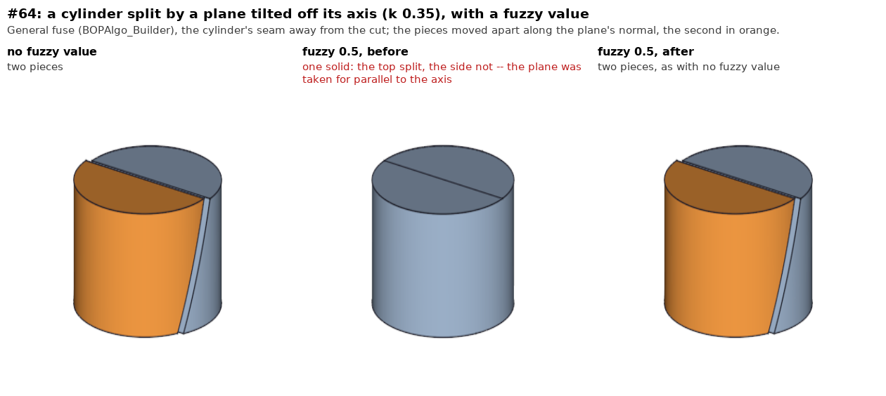
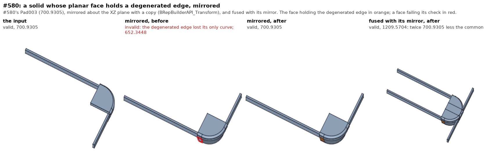
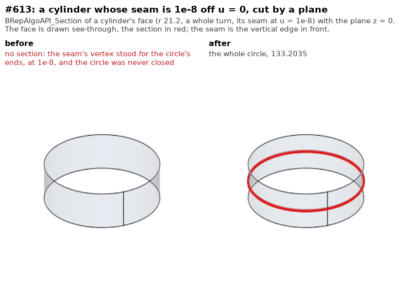

# Booleans and the general fuse

The fork's fixes met through the booleans and the general fuse
(`BOPAlgo_Builder`, what FreeCAD's Split, Fragments, Cut and Fuse run), what
they call -- the surface intersections -- and what makes their arguments --
the transforms of a shape. Most come from the issues of `../occ-issues/`.

```
FreeCADCmd tests/fork/boolean/run_tests.py      # the cases, through FreeCAD
pictures/make_pictures.sh                       # models/pictures, before and after
```

`models/` holds a C++ driver of each fix, built against an install (its
header says how); `run_tests.py` runs the same cases through FreeCAD's
`Part`. The pictures are made by `pictures/make_pictures.sh`: the driver run
on the install and on the library the fix changed as it was just before
(`pictures/mkold.py` links it from the build tree's own objects, nothing
installed touched), the results laid out (`prep.py`), rendered in the
FreeCAD GUI (`../fillet/pictures/render.py`) and composed (`compose.py`).

## #64: a plane and a cylinder under a fuzzy value (`ed990cf61b`, 2026-10-28)

**The issue.** `../occ-issues/models/issue064_boolean_split_seam.FCStd`: a
Split of a cylinder (r 25, h 35) by an extruded S-curve, reported wrong near
the cylinder's seam. The Split runs the general fuse with the document's
Tolerance as its fuzzy value -- 3 mm in the file. At 0, 1e-5, 0.1, 1 and 2.5
it is valid, two solids; at 0 the pieces are 42396.3536 and 26325.9857
(integrated to 1e-9; together the cylinder's 68722.3393) with the seam at
the cut or turned 37, 90 or 180 deg away: the seam split of the report is
made, and was before this fix. (Part's default `Volume` reads the pieces up
to 1.6 apart with the seam's place: an integration error, not the shape.)
At 3 the result is invalid, one solid of 22907.4464, and only with the seam
at the cut. The cut crosses the seam three times (z 10.71, 23.61, 34.36) and
between the crossings stays within 2.83 and 0.85 of it: within 3 mm the cut
is the seam edge for 24 mm, and the vertices on it take tolerances of 8 to 14
on a cylinder 35 high. That is what the fuzzy value asks for; it is left so.

**What was broken.** Looking for that, a plain case failed: the cylinder
split by a plane tilted off its axis, y = k (z - zc), came back one solid,
uncut, from a fuzzy value of half the sine of the tilt -- 0.05 at k 0.1,
0.17 at 0.35, 0.35 at 1 -- wherever the plane lay and wherever the seam was.
The plane/cylinder pair had no section curve at all.
`IntAna_QuadQuadGeo::Perform(gp_Pln, gp_Cylinder, ...)` takes the plane for
parallel to the axis when `|sinda - Tol| < Tol`: the sine of the angle
between them against a length. At the default tolerance that is a plane
parallel within 2e-7; at the tolerances a fuzzy value gives the faces, a
plane tilted by up to 2 Tol radians. The two lines it then gives for the
section miss the cylinder (7.2 off at its top for k 0.35, Tol 0.5), and the
pair comes out of the face/face intersection with no curve. Upstream's #1176 (`797d3259df`, 2026-03) had added
the sound test beside it -- the axis's deviation from the plane over the
cylinder face's height, `sinda * H < 2 Tol`, a length against a length --
but kept the old one, either sufficing.

**The fix.** When the face's height is known (`H > 0`, as `IntPatch` and
`IntTools_FaceFace` give it), the height test alone decides; the old one
stays for an unbounded cylinder (`H = 0`). Below 2e-7 rad the angle is
parallel whatever `H`, as the old test made it at the default tolerance. For
a face no higher than 1 nothing changes (the height test then accepts
whatever the old one did). `IntTools_FaceFace` already sends an ellipse
longer than 1e5 times its width to the walking intersection, so a nearly
parallel plane the stricter test now leaves to the ellipse is not handed to
BOP as one.

**The cases.** `models/issue064_fuzzy_plane_cylinder.cpp` and
`run_tests.py`: k 0.1, 0.35 and 1, fuzzy 0, 0.1, 0.5 and 1, the seam at the
cut and turned 90 deg away -- 24 runs. Each must give two valid solids and,
with the seam away, each within 1% of its volume at no fuzzy value. Before:
14 of the 24 one uncut solid. After: all pass. With the seam at the cut a
fuzzy value merges the plane's crossing of the top rim, k 0.64 from the
seam's vertex there, into that vertex (the short section edge between them
collapsed too): the top's chord starts that far from where its arc ends, the
gap closed by the vertex's tolerance, and the volume integrals read that
loop short -- 1.8% at most here. A valid shape within its tolerances, which
is what a fuzzy value asks for; those runs are asked for the two valid
solids only.



**Still a limit.** At a fuzzy value near a twentieth of the cylinder the
pair loses its section again: k 0.1 from 2.2, where the height test itself
(3.48 against 4.4) takes the plane for parallel -- the lines it gives lie
within the tolerance (0.58 off at Tol 2.2), yet the face/face intersection
again keeps no curve (not followed further); and k 1 from 1.1, from another
cause, not looked at.

**Validation** (against `0b44bd01ba`, the kernel before): Part 390 and
PartDesign 486 tests OK; the fillet suite PASS=815 XFAIL=1, thickness 378,
draft 105, as before; the six fillet sweeps (12242, 12242, 3921, 3921, 2614,
3921 runs) and the three draft sweeps (1222, 500, 114) not one result
changed; the thickness sweep right in all 928 runs by its reference.

## #580: a degenerated edge on a plane lost by a transformed copy (`c20f921783`, 2026-10-28)

**The issue.** `../occ-issues/models/issue580_mirror_crash.FCStd`: mirroring
a part (a MultiTransform's Mirrored, the whole shape) gave an invalid shape,
and the fuse that follows crashed (2022, OCC 7.5). Today the fuse does not
crash, but the mirror of the part, `Pad003` (valid, 700.9305), is invalid:
652.3448 by the volume integrals -- the volume the document's Body stored --
and its fuse with the part invalid too.

**What was broken.** Pad003's face 19, a plane, holds a degenerated edge, one
with no 3D curve, only its pcurve. `BRepBuilderAPI_Transform` with a copy
rebuilds the shape through `BRepTools_Modifier`, and
`BRepTools_TrsfModification::NewCurve2d` gives no new pcurve for an edge on a
plane: `BRep_Tool` projects an edge's 3D curve onto a plane when its pcurve
is asked for. A degenerated edge has nothing to project; it was left with no
curve at all, its face `NoCurveOnSurface`. Not the mirror's alone: a copied
rotation and a scale of Pad003 were invalid the same way; only a move
without a copy, a location, was not.

**The fix.** On a plane, `NewCurve2d` declines only an edge that has a 3D
curve; one without carries its pcurve over as on any other surface (a
plane's parameters are unchanged by a rigid move or a mirror; a scale goes
through the surface's parametric transformation, as for the others).

**The cases.** `models/issue580_mirror_degenerated.cpp` on
`models/issue580_pad003.brep` (#580's Pad003), and `run_tests.py`: the part
mirrored about the XZ plane, moved with and without a copy and scaled by 2,
each valid with the volume it should have; its fuse with its mirror valid,
twice the part less their common (1209.5704). Before: the mirror, the copied
move, the scale and the fuse invalid. After: all pass.



**What is left of #580.** The document no longer recomputes to the mirror:
its Chamfer (two distances, 5 and 2, on a circle and two lines of `Pad001`)
fails first. The kernel makes that chamfer -- exactly the stored 476.2935 --
on the edges the file names, with the distances on the faces it gave them.
Recomputed (8.0.1 renumbers the shape), the same three edges are named
again, but the face each edge lists first, which a two-distance chamfer
gives the first distance, is now the pad's base for all three, where 5 does
not fit; given the other way round the kernel refuses it on the stored shape
too. A FreeCAD matter (which face a two-distance chamfer measures from is not
kept through a rebuild), not the kernel's.

**Validation** (against `ed990cf61b`): Part 390 and PartDesign 486 tests
OK; the fillet suite PASS=815 XFAIL=1, thickness 378, draft 105, as before;
the six fillet sweeps and the three draft sweeps not one result changed; the
thickness sweep right in all 928 runs by its reference.

## #613: a section lost to a seam a hair off its start (`59ca72bbcc`, 2026-10-28)

**Where it was met.** `../thickness/`'s #613: a filleted part, its top and
bottom removed inward. The cap at the top meets the part's cone at the
ridge's ends; the offset cone, enlarged, was cut by the cap's plane in a
whole circle -- and the pave filler gave no section: the cap was never cut,
kept whole, and the thick solid refused as the input unhollowed.

**What was broken.** The cone's seam lay 2.1e-8 off u = 0 (its pcurves a
hair less than the period apart), where the circle the plane cuts from it
starts. On a radius of 21 that is 4e-7 in space, within the vertices'
tolerance of the circle's end: no vertex was made at the circle's bounds,
the seam's vertex standing for them -- at 2.1e-8. `PutClosingPaveOnCurve`
closes a closed curve by putting the vertex found at one bound at the
other too, and looked for it by its parameter (within 1e-9): none was
found, the circle kept one pave, made no block, and the section was empty.
Any whole turn does it -- a plain cylinder or cone, its seam 1e-8 or 2e-8
off u = 0, cut by a plane square to its axis, has no section; at 0, 1e-9,
5e-8 and beyond it has.

**The fix.** With no pave at a bound by its parameter, a pave whose vertex
is at a bound in space -- within the vertex's tolerance and the curve's --
is taken for it, unless the other bound already has one; the closure test
after it is as before.

**The cases.** `models/issue613_seam_section.cpp` and `run_tests.py`: a
cylinder's and a cone's face (radius 21.2, a whole turn) with the seam at
0, 1e-9, 1e-8, 2e-8, 5e-8 and 1e-6, cut by the plane z = 0, each giving the
whole circle (its length to 1e-6). Before: the four at 1e-8 and 2e-8 empty.
After: all twelve.



**Validation** (against `37cb17ed8e`): Part 390 and PartDesign 486 tests
OK; the fillet suite PASS=815 XFAIL=1, thickness 381 (with #613's new
cases), draft 105, boolean 39; the six fillet sweeps and the three draft
sweeps not one result changed; the thickness sweep right in all 928 runs.
