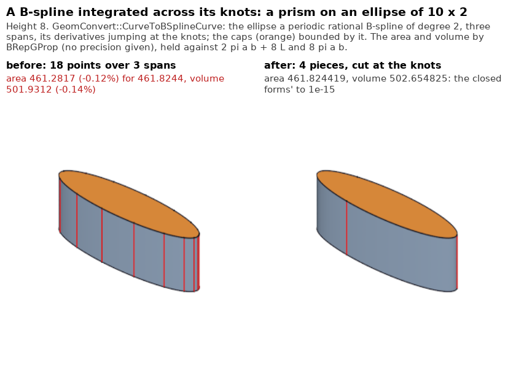
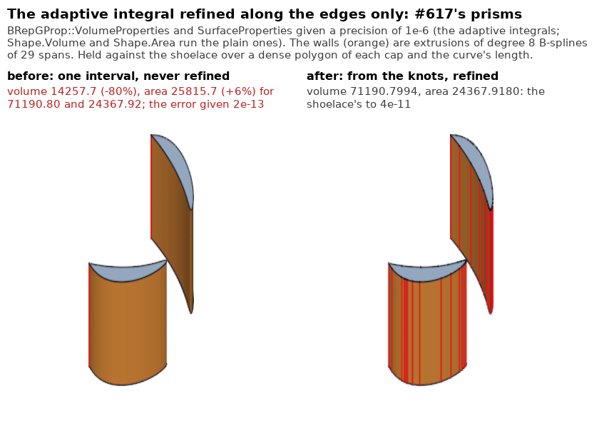
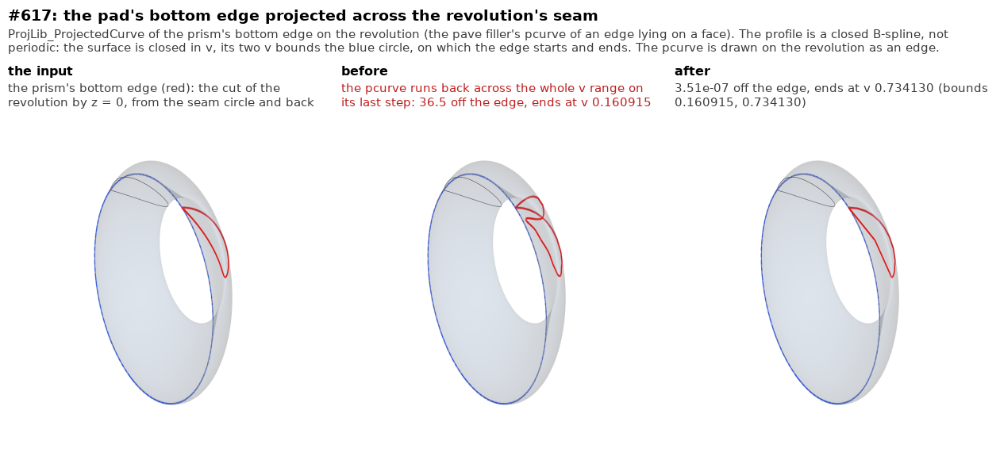
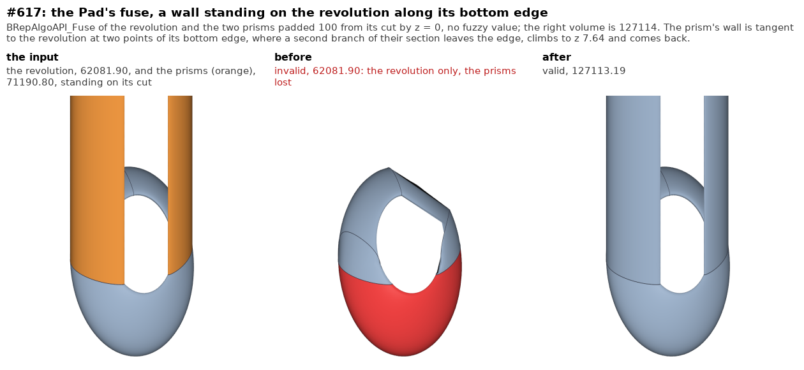
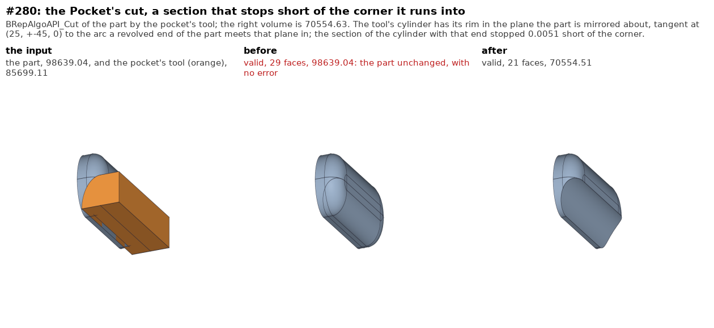
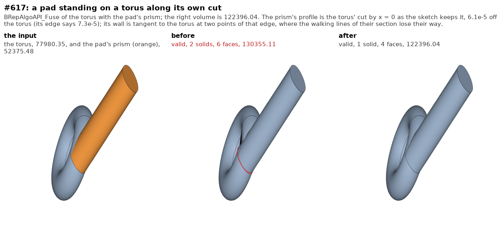
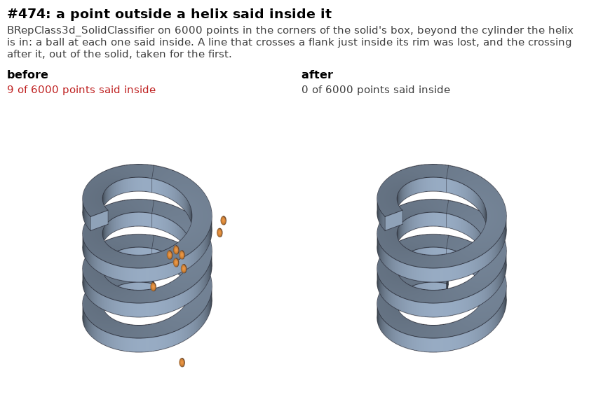
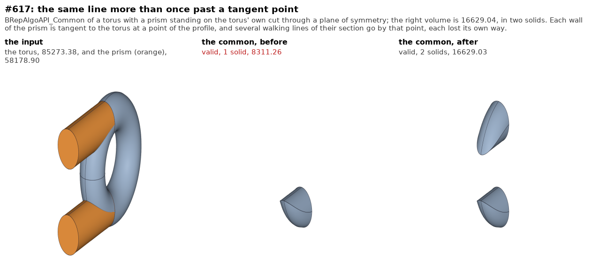

# Booleans and the general fuse

The fork's fixes met through the booleans and the general fuse
(`BOPAlgo_Builder`, what FreeCAD's Split, Fragments, Cut and Fuse run), what
they call -- the surface intersections -- what makes their arguments --
the transforms of a shape -- and what measures their results, the volume
and area integrals. Most come from the issues of `../occ-issues/`.

```
FreeCADCmd tests/fork/boolean/run_tests.py      # the cases, through FreeCAD
pictures/make_pictures.sh                       # models/pictures, before and after
```

`models/` holds a C++ driver of each fix, built against an install (its
header says how); `run_tests.py` runs the same cases through FreeCAD's
`Part`. The pictures are made by `pictures/make_pictures.sh`: the driver run
on the install and on the library the fix changed as it was just before
(`pictures/mkold.py` links it from the build tree's own objects, nothing
installed touched), the results laid out (`prep.py`), rendered in the
FreeCAD GUI (`../fillet/pictures/render.py`) and composed (`compose.py`).

## #64: a plane and a cylinder under a fuzzy value (`ed990cf61b`, 2026-10-28)

**The issue.** `../occ-issues/models/issue064_boolean_split_seam.FCStd`: a
Split of a cylinder (r 25, h 35) by an extruded S-curve, reported wrong near
the cylinder's seam. The Split runs the general fuse with the document's
Tolerance as its fuzzy value -- 3 mm in the file. At 0, 1e-5, 0.1, 1 and 2.5
it is valid, two solids; at 0 the pieces are 42396.3536 and 26325.9857
(integrated to 1e-9; together the cylinder's 68722.3393) with the seam at
the cut or turned 37, 90 or 180 deg away: the seam split of the report is
made, and was before this fix. (Part's default `Volume` reads the pieces up
to 1.6 apart with the seam's place: an integration error, not the shape.)
At 3 the result is invalid, one solid of 22907.4464, and only with the seam
at the cut. The cut crosses the seam three times (z 10.71, 23.61, 34.36) and
between the crossings stays within 2.83 and 0.85 of it: within 3 mm the cut
is the seam edge for 24 mm, and the vertices on it take tolerances of 8 to 14
on a cylinder 35 high. That is what the fuzzy value asks for; it is left so.

**What was broken.** Looking for that, a plain case failed: the cylinder
split by a plane tilted off its axis, y = k (z - zc), came back one solid,
uncut, from a fuzzy value of half the sine of the tilt -- 0.05 at k 0.1,
0.17 at 0.35, 0.35 at 1 -- wherever the plane lay and wherever the seam was.
The plane/cylinder pair had no section curve at all.
`IntAna_QuadQuadGeo::Perform(gp_Pln, gp_Cylinder, ...)` takes the plane for
parallel to the axis when `|sinda - Tol| < Tol`: the sine of the angle
between them against a length. At the default tolerance that is a plane
parallel within 2e-7; at the tolerances a fuzzy value gives the faces, a
plane tilted by up to 2 Tol radians. The two lines it then gives for the
section miss the cylinder (7.2 off at its top for k 0.35, Tol 0.5), and the
pair comes out of the face/face intersection with no curve. Upstream's #1176 (`797d3259df`, 2026-03) had added
the sound test beside it -- the axis's deviation from the plane over the
cylinder face's height, `sinda * H < 2 Tol`, a length against a length --
but kept the old one, either sufficing.

**The fix.** When the face's height is known (`H > 0`, as `IntPatch` and
`IntTools_FaceFace` give it), the height test alone decides; the old one
stays for an unbounded cylinder (`H = 0`). Below 2e-7 rad the angle is
parallel whatever `H`, as the old test made it at the default tolerance. For
a face no higher than 1 nothing changes (the height test then accepts
whatever the old one did). `IntTools_FaceFace` already sends an ellipse
longer than 1e5 times its width to the walking intersection, so a nearly
parallel plane the stricter test now leaves to the ellipse is not handed to
BOP as one.

**The cases.** `models/issue064_fuzzy_plane_cylinder.cpp` and
`run_tests.py`: k 0.1, 0.35 and 1, fuzzy 0, 0.1, 0.5 and 1, the seam at the
cut and turned 90 deg away -- 24 runs. Each must give two valid solids and,
with the seam away, each within 1% of its volume at no fuzzy value. Before:
14 of the 24 one uncut solid. After: all pass. With the seam at the cut a
fuzzy value merges the plane's crossing of the top rim, k 0.64 from the
seam's vertex there, into that vertex (the short section edge between them
collapsed too): the top's chord starts that far from where its arc ends, the
gap closed by the vertex's tolerance, and the volume integrals read that
loop short -- 1.8% at most here. A valid shape within its tolerances, which
is what a fuzzy value asks for; those runs are asked for the two valid
solids only.


**Still a limit.** At a fuzzy value near a twentieth of the cylinder the
pair loses its section again: k 0.1 from 2.2, where the height test itself
(3.48 against 4.4) takes the plane for parallel -- the lines it gives lie
within the tolerance (0.58 off at Tol 2.2), yet the face/face intersection
again keeps no curve (not followed further); and k 1 from 1.1, from another
cause, not looked at.

**Validation** (against `0b44bd01ba`, the kernel before): Part 390 and
PartDesign 486 tests OK; the fillet suite PASS=815 XFAIL=1, thickness 378,
draft 105, as before; the six fillet sweeps (12242, 12242, 3921, 3921, 2614,
3921 runs) and the three draft sweeps (1222, 500, 114) not one result
changed; the thickness sweep right in all 928 runs by its reference.

## #580: a degenerated edge on a plane lost by a transformed copy (`c20f921783`, 2026-10-28)

**The issue.** `../occ-issues/models/issue580_mirror_crash.FCStd`: mirroring
a part (a MultiTransform's Mirrored, the whole shape) gave an invalid shape,
and the fuse that follows crashed (2022, OCC 7.5). Today the fuse does not
crash, but the mirror of the part, `Pad003` (valid, 700.9305), is invalid:
652.3448 by the volume integrals -- the volume the document's Body stored --
and its fuse with the part invalid too.

**What was broken.** Pad003's face 19, a plane, holds a degenerated edge, one
with no 3D curve, only its pcurve. `BRepBuilderAPI_Transform` with a copy
rebuilds the shape through `BRepTools_Modifier`, and
`BRepTools_TrsfModification::NewCurve2d` gives no new pcurve for an edge on a
plane: `BRep_Tool` projects an edge's 3D curve onto a plane when its pcurve
is asked for. A degenerated edge has nothing to project; it was left with no
curve at all, its face `NoCurveOnSurface`. Not the mirror's alone: a copied
rotation and a scale of Pad003 were invalid the same way; only a move
without a copy, a location, was not.

**The fix.** On a plane, `NewCurve2d` declines only an edge that has a 3D
curve; one without carries its pcurve over as on any other surface (a
plane's parameters are unchanged by a rigid move or a mirror; a scale goes
through the surface's parametric transformation, as for the others).

**The cases.** `models/issue580_mirror_degenerated.cpp` on
`models/issue580_pad003.brep` (#580's Pad003), and `run_tests.py`: the part
mirrored about the XZ plane, moved with and without a copy and scaled by 2,
each valid with the volume it should have; its fuse with its mirror valid,
twice the part less their common (1209.5704). Before: the mirror, the copied
move, the scale and the fuse invalid. After: all pass.


**What is left of #580.** The document no longer recomputes to the mirror:
its Chamfer (two distances, 5 and 2, on a circle and two lines of `Pad001`)
fails first. The kernel makes that chamfer -- exactly the stored 476.2935 --
on the edges the file names, with the distances on the faces it gave them.
Recomputed (8.0.1 renumbers the shape), the same three edges are named
again, but the face each edge lists first, which a two-distance chamfer
gives the first distance, is now the pad's base for all three, where 5 does
not fit; given the other way round the kernel refuses it on the stored shape
too. A FreeCAD matter (which face a two-distance chamfer measures from is not
kept through a rebuild), not the kernel's.

**Validation** (against `ed990cf61b`): Part 390 and PartDesign 486 tests
OK; the fillet suite PASS=815 XFAIL=1, thickness 378, draft 105, as before;
the six fillet sweeps and the three draft sweeps not one result changed; the
thickness sweep right in all 928 runs by its reference.

## #613: a section lost to a seam a hair off its start (`59ca72bbcc`, 2026-10-28)

**Where it was met.** `../thickness/`'s #613: a filleted part, its top and
bottom removed inward. The cap at the top meets the part's cone at the
ridge's ends; the offset cone, enlarged, was cut by the cap's plane in a
whole circle -- and the pave filler gave no section: the cap was never cut,
kept whole, and the thick solid refused as the input unhollowed.

**What was broken.** The cone's seam lay 2.1e-8 off u = 0 (its pcurves a
hair less than the period apart), where the circle the plane cuts from it
starts. On a radius of 21 that is 4e-7 in space, within the vertices'
tolerance of the circle's end: no vertex was made at the circle's bounds,
the seam's vertex standing for them -- at 2.1e-8. `PutClosingPaveOnCurve`
closes a closed curve by putting the vertex found at one bound at the
other too, and looked for it by its parameter (within 1e-9): none was
found, the circle kept one pave, made no block, and the section was empty.
Any whole turn does it -- a plain cylinder or cone, its seam 1e-8 or 2e-8
off u = 0, cut by a plane square to its axis, has no section; at 0, 1e-9,
5e-8 and beyond it has.

**The fix.** With no pave at a bound by its parameter, a pave whose vertex
is at a bound in space -- within the vertex's tolerance and the curve's --
is taken for it, unless the other bound already has one; the closure test
after it is as before.

**The cases.** `models/issue613_seam_section.cpp` and `run_tests.py`: a
cylinder's and a cone's face (radius 21.2, a whole turn) with the seam at
0, 1e-9, 1e-8, 2e-8, 5e-8 and 1e-6, cut by the plane z = 0, each giving the
whole circle (its length to 1e-6). Before: the four at 1e-8 and 2e-8 empty.
After: all twelve.


**Validation** (against `37cb17ed8e`): Part 390 and PartDesign 486 tests
OK; the fillet suite PASS=815 XFAIL=1, thickness 381 (with #613's new
cases), draft 105, boolean 39; the six fillet sweeps and the three draft
sweeps not one result changed; the thickness sweep right in all 928 runs.

## A section's tangent end at a corner (`e9ded0215d`, 2026-10-29)

**Where it was met.** A box (80 x 50 x 40) split by a B-spline dome (a
network surface, z 22 to 32), the dome's four edges filleted (r 3), a
thickness 2 inward with the bottom removed, the Arc join: refused
(`BRepOffset_UnknownError`, the offset shell empty). Found by a peer
session's B-spline fillet work; its shape is `models/dome_fillet_r3.brep`.

**What was broken.** At each corner of the dome two fillets meet in a mitre
and both meet the dome tangentially, so the three faces' normals agree at
the corner and the offsets of the two fillets are tangent to each other at
the corner's offset. Their section is a curve that passes that corner at a
hair's distance -- 4 to 7e-4, to the side, not through it -- and its end
lies across the boundary of one of the faces (1.3 to 1.9e-4 out, with the
curve's tolerance 1e-5). `PutBoundPaveOnCurve` gives an end a vertex only
if it is on both faces, and `PutStickPavesOnCurve` takes a vertex of both
for it only within 4.5e-4 and with the faces tangent at the end itself (to
0.006 deg; they part at 0.025 to 0.037 deg there): the section had one end,
no block, no edge. In the thickness the mitre pairs were not cut, and the
offset shell fell apart. All four corners alike; upstream the same.

**The fix.** An end that is not on both faces and has no vertex takes the
nearest vertex lying on both -- one they share or one their vertices merged
into -- if the faces are tangent at it (the pave filler's own crease
criterion) and stay within the curve's tolerance of each other all the way
from the end to it: the distance times the sine of the angle between the
faces at the end (here 2 to 4e-7) -- and the vertex is near the end, within a
tenth of the curve's chord. The vertex's tolerance grows to the distance.

**The cases.** `models/dome_tangent_corner.cpp` and `run_tests.py`: the
offsets (-2) of each mitre pair made alone, sectioned: one edge, 1.7038
long. `../thickness/`'s `dome_tangent_corner_in` and `_in_inter`: the
thickness, valid, 20254.4308 -- the shape less the part above z = 0 of the
offset of it carried down to z = -10 gives 20254.4292 (that offset failed
before too). Before: no edge on any pair, the thickness refused. After: all.


**Validation** (against `19c89dc908`): Part 390 and PartDesign 486 tests
OK; the fillet suite PASS=815 XFAIL=1, thickness 400 (with the two new
cases), draft 105, boolean 43; the six fillet sweeps and the three draft
sweeps not one result changed; the thickness sweep right in all 928 runs,
not one changed.

## #617: a volume integrated a point or two a span (`2c45873435`, 2026-11-01)

**Where it was met.** #617's sketch: a revolution cut by the plane z = 0
(Approximation on), the section's two lobes padded 100. FreeCAD showed the
pad's volume as 92341; it is 71190.80. Its shapes are
`models/issue617_revolution.brep` and `models/issue617_prisms.brep`.

**What was broken.** `BRepGProp`'s plain volume and area integrals
(`BRepGProp_Gauss`, what `Shape.Volume` and `Shape.Area` run) integrate a
face along its boundary edges with one Gauss rule per edge, and across the
face with one rule per point, each capped at 61 points over the whole edge
or the whole range. The section's lobes are degree 8 B-splines of 29 spans,
their knots bunched where the cut turns: one rule of 61 points over 29
spans gives a point or two a span, and no polynomial rule integrates a
piecewise curve across its knots. Each lobe's area came out 343.65 for
355.95, the prisms' volume 91909 for 71191 (29% over), their area 3% short.
Any B-spline curve or surface of many spans, or of knots bunched, is
integrated as badly; upstream the same.

**The fix.** Where a rule over the whole edge or range would give a span
fewer points than its degree asks, the integral is taken span by span: the
edge is broken at its pcurve's knots and where it crosses the face's own
knots (a B-spline surface's, or the B-spline basis of an extrusion or a
revolution), the range across the face at the surface's knots in that
direction, each piece with its own rule. An edge and a face with no such
knots are integrated as before, to the bit.

**The cases.** `models/issue617_gprop_prism.cpp` and `run_tests.py`: the
prisms' volume and area against what does not come from the integrals --
each lobe's area by the shoelace over a dense polygon of its curve, times
the height, and the curve's length. Before: volume 91908.84 for 71190.80,
area 23709.16 for 24367.92. After: within 1e-10 of both.


**What it moved.** Volumes only, and only where a B-spline has more spans
than one rule follows; never a shape. The suites' references moved, each
toward the adaptive integral: 13 of the fillet suite's (1e-7 to 6e-6 --
#273's `Fillet001` and #962's slanting side), FreeCAD's Part test of the
ellipse's thickness (608.6631 to 608.6621) and PartDesign's loft of
`FaceRefs_fork_whole_names` (12238.1843 to 12238.1739, the adaptive
integral's to 2e-12). In the fillet sweeps 5175 results moved their
volume, by at most 4.3e-4 (#474's `Fillet003` at `V26:44,53@1`, now the
adaptive integral's; it was 0.82 off), the others by less than 1e-4;
in the thickness sweep 10, in the last digit printed. Over 80121 shapes of the sweeps and
models, 2634 moved, by 1e-4 or more only #617's, a dome's and #423's, each
closer to the adaptive integral or a dense polygon. The plain integral's
order on an offset surface was left at 18 points: the ellipse's thickness
read 608.66 for 609.89, the next section's fix.

**Validation** (against `d0d93c69c2`): Part 390 and PartDesign 486 tests
OK, plain and frozen; the fillet suite PASS=815 XFAIL=1, plain and frozen
(the 13 references moved); thickness 463 XFAIL=1 at levels 0 and 1, plain
and frozen; draft 105, boolean 44; the thickness sweep right in all 928
runs in the four modes; the three draft sweeps not one result changed; the
six fillet sweeps not one status, face count or tolerance changed.

## An offset surface integrated at 18 points (`54de50c4c1`, 2026-11-01)

**Where it was met.** FreeCAD's Part test of thickness on seam faces and an
ellipse (`test_thickness_of_seam_faces_and_an_ellipse`): a prism on an
ellipse of 10 x 5, its top removed, 1 outward -- 608.6621 by the volume
integral where the solid is 609.8911 (a fine mesh: 609.889), and its bottom
removed, 1 inward, 473.2070 for 474.1842. The thickness's wall is the
offset (`Geom_OffsetSurface`) of the prism's.

**What was broken.** An offset surface carries its basis's unit normal, and
the integrands with it the square root of the basis's speed. For an ellipse
of a by b that has zeros off the real axis by about atanh(b/a) -- 0.55 for
10 x 5, 0.2 for 10 x 2 -- where the normal turns fastest, and one Gauss rule
over the whole turn converges only as fast as that distance against the
range allows. `BRepGProp_Face` gives an offset surface the default order,
18 points over the range: 0.08% short on the 10 x 5 ellipse, 5% on 10 x 2,
15% on 10 x 1. More points over the whole range do not cure it (60 points:
4e-4 on 10 x 2).

**The fix.** An offset surface whose basis's normal turns unevenly along u
or v -- the fastest turning more than 1.2 times the slowest, sampled on
three iso lines -- has its range in that parameter cut into pieces, each
integrated with a rule of 20 points, the way the B-spline spans of "#617: a
volume integrated a point or two a span" are. The zeros lie off the axis by the inverse of
the turning at its peak, and further off with the distance from the peak
(an ellipse's turning is d / (t^2 + d^2) about a peak of 1 / d), so the
pieces are graded toward the peaks: spaced by the integral of the square
root of the turning times its maximum, 1 / sqrt(t^2 + d^2) about such a
peak -- a few pieces each time the distance grows tenfold, at most 64; 12
on the 10 x 2 ellipse, 16 on 30 x 1. It is the basis's normal that is
sampled, the one the integrands carry: the offset's own turns back where
the offset folds, beyond a radius of curvature, and the integrands pass
smoothly through. A normal turning evenly (an offset cylinder's, a
circle's) has no such zero, and is integrated as before.

An offset of a B-spline (or of an extrusion or a revolution of one) is cut
at every knot of its basis inside the face as well, not only when one rule
cannot follow that many spans: the offset's derivatives take in the
basis's next ones, which jump at a knot. A face of the corpus, an offset by
-2 of a degree 2 B-spline curved between its knots at u = 0 and 4.115 and
flat beyond, reached 0.00127 past one of them: its area element doubles
there, and a rule across the jump converged on nothing -- 1.5e-4 off with
the rule over the whole range, and wandering by as much as more pieces were
put in. Cut there, it is the same to 1e-15 at any number of pieces (and a
dense mesh agrees).

Along an edge not cut at its own knots, each piece keeps the rule the whole
edge would have had, when that is the finer. Since `2c45873435` an edge cut
only where it crosses the face's knot cuts took each piece with the span's
rule (8 points on a cubic) in place of the edge's (up to 61): coarser, not
finer. An interpolated 9 x 7 cubic B-spline face (FreeCAD's Surface test of
a split, `waveFace`) read 251.376140 for 251.377801, 64 times further off
than before; it reads 251.377797 now. A face of #346's corpus with a near
pinch inside a span: 4804.61886 by the span's rule, 4804.62607 by the
edge's, 4804.62500 adaptively.

**The cases.** `models/offset_surface_gprop.cpp` and `run_tests.py`: a prism
on an ellipse (10 x 5, 10 x 2, 6 x 5, 10 x 1, 30 x 1; height 8), offset by 1
(and 10 x 5 by -1) with the Intersection join -- the wall the offset of the
prism's, the caps planes -- against Steiner: the offset region's area
pi a b + L d + pi d^2, its curve L + 2 pi d (L the ellipse's length), the
solid that region times 8 + 2 d. Before: 0.08% to 18% off. After: within
2e-8 (30 x 1), the others 4e-10.


**What it moved.** Volumes and areas only, never a shape. The ellipse's
thickness: 608.6621 to 609.8911 (top, out) and 473.2070 to 474.1842
(bottom, in) -- FreeCAD's Part test and the thickness suite's four
ellipse references, each now Steiner's (`thickness/sweep/hand.py`), as are
the thickness sweep's 16 ellipse results. Over 80049 shapes of the sweeps
and models, 479 moved; of the 409 not degenerate, 389 moved closer to a
build giving an offset 60 points over the whole range. The largest, 1.5e-4,
are seven shapes of #613's corpus holding the offset of the degree 2
B-spline above, now converged (the 60 point rule is as far off: it crosses
the knot too); next a shape of the dome corpus, 6.7e-6, now the 60 point
rule's to 3e-10. The integrals over
those shapes took 28% longer (556 s for 434 s), most of it the edge rule
on #346's offsets (2.5 s to 5.2 s a shape) and #617's fuse. In the fillet
sweeps 125 results moved their volume, by the edge rule, at most 7.3e-7
(#876's fillets of 10, by 0.0044): each to within 1e-7 of the adaptive
integral, ten times nearer than it was (`E76@10`: 6017.2417 to 6017.2372,
adaptively 6017.2368).

**Validation** (against `e276ca1858`): Part 390 and PartDesign 486 tests
OK, plain and frozen; the fillet suite PASS=815 XFAIL=1, plain and frozen;
thickness 463 XFAIL=1 at levels 0 and 1, plain and frozen (its four
ellipse references moved); draft 105, boolean 50; the thickness sweep right
in all 928 runs in the four modes (16 ellipse volumes moved, to Steiner's);
the three draft sweeps not one result changed; the six fillet sweeps not
one status, face count or tolerance changed.

## An ellipse's extrusion: its area integrated at 18 points (`8655926813`, 2026-11-02)

**Where it was met.** Measuring the offset fix above: the plain area of a
prism on an ellipse (no offset) was off too -- 1.8e-5 on 10 x 5, 0.1% on
10 x 2, 0.45% on 30 x 1 -- where its volume came out exact. A pad of an
ellipse, FreeCAD's `Shape.Area`.

**What was broken.** The same integrand as an offset's: the area element of
an extrusion of a curve is the curve's speed times the extrusion's, the
square root of a polynomial in the curve's derivatives, with zeros off the
real axis where the curve turns fastest; a revolution's carries the speed
of the curve revolved. `BRepGProp_Face` gives both the default order, 18
points over the whole range. The volume integrand has no square root and
was exact.

**The fix.** An extrusion and a revolution are cut in pieces as an offset
is, where their own normal turns unevenly: an extrusion in u (along its
curve), a revolution in v (its curve; the turn about the axis is even). Cut
in pieces, an extrusion or a revolution of a B-spline is cut at every knot
of the curve as well, as an offset is: a piece across a knot follows
nothing. #617's revolution (a cubic of four spans, revolved) shows why: its
volume read 62064.29 for 62081.90, 3e-4 short, and now agrees with its
meridian integrated directly (Pappus, span by span, refined) to 1e-12.

**The cases.** `models/extrusion_area_gprop.cpp` and `run_tests.py`: a
prism on an ellipse (10 x 5, 10 x 2, 6 x 5, 10 x 1, 30 x 1; height 8)
against 2 pi a b + 8 L, and four spheroids -- half an ellipse revolved
about its axis, 10 x 2, 10 x 5 oblate, 2 x 10, 5 x 10 prolate -- against
their closed forms. Before: the prisms 1.4e-8 to 0.45% off, the spheroids
up to 1.7e-4 (10 x 2). After: within 2e-15.


**What it moved.** Over 79992 shapes of the sweeps and models, 7: #617's
revolution and its pad (3e-4 in volume, 9e-4 in area, now exact), four of
#617's fuses (invalid, their faces' wires crossing) and a face of #64's
split, an extrusion of a cubic, 1.6e-6 in area (2302.8428 to 2302.8390;
Green's theorem over its pcurves, refined: 2302.8390). The integrals over
them took 0.8% longer, but for the two invalid fuses of #617 (133 s and
142 s to 222 s each).

**Validation** (against `73a6940466`): Part 390 and PartDesign 486 tests
OK, plain and frozen; the fillet suite PASS=815 XFAIL=1, plain and frozen;
thickness 463 XFAIL=1 at levels 0 and 1, plain and frozen; draft 105,
boolean 59; the thickness sweep right in all 928 runs in the four modes,
not one result changed; the three draft sweeps not one result changed; the
six fillet sweeps not one status, face count, tolerance or volume changed.

## A B-spline integrated across its knots (`66c168acc5`, 2026-11-03)

**Where it was met.** Measuring the extrusion fix above on an ellipse made
a B-spline: GeomConvert's exact rational one (three spans of degree 2, C1
at its knots). The prism on it, 10 x 2, came 1.2e-3 off in area and 1.4e-3
in volume, where on the ellipse itself it was exact.

**What was broken.** A Gauss rule across a knot of a B-spline converges
only as a power of its points: the integrand's derivatives jump there.
`2c45873435` (#617 above) cut a B-spline at its knots only where a rule of
61 points could not give each span its degree's share, so a curve of few
spans was integrated across them: the caps' edge, one rule of 18 points
over the whole ellipse (61 points: still 1e-4). Over each span alone the
rule converges as over a smooth curve: 6 points 2e-7, 16 exact.

And where an edge crosses a surface's knot is found on a sampling of the
edge: a sample landing on the knot exactly gave a product of zero on both
sides, and the knot was missed. An oblate spheroid, half the ellipse's
B-spline revolved (its knots GeomConvert's, 3 pi / 2, 2 pi, 5 pi / 2), has
its seam run from the first to the last, the middle sample on the middle
knot: 6.9e-6 over in area.

**The fix.** A B-spline -- a surface in u or v, the curve of an extrusion
or a revolution, an edge's curve on the face -- is cut at every knot
inside the range, every period of a periodic one, each span with
2 (degree + 1) points, 10 more for a rational one (a third of a turn of a
conic wants 16). An edge's knots are its own curve's on the face, mirrored
for a reversed edge as `BRepGProp_Face` loads it. A sample on a knot is
the crossing.

**The cases.** `models/bspline_knots_gprop.cpp` and `run_tests.py`: prisms
on the B-spline ellipse (10 x 5, 10 x 2, 10 x 1, and 10 x 2 made
periodic), a plate 30 x 20 with the ellipse cut through it (its edge
reversed on the plate's faces), and the spheroids 10 x 2 and 2 x 10,
against closed forms. Before: the prisms 7e-4 to 1.9e-3 off, the plate
6.5e-4, the oblate spheroid 6.9e-6 (the prolate one was exact). After:
within 1e-15.



**What it moved.** Over 79992 shapes of the sweeps and models, 1184 of
those with a volume and an area moved, 662 by more than 1e-7, 4 by more
than 1e-5 -- at most 3.2e-5, faces of #363's groove and its sweeps --
and each toward the same integral taken with 61
points a span, but one, as far from it (6e-7) either way. The integrals
over them took 4.9% longer (the rational spans' points, mostly on #346's
offsets), but for #617's invalid fuses.

In the fillet suite nine volumes moved past their references, #273's handle
and Fillet001 and #309's refined arch: at most 0.11 (`issue273_handle_foot_e11_r2`,
8585.0031 to 8585.1123, 1.3e-5), each now the integral at 61 points a span
to 1e-11 and the adaptive one (`BRepGProp` with an epsilon, the old
library) to its last printed digit; their references are those. The fillet
sweeps moved 2471 volumes of the vertex sweeps, 538 of the edge sweep, 205
of the large radii, 418 of the chamfers, at most 3.5e-5: #876's fillets and
chamfers at 2, 0.30 high before, now the 61-point and adaptive integrals'
(twelve largest checked, the same way). Not one status, face count,
tolerance or BOP check changed. The draft chains sweep has one result
changed: `issue631_Fillet003 18 13 5` failed (RefilletFails) and now makes
a valid solid of 19 faces. FreeCAD's cell draft joins the edges the draft
split before refilleting, and keeps the join only if the volume stays
within 1e-9 (`CellDraft.cpp`, `joinSplitEdges`); the old integral gave the
solid two volumes further apart than that, its edges split and joined, and
the join was refused.

**Validation** (against `318d7f1478`): Part 390 and PartDesign 486 tests
OK, plain and frozen; the fillet suite PASS=815 XFAIL=1, plain and frozen
(its nine references moved); thickness 463 XFAIL=1 at levels 0 and 1,
plain and frozen; draft 105, plain and frozen; boolean 65 (59 and the six
cases above); the thickness sweep right in all 928 runs in the four modes,
not one result changed; the draft sweeps the same but the result above,
and volumes within 1e-6; the six fillet sweeps not one status, face count
or tolerance changed.

## The adaptive integral refined along the edges only (`15ce0973f6`, 2026-11-03)

**Where it was met.** Checking #617's prisms (above) against the
adaptive integral, `BRepGProp::VolumeProperties` given a precision: 14258
for 71191, the error it reported 1.6e-13. The prisms on an ellipse of the
extrusion fix came 0.2% to 11% short in area. FreeCAD never asks for it
(`Shape.Volume`, `Shape.Area` and the rest run the plain integrals); in
OCCT, the Draw commands and `ShapeUpgrade_FaceDivideArea` do.

**What was broken.** Given a precision, the integral runs along the
face's edges and, at each point of the rule there, across u from the
face's first u. The rule along the edges is refined until its error
estimate meets the precision. The one across u never was: its target
`EpsU` was set only where its refinement gave up, and its error `ErrorU`
never updated after the first pass -- so, since `GProp_SGProps`, one rule
over the surface's spans: the whole range of an extrusion, a revolution or
an offset, whatever its curve. Along an edge of an extrusion running in v
the integrand does not change, both rules agree, and the error reported is
nothing.

**The fix.** The integral across u is refined until the largest interval's
error estimate is within the precision of the integral's own size, as the
one along the edges is, the estimate taken on both rules along the edge.
It starts from the breaks the plain integral takes: the knots of an
extrusion's or a revolution's B-spline curve, of an offset's basis, and
where the normal turns unevenly -- 32 bisections of one interval could not
resolve #617's 29 spans (4.9e-7 off at 1e-8, worse than at 1e-6). A face
with no edges starts from them along v too.

**The cases.** `models/adaptive_gprop.cpp`, at a precision of 1e-6: the
prisms on an ellipse of the extrusion fix (10 x 5, 10 x 2, 6 x 5, 10 x 1,
30 x 1), the 10 x 2 one on GeomConvert's B-spline, the four spheroids, and
#617's prisms (`models/issue617_prisms.brep`), against the closed forms
and the shoelace. Before: the prisms on the ellipse 0.2% to 11% short in
area and 2.1e-5 over in volume, the B-spline one 6% over in volume, #617's
80% short in volume and 6% over in area, each reporting 2e-9 or less; the
spheroids right (a revolution's u is the turn, its rule exact). After:
within 4e-9 (#617's 4e-11); the prolate spheroids 1.9e-8 off as before,
inside the 3.5e-7 they report. No case in `run_tests.py`: FreeCAD's Python
reaches only the plain integrals.



**What it moved.** The adaptive integrals only; the plain ones not by a
bit over 16004 shapes of the sweeps and models (every fifth). Of the 521
with a volume and an area, the adaptive volume came more than 1e-5 off the
plain one in 15 before, 1 after; the area in 8 before, none after; those
further off than before by a few 1e-7 at most, at the precision asked. The
one left is #617's revolution (`pad_deg8`): 4% off before, 2.2e-5 after
with an error of 1.7e-5 reported, converging as the precision tightens;
its edges carry tolerances to 39, their curves on the face not the face's
boundary, the plain and adaptive integrals of its faces apart by twice.
Of the 953 with an area, the adaptive one more than 1e-5 off the plain one:
10 before, 2 after -- a sliver of the dome corpus, 2.8% before and 3.6e-5
now (an area of 0.0237 in a square of 82 on the surface: the difference of
integrals 1e5 times larger, the two apart by 1e-10 of those), and a shape
of #346's sweep with an edge 2e100 long, its area 1e104 either way, the
same before and after. None further off than before by more than twice and
1e-7. The adaptive integrals took 15.4 s for 11.2 s over those shapes.

**Validation** (against `89c3ee61f3`): Part 390 and PartDesign 486 tests
OK, plain and frozen; the fillet suite PASS=815 XFAIL=1, plain and frozen;
thickness 463 XFAIL=1 at levels 0 and 1, plain and frozen; draft 105,
plain and frozen; boolean 65; the thickness sweep right in all 928 runs in
the four modes; the draft and fillet sweeps -- every result, face count,
volume and tolerance -- the same, as FreeCAD never calls the adaptive
integrals.

## #617: the pad's bottom edge projected across the revolution's seam (`3c35c64037`, `6abd543fc8`, 2026-11-06)

**Where it was met.** #617's Pad again, the fuse of the revolution with the
two prisms padded from its cut by z = 0 (`models/issue617_revolution.brep`,
`models/issue617_prisms.brep`). Every general fuse of the two carried an edge
of tolerance 36 to 39, plain or under a fuzzy value of 1e-6 to 1e-4, and the
plain one took 184 s.

**What was broken.** The revolution's profile is a closed B-spline, not
periodic: the surface is closed in v, its two v bounds one circle (blue
below). The prism's bottom edge is the revolution's cut and lies on it; it
starts on that circle, runs once round the lobe and comes back to it from the
other side. The pave filler builds the edge's pcurve on the revolution by
projection (`ProjLib_ProjectedCurve`). Two faults:

- The walk (`ProjLib_CompProjectedCurve`) came to v's upper bound at the end,
  and the guard against traps on a revolution's v bounds
  (`UpdateTripleByTrapCriteria`, OCCT bug 25892) searched that last point
  afresh, found the lower bound -- the same circle -- and took it. The pcurve
  ran back across the whole v range on its last step: 36.5 off. The guard put
  the walk's side back across a period only.
- The walk was approximated in at most 16 segments, which cannot follow a
  degree 8 B-spline of 29 spans, its knots bunched where the cut turns: 0.80
  off at any tolerance. More segments alone left the pcurve 37.9 off, the
  seam alone 0.80.

**The fix.** The guard keeps the walk's side across a closed, non-periodic
direction's range too. Where the caller set no limit on the segments, the
curve has more spans than the 16 segments allowed and the approximation
misses its tolerance, the segments are doubled, up to 256, and the best result
kept; one within its tolerance, or of a curve of fewer spans, is left as it
was, to the bit.

**The cases.** `models/issue617_seam_pcurve.cpp` and `run_tests.py`: the
pcurve at the edge's tolerance (1e-7) and a fuzzy value's (1e-5), against the
edge -- 3.51e-7 and 1.01e-6 off (the edge itself is 3.5e-7 off the
revolution), ending at v's upper bound; before, 36.5 off at both, ending at
the lower. The general fuse plain and at 1e-6, 1e-5 and 1e-4: done, its
largest edge tolerance 1.0e-5 to 5e-6 (39.2, 35.9, 36.5, 36.5 before), in 0.7
to 1.8 s (166 s, 3.2, 3.1, 2.9). The fuse itself stays wrong after this fix
alone (the revolution only, 62081.90), the next section's.



**What it moved.** The dome's thickness with the Intersection join
(`../thickness/run_tests.py`, `dome_join_in`, `_in_2`, `_out`, `_out_2` and
`_out_level0`), by the more segments: 10416.4066, 20254.6343, 11010.4747 and
22629.4365 to 10416.1020, 20254.1121, 11010.2576 and 22628.9082. The shapes
move at most 2.2e-4, 8.2e-4, 1.8e-4 and 8.4e-4 (points on every face, each
way), where their edges have tolerances of 8.7e-4 to 2.8e-3: within them,
so plain. The outward ones came toward sec 33's estimate (11010.25 and
22628.7); the inward ones went from the booleans' 10416.5477 and 20254.4292,
0.45 and 0.32 off (0.14 and 0.21 before), those booleans themselves made
with 16 segments. Nothing else in the suites or the sweeps; over the
thickness corpus (1072 runs) nothing changes. Validation: the next
section's, made over both.

## #617: a pad's wall standing on a revolution along its bottom edge (`11d03d433c`, 2026-11-06)

**Where it was met.** The same fuse, `BRepAlgoAPI_Fuse` (what FreeCAD's
Pad runs to add a pad to its body): invalid, 93428 in 69 s; under a fuzzy
value of 1e-5 valid and wrong, 119660, a wall kept whole. The right volume is
127114: the revolution's 62081.90 and the prisms' 71190.80, less their
common part, 6164 by vertical rays through the prisms' base; the prisms 0.01
above or below the cut fuse to 127121 and 127107.

**What was broken.** Each prism's bottom edge lies on the revolution, and the
prism's wall stands on the revolution along it -- tangent to it at the two
points where the revolution turns vertical over the edge, (18.47, 46.91) and
(50.34, 23.83). There a second branch of the wall's section leaves the edge,
climbs to z 7.64 at the wall's seam and comes back: between it and the edge
the wall is inside the revolution, and must be cut off. The pave filler
found the edge on the revolution (an edge/face common block, all of it), and
nothing at the two points: no edge/face intersection marks them, the edge
being on the face all along. And the walking lines of the section lose
their way a few 1e-3 off them, through the crossing of two branches: one
stops 0.0015 short of the first point, one runs on past the second along the
edge itself. Their ends had no vertex to come to, and the branch got no
edge.

**The fix.** In the edge/face pass, an edge found on a face is split where a
face of its own is tangent to that face: where the sine between their
normals about the edge, (N_F x N_G) . T, changes its sign clearly -- both
normals lie in the plane square to the edge, the edge being on both. Faces
that do not cross along the edge, and two planes, are left alone. In
`MakeBlocks`, a section curve passing within d of such a vertex is given it,
as the tangent end of the dome's section is (above): if the faces stay within
the curve's tolerance of each other from the curve to the vertex (d times the
sine between them there), d is under a tenth of the curve, and the faces are
tangent at the vertex. Only the vertices the edge/face pass put there, and
not for a curve running along edges the two faces share already, judged
evenly along its length (a walking line's parameter is not: one ran along the
edge for 99% of its range, then climbed the branch for half its length) --
its pieces go to those edges, and a vertex grown to reach its end would stay
grown.

**The cases.** `models/issue617_pad_fuse.cpp`: the fuse plain and at 1e-6,
1e-5 and 1e-4 -- valid, one solid, 127113.19, 127110.26, 127112.25 and
127114.47, in about 1 s; the vertices at the two points to 0.0023 (0.0062 at
1e-6), the curves' distance from them. Before (with the pcurve fixed): the
revolution only, 62081.90, invalid plain and at 1e-5. The prisms shifted
0.01, 0.001 or 1e-4 up or down fuse as before, to the bit. #617's model
(`../occ-issues/models/issue617_intersection_pad.FCStd`, one lobe padded):
the Pad valid, one solid, 94597.28 in 0.3 s, where the revolution's 62081.90
and the pad's 35595.40 less their common part, 3079.8 by vertical rays, give
94597.5; invalid before, 62081.89.



**What it moved.** Nothing in the suites or the sweeps; over the thickness
corpus (1072 runs) nothing changes.

**Validation** (both fixes, against `975d306ac4`, on Linux): Part 390,
PartDesign 486 and ShapeStorage 63 tests OK, plain and frozen; thickness
PASS=570 at levels 0 and 1, plain and frozen; the thickness sweep 928 of 928
in the four modes; the fillet suite PASS=815 XFAIL=1, plain and frozen;
boolean 67 (65 + these 2). Draft 104 and 1 FAIL, plain and frozen, as on the
fork before them: `new_roof_L_a-30` fails on Linux ("FaceVanishes"), 105 on
macOS. Every case line the same but those named above. PartDesign crashed
twice in 13 full runs, both in `TestFillet.TestFilletSlivers.
testBaseOutsideTheBody`, FreeCAD's link check (`GeoFeatureGroupExtension::
getGroupOfObject`) on a dangling object, with the box loaded by another
build; none in 11 on the fork before them, the test logs otherwise alike --
FreeCAD's, noted here. Found since: removing a fillet cleared its links one
by one, and its `Corners` change linked its `Base` again after that link was
cleared, so the deleted fillet stayed in the holder's InList; the crash comes
whenever its memory has been reused (fcad `d1bb0beb38`, PartDesign).

## #280: a section that stops short of the corner it runs into (`c861b8b553`, 2026-11-12)

**Where it was met.** `../occ-issues/models/issue280_pocket_sphere_seam.FCStd`,
"Pocket through a mirrored sphere fails once wide enough". Made again, the
Pocket was in no error, its shape valid -- and it removed nothing: 98639.0377,
the volume of the part under it. Not found by an error or by a check: by
reading the volumes of every model made again, with and without a FreeCAD
change. `models/issue280_part.brep` and `issue280_tool.brep` are the part
(`Mirrored001`, 98639.04) and the pocket's tool (85699.11), both valid; they
overlap -- (15, 0, -10) is inside both -- and `BRepAlgoAPI_Cut` gave the part
unchanged with 29 faces for its 24, `BRepAlgoAPI_Common` and
`BRepAlgoAPI_Fuse` nothing at all, with no error and no warning. With the
tool moved 0.001 up or down along z the three are right and add up: cut
70552.57 and 70556.68, common 28086.46 and 28082.36. Halved: 70554.63,
28084.41, and 156253.74 for the fuse.

**What was broken.** The part is a slab with a rounded edge, extruded 80
along y, its ends revolved a quarter turn about x, and the whole mirrored
about z = 0: each revolved end meets the mirror plane in an arc (in z = 0,
centre (10, +-45), radius 15). The tool is a prism along y under z = 0, its
profile a quarter disc, so its cylinder (axis along y through (25, -20),
radius 20) has its rim in z = 0, on the line x = 25. For |y| <= 45 the rim
lies along the part's edge there. At (25, +-45, 0) the part's boundary turns
away into the arc, tangent to the rim. The section of the cylinder with the
revolved end starts at that corner and runs along both: the arc is s^2/30
from the rim s past the corner, and s^4/36000 from the cylinder -- within
1e-7 of it for 0.25. In there the walking line can stop anywhere, and
stopped 0.0051 short of the corner. Its end is on both faces, so it took a
vertex of its own (`PutBoundPaveOnCurve`), 0.0051 from the corner's. The rim
and the arc were both split there, and their pieces from that vertex to the
corner, 2e-7 apart at the middle, were not found the same edge: a face of no
area between them, the cylinder's piece inside the part and the revolved
end's pieces bounded by edges no second face shares, and the solid builder
dropped them. No solid was split. The cut of two unsplit solids is the first
one; a common has no piece, and neither had the fuse.

**The fix.** In `MakeBlocks`, before an end with no vertex is given one of
its own, it takes a vertex the two faces share if the section goes on to it
(`continuedEndVertex`): the vertex lies ahead of the end the way the curve
runs (within 26 deg of its tangent), the points from the end to it are on
both surfaces within the curve's tolerance, and it is near, under a tenth of
the curve. The vertex's tolerance grows to the distance, as for the tangent
end of the dome's section and the branch of #617's above
(`PutPaveOnCurve`). An end within tolerance of a vertex is its already, and
is left to the passes before.

**The cases.** `models/issue280_pocket_cut.cpp` and `run_tests.py`: the cut,
the common and the fuse of the two models -- valid, one solid each, 70554.51
(21 faces), 28084.40 and 156253.59, within 1e-5 of the volumes above. The
three are short of them by 0.12, 0.02 and 0.15: the section's curve still
ends 0.0051 from the corner's vertex, which closes the gap by its tolerance,
and the two pieces of each revolved end read 538.453 together for the
face's 538.484.
The vertex at each corner has a tolerance of 0.205, before the fix as after
(0.200 then, on the vertex the end had taken): the two edges of the thin
piece of the revolved end between the section and the arc stay within
tolerance of each other that far, which `CorrectWires` gives to the vertex
they leave. #280's model: the Pocket valid, one solid, 70554.51.



**What it moved.** Nothing in the suites, the thickness corpus (1072 runs) or the
thickness sweep, not a line; of the 29 issue models made again, each
feature's volume and counts read, this model's Pocket and nothing else.

**Validation** (against `643d40b26f`, on Linux): boolean 70 (67 + these
3), draft 105, thickness PASS=683 at level 0 and at level 3 frozen, the
fillet suite PASS=824 XFAIL=1, every case line the same; the thickness
corpus as its baseline; the thickness sweep 928 of 928. FreeCAD (`319e756a1d`):
the Python suite 4376 OK; C++ Part 117, PartDesign 20, Sketcher 148,
TopoShapeEx 94. Not run: macOS, thickness levels 1 and 2.

## #617: a pad standing on a torus along its own cut (`066e82ba7d`, 2026-11-12)

**Where it was met.** `../occ-issues/models/issue617_intersection_pad_simple.FCStd`,
the variant of #617's model that was counted clean on 2026-10-28: its Pad
in no error, its shape valid. It added nothing -- 77980.3452, the volume of
the torus under it. Found by asking, of every feature of the 29 issue models
made again, whether points taken at random are inside the result where they
are inside what it was made of (`../occ-issues/README.md`); neither an error
nor a validity check sees a boolean that does nothing.
`models/issue617_torus.brep` is the torus (R 27.58, r 11.97, 77980.35) and
`issue617_torus_pad.brep` the pad's prism (52375.48): its profile is one of
the two closed curves the plane x = 0 cuts the torus in, and it runs from
there to x = -100. With the prism moved 0.01 along x either way the fuse,
the cut and the common are right and add up -- 122390.80 and 122401.28,
70015.32 and 70025.79, 7965.03 and 7954.55; halved: 122396.04, 70020.56,
7959.79.

**What was broken, first: the profile.** The profile is not the cut. The
sketch simplifies a reference curve of a degree over 5 (to within 1e-4),
and what it keeps is a B-spline of degree 5 that is 6.1e-5 off the torus
and crosses it 44 times -- as an edge at the default tolerance of 1e-7,
which is on neither side of the torus by its own account. Of that no result
is to be asked: the pave filler split the edge 44 times against the torus,
and the fuse came back the torus alone. This part is FreeCAD's (fcad
`230d1778eb`): the simpler curve now carries how far it is from the one it
stands for, and the edge takes it as its tolerance, 7.3e-5 here.

**What was broken, then: the tangent points.** With the profile saying what
it is the fuse was still not right. Told by the profile's edge and its
vertices alone (`issue617_torus_pad_edge.brep`): two solids, unfused, the
common nothing and the cut the torus, with no error. Told by the prism's wall
as well, which is how FreeCAD makes the pad (`issue617_torus_pad.brep`): one
solid, 122392.63, with a vertex of 0.041 and an edge going nowhere, its own
cut and common adding up to 8.5 more.
The prism's wall stands on the torus along the profile, as in "#617: a pad's
wall standing on a revolution along its bottom edge" above, and is tangent
to it at two points of that edge, (0, 29.2128, -28.3025) and
(0, 6.3525, -21.1993); there the second branch of their section leaves the
edge, runs to the wall's seam at x = -26.01 and comes back. The edge/face
pass puts a vertex at each (`11d03d433c`), and `MakeBlocks` put it on a
walking line that passes near, growing the vertex to the line. Here the
lines pass further off and worse. One turns 0.07 short of its point, runs on
beside the edge, 0.005 to 0.03 off it, and stops 0.17 past the point on
nothing; the nearest it comes is 0.04. The other comes along the edge 1e-3
off it, crosses it 0.007 the wrong side of the point, hooks back over it
0.12 further on and leaves on the other branch. The angle between the
faces at the line's nearest point, times the distance, said the vertex was
not the line's (5.9e-5 for a tolerance of 1.7e-5), though the faces are
2.9e-5 apart on the way; and where the vertex was taken it grew to 0.04 and
0.0075, the hook stayed an edge and the run past the point an edge of its
own. Faces whose wires close only within 0.04 read their areas wrong by
that much times their size.

**The fix.** In `MakeBlocks`, a walking line passing near a tangent vertex
is cut where it is still sound and the rest is made (`bridgeToVertex`): the
points between the cut and the vertex along the line in the first face's
parameters, every one within tolerance of the second face, and a curve
through them with its own curves on the two faces. The cut is the first
point past the line's last sharp turn (20 deg in a step, the steps under
half the nearest distance, looked for within 64 times it) from which the
faces stay together to the vertex. One side of the line from its nearest
point must be lost -- nothing put on it, its end near, its points on the
vertex or on an edge both faces share as far as the faces tell -- or be
nothing, the line ending there. What is left of the line is measured again
for its tolerance, which may have been the lost part's (0.0036 here, 1.2e-5
after). Where none of that holds the vertex is put on the line as before.
With it:

- the faces' distance from a line to a tangent vertex is measured along the
  way (`facesTogether`) where the angle times the distance says too far, and
  against the vertex's own tolerance too -- the edge it is on is known no
  better (`tangentVerticesNearCurve`);
- a section curve with nothing put on it that lies beside the shared edges
  all along takes no vertex (`lostAlongEdges`): a stray piece 0.31 long,
  0.002 off the edge, stayed in its face;
- a curve along the shared edges ends at the last vertex put on it where its
  own end is on one of them (`trimEndsOnEdges`): the grown vertex used to
  take such an end in, 5e-4 off it on #617's pad, and the piece from it
  became an edge beside the one already there.

**The cases.** `models/issue617_torus_pad.cpp` (either model) and
`run_tests.py` (both): the cut, the common and the fuse -- valid, one solid
each, 70020.5551, 7959.7901 and 122396.0385, the three adding up to 1e-4;
no vertex looser than the profile's 7.3e-5; no edge with a face missing
(in the cut the profile is on four faces, where the hole reaches the torus'
skin along it). `run_tests.py` also holds #617's Pad itself now
(`issue617_pad_fuse`: the revolution and the two prisms): valid, one solid,
127113.94, its largest vertex 5e-6 where it was 0.0023. #617's `_simple`
model: the Pad valid, one solid, 122396.04; the full model's 94597.92 for
94597.28, its vertices no longer grown.



**What is left.** How the tolerance is told matters still: told as 2e-4 and
more, or on every face and too small (2e-5), a tangent vertex is reached
the old way (valid, one solid, a vertex of 0.0075 to 0.04, the fuse up to 7
off). And the same pad on a torus cut through its plane of symmetry
(R 30, r 12 about y, the plane x = 10) is not made right by this: towards
-x with the edges alone told it is (109149.49 for 109149.01, where it was
nothing at all), but towards +x with the profile cut in two by FreeCAD's
default face maker the fuse is invalid, a vertex of 11.5, before this as
after -- the walking lines there are several on top of each other.

**2026-11-13**: that cut in two was FreeCAD's fault and is gone (FreeCAD
`fa38ec098d`). The default face maker since 2026-10-02 asks where a curve
meets itself and took the foot of every normal from each such point to the
curve; a closed curve meets itself at its seam, so every closed B-spline
was cut once more, opposite the seam, and the pad had a second side face
and a second seam down it -- in the plane of symmetry here. Only the feet
on the curve are taken now. With the profile whole the pad on the
symmetric torus is valid and one solid both ways: 126817.94 towards +x
for 126823.24 (a vertex of 0.028, the 5.3 short not looked into yet) and
109149.02 towards -x for 109149.01. The kernel on the profile cut in two
was as it had been, invalid; that and the 5.3 are the section "#617: the
same line more than once past a tangent point" below (`dec6b59a04`).

**What it moved.** Nothing in the suites, the thickness corpus (1072 runs)
or the thickness sweep, not a line; of the 29 issue models made again,
#617's two Pads and nothing else.

**Validation** (against `cc62eca817`, on Linux): boolean 77 (70 + 6 of
these and #617's Pad), draft 105, thickness PASS=683 at level 0 and at
level 3 frozen, the fillet suite PASS=824 XFAIL=1, every case line the
same; the thickness corpus as its baseline; the thickness sweep 928 of 928.
FreeCAD (`230d1778eb`): the Python suite 4380 OK; C++ Part 117, PartDesign
20, Sketcher 148, TopoShapeEx 94. Not run: macOS, thickness levels 1 and 2.

## #474: a point outside a helix said inside it (`3e81901253`, 2026-11-12)

**Where it was met.** `../occ-issues/models/issue474_fillet_edit_crash.FCStd`,
by the points taken at random in each feature's box (above, #617): one of
1500 for `Pad006` was inside the pad's base, `Helix002`, and not inside the
pad. The pad was right. The base is a helical thread, 2.6 turns of a square
profile between the radii 9.28 and 13 (`models/issue474_helix.brep`: one
solid, valid, 1850.69), and `BRepClass3d_SolidClassifier` said IN for
(10.875, -12.661, 17.151), which is 3.96 from it and outside the cylinder
it is in: of 20000 points sampled in the corners of the solid's box, beyond
that cylinder, 28 were said inside. `BOPAlgo` classifies with the same
classifier: the common of the line from that point along
(-0.047987, 0.971357, -0.232727) with the solid was 12.1082 long in two
edges, the part from the point to the solid kept, for 6.7904 in one.

**What was broken.** The classifier casts a line from the point to a point
of a face and takes the first crossing. That line crosses the solid's skin
at 5.3168, on a flank of the thread, and at 12.1072, and only the second
was found: going out, so the point was inside. The flank is a B-spline face
(degree 1 across, 9 along, four C2 intervals along), and the crossing is
0.0008 inside its rim. `IntCurvesFace_Intersector` looks for crossings on a
polyhedron of the face, then exactly, and the rim bulges out of the
polyhedron's border chords: where a line meets the surface out there,
`Intf_InterferencePolygonPolyhedron` takes the point if it is within the
polyhedron's border deflection of a border edge. Three things kept that from
working:

- a face of several C2 intervals gets its polyhedron on parameters that are
  denser in one interval than in another (steps of 0.262 and 0.315 along
  this rim), and the border deflection was measured on as many even steps:
  0.121 for the 0.160 of the longest chords. The line passed the border
  triangle 0.144 out;
- the border triangles' boxes were enlarged by the triangles' own deflection
  only (0.0026 here, across the surface), so a line in the band beyond the
  border could pass a border triangle's box by, and the triangle was never
  tried against it;
- measured exactly, the border deflection is how far the border is from the
  middle of its longest chord, and a line meeting the surface right there
  meets the plane of the border triangle a little further out: 0.1605 for
  0.16005, refused by a hair.

**The fix.** In `IntCurveSurface_ThePolyhedronOfHInter`: the border
deflection of a polyhedron built on given parameters is measured on the
chords it has; the boxes of the triangles on the border, and the box of the
whole (to which the intersector clips the line), reach the border; and the
border deflection is over-estimated as the triangles' is, 1.2 times and the
triangles' added. What is taken by it goes to the exact solver, which is
bounded by the surface.

**The cases.** `models/issue474_helix_classify.cpp`: the seven points found
are outside (all seven said inside before); of 6000 points sampled beyond
the cylinder none is inside (9 before); the line's common is 6.7904 in one
edge. `run_tests.py` has the seven points and the line.



**What it moved.** Nothing in the suites, the thickness corpus (1072 runs)
or the thickness sweep, not a line.

**Validation** (against `06cbc35303`, on Linux): boolean 79 (77 + these
2), draft 105, thickness PASS=683 at level 0 and at level 3 frozen, the
fillet suite PASS=824 XFAIL=1, every case line the same; the thickness
corpus as its baseline; the thickness sweep 928 of 928. FreeCAD (`230d1778eb`):
the Python suite 4380 OK. Not run: macOS,
thickness levels 1 and 2.

## #617: the same line more than once past a tangent point (`dec6b59a04`, 2026-11-13)

**Where it was met.** What "#617: a pad standing on a torus along its own
cut" left: the same pad on a torus cut through a plane of symmetry
(`models/issue617_symtorus.brep`: R 30, r 12 about y, cut by x = 10 in two
closed curves, each its own mirror image in y = 0; the profile is the two as
a sketch keeps them, 6e-5 off the torus and saying 8.1e-5). Three prisms on
it:

- towards +x (`issue617_symtorus_pad.brep`): valid, one solid, and wrong --
  a vertex of 0.028, the fuse 126811.87 for 126823.24, the cut 5.9 short and
  the common 1.2;
- towards +x with each curve cut in two at (10, -0.0053, +-14.9666), as
  FreeCAD's face maker had them until 2026-11-13
  (`issue617_symtorus_pad_split.brep`): the fuse and the cut invalid, a
  vertex of 11, the common one solid of the two, 8311.26 for 16629.04;
- towards -x (`issue617_symtorus_pad_back.brep`): right, at more than 100 s
  a boolean.

And the pad of FreeCAD's own test (`PartDesignTests.TestIntersectionProfile`)
on both curves of a torus about a tilted axis (`issue617_tilttorus.brep`:
the circle of radius 12 at (39, 12, 0) about the line from (15, 40, 0) to
(9, 0, 0), cut by x = 0 in two curves that are each other's mirror image
only): towards +x (`issue617_tilttorus_pad.brep`) valid with a vertex of
0.0097 and the fuse 1.05 over; towards -x (`issue617_tilttorus_pad_back.brep`)
valid with a vertex of 0.0135 and the fuse 4.6 short, 125061.40 for
125066.03.

**What was broken.** Each wall is tangent to the torus at (10, +-12,
+-28.2843) on the profile, and `bridgeToVertex()` (the section above) cuts a
walking line that loses its way there and joins it to the point by a curve
of its own. It took a line one side of which is lost near the point. Here:

- three lines of one wall go by one point. One stops 0.016 short of it and
  was cut and joined. The other two come round the point 0.022 off and run
  on along the profile for some 25, to stop on it: no side of them
  is lost near the point, so they took the point as it was, which grew to
  0.028 to reach them and swallowed the first line's curve;
- cutting each of them at its own point and joining each is no better (a
  first attempt: the fuse 89293.76). Within 0.12 of the point the three are
  up to 2.4e-3 apart -- the faces are within 8e-5 of each other all over
  that neighbourhood, and each line is right to that -- so the cut lines and
  their curves cross each other and close slivers;
- with the curves cut in two, a line that runs along the profile to the end
  of its wall goes 0.013 past it (the intersector widens a face's domain),
  with the wall's corner vertex put on it: not a side with nothing on it;
- and one line comes by the point 0.0057 off, runs on beside the profile for
  0.44, turns round, comes by the point again 0.017 off and leaves on the
  other branch. Its nearest point is the first, and what was kept from there
  had the hook in it (the turn is looked for within 64 times the nearest,
  0.37);
- on the tilted torus, towards -x, two lines of one wall go by one point,
  and one of them (given as 1.1e-3 by the intersector) swings 0.018 out of
  its wall past the point and comes back: not a side lost near the point
  either. With the rest of this in and that left, the other line was cut
  and joined and this one took the point grown: the same line twice between
  the point and the cut, the fuse invalid (FreeCAD's test caught it);
- towards -x on the symmetric torus nothing was wrong but the time:
  `curveAlongEdges()` spreads
  points evenly along a line by `GCPnts_UniformAbscissa`, which integrates
  each span's length down to the curve's resolution, and one walking line's
  is 5e-24.

**The fix.** In `BOPAlgo_PaveFiller_6.cxx`:

- a side of a line is lost also when it runs on beside the edges the faces
  share however far: 64 points of it, each on such an edge as far as the
  faces tell or off one of the faces. What is along a shared edge is that
  edge's already; the vertices put on such a side go with it. A point off a
  face counts for a side that ends near the point too;
- the first line joined to a tangent point owns it. A later line going by
  the same point is the same line once more: it is cut at the first of its
  points from which on it lies on the owner (within the two tolerances) and
  ends there, on the owner, with no curve of its own. So is a line no side
  of which is lost, if one side lies on the owner -- left as it is it would
  be there twice -- and a line the point could not be joined to is tried
  again once the point has an owner, before the point is grown to it;
- the cut is not taken on a shared edge (within ten times the line's
  tolerance of it): the curve from there to the point would run along that
  edge. The tilted torus' line reaches the profile 0.0064 from the point,
  and joined from there the fuse was right and the common one solid of two;
- every foot of the point on the line from which the faces are together to
  the point is tried, not the nearest only, and the one that leaves least
  of the line is taken: a line that comes by twice is cut after the second
  time;
- the points evenly along a line are taken off the polygon through its
  knots (`evenParameters()`), in the three places that asked
  `GCPnts_UniformAbscissa`.

**The cases.** `models/issue617_symtorus_pad.cpp` (a torus, a prism, and
`forward`, `back`, `split`, `tilt` or `tiltback`) and `run_tests.py` (the
fifteen): the cut, the common and the fuse of each prism -- valid, the
solids counted (the cut towards +x is two: what is left of the torus beyond
the plane touches the rest along the profile only), the volumes those of
the prism moved 0.01 either way, halved, no vertex looser than 1e-4 (3e-4
with the curves cut in two, where the intersector gives a line as 2.2e-4,
and 1e-3 on the tilted torus towards -x, where it gives one as 5.4e-4), no
edge with a face missing, none a minute long. As they are now, with the
volumes wanted under them:

| prism | cut | common | fuse | largest vertex | a boolean |
|-------|-----|--------|------|----------------|-----------|
| +x | 68644.3431 | 16629.0389 | 126823.2417 | 8.7e-5 | 4.7 s |
| +x, cut in two | 68644.3591 | 16629.0277 | 126823.2613 | 2.2e-4 | 3.2 s |
| | 68644.34 | 16629.04 | 126823.24 | | |
| -x | 50970.1173 | 34303.2632 | 109149.0159 | 8.1e-5 | 4.6 s |
| | 50970.12 | 34303.27 | 109149.01 | | |
| tilted, +x | 46379.7023 | 32890.4480 | 108216.3439 | 7.9e-5 | 0.4 s |
| | 46379.70 | 32890.45 | 108216.35 | | |
| tilted, -x | 63229.3658 | 16040.7731 | 125066.0089 | 5.2e-4 | 0.4 s |
| | 63229.37 | 16040.78 | 125066.03 | | |

In FreeCAD the pad on the whole sketch, on one face and on the other, both
ways: 126823.2417, 106048.3119, 106048.3119 (2e-9 off; they were 4e-5 off
with a vertex of 0.028) and 109149.0159, 97211.1983, 97211.1995.



**What is left.** The prism with its curves cut in two, moved 0.001 to 0.05
into the torus (-x): the common is nothing and the fuse 37 short, valid and
with no error, before this as after (at 0.1 it is right, and the prism of
whole curves is right at 0.01). The profile's edge then crosses the torus
at a grazing angle near each tangent point and gets a vertex of 0.046
there, at which five edges of the wall end, two pairs of them parallel and
0.01 apart; two of the wall's four pieces come out with their wires wrong
(areas of -0.31 and -0.26). The tilted torus' prisms moved 0.01 into it
come out invalid, their volumes as wanted, before this as after. Not
looked into further. And a boolean on the symmetric torus takes 3 to 5 s
where one on the tilted takes 0.4: the intersector walks a line of 170000
points there and approximates it.

**What it moved.** The cut, the common and the fuse of the pad on #617's
torus with its edge alone told (`issue617_torus_pad_edge`), by 2e-4 mm3
(70020.5549, 7959.7902, 122396.0384). Nothing else in the suites, the
thickness corpus (1072 runs) or the thickness sweep, not a line; of the 29
issue models made again, nothing.

**Validation** (against `48fd8933ab`, on Linux): boolean 94 (79 + these
15), draft 105, thickness PASS=683 at level 0 and at level 3 frozen, the
fillet suite PASS=824 XFAIL=1, every case line the same; the thickness
corpus as its baseline; the thickness sweep 928 of 928. FreeCAD
(`fa38ec098d`): the Python suite 4386 OK. Not run: macOS, thickness levels
1 and 2.
