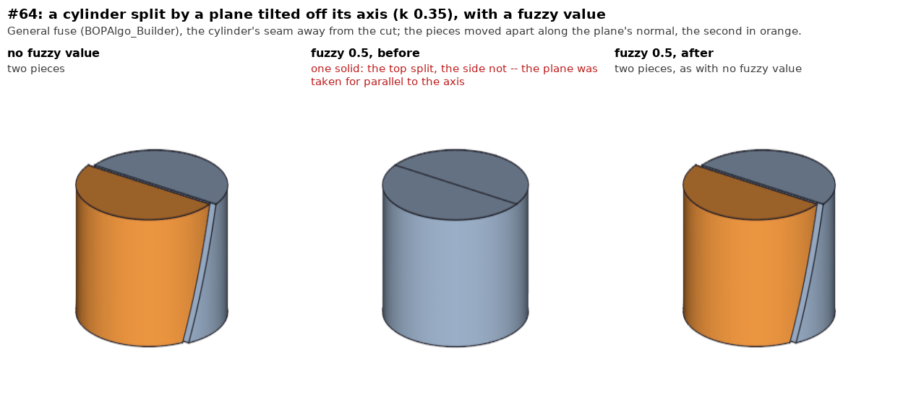
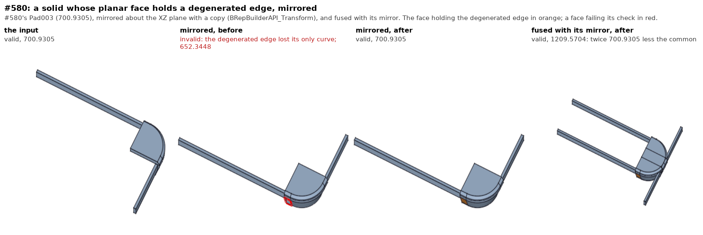
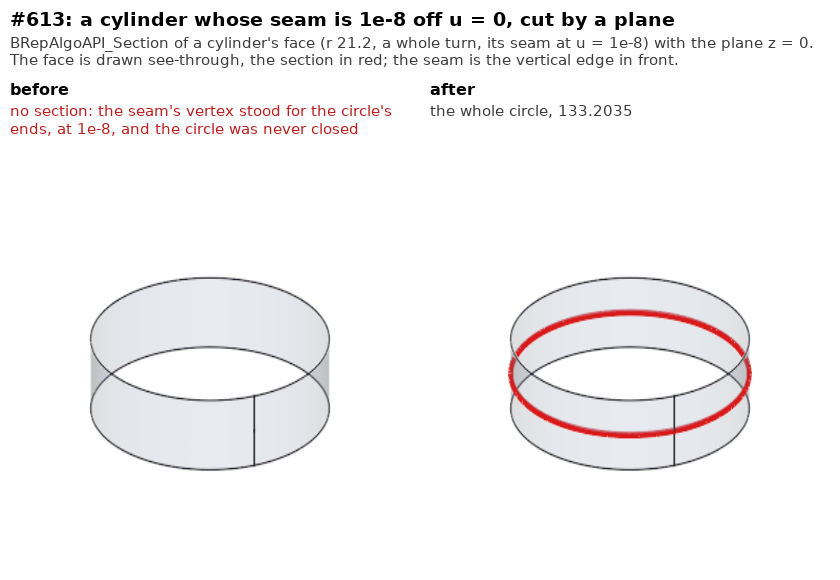
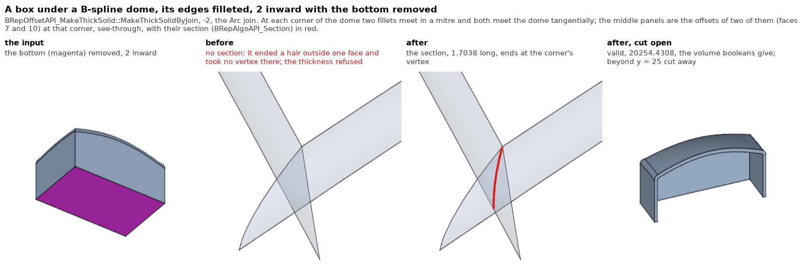
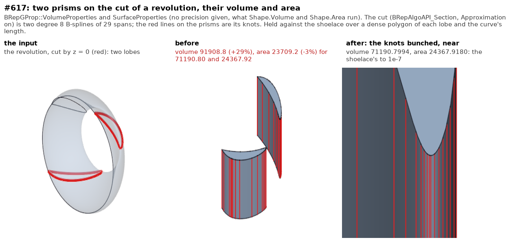
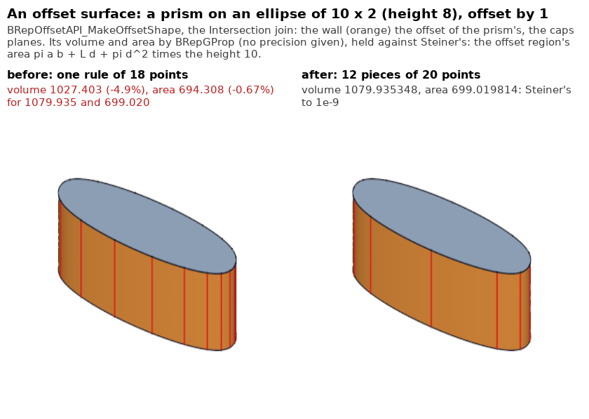
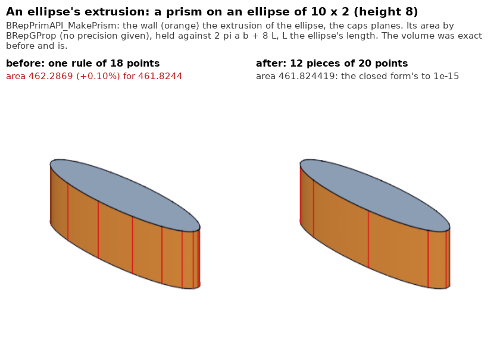

# Booleans and the general fuse

The fork's fixes met through the booleans and the general fuse
(`BOPAlgo_Builder`, what FreeCAD's Split, Fragments, Cut and Fuse run), what
they call -- the surface intersections -- what makes their arguments --
the transforms of a shape -- and what measures their results, the volume
and area integrals. Most come from the issues of `../occ-issues/`.

```
FreeCADCmd tests/fork/boolean/run_tests.py      # the cases, through FreeCAD
pictures/make_pictures.sh                       # models/pictures, before and after
```

`models/` holds a C++ driver of each fix, built against an install (its
header says how); `run_tests.py` runs the same cases through FreeCAD's
`Part`. The pictures are made by `pictures/make_pictures.sh`: the driver run
on the install and on the library the fix changed as it was just before
(`pictures/mkold.py` links it from the build tree's own objects, nothing
installed touched), the results laid out (`prep.py`), rendered in the
FreeCAD GUI (`../fillet/pictures/render.py`) and composed (`compose.py`).

## #64: a plane and a cylinder under a fuzzy value (`ed990cf61b`, 2026-10-28)

**The issue.** `../occ-issues/models/issue064_boolean_split_seam.FCStd`: a
Split of a cylinder (r 25, h 35) by an extruded S-curve, reported wrong near
the cylinder's seam. The Split runs the general fuse with the document's
Tolerance as its fuzzy value -- 3 mm in the file. At 0, 1e-5, 0.1, 1 and 2.5
it is valid, two solids; at 0 the pieces are 42396.3536 and 26325.9857
(integrated to 1e-9; together the cylinder's 68722.3393) with the seam at
the cut or turned 37, 90 or 180 deg away: the seam split of the report is
made, and was before this fix. (Part's default `Volume` reads the pieces up
to 1.6 apart with the seam's place: an integration error, not the shape.)
At 3 the result is invalid, one solid of 22907.4464, and only with the seam
at the cut. The cut crosses the seam three times (z 10.71, 23.61, 34.36) and
between the crossings stays within 2.83 and 0.85 of it: within 3 mm the cut
is the seam edge for 24 mm, and the vertices on it take tolerances of 8 to 14
on a cylinder 35 high. That is what the fuzzy value asks for; it is left so.

**What was broken.** Looking for that, a plain case failed: the cylinder
split by a plane tilted off its axis, y = k (z - zc), came back one solid,
uncut, from a fuzzy value of half the sine of the tilt -- 0.05 at k 0.1,
0.17 at 0.35, 0.35 at 1 -- wherever the plane lay and wherever the seam was.
The plane/cylinder pair had no section curve at all.
`IntAna_QuadQuadGeo::Perform(gp_Pln, gp_Cylinder, ...)` takes the plane for
parallel to the axis when `|sinda - Tol| < Tol`: the sine of the angle
between them against a length. At the default tolerance that is a plane
parallel within 2e-7; at the tolerances a fuzzy value gives the faces, a
plane tilted by up to 2 Tol radians. The two lines it then gives for the
section miss the cylinder (7.2 off at its top for k 0.35, Tol 0.5), and the
pair comes out of the face/face intersection with no curve. Upstream's #1176 (`797d3259df`, 2026-03) had added
the sound test beside it -- the axis's deviation from the plane over the
cylinder face's height, `sinda * H < 2 Tol`, a length against a length --
but kept the old one, either sufficing.

**The fix.** When the face's height is known (`H > 0`, as `IntPatch` and
`IntTools_FaceFace` give it), the height test alone decides; the old one
stays for an unbounded cylinder (`H = 0`). Below 2e-7 rad the angle is
parallel whatever `H`, as the old test made it at the default tolerance. For
a face no higher than 1 nothing changes (the height test then accepts
whatever the old one did). `IntTools_FaceFace` already sends an ellipse
longer than 1e5 times its width to the walking intersection, so a nearly
parallel plane the stricter test now leaves to the ellipse is not handed to
BOP as one.

**The cases.** `models/issue064_fuzzy_plane_cylinder.cpp` and
`run_tests.py`: k 0.1, 0.35 and 1, fuzzy 0, 0.1, 0.5 and 1, the seam at the
cut and turned 90 deg away -- 24 runs. Each must give two valid solids and,
with the seam away, each within 1% of its volume at no fuzzy value. Before:
14 of the 24 one uncut solid. After: all pass. With the seam at the cut a
fuzzy value merges the plane's crossing of the top rim, k 0.64 from the
seam's vertex there, into that vertex (the short section edge between them
collapsed too): the top's chord starts that far from where its arc ends, the
gap closed by the vertex's tolerance, and the volume integrals read that
loop short -- 1.8% at most here. A valid shape within its tolerances, which
is what a fuzzy value asks for; those runs are asked for the two valid
solids only.



**Still a limit.** At a fuzzy value near a twentieth of the cylinder the
pair loses its section again: k 0.1 from 2.2, where the height test itself
(3.48 against 4.4) takes the plane for parallel -- the lines it gives lie
within the tolerance (0.58 off at Tol 2.2), yet the face/face intersection
again keeps no curve (not followed further); and k 1 from 1.1, from another
cause, not looked at.

**Validation** (against `0b44bd01ba`, the kernel before): Part 390 and
PartDesign 486 tests OK; the fillet suite PASS=815 XFAIL=1, thickness 378,
draft 105, as before; the six fillet sweeps (12242, 12242, 3921, 3921, 2614,
3921 runs) and the three draft sweeps (1222, 500, 114) not one result
changed; the thickness sweep right in all 928 runs by its reference.

## #580: a degenerated edge on a plane lost by a transformed copy (`c20f921783`, 2026-10-28)

**The issue.** `../occ-issues/models/issue580_mirror_crash.FCStd`: mirroring
a part (a MultiTransform's Mirrored, the whole shape) gave an invalid shape,
and the fuse that follows crashed (2022, OCC 7.5). Today the fuse does not
crash, but the mirror of the part, `Pad003` (valid, 700.9305), is invalid:
652.3448 by the volume integrals -- the volume the document's Body stored --
and its fuse with the part invalid too.

**What was broken.** Pad003's face 19, a plane, holds a degenerated edge, one
with no 3D curve, only its pcurve. `BRepBuilderAPI_Transform` with a copy
rebuilds the shape through `BRepTools_Modifier`, and
`BRepTools_TrsfModification::NewCurve2d` gives no new pcurve for an edge on a
plane: `BRep_Tool` projects an edge's 3D curve onto a plane when its pcurve
is asked for. A degenerated edge has nothing to project; it was left with no
curve at all, its face `NoCurveOnSurface`. Not the mirror's alone: a copied
rotation and a scale of Pad003 were invalid the same way; only a move
without a copy, a location, was not.

**The fix.** On a plane, `NewCurve2d` declines only an edge that has a 3D
curve; one without carries its pcurve over as on any other surface (a
plane's parameters are unchanged by a rigid move or a mirror; a scale goes
through the surface's parametric transformation, as for the others).

**The cases.** `models/issue580_mirror_degenerated.cpp` on
`models/issue580_pad003.brep` (#580's Pad003), and `run_tests.py`: the part
mirrored about the XZ plane, moved with and without a copy and scaled by 2,
each valid with the volume it should have; its fuse with its mirror valid,
twice the part less their common (1209.5704). Before: the mirror, the copied
move, the scale and the fuse invalid. After: all pass.



**What is left of #580.** The document no longer recomputes to the mirror:
its Chamfer (two distances, 5 and 2, on a circle and two lines of `Pad001`)
fails first. The kernel makes that chamfer -- exactly the stored 476.2935 --
on the edges the file names, with the distances on the faces it gave them.
Recomputed (8.0.1 renumbers the shape), the same three edges are named
again, but the face each edge lists first, which a two-distance chamfer
gives the first distance, is now the pad's base for all three, where 5 does
not fit; given the other way round the kernel refuses it on the stored shape
too. A FreeCAD matter (which face a two-distance chamfer measures from is not
kept through a rebuild), not the kernel's.

**Validation** (against `ed990cf61b`): Part 390 and PartDesign 486 tests
OK; the fillet suite PASS=815 XFAIL=1, thickness 378, draft 105, as before;
the six fillet sweeps and the three draft sweeps not one result changed; the
thickness sweep right in all 928 runs by its reference.

## #613: a section lost to a seam a hair off its start (`59ca72bbcc`, 2026-10-28)

**Where it was met.** `../thickness/`'s #613: a filleted part, its top and
bottom removed inward. The cap at the top meets the part's cone at the
ridge's ends; the offset cone, enlarged, was cut by the cap's plane in a
whole circle -- and the pave filler gave no section: the cap was never cut,
kept whole, and the thick solid refused as the input unhollowed.

**What was broken.** The cone's seam lay 2.1e-8 off u = 0 (its pcurves a
hair less than the period apart), where the circle the plane cuts from it
starts. On a radius of 21 that is 4e-7 in space, within the vertices'
tolerance of the circle's end: no vertex was made at the circle's bounds,
the seam's vertex standing for them -- at 2.1e-8. `PutClosingPaveOnCurve`
closes a closed curve by putting the vertex found at one bound at the
other too, and looked for it by its parameter (within 1e-9): none was
found, the circle kept one pave, made no block, and the section was empty.
Any whole turn does it -- a plain cylinder or cone, its seam 1e-8 or 2e-8
off u = 0, cut by a plane square to its axis, has no section; at 0, 1e-9,
5e-8 and beyond it has.

**The fix.** With no pave at a bound by its parameter, a pave whose vertex
is at a bound in space -- within the vertex's tolerance and the curve's --
is taken for it, unless the other bound already has one; the closure test
after it is as before.

**The cases.** `models/issue613_seam_section.cpp` and `run_tests.py`: a
cylinder's and a cone's face (radius 21.2, a whole turn) with the seam at
0, 1e-9, 1e-8, 2e-8, 5e-8 and 1e-6, cut by the plane z = 0, each giving the
whole circle (its length to 1e-6). Before: the four at 1e-8 and 2e-8 empty.
After: all twelve.



**Validation** (against `37cb17ed8e`): Part 390 and PartDesign 486 tests
OK; the fillet suite PASS=815 XFAIL=1, thickness 381 (with #613's new
cases), draft 105, boolean 39; the six fillet sweeps and the three draft
sweeps not one result changed; the thickness sweep right in all 928 runs.

## A section's tangent end at a corner (`e9ded0215d`, 2026-10-29)

**Where it was met.** A box (80 x 50 x 40) split by a B-spline dome (a
network surface, z 22 to 32), the dome's four edges filleted (r 3), a
thickness 2 inward with the bottom removed, the Arc join: refused
(`BRepOffset_UnknownError`, the offset shell empty). Found by a peer
session's B-spline fillet work; its shape is `models/dome_fillet_r3.brep`.

**What was broken.** At each corner of the dome two fillets meet in a mitre
and both meet the dome tangentially, so the three faces' normals agree at
the corner and the offsets of the two fillets are tangent to each other at
the corner's offset. Their section is a curve that passes that corner at a
hair's distance -- 4 to 7e-4, to the side, not through it -- and its end
lies across the boundary of one of the faces (1.3 to 1.9e-4 out, with the
curve's tolerance 1e-5). `PutBoundPaveOnCurve` gives an end a vertex only
if it is on both faces, and `PutStickPavesOnCurve` takes a vertex of both
for it only within 4.5e-4 and with the faces tangent at the end itself (to
0.006 deg; they part at 0.025 to 0.037 deg there): the section had one end,
no block, no edge. In the thickness the mitre pairs were not cut, and the
offset shell fell apart. All four corners alike; upstream the same.

**The fix.** An end that is not on both faces and has no vertex takes the
nearest vertex lying on both -- one they share or one their vertices merged
into -- if the faces are tangent at it (the pave filler's own crease
criterion) and stay within the curve's tolerance of each other all the way
from the end to it: the distance times the sine of the angle between the
faces at the end (here 2 to 4e-7) -- and the vertex is near the end, within a
tenth of the curve's chord. The vertex's tolerance grows to the distance.

**The cases.** `models/dome_tangent_corner.cpp` and `run_tests.py`: the
offsets (-2) of each mitre pair made alone, sectioned: one edge, 1.7038
long. `../thickness/`'s `dome_tangent_corner_in` and `_in_inter`: the
thickness, valid, 20254.4308 -- the shape less the part above z = 0 of the
offset of it carried down to z = -10 gives 20254.4292 (that offset failed
before too). Before: no edge on any pair, the thickness refused. After: all.



**Validation** (against `19c89dc908`): Part 390 and PartDesign 486 tests
OK; the fillet suite PASS=815 XFAIL=1, thickness 400 (with the two new
cases), draft 105, boolean 43; the six fillet sweeps and the three draft
sweeps not one result changed; the thickness sweep right in all 928 runs,
not one changed.

## #617: a volume integrated a point or two a span (`2c45873435`, 2026-11-01)

**Where it was met.** #617's sketch: a revolution cut by the plane z = 0
(Approximation on), the section's two lobes padded 100. FreeCAD showed the
pad's volume as 92341; it is 71190.80. Its shapes are
`models/issue617_revolution.brep` and `models/issue617_prisms.brep`.

**What was broken.** `BRepGProp`'s plain volume and area integrals
(`BRepGProp_Gauss`, what `Shape.Volume` and `Shape.Area` run) integrate a
face along its boundary edges with one Gauss rule per edge, and across the
face with one rule per point, each capped at 61 points over the whole edge
or the whole range. The section's lobes are degree 8 B-splines of 29 spans,
their knots bunched where the cut turns: one rule of 61 points over 29
spans gives a point or two a span, and no polynomial rule integrates a
piecewise curve across its knots. Each lobe's area came out 343.65 for
355.95, the prisms' volume 91909 for 71191 (29% over), their area 3% short.
Any B-spline curve or surface of many spans, or of knots bunched, is
integrated as badly; upstream the same.

**The fix.** Where a rule over the whole edge or range would give a span
fewer points than its degree asks, the integral is taken span by span: the
edge is broken at its pcurve's knots and where it crosses the face's own
knots (a B-spline surface's, or the B-spline basis of an extrusion or a
revolution), the range across the face at the surface's knots in that
direction, each piece with its own rule. An edge and a face with no such
knots are integrated as before, to the bit.

**The cases.** `models/issue617_gprop_prism.cpp` and `run_tests.py`: the
prisms' volume and area against what does not come from the integrals --
each lobe's area by the shoelace over a dense polygon of its curve, times
the height, and the curve's length. Before: volume 91908.84 for 71190.80,
area 23709.16 for 24367.92. After: within 1e-10 of both.



**What it moved.** Volumes only, and only where a B-spline has more spans
than one rule follows; never a shape. The suites' references moved, each
toward the adaptive integral: 13 of the fillet suite's (1e-7 to 6e-6 --
#273's `Fillet001` and #962's slanting side), FreeCAD's Part test of the
ellipse's thickness (608.6631 to 608.6621) and PartDesign's loft of
`FaceRefs_fork_whole_names` (12238.1843 to 12238.1739, the adaptive
integral's to 2e-12). In the fillet sweeps 5175 results moved their
volume, by at most 4.3e-4 (#474's `Fillet003` at `V26:44,53@1`, now the
adaptive integral's; it was 0.82 off), the others by less than 1e-4;
in the thickness sweep 10, in the last digit printed. Over 80121 shapes of the sweeps and
models, 2634 moved, by 1e-4 or more only #617's, a dome's and #423's, each
closer to the adaptive integral or a dense polygon. The plain integral's
order on an offset surface was left at 18 points: the ellipse's thickness
read 608.66 for 609.89, the next section's fix.

**Validation** (against `d0d93c69c2`): Part 390 and PartDesign 486 tests
OK, plain and frozen; the fillet suite PASS=815 XFAIL=1, plain and frozen
(the 13 references moved); thickness 463 XFAIL=1 at levels 0 and 1, plain
and frozen; draft 105, boolean 44; the thickness sweep right in all 928
runs in the four modes; the three draft sweeps not one result changed; the
six fillet sweeps not one status, face count or tolerance changed.

## An offset surface integrated at 18 points (`54de50c4c1`, 2026-11-01)

**Where it was met.** FreeCAD's Part test of thickness on seam faces and an
ellipse (`test_thickness_of_seam_faces_and_an_ellipse`): a prism on an
ellipse of 10 x 5, its top removed, 1 outward -- 608.6621 by the volume
integral where the solid is 609.8911 (a fine mesh: 609.889), and its bottom
removed, 1 inward, 473.2070 for 474.1842. The thickness's wall is the
offset (`Geom_OffsetSurface`) of the prism's.

**What was broken.** An offset surface carries its basis's unit normal, and
the integrands with it the square root of the basis's speed. For an ellipse
of a by b that has zeros off the real axis by about atanh(b/a) -- 0.55 for
10 x 5, 0.2 for 10 x 2 -- where the normal turns fastest, and one Gauss rule
over the whole turn converges only as fast as that distance against the
range allows. `BRepGProp_Face` gives an offset surface the default order,
18 points over the range: 0.08% short on the 10 x 5 ellipse, 5% on 10 x 2,
15% on 10 x 1. More points over the whole range do not cure it (60 points:
4e-4 on 10 x 2).

**The fix.** An offset surface whose basis's normal turns unevenly along u
or v -- the fastest turning more than 1.2 times the slowest, sampled on
three iso lines -- has its range in that parameter cut into pieces, each
integrated with a rule of 20 points, the way the B-spline spans of "#617: a
volume integrated a point or two a span" are. The zeros lie off the axis by the inverse of
the turning at its peak, and further off with the distance from the peak
(an ellipse's turning is d / (t^2 + d^2) about a peak of 1 / d), so the
pieces are graded toward the peaks: spaced by the integral of the square
root of the turning times its maximum, 1 / sqrt(t^2 + d^2) about such a
peak -- a few pieces each time the distance grows tenfold, at most 64; 12
on the 10 x 2 ellipse, 16 on 30 x 1. It is the basis's normal that is
sampled, the one the integrands carry: the offset's own turns back where
the offset folds, beyond a radius of curvature, and the integrands pass
smoothly through. A normal turning evenly (an offset cylinder's, a
circle's) has no such zero, and is integrated as before.

An offset of a B-spline (or of an extrusion or a revolution of one) is cut
at every knot of its basis inside the face as well, not only when one rule
cannot follow that many spans: the offset's derivatives take in the
basis's next ones, which jump at a knot. A face of the corpus, an offset by
-2 of a degree 2 B-spline curved between its knots at u = 0 and 4.115 and
flat beyond, reached 0.00127 past one of them: its area element doubles
there, and a rule across the jump converged on nothing -- 1.5e-4 off with
the rule over the whole range, and wandering by as much as more pieces were
put in. Cut there, it is the same to 1e-15 at any number of pieces (and a
dense mesh agrees).

Along an edge not cut at its own knots, each piece keeps the rule the whole
edge would have had, when that is the finer. Since `2c45873435` an edge cut
only where it crosses the face's knot cuts took each piece with the span's
rule (8 points on a cubic) in place of the edge's (up to 61): coarser, not
finer. An interpolated 9 x 7 cubic B-spline face (FreeCAD's Surface test of
a split, `waveFace`) read 251.376140 for 251.377801, 64 times further off
than before; it reads 251.377797 now. A face of #346's corpus with a near
pinch inside a span: 4804.61886 by the span's rule, 4804.62607 by the
edge's, 4804.62500 adaptively.

**The cases.** `models/offset_surface_gprop.cpp` and `run_tests.py`: a prism
on an ellipse (10 x 5, 10 x 2, 6 x 5, 10 x 1, 30 x 1; height 8), offset by 1
(and 10 x 5 by -1) with the Intersection join -- the wall the offset of the
prism's, the caps planes -- against Steiner: the offset region's area
pi a b + L d + pi d^2, its curve L + 2 pi d (L the ellipse's length), the
solid that region times 8 + 2 d. Before: 0.08% to 18% off. After: within
2e-8 (30 x 1), the others 4e-10.



**What it moved.** Volumes and areas only, never a shape. The ellipse's
thickness: 608.6621 to 609.8911 (top, out) and 473.2070 to 474.1842
(bottom, in) -- FreeCAD's Part test and the thickness suite's four
ellipse references, each now Steiner's (`thickness/sweep/hand.py`), as are
the thickness sweep's 16 ellipse results. Over 80049 shapes of the sweeps
and models, 479 moved; of the 409 not degenerate, 389 moved closer to a
build giving an offset 60 points over the whole range. The largest, 1.5e-4,
are seven shapes of #613's corpus holding the offset of the degree 2
B-spline above, now converged (the 60 point rule is as far off: it crosses
the knot too); next a shape of the dome corpus, 6.7e-6, now the 60 point
rule's to 3e-10. The integrals over
those shapes took 28% longer (556 s for 434 s), most of it the edge rule
on #346's offsets (2.5 s to 5.2 s a shape) and #617's fuse. In the fillet
sweeps 125 results moved their volume, by the edge rule, at most 7.3e-7
(#876's fillets of 10, by 0.0044): each to within 1e-7 of the adaptive
integral, ten times nearer than it was (`E76@10`: 6017.2417 to 6017.2372,
adaptively 6017.2368).

**Validation** (against `e276ca1858`): Part 390 and PartDesign 486 tests
OK, plain and frozen; the fillet suite PASS=815 XFAIL=1, plain and frozen;
thickness 463 XFAIL=1 at levels 0 and 1, plain and frozen (its four
ellipse references moved); draft 105, boolean 50; the thickness sweep right
in all 928 runs in the four modes (16 ellipse volumes moved, to Steiner's);
the three draft sweeps not one result changed; the six fillet sweeps not
one status, face count or tolerance changed.

## An ellipse's extrusion: its area integrated at 18 points (`8655926813`, 2026-11-02)

**Where it was met.** Measuring the offset fix above: the plain area of a
prism on an ellipse (no offset) was off too -- 1.8e-5 on 10 x 5, 0.1% on
10 x 2, 0.45% on 30 x 1 -- where its volume came out exact. A pad of an
ellipse, FreeCAD's `Shape.Area`.

**What was broken.** The same integrand as an offset's: the area element of
an extrusion of a curve is the curve's speed times the extrusion's, the
square root of a polynomial in the curve's derivatives, with zeros off the
real axis where the curve turns fastest; a revolution's carries the speed
of the curve revolved. `BRepGProp_Face` gives both the default order, 18
points over the whole range. The volume integrand has no square root and
was exact.

**The fix.** An extrusion and a revolution are cut in pieces as an offset
is, where their own normal turns unevenly: an extrusion in u (along its
curve), a revolution in v (its curve; the turn about the axis is even). Cut
in pieces, an extrusion or a revolution of a B-spline is cut at every knot
of the curve as well, as an offset is: a piece across a knot follows
nothing. #617's revolution (a cubic of four spans, revolved) shows why: its
volume read 62064.29 for 62081.90, 3e-4 short, and now agrees with its
meridian integrated directly (Pappus, span by span, refined) to 1e-12.

**The cases.** `models/extrusion_area_gprop.cpp` and `run_tests.py`: a
prism on an ellipse (10 x 5, 10 x 2, 6 x 5, 10 x 1, 30 x 1; height 8)
against 2 pi a b + 8 L, and four spheroids -- half an ellipse revolved
about its axis, 10 x 2, 10 x 5 oblate, 2 x 10, 5 x 10 prolate -- against
their closed forms. Before: the prisms 1.4e-8 to 0.45% off, the spheroids
up to 1.7e-4 (10 x 2). After: within 2e-15.



**What it moved.** Over 79992 shapes of the sweeps and models, 7: #617's
revolution and its pad (3e-4 in volume, 9e-4 in area, now exact), four of
#617's fuses (invalid, their faces' wires crossing) and a face of #64's
split, an extrusion of a cubic, 1.6e-6 in area (2302.8428 to 2302.8390;
Green's theorem over its pcurves, refined: 2302.8390). The integrals over
them took 0.8% longer, but for the two invalid fuses of #617 (133 s and
142 s to 222 s each).

**Validation** (against `73a6940466`): Part 390 and PartDesign 486 tests
OK, plain and frozen; the fillet suite PASS=815 XFAIL=1, plain and frozen;
thickness 463 XFAIL=1 at levels 0 and 1, plain and frozen; draft 105,
boolean 59; the thickness sweep right in all 928 runs in the four modes,
not one result changed; the three draft sweeps not one result changed; the
six fillet sweeps not one status, face count, tolerance or volume changed.
