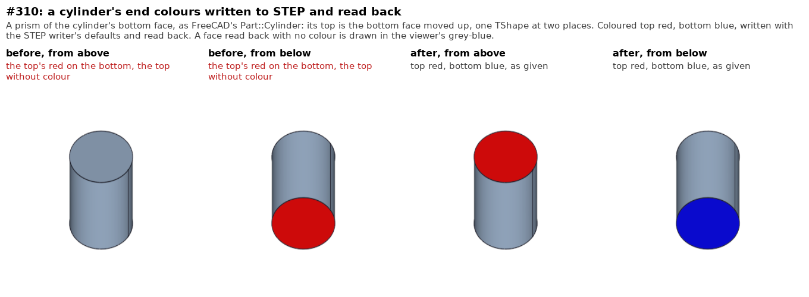

# Data exchange

The fork's fixes to reading and writing STEP and the other formats
(`TKDESTEP`, `TKXSBase`, and the shape processing they run, `ShapeProcess`
in `TKShHealing`). Most come from the issues of `../occ-issues/`.

```
pictures/make_pictures.sh        # models/pictures, before and after
```

`models/` holds a C++ driver of each fix, built against an install (its
header says how). The pictures are made by `pictures/make_pictures.sh`: the
driver run on the install and on the library the fix changed as it was just
before (`../boolean/pictures/mkold.py` links it from the build tree's own
objects, nothing installed touched), the shapes it read back laid out
(`prep.py`), rendered in the FreeCAD GUI (`../fillet/pictures/render.py`)
and composed (`../boolean/pictures/compose.py`).

## #310: a STEP colour moved to a partner face (`9ba3806e9b`, 2026-10-28)

**The issue.** `../occ-issues/models/issue310_step_color_export.FCStd`: two
cylinders, their top faces coloured, exported to STEP. The moved one's
colours come out right; the other's top colour is written on its bottom
face, and its top has none. The issue's own exports
(`issue310_cylinder_untransformed.step`, `_transformed.step`) show it read
back: the untransformed file's bottom face red, its top uncoloured.

**What was broken.** FreeCAD's `Part::Cylinder` is a prism of the cylinder's
bottom face (`BRepPrimAPI_MakePrism`): its top is that face moved up, one
TShape at two places, the two faces partners. (OCCT's own
`BRepPrimAPI_MakeCylinder` gives two faces since 8.0, and its colours were
right.) The STEP writer processes the shape before writing it (`DirectFaces`
by default, a `BRepTools_Modifier`, which rebuilds every face) and maps its
history back onto the shape it was given, so that a colour found on an
original face reaches the face written. `ShapeProcess_ShapeContext` kept that
history for each sub-shape with its location taken off (OCC21617, for a root
shape with a location): the bottom face and the top were one key, the top's
result replaced the bottom's, and the writer bound one face of the two. The
top, not found with its location, was then looked up without it
(`STEPConstruct::FindEntity`) and found the bottom: its red was written
there, and nothing on itself. Placed, moved by a location on the whole, the
same. With the processing off, or a cylinder with no partners, it was right.

**The fix.** The history is kept for each sub-shape as it is in the root,
only the root's own location left out, in both versions of `RecModif` (a
modification's map and a `ShapeBuild_ReShape`); the root's own key is as
before, and so is every key of a shape with no located sub-shapes.

**The cases.** `models/issue310_step_partner_colours.cpp`: the prism, top red
and bottom blue, written with the writer's defaults and read back; the same
placed (a rotation and a move on the whole); `BRepPrimAPI_MakeCylinder`'s
cylinder; two partner faces in a compound. Before: the prism and the placed
prism the bottom red, the top uncoloured. After: all four as given. FreeCAD's
own export (`ImportGui.export` of a `Part::Cylinder`, top red and bottom
blue, plain and placed) reads back right too.



**Validation** (against `c20f921783`): every STEP file of the trees (32: the
fcad tree's IDF part library and the occ-issues models) read with colours
and names, written back and read again, gives the same solids, faces,
volumes, validity and face colours as before, read and read again; fcad's
Import (18) and Part (113) C++ tests and its Part 390 and PartDesign 486
Python tests OK.

## A direction read back as it was written (2026-11-24)

**Found in FreeCAD.** A recompute of `scanner.FCStd` made in a worker
process (`docs/WorkerProcess.md` in FreeCAD, sec 59-60) drew one TechDraw
section view with 20 visible edges where the same recompute made in the
process that holds the document drew 19. The worker reads its copy of the
document from a saved version, and that was enough: this process drew 20
too after a save and a reopen. One shape upstream of the section's fillet,
a binder, came back from the file with one line's direction moved by an ulp
in each coordinate, `(-0.70710678118654735, 0.70710678118654757, 0)` read
as `(-0.70710678118654746, 0.70710678118654768, 0)`. The fillet made of it
differed by about 1e-15, and the section's projection made of that one more
edge, a B-spline 0.0133 long.

**What was broken.** The direction was written exactly, as text with 17
digits and as binary, and lost in the reading. Its square norm was
1 - 1.1e-16: `gp_Dir::Transform()` divides by the norm, and the result is
often unit only to an ulp. `gp_Dir` keeps a vector as given only when its
square norm is 1 within `gp::Resolution()`, which in practice means exactly
1. The readers of `GeomTools_CurveSet`, `_SurfaceSet` and `_Curve2dSet` (text)
and of `BinTools_CurveSet`, `_SurfaceSet` and `_Curve2dSet` (binary) made a
`gp_Dir` of every direction they read, and normalizing a second time moved
it. The frames went the same way. A conic's frame was made again as
`gp_Ax2(P, A, AX)`, an elementary surface's as `gp_Ax3(P, A, AX)` and a 2D
conic's as `gp_Ax22d(P, AX, AY)`, each of which makes its X and Y directions
again from what it is given. So a shape read back was not the shape
written, and an algorithm run on it could give another result.

**The fix.** Inline functions of `GeomTools` (no symbol of the fork's), used
by the six readers:
- `DirAsWritten()` and `Dir2dAsWritten()` keep a direction whose square
  norm is 1 within 4 epsilon as it was written, and normalize any other as
  before.
- `Ax2AsWritten()`, `Ax3AsWritten()` and `Ax22dAsWritten()` make the frame
  as before. Where what they make is the written frame to rounding (each
  coordinate within 16 epsilon), they keep the written point and
  directions.

Each checks what it built through the class's own accessors, and returns
what the class would have made if a layout ever differs from the one it
assumes.

**The cases.** `models/brep_direction_round_trip.cpp`. Binder008's line, its
direction put in as it was in memory. Then 1000 rotations of `(1, 0, 0)`
about `(1, 2, 3)`, each giving a line, a circle, a plane face and a 2D
circle on a plane. Each is written and read back through `BRepTools` and
`BinTools`, and every coordinate of every direction compared bit for bit:

| coordinates read back other than written | before | after |
|---|---|---|
| Binder008's line (of 3) | 2 | 0 |
| lines (of 15000: the line edges and the plane faces' edges) | 690 | 0 |
| circles' frames (of 9000) | 3685 | 0 |
| planes' frames (of 9000) | 3662 | 0 |
| 2D circles' frames (of 4000) | 0 | 0 |

The same for text and binary. 521 of the 1000 rotated directions are not
unit to the last bit. In FreeCAD, the binder made and the binder restored
are the same but for the Checked flag, and the worker's section view has
19 edges, as here.

No picture: what changed is in the last bits of the numbers, and the table
is its record.

**Validation** (against `357a41bfc6`). The fork's suites were run with each
read, the old and the new, switched in one build. Counted alongside:
directions the new read kept that the old one changed, and frames.

| suite | old and new | directions, frames reached | what differs |
|---|---|---|---|
| boolean | 108 PASS | 3, 11 | nothing |
| draft | 105 PASS | 0, 1525 | nothing |
| thickness, level 0, 3, 3 frozen | 696 PASS | 637, 994 | nothing, at 17 digits too (697 lines) |
| fillet, level 0, 4, 4 frozen | 919 PASS, 1 XFAIL | 256, 753 | 31 of 921 lines at 17 digits, no verdict |

The fillet results that move, measured: `issue273_crease_chamfer_e5_2_level3`
8558.7107131 -> 8558.7092224 (1.7e-7 relative), `issue273_rim_run_on_e7_r2`
8559.4294082 -> 8559.4293201 (1.0e-8), then two below 2e-10, and 27 below
1e-12. In both of the first two the faces, edges and vertices are as many as
before. Not a vertex moves, and the largest vertex tolerance (0.03) is the
same: within the shapes' tolerances, so the fix lands plainly (`../README.md`,
"A fix that changes a shape"). Both are on #273's handle, which the suite
already holds to 3e-3 and 5e-3 for the compiler. Its comment gives 8558.7094
for a copy of the shape read, against 8558.7109 for the shape read; the new
read gives 8558.7092. No symbol is added to `TKGeomBase` or `TKBRep`
(`nm -gU`).
