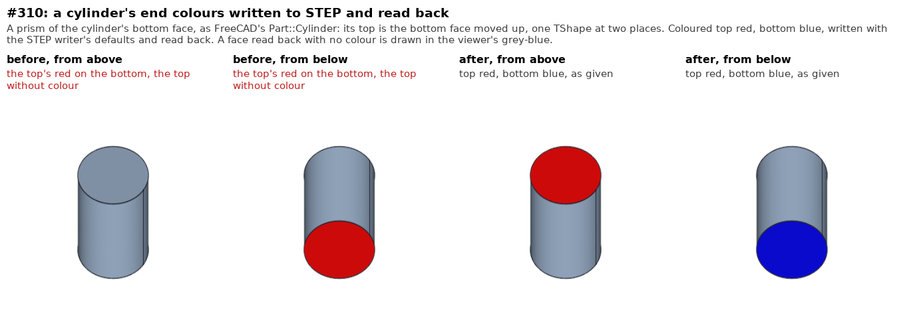

# Data exchange

The fork's fixes to reading and writing STEP and the other formats
(`TKDESTEP`, `TKXSBase`, and the shape processing they run, `ShapeProcess`
in `TKShHealing`). Most come from the issues of `../occ-issues/`.

```
pictures/make_pictures.sh        # models/pictures, before and after
```

`models/` holds a C++ driver of each fix, built against an install (its
header says how). The pictures are made by `pictures/make_pictures.sh`: the
driver run on the install and on the library the fix changed as it was just
before (`../boolean/pictures/mkold.py` links it from the build tree's own
objects, nothing installed touched), the shapes it read back laid out
(`prep.py`), rendered in the FreeCAD GUI (`../fillet/pictures/render.py`)
and composed (`../boolean/pictures/compose.py`).

## #310: a STEP colour moved to a partner face (`9ba3806e9b`, 2026-10-28)

**The issue.** `../occ-issues/models/issue310_step_color_export.FCStd`: two
cylinders, their top faces coloured, exported to STEP. The moved one's
colours come out right; the other's top colour is written on its bottom
face, and its top has none. The issue's own exports
(`issue310_cylinder_untransformed.step`, `_transformed.step`) show it read
back: the untransformed file's bottom face red, its top uncoloured.

**What was broken.** FreeCAD's `Part::Cylinder` is a prism of the cylinder's
bottom face (`BRepPrimAPI_MakePrism`): its top is that face moved up, one
TShape at two places, the two faces partners. (OCCT's own
`BRepPrimAPI_MakeCylinder` gives two faces since 8.0, and its colours were
right.) The STEP writer processes the shape before writing it (`DirectFaces`
by default, a `BRepTools_Modifier`, which rebuilds every face) and maps its
history back onto the shape it was given, so that a colour found on an
original face reaches the face written. `ShapeProcess_ShapeContext` kept that
history for each sub-shape with its location taken off (OCC21617, for a root
shape with a location): the bottom face and the top were one key, the top's
result replaced the bottom's, and the writer bound one face of the two. The
top, not found with its location, was then looked up without it
(`STEPConstruct::FindEntity`) and found the bottom: its red was written
there, and nothing on itself. Placed, moved by a location on the whole, the
same. With the processing off, or a cylinder with no partners, it was right.

**The fix.** The history is kept for each sub-shape as it is in the root,
only the root's own location left out, in both versions of `RecModif` (a
modification's map and a `ShapeBuild_ReShape`); the root's own key is as
before, and so is every key of a shape with no located sub-shapes.

**The cases.** `models/issue310_step_partner_colours.cpp`: the prism, top red
and bottom blue, written with the writer's defaults and read back; the same
placed (a rotation and a move on the whole); `BRepPrimAPI_MakeCylinder`'s
cylinder; two partner faces in a compound. Before: the prism and the placed
prism the bottom red, the top uncoloured. After: all four as given. FreeCAD's
own export (`ImportGui.export` of a `Part::Cylinder`, top red and bottom
blue, plain and placed) reads back right too.



**Validation** (against `c20f921783`): every STEP file of the trees (32: the
fcad tree's IDF part library and the occ-issues models) read with colours
and names, written back and read again, gives the same solids, faces,
volumes, validity and face colours as before, read and read again; fcad's
Import (18) and Part (113) C++ tests and its Part 390 and PartDesign 486
Python tests OK.
