# Fillets in the OCCT fork, before and after

FreeCAD's Fillet -- `Part::Fillet`, `PartDesign::Fillet`, `Shape.makeFillet()`
-- is OCCT's `BRepFilletAPI_MakeFillet`, the `ChFi3d` builder in `TKFillet`.
Fillets, chamfers and drafts are among FreeCAD's most reported kernel
failures; `../../occ-issues/` holds the reports with their models. This page
shows each fix the fork makes to fillets, in pictures. The case-by-case
reference and the history are `../README.md`; the suite is
`../run_tests.py`.

## Reading a picture

Each picture is one case of the suite: the shape, the edge filleted (by its
two ends), the radius, the expected volume and the fork commit that fixed it.

Three columns:

- **upstream OCCT 8.0.1** -- upstream's `TKFillet` files at the fork's base
  (`91be8c4c71`), compiled into a scratch `TKFillet` and loaded ahead of the
  installed one, the rest of the fork as it is -- but for the files of other
  toolkits a fix here changed, which are upstream's too (`GeomPlate`'s, in
  `TKGeomAlgo`).
- **fork before** -- the fork's `TKFillet` (and, for a fix outside it, that
  toolkit) at the commit just before the fix (named in the heading), the
  same way.
- **fork after** -- the fork now.

Three rows:

- the whole result;
- the result zoomed on the fillet's end, where the fault is;
- one face of the result drawn in its own (u, v) parameters, the face the
  fault is in (its label names it) -- each edge's pcurve on it, as the
  face's wire holds the edge, which is what `BRepCheck` reads. A closed wire
  is a closed outline; an end of a pcurve that meets no other pcurve's end
  is circled red. On a cylinder the gridlines are at multiples of pi/2 in u.

Under each column heading: "valid, volume V" in green, or what was wrong in
red. Faces that fail `isValid()` are drawn red; red edges are edges not
used once each way round by the faces.

## The fixes

### A seam left on a piece of a closed face (`16df68d224`, realthunder/FreeCAD#523)

The model is a 10 box with a three-quarter cylinder of radius 2 at the
corner on the z axis, joined by Part's Connect. The cylinder's seam is the
line x=2, y=0, where the cylinder meets the box's side, and the boolean kept
that line as an edge with **both** pcurves on the cylinder -- u=0 and
u=2 pi -- though the three-quarter face holds it once and runs from pi/2 to
2 pi. A fillet on the box edge along y=0, which ends at that line, comes out
"Unorientable" at every radius: the cylinder face, red in the first two
columns, does not close. Its third row shows why: the cap the fillet's end
cuts out of the cylinder was computed near u=0, a period away from the face,
four ends open. After the fix the cap continues the face past 2 pi and the
outline closes.

`ChFi3d_Builder::PerformOneCorner` read the pcurve of the edge at the
fillet's end with `BRep_Tool::CurveOnSurface`, which, for an edge with two
pcurves on the face's surface, chooses by the orientation of the edge it is
handed; it was handed the edge as the fillet data carries it, not as the
face holds it. Now an edge closed on the face but not really closed
(`BRepTools::IsReallyClosed`) is read as the face holds it.

The geometry is the same in all three columns, which is the point: nothing
in the shape looked wrong, the face's parameters were. The fixed volumes
equal those of the same fillet on the edge across the box's diagonal, which
does not end on a seam (1092.5263 at radius 1).

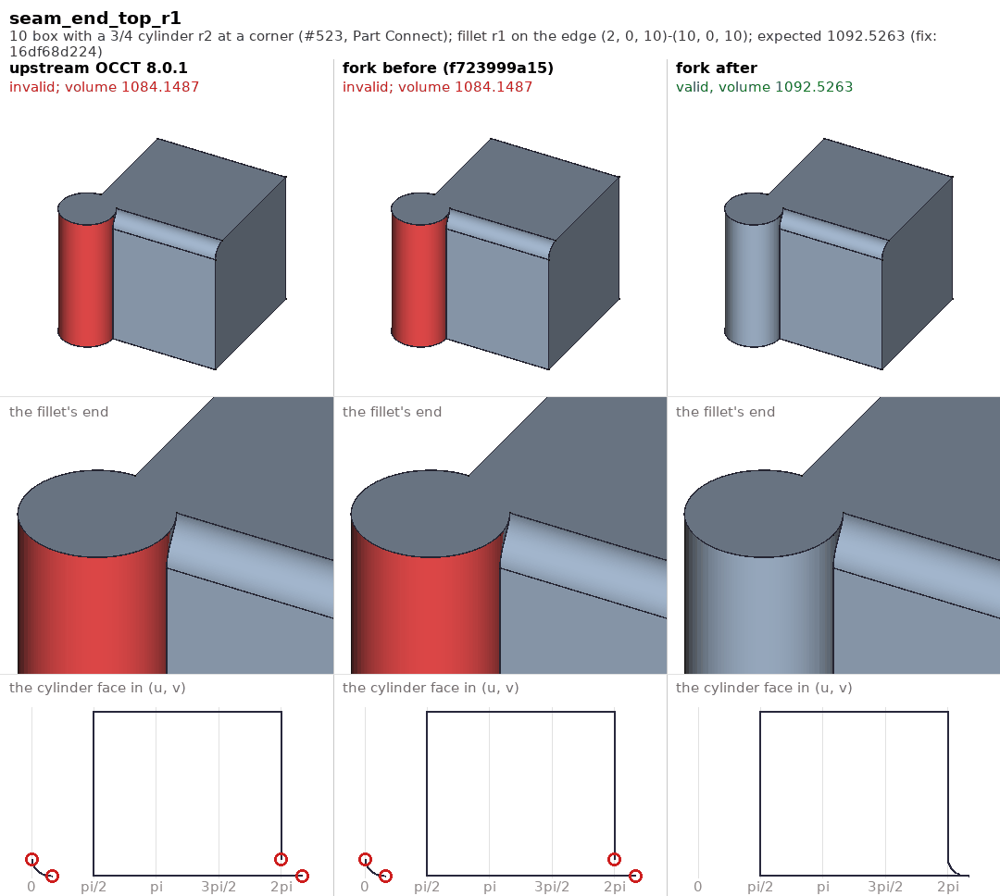
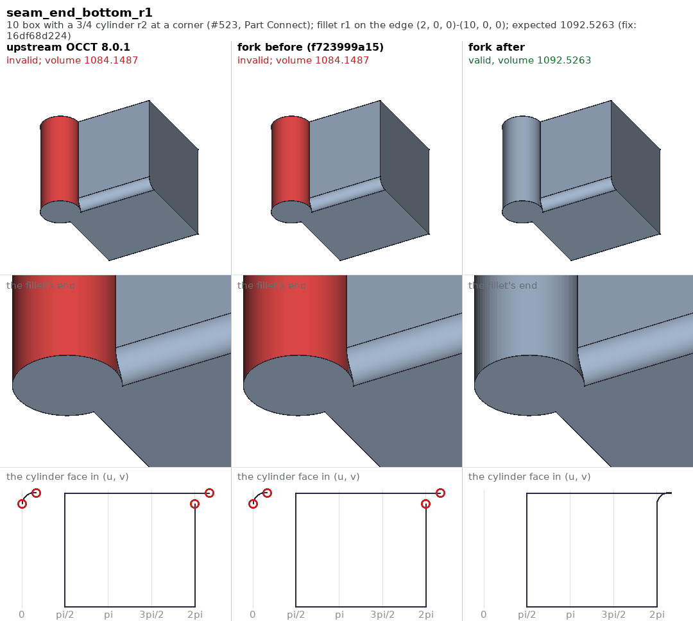
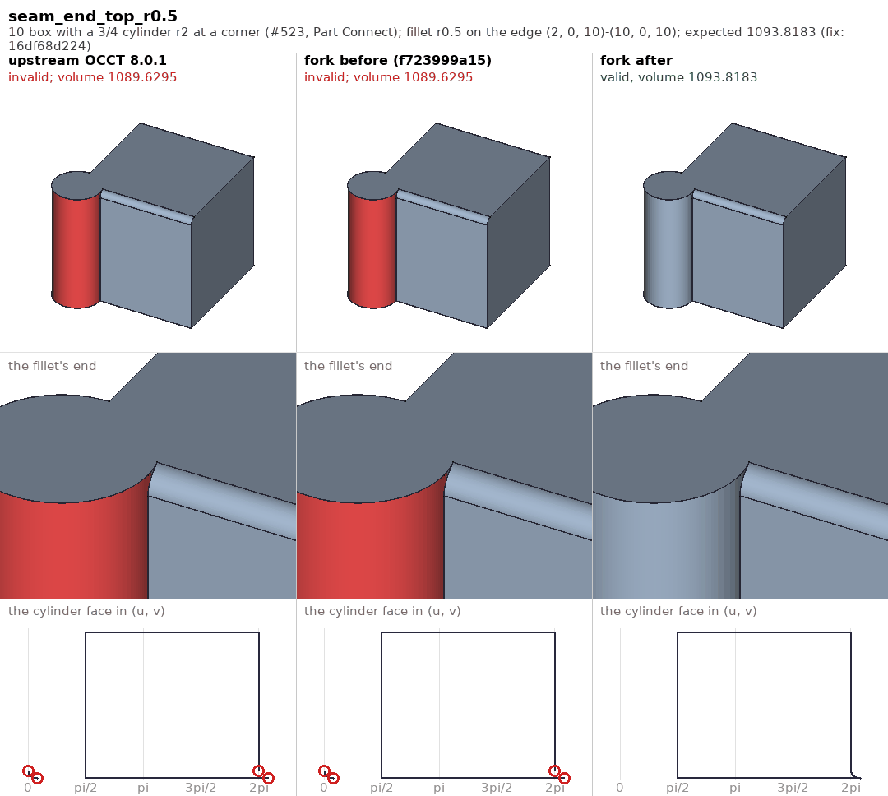

At radius 2, the cylinder's own radius, the cap reaches the face's far end
as well (u = 5 pi/2, which is pi/2 a period on). The top is right now; the
bottom, its mirror image, stayed invalid -- not for its geometry, which is
the top's, but for a crossing of 2e-9 that BRepCheck saw on one and not the
other -- until "A corner's curve kept on its face", below.

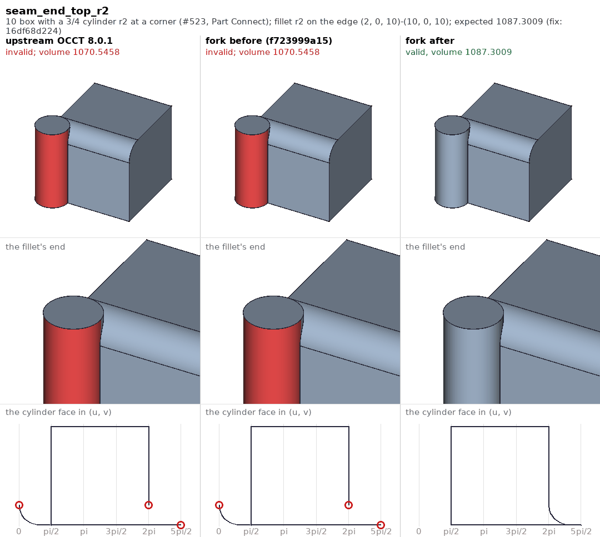

### A fillet line collapsed to a point (`214d858dc3`)

Not pictured: there is no result to show. A fillet of radius 2 on the
cylinder's top or bottom arc has no line on the top face, only a point; the
corner code dereferenced the missing curve and the process died. It is
refused now (`StdFail_NotDone`); the suite's `arc_*_r2_no_crash`.

### A corner whose faces are split in coplanar pieces (`cf96757c36`, realthunder/FreeCAD#962)

A PartDesign body without Refine keeps a wall as several coplanar faces, cut
apart by the booleans that made it. #962's Fillet (radius 0.8, twelve edges)
was invalid, and five of its edges were invalid alone. Four of them are the
outer edges of slots cut down to a floor: the fillet ends on the floor, which
it has to extend into its end -- `PerformOneCorner`'s OnSame corner. The
slot's wall is two faces there, its piece at the outer face 0.692 wide (0.787
for the other pair of slots), and from that radius on the corner went wrong.

The corner is built from the face holding the fillet's common point on the
floor, the face on the other side, and the edge between the floor and that
other face, which is extended to the fillet. With the fillet wider than the
wall's narrow piece, the common point lies on the next piece, and the corner
took the narrow piece's own bottom edge as the edge to extend. In the
pictures the narrow piece survives whole, red, and the floor keeps its
bottom edge, dangling: the third row's open end. The fix extends the edge
between the floor and the far face, and removes the edges of the floor
between the vertex and the common point the way the filleted edge itself
goes. The block below is the same thing made small -- a slot whose wall is
split 0.7 from the outer face -- and it comes out as the unsplit slot does.

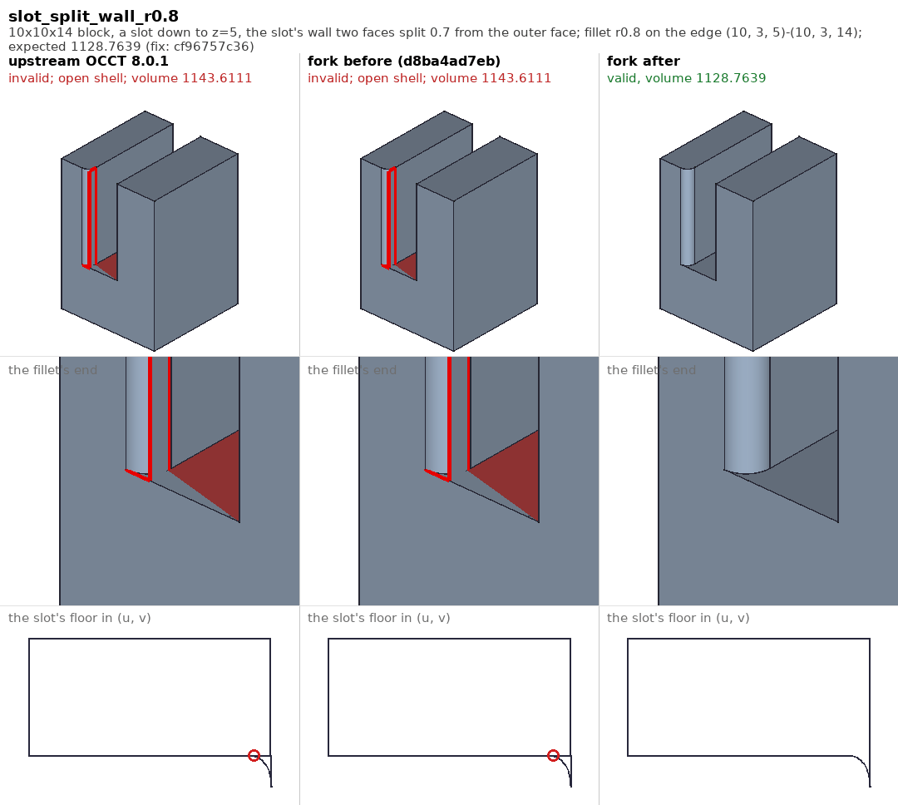
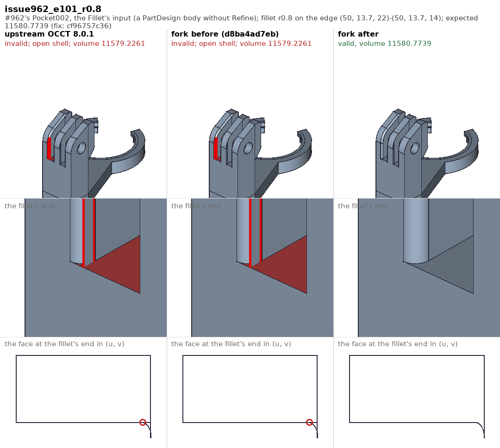

The fifth edge, 50, ends under a chamfer, and there the split is on the
other side: the wall beside the edge (y=10.2) is two faces, and the edge to
extend belongs to the other one. Its orientation in the wall was not looked
up -- it defaulted to forward -- and the wall, red, lost the fillet's line.
The third row looks the same in all three columns: the wall's outline closes
in each, and what was wrong was the direction of one of its edges, which an
outline does not show.

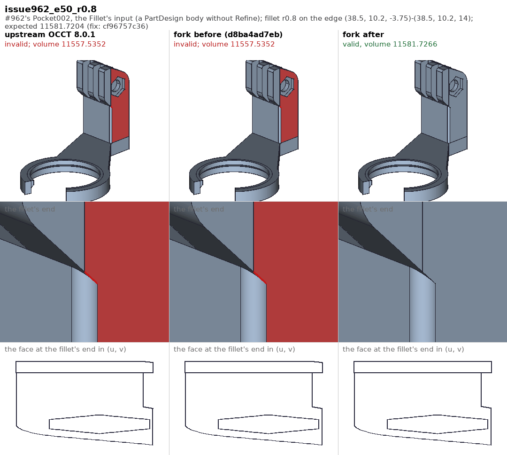

The most ordinary case of the three needs no slot: a fin padded flush with a
block's side, its vertical edge filleted down to the block. The outer face is
two faces, the fin's and the block's, split at the block's top, and the
fillet's line on the fin's face ends on that split. The corner moved that
end off the edge and gave the extension -- which runs along the split -- to
the fin's face: the fin's face, red, holds the whole split edge and no
fillet line (the third row's stray stroke). Now the end stays on the edge,
and the extension bounds the block's face. The volume was right all along;
only the faces were not.

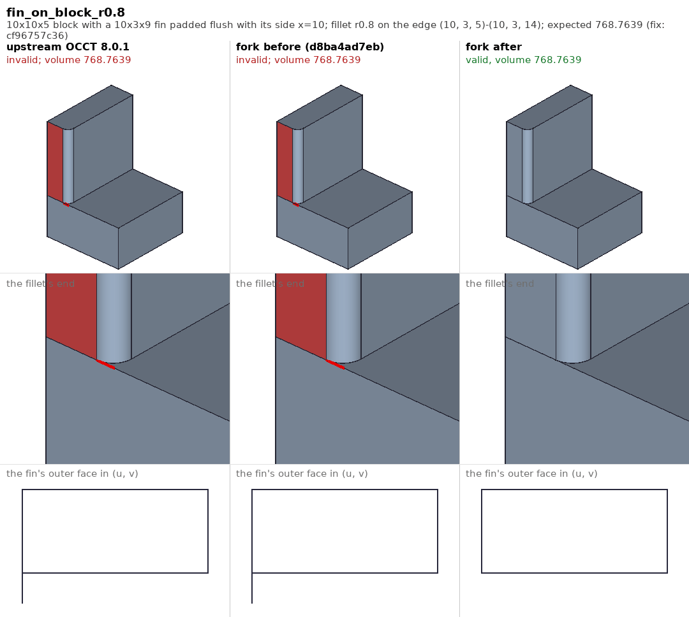

### A seam two corners cut at its two ends (`b38f0d910c`, realthunder/FreeCAD#962)

With those fixed, #962's Fillet was still invalid with all twelve edges, from
two of them: the edges at the foot of the block where the arm meets it, each
fine alone. The bottom is two faces, the arm's and the block's, split along
x=38.5. The convex fillet on one edge cuts that seam short; the concave one
on the other meets the seam's line just past its end, and the corner gave
the seam that point anyway, outside the edge -- alone the face rebuild turns
that into a longer edge, but with the other corner's cut on the same edge it
built both versions, the cut one and the longer one. In the pictures the
bottom faces are red and the arm's bottom has an extra stroke along the seam
with two loose ends. Now the piece of the seam's line past its end is a
curve of its own, and the seam is left to the other corner. It happens with
the seam running one way only, as here.

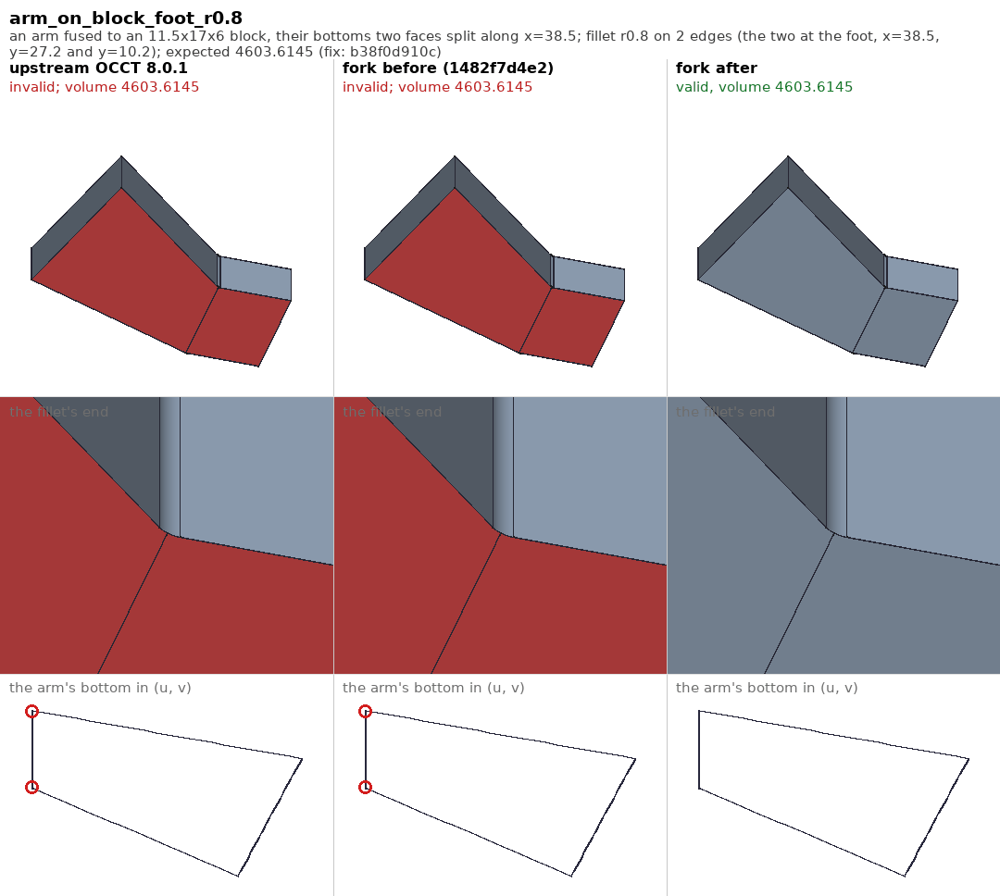
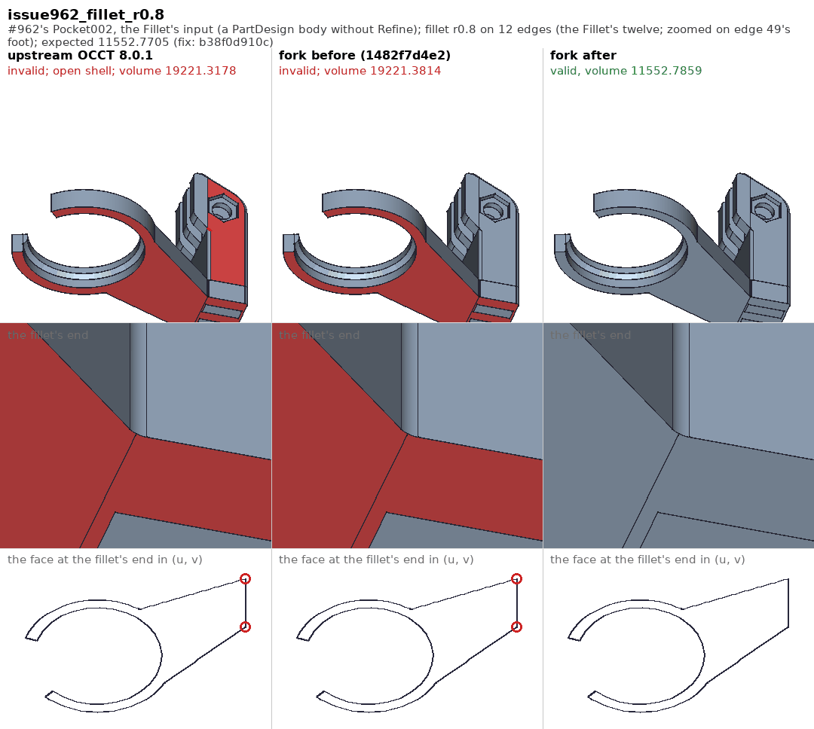

### A fillet ending on a wall kept in coplanar pieces (`2ac4fee0c6`)

The two shapes of the corner fix put together: the fin flush with the
block's side, its wall split 0.7 from the outer face as the slot's. With the
fillet wider than the wall's narrow piece, its line on the wall runs on the
wide piece, whose edge on the floor stops short of the vertex the fillet
ends at. The fillet stopped where the fin's face ends, and both the restart
of its walk and the corner took that edge for an obstacle, not for the end
of the wall: the walk failed, upstream and in the fork alike, and both
columns show the input. Now the edge counts as the wall's own, reaching
the vertex through the narrow piece, and the corner is the slot's: the
narrow piece goes, and the block's top closes around the fillet's end. The
volume is the unsplit fin's.

A radius equal to the narrow piece's width, 0.7, where the fillet's line on
the wall runs along the split itself, stayed open; see the last fix below.

### A corner plate whose boundary curve missed its first surface (`2b9df66c48`, realthunder/FreeCAD#962)

Edge 36 of #962 alone, below radius 0.42. The edge is shallow -- the arm's
side meets the block's side at 21 degrees -- and at its top five faces
meet: the arm's top, the block's wall above the arm, and the block's side
going on upward as a second, coplanar face. The fillet fills that corner
with a `GeomPlate` patch. At small radii one of the patch's boundary
curves had no projection at all on the plate's first surface, and the
projection threw where the plate would have tried another surface: upstream
and the fork alike, both columns show the input. The fix is in
`GeomPlate` (`TKGeomAlgo`), so these two columns carry upstream's and the
earlier fork's `GeomPlate` as well. Now the plate falls back on a plane, and
the patch closes the fillet's end: in the zoom, the narrow fillet strip up
the edge and the small patch at its top; in the third row, the patch's
outline, closed, with a hook where two of its boundary curves meet. The
small block is the same corner made small; it failed the same way.

The pictures' after is the fork as it is now: since the ceiling under a
wall (`0669daa0b6`, below) there is no patch at this corner, the fillet
ends exactly (the closed form's volume to 1e-6), and the third row has
no patch to draw.

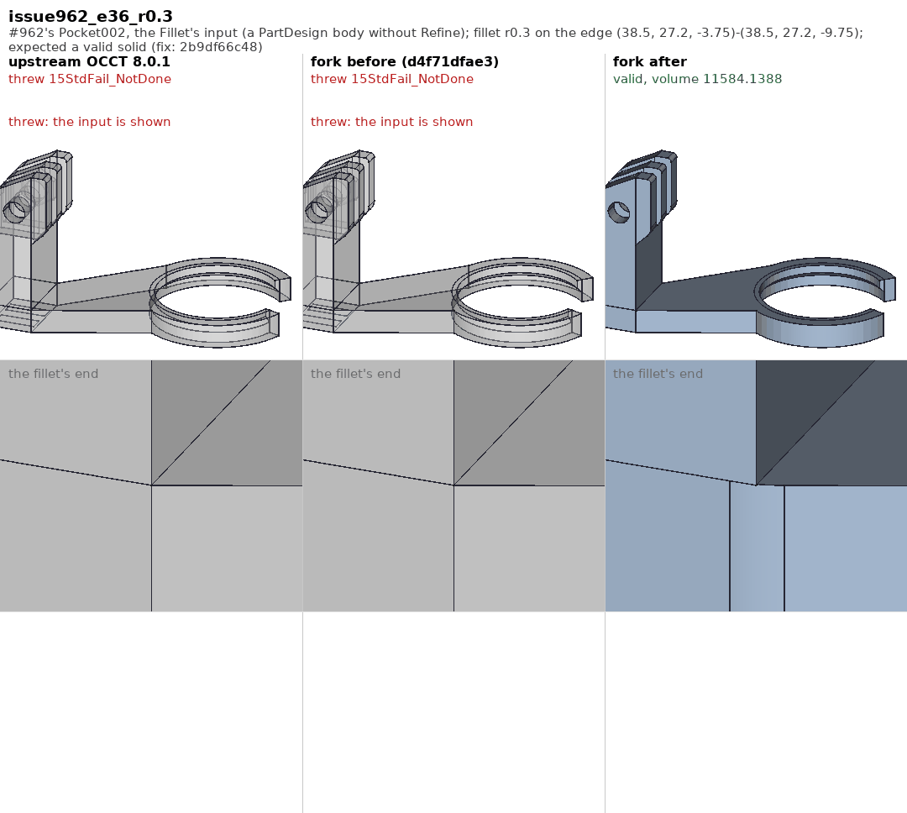
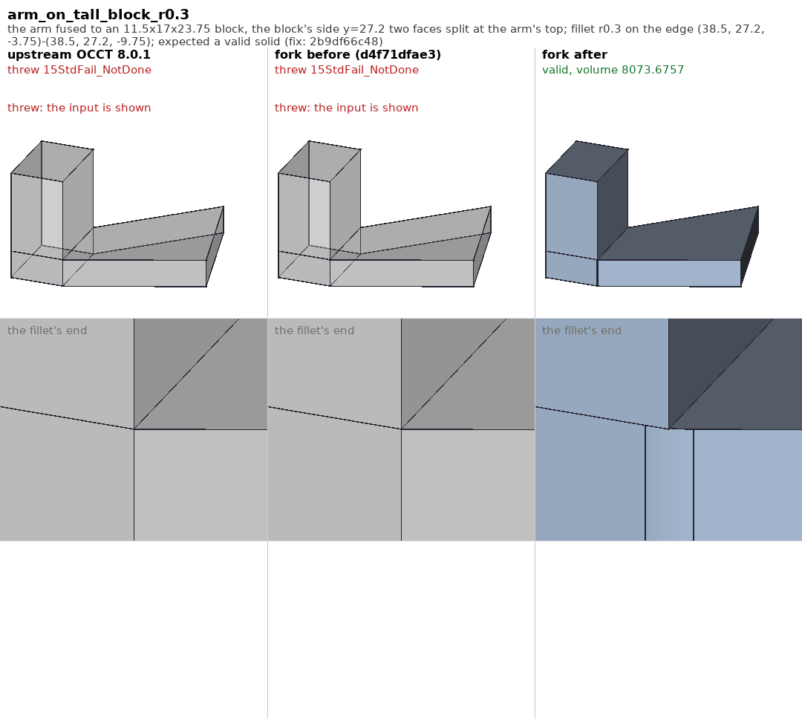

The fix lets five other fillets of the sweep get past their plate, and they
fail further on, as an invalid shape instead of an exception (see
`../README.md`). Also open: the same corner with the block's side one face
(`arm_on_tall_block_whole_r0.5`), invalid at every radius, before the fix
as after -- fixed since, below.

### A corner plate folded to stay tangent (`fb9200b0fd`, realthunder/FreeCAD#962)

Edge 56 of #962 alone gave a valid solid whose volume nobody could agree
on: 5.04 taken by GProp's default integration, 2.0 by its adaptive one,
3.5 by a mesh, where its mirror image, edge 50, takes 2.4 by all three.
Its foot is the five-face corner of the previous fix, filled by a
`GeomPlate` patch held tangent to the stripe. To stay tangent where the
stripe meets the faces at a sharp angle, the plate folded -- the lump at
the fillet's foot in the first two zooms -- missing its own boundary by
0.09 on a fillet of 0.8; its approximation then strayed 0.48, and the
corner kept edges of tolerance up to 1.18. Its control points reach so far
out that the face's bounding box is 158 across, on a corner of 0.8. Such
plates are common: of the 495 the every-edge sweep builds, 87 miss their
boundary by more than 0.1. A plate missing it by more than 1% of the
smallest radius at the corner -- a setting,
`ChFi3d_Builder::SetPlateG0FallbackRatio()`, FreeCAD's Part preference
`FilletPlateG0FallbackRatio`; at first a fixed 1e-3, which also creased
large fillets whose plates were tangent within half a percent -- is now
built again on positions alone and taken if it fits better: the foot
flares into the corner cleanly. The third row looks much the same in all
three columns -- the old outline's loop, where one pcurve crosses itself
near its end, is a few thousandths across, too small to see here; the zoom's lump is
what shows the fold. The volume is edge 50's.

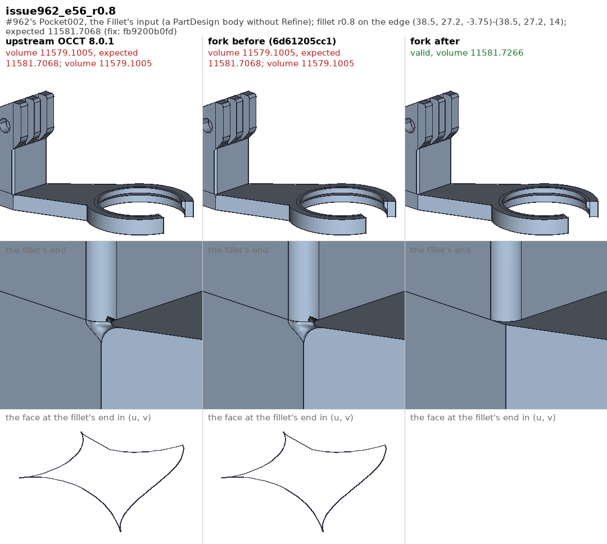

The Fillet003 input of #474 is one of the 17 results the change turns valid:
edge 6's corner plate missed by 1.8 at radius 2, its fillet was invalid at
every radius, with a face of no area and edge tolerances up to 36. In the
third row the old plate's outline is a sliver -- its boundary curves lie
almost on one line of a surface whose bounding box is 28 across, for a
corner of 0.8.

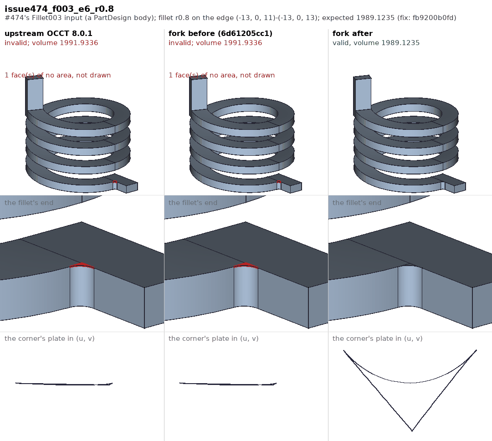

Edge 50's and #962's whole-Fillet pictures above changed with it: their
"fork after" corners are the rebuilt plates now (tolerances 0.009 where they
were 0.195). One result went the other way -- #962's edge 33 at radius 0.3,
rejected by `BRepCheck` with the new plate. That was not the plate's fault:
see the next fix.

### A plate boundary stored backwards (`3fa9420429`, realthunder/FreeCAD#962)

Edge 33 of #962, the arm's top along its side, ends at the five-face corner
under edge 50. Upstream's fillet of it at 0.3 is valid, but GProp says it
takes 9.4 of volume where 0.55 is due -- a mesh of the same result says
0.555. The corner's plate is closed by curves laid on the faces between the
stripes' ends, each stored as running from one stripe's end to the next;
one of them, the 0.3 on the block's side y=10.2, was a projection that ran
the other way and was stored as it was. Its edge had its FORWARD vertex at
its last parameter: each vertex is on the curve where it says, so
`BRepCheck` passes it, but GProp walks the edge by its range and so
backwards, and put the block's side at 62.1 of its 69. The same curve, as a
boundary of the plate, ran head to head with the one before it, and the
plate's orientation is worked out from a polygon of the boundaries' starts:
with the G0 plate of the fix above it came out turned over -- "fork before"
draws that plate as a face of no area, and the edges round it red, each
used the same way by both faces it bounds. The projection is now reversed
before it is stored, and the orientation read with the boundaries'
directions as the plate reports them.

The zoom shows the corner: upstream's is the G1 plate, dark where it
crumples, the fork's before is missing. After this fix it was the G0 plate;
the picture's after is the fork as it is now, where the corner of five edges
below (`63c8218a86`) makes this one exactly too: no plate, the fillet
meets the side, 11583.5853 where the plate gave 11583.5858, and the third
row has nothing to draw. That row, the plate's outline, looks alike in the
other two; what was wrong is a direction, which an outline does not show. The same fix gives four more edges into these corners
-- two in each of #962's Fillet and Chamfer inputs -- the volumes a mesh
gives them, and tolerances of 0.007 to 0.12 where they had the radius.

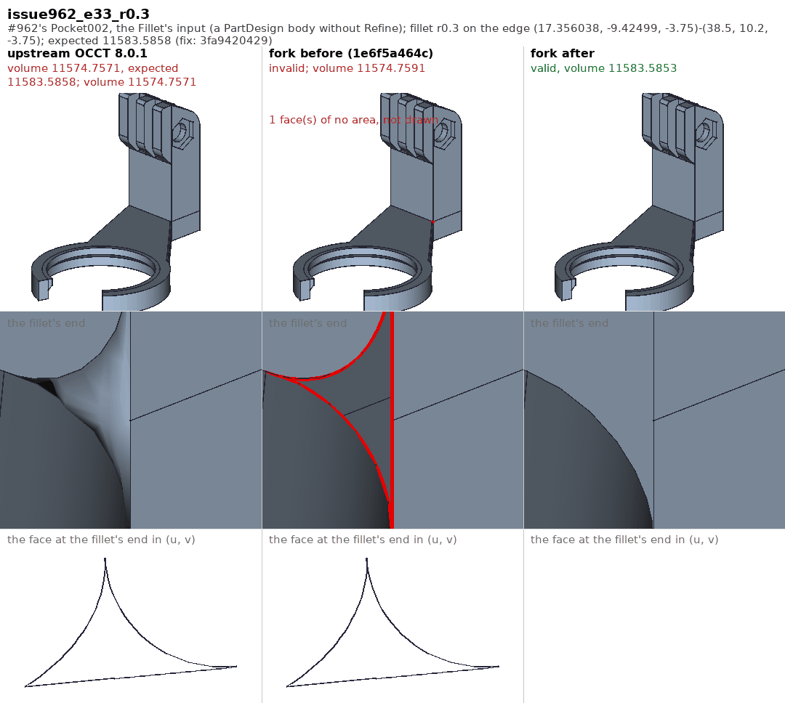

### A fillet as wide as the piece of a split wall (`98c6125b85`)

The slot and the fin of the two fixes above, their wall split 0.7 from the
outer face, at a radius within the walk's tolerance (1e-4) of 0.7: the
fillet's line on the wall runs along the split, its whole length. The walk
starts, and goes on, only at points inside both faces, and a line along
the split is on the boundary of both pieces everywhere. At 0.7 the walk
did not start: the fin's picture shows the input in both "before"
columns. Just past it, at 0.7001, it started on the wide piece, but the
line's ends fell on the split's own vertices and nothing cut the narrow
piece away: the wide piece kept the split and the fillet's line side by
side, a slit of no width, and the narrow piece stayed whole beside the
fillet. The slot's picture draws the wall red, the split's edges red, and
on the third row the block's top still holding the narrow piece's edge, a
loose end circled red. Upstream fails too, with another volume.

Now, on the far piece, a point on the split toward the piece the spine is
on counts as inside; a line along that split cuts the split away, as it
does the spine's edge; and the top corner, of three convex edges, cuts
away the narrow piece's edge on the top as the floor's corner already did.
Every radius from 0.69995 to 0.7001 gives the unsplit slot's volume, and a
chamfer of the same size, which walks the same way, comes out right with
it.

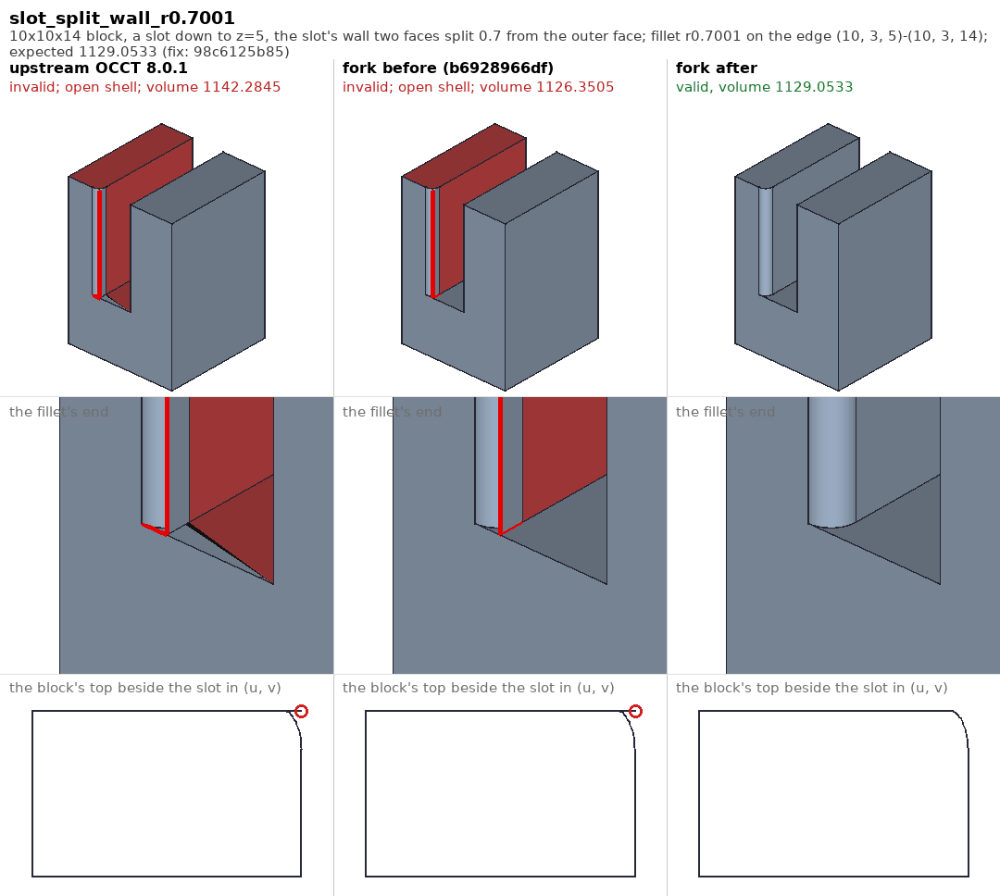
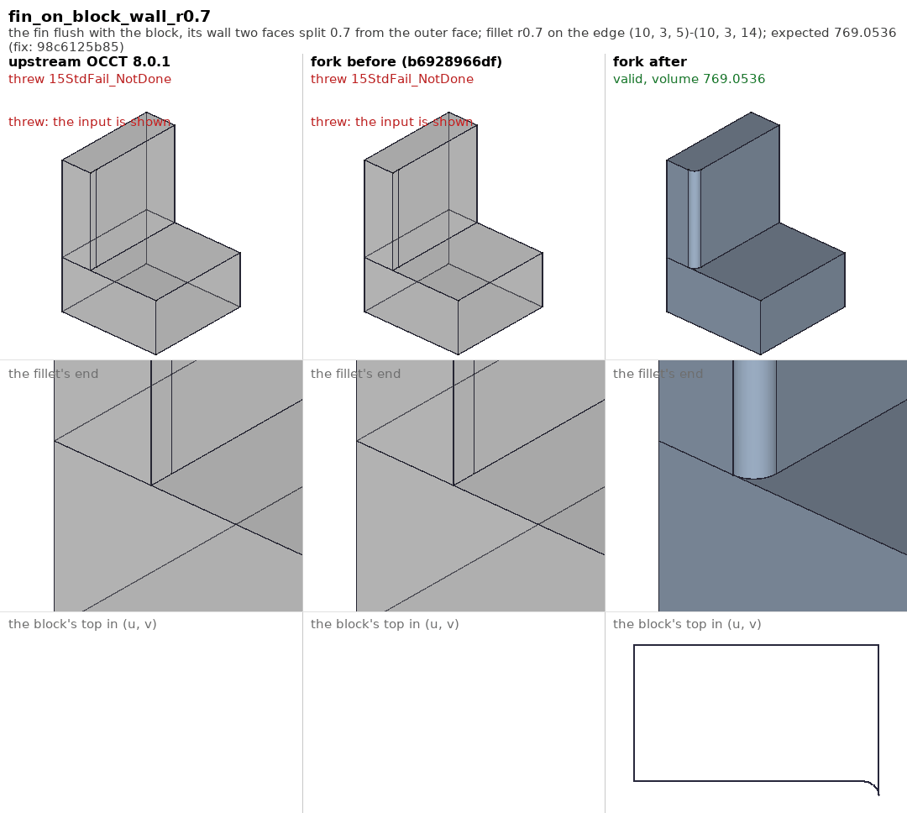

### A fillet's end under a wall that runs on past the corner (`692cae9e35`)

The small block of the plate fix above with the block's side y=27.2 left
one face, from the floor to the block's top. The fillet's line on the arm's
side stops at the arm's top; the one on the block's side runs on up the
wall. The corner stretched the arm's top out to meet it, and the arm's top
reaches under the block there: the section's arc crossed the arm top's own
edge x=38.5, and the arm top's outline crossed itself. In both "before"
columns the arm's top is drawn red, the face that fails, its shading
folded along a diagonal; zoomed on the fillet's top, it runs on as a flat
red sheet past the fillet into the block's corner. Upstream fails the same
way, with the same volume. The crossing itself is 0.375 wide at radius 2
(0.1875 r), too small to show in the third row, which draws the whole arm
top: its outline looks the same in all three columns.

Now the corner checks for that crossing first. When the arm top's other
edge runs into the corner, the line on the block's side is cut where the
arm's side ends, as a split at the arm's top would cut it, and the corner
gets the plate the split block gets: the same result to within 0.5% of
what the fillet takes -- in the zoom, the small patch where the fillet's
top meets the arm's top and the block's corner. The mirror corner, the block's edge coming down onto
the arm's top, crosses nothing -- there the stretched arm top is the
fillet's floor -- and keeps the exact plane.

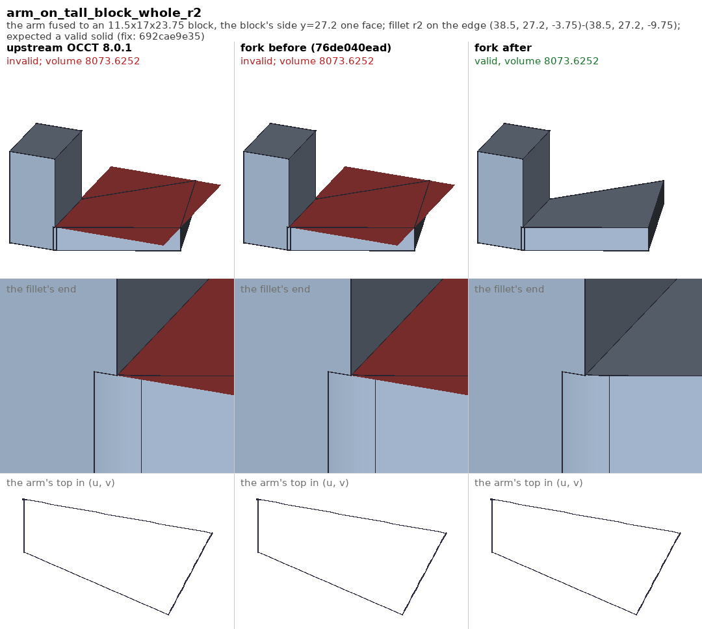

### An end point a rounding error past the line (`efbe5c99fd`, realthunder/FreeCAD#523)

The box and cylinder of the first fix, at radius 2, on the top edge across
the box's diagonal from the one ending on the seam: x=0, from the
cylinder's face at (0, 2) to (0, 10). The fillet's line on the top, x=2,
runs to the cylinder's top circle and is tangent to it at the line's very
end, the seam's vertex (2, 0, 10). The corner cuts the line with the
cylinder extended past its face, and found that point -- 6e-15 past the
line's end, where on the seam's side it fell 7e-15 inside. Thrown away, it
left the corner with nothing to cut the line with, and the fillet was
refused, upstream and in the fork alike: both "before" columns show the
input. Now a point a rounding error past an end, when none lies on the
line, is the end, and the result is the seam case's, the cap of the
cylinder running from its face's start back to the seam: in the third row,
the piece left of pi/2, down to u=0, where the cap's curve meets the
circle tangentially.

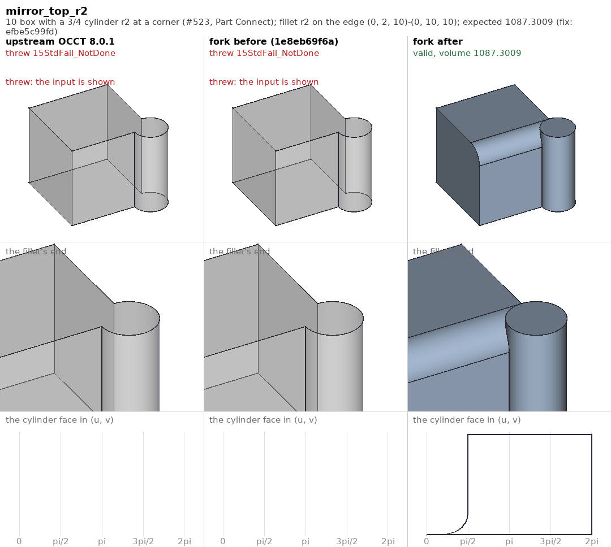

### A fillet's end on the edge where its side runs into a wall (`538ce9f99a`, realthunder/FreeCAD#876)

A post, a cylinder of radius 3, stands on a 3-thick plate whose side y=-3
runs tangent into the plate's round end under the post; the fillet is on
the plate's top edge along that side. The top pinches out between the side
and the post's base at (0,-3,3), where the edge ends, so the fillet is cut
by the post's cylinder, carried down past its face: in the zoom, the
fillet's end curving up into the post, the same in all three columns. On
the plate's side the cut ends exactly on the edge where the side turns into
the round end. The piece of that edge above it should bound the round end
and the post's wall alone; it stayed in the side face as well, whose
outline ran up to the plate's top and back down -- the spur at the top
right of the third row, before. In both "before" columns the side is drawn
red, the face that fails; upstream fails the same way. Now that piece goes
to the round end and the side stops at the fillet: the volume is the same,
the shape valid. With the post drafted 1 deg (#876's own corner) the
fillet is still refused -- next.

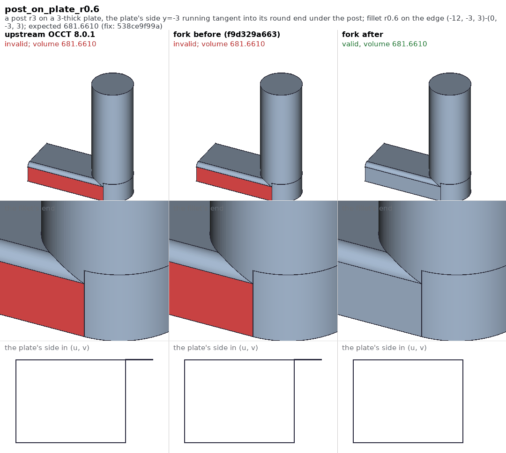

### A drafted wall at the fillet's end (`5310ff9d59`, realthunder/FreeCAD#876)

The same post drafted 1 deg, as #876's tall body is: its wall is a cone,
the round end under it still a cylinder, and the edge between them sharp.
That makes four sharp edges at the fillet's end, and an end at more than
three was a break point: the walk ran on along the post's base and the
corner went to the plate, which refused it -- "fork before" shows the
input. Upstream builds something, an open shell: in its zoom the faces at
the cut are red, and the edge round the post's base. But the plate's side
and its round end are one wall in two faces, tangent across their edge;
leave that edge out and the corner is the undrafted post's. Now the fillet
ends there against the post, cut by the cone carried on below its base: in
the zoom, the fillet's end curving up into the post as before, and in the
third row the cone's outline dipping below its base where the cut runs.
Since the side is tangent to the cone's base circle at the vertex, the side
face keeps a sliver between the cut and the round end, closing to a point
at the top -- the notch under the fillet's end in the zoom. On #876's own model two of the
drafted walls were cones trimmed at the plate's top, which kept the cut
off them; the trim is no bound now, and #876's Fillet002 (0.6) is valid,
the Pocket after it taking material away as it should.

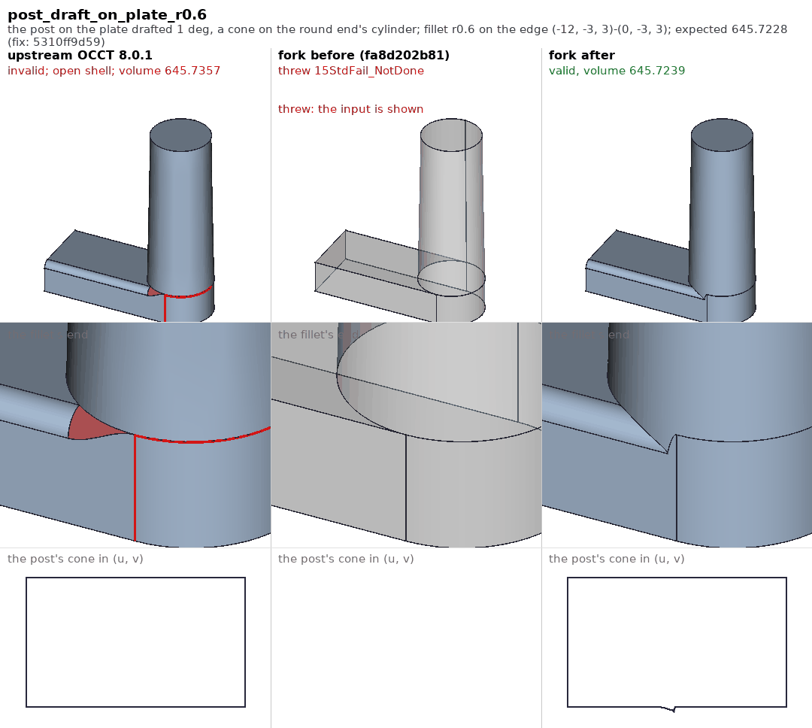

### A corner's extension on the cut's side of a seam (`c34722ef01`)

The undrafted post turned three quarters, so that its seam runs up from
the fillet's end. The cut on the post's cylinder runs round from the
post's base to the seam and ends there at u=2pi; the extension from that
end down to the vertex was put at u=0, where the edge beside it gives the
vertex its parameter. The post's outline jumped a period between the two
-- in the third row, before, the cut's end at 2pi is left open, circled
red at the bottom right -- and the face was built inside out: in both
"before" columns the post's wall is red, and the fillet takes 12 instead
of 0.87. Now the extension starts where the cut ends, the outline closes
at 2pi, and the result is the post's turned any other way. (The circles
at u=0, in all three columns, are the seam's other side: the outline draws
the seam once.)

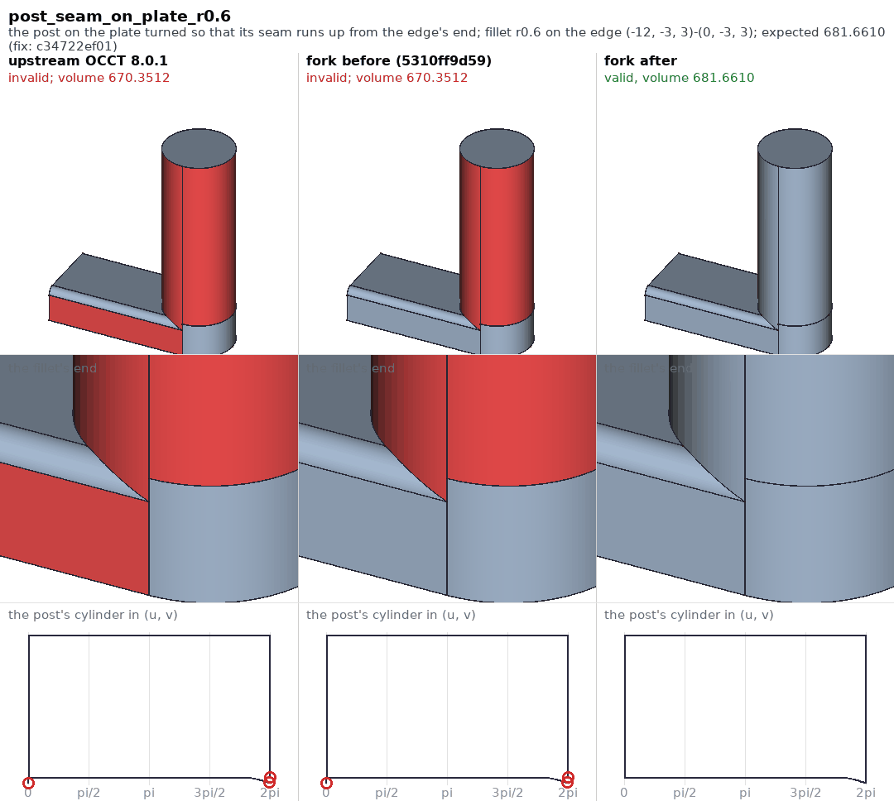

### The cut over a drafted wall's cone and plane (`2a623612a8`, realthunder/FreeCAD#876)

The tall body of #876 has its corner drafted the same way, but the corner's
cone covers only 41 deg of arc on the plate's top before the drafted
wall's plane takes over, the cone running on into the plane tangent. Made
small: the drafted post with a straight wall tangent to its cone there --
a teardrop. The fillet's line on the plate's top ends where the top does:
on the cone's base arc up to radius 0.74, on the plane's base edge past
that. The plane holds no edge of the vertex, so the corner found no edge
to carry the cut on along and gave up: both "before" columns show the
input, refused. Now the cut runs over the plane from the line's end, then
on over the cone, the two pieces meeting where the cut crosses the
cone/plane edge carried down below the plate's top -- in the zoom, the
fillet's end rising into the post across the dark plane and the light
cone, with the notch at the side as before. The third row is the plane's
outline: at its bottom left the cone/plane edge runs on a little below
the base, and the cut's piece on the plane brings it back to the base
edge -- the kink. The volume matches the corner prism outside the post
carried on below its base to 1e-5. On #876's Fillet002 this makes radius
0.8 to 2 (refused before); at 1.2 with a fix to the tolerance of the
vertex at a corner's curve end (`d45fc2c2b6`). With the post's faces
B-splines, the cut's end on the side must lie beside the cone's arc
(`8c91316949`): the B-spline cone carried on can meet the side again far
off.

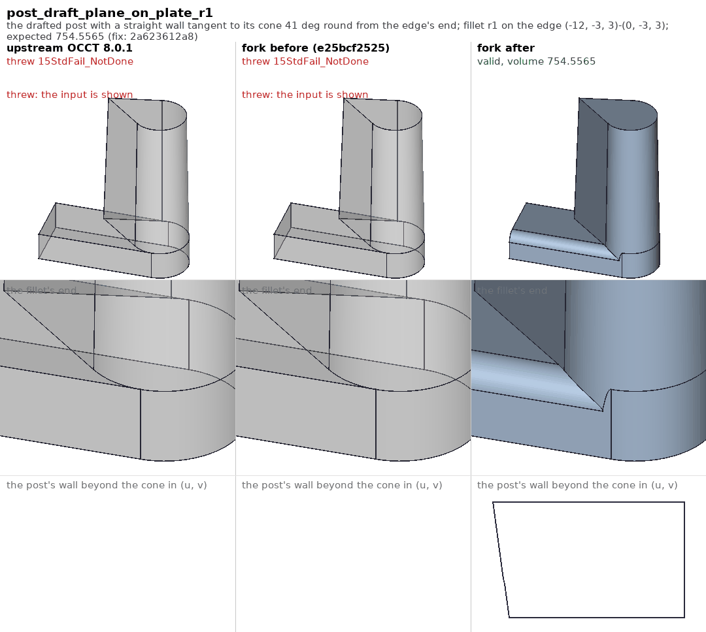

### A failed corner set back (`0ff4092766`, realthunder/FreeCAD_assembly3#894)

Where a fillet fails at a corner, the fork now computes it again with that
corner set back: the fillets there stop short of the vertex along their
edges, and the opening is closed by one patch tangent to them -- the setback
corner of the "Blend Corner" request, used here as a fallback. It tries
where the fillets meet first, then 1, 1.5 and 2 times the radius, and keeps
the first result that is valid, valid again once written and read back, has
no edge looser than the input's or a twentieth of the radius, no face of no
area, and every fillet asked for in it; otherwise the fillet fails as it
did. Nothing made before changes. Design and measurements: fcad's
`docs/CornerBlending.md`, section 9; FreeCAD's Part preference
`FilletCornerSetbackFallback` (0 turns it off).

The first Fillet input of #876, the four edges at the corner (17,16.75,3):
the fork threw (`Standard_ProgramError`, a stripe's end without a point at the
far corner, (-17,16.75,3)) and upstream refused. Now both corners are set
back where their fillets meet. In the zoom, the vertical fillet and the
one along the base stop short of the corner, and the patch closes it. Its
outline is the third row: six edges -- the ends of those two fillets (1.41
and 1.46), a curve on each of the two plane walls (1.50), and the ends of
the other two fillets (0.0175 each), which run along edges between walls a
degree apart and are all but flat: the outline's left end, where they meet.
Those walls being so nearly flat, the volume moves by thousandths. The red
mark by the left hole is the input's own: the holes' seam edges are stored
once, not once each way round.

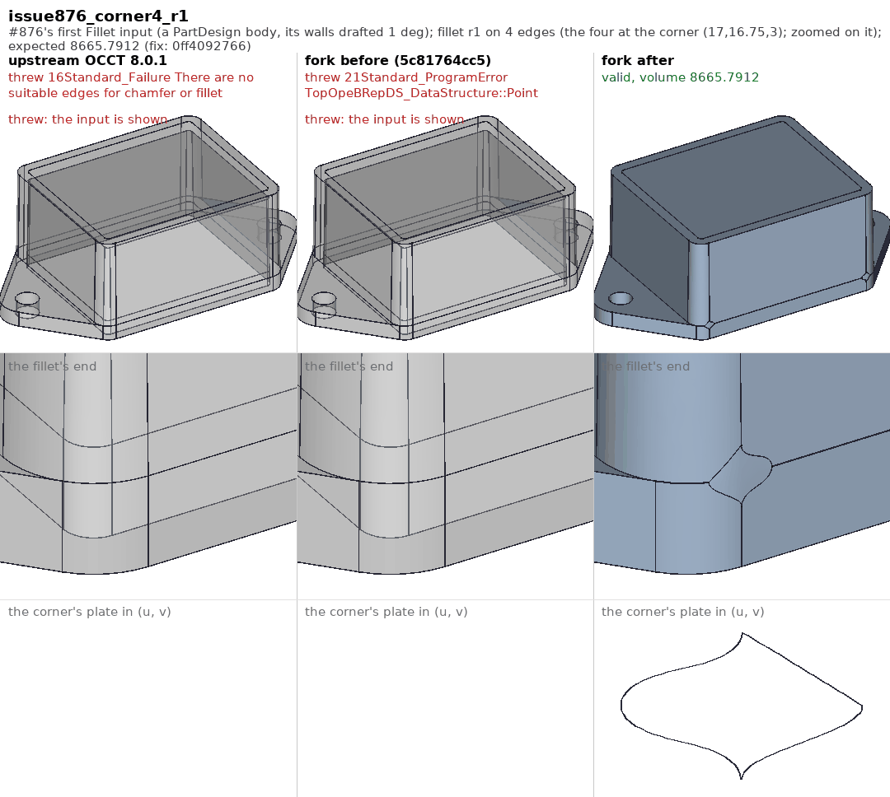

The box and cylinder of #523 past the cylinder's radius, the end refused as
a cut over two faces ("bouchon non ecrit") by the fork before and upstream
alike. At radius 2.5 the fillet stops one radius short of the corner (at
x = 4.5), and the patch blends on into the cylinder's top and down the
box's side: four edges, the fillet's end (its quarter circle), a curve on
the top, one on the side and the cylinder's. Valid, and close to the fillet
run on to the cylinder (that fillet, the boolean's, is 1083.3063; this is
1087.9914).

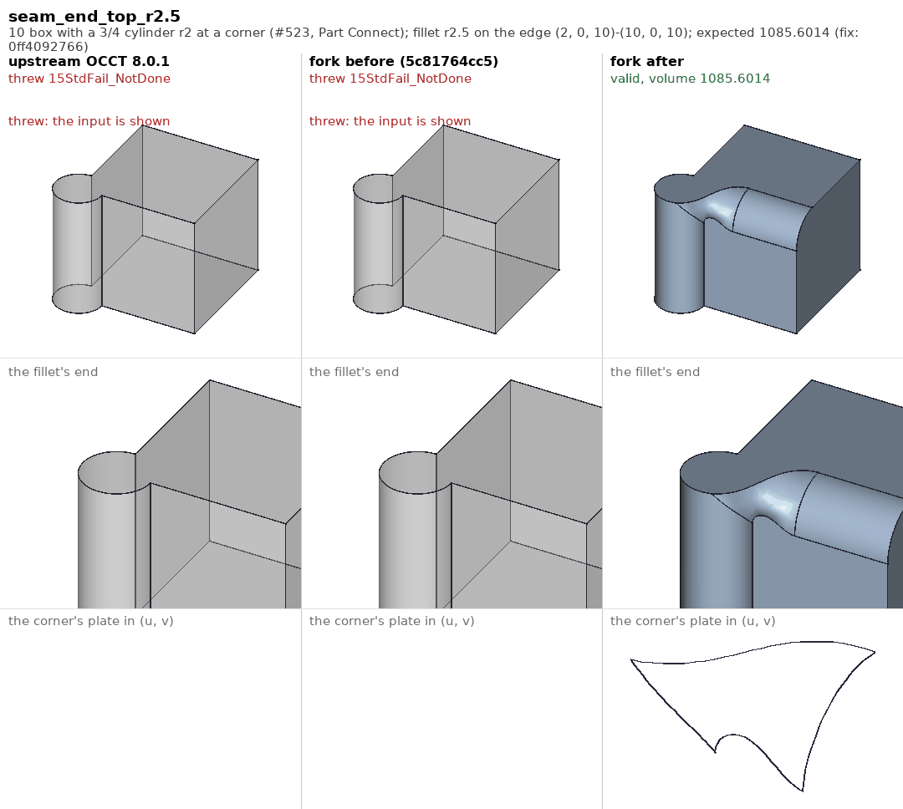

At radius 3 the same, the fillet stopping at x = 5 (1086.0296, against the
run-on fillet's 1078.3294). Both pictures were drawn again after later
changes to the fallback moved them -- the patch approximated to its own
boundary rather than to the plate, and the end of its curve on the box's
side freed from a right angle to its chord (`../README.md`). Before those,
radius 2.5 had a notch in the patch's curve on the side (1085.6014), and at
radius 3 the nearer setbacks left edges too loose and only twice the radius
passed: what was left of the fillet was its last 2 of 8, the rest a patch
scooped from the cylinder's top down the box's side (1072.1768).

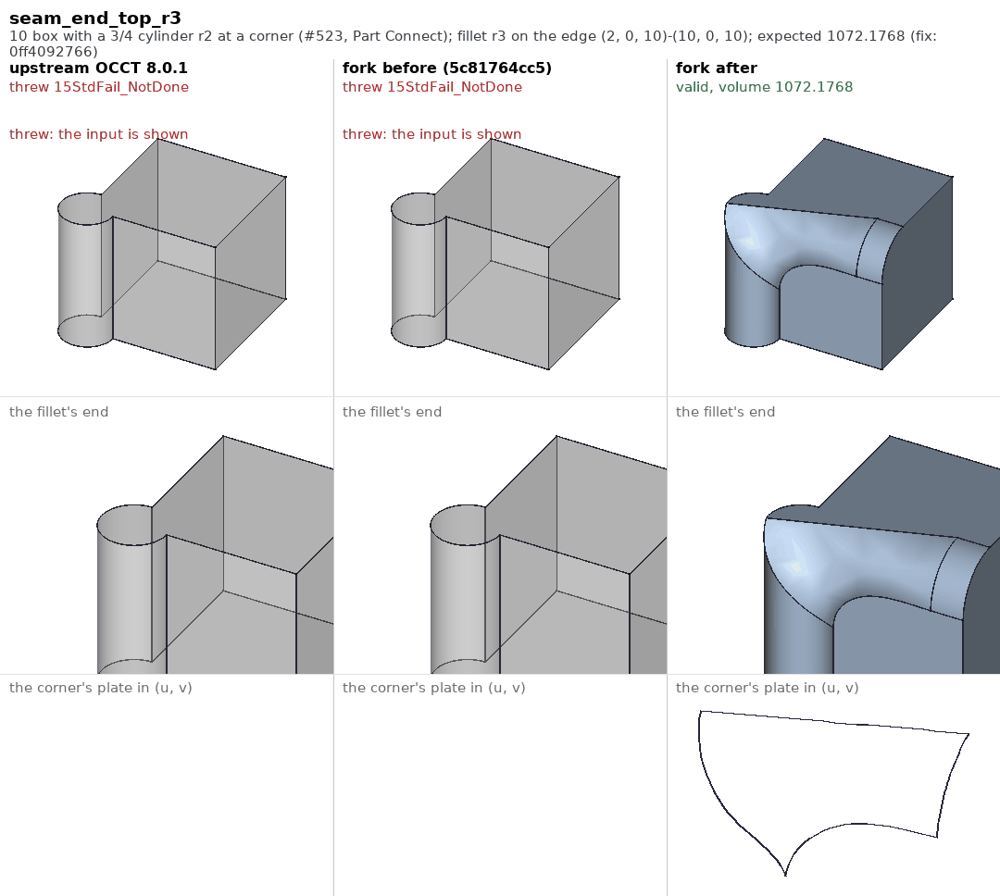

### A fillet's line over a wall kept in coplanar pieces (`9c44789bbb`, realthunder/FreeCAD#962)

The model of #962 has a rib whose flat top ends on a face sloping down. The
rib's side wall is two coplanar faces, split by a vertical edge where the slope
has come down to 31.886, 0.364 under the top. The fillet on the top's edge
along the wall: from that radius on, its line on the wall runs under the
slope's edge with the first piece, crosses the split and meets the slope on
the second piece. The walk stops at the edge's end with that side still in
the face, the corner found no face at the end for its two points, and the
end was left to the intersection at end, whose plate was a little off below
radius 0.8 (0.017 at 0.7, "valid") and invalid from it: in the "before"
columns the first piece and the slope are red, the second piece is kept
whole under the fillet, and the end is a small patch.

Now the line is carried on: it crosses one edge of its face into a piece
of the same plane, the same way up, and meets the slope on an edge of that
piece, so the end is cut as on a wall in one face, and the line is stored
in two, on each piece. In the zoom the fillet runs on past the split line
to the slope; the third row is the second piece, which now has the line's
short piece along its bottom right, from the split to the slope. The end
agrees with the same fillet on the shape refined (`removeSplitter`) to
1e-7 at every radius from 0.3 to 0.95 (a chamfer to 1e-13). The edge's
other end, at the rib's foot, is four edges whose wall line crosses the
same split onto the block's top; it is the next section.

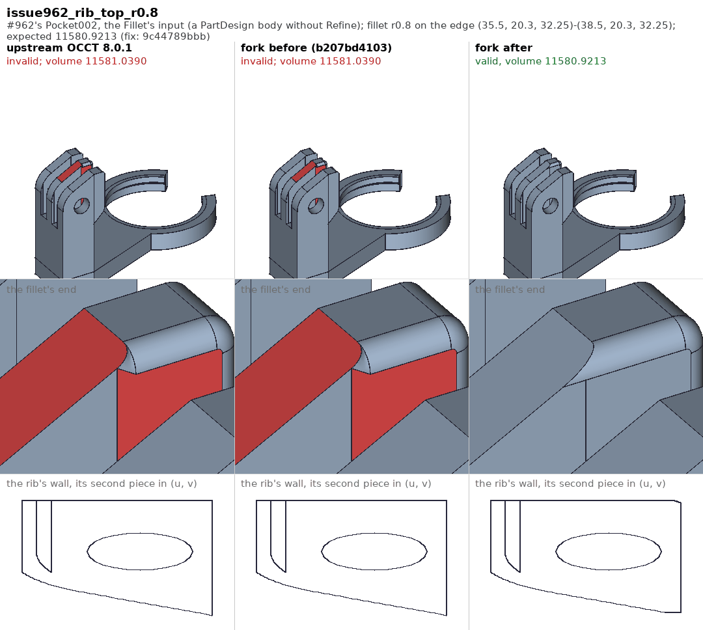

The same made small: a prism whose top slopes down past x=4, its front wall
split at x=5, filleted along the top's front edge. The volume taken is the
fillet's cross-section swept from the far end to the slope, in closed form,
and the result matches it at every radius tried, the edge either way round
and the second piece either way up on its plane (#962's is upside down,
which turns the line's transitions over).

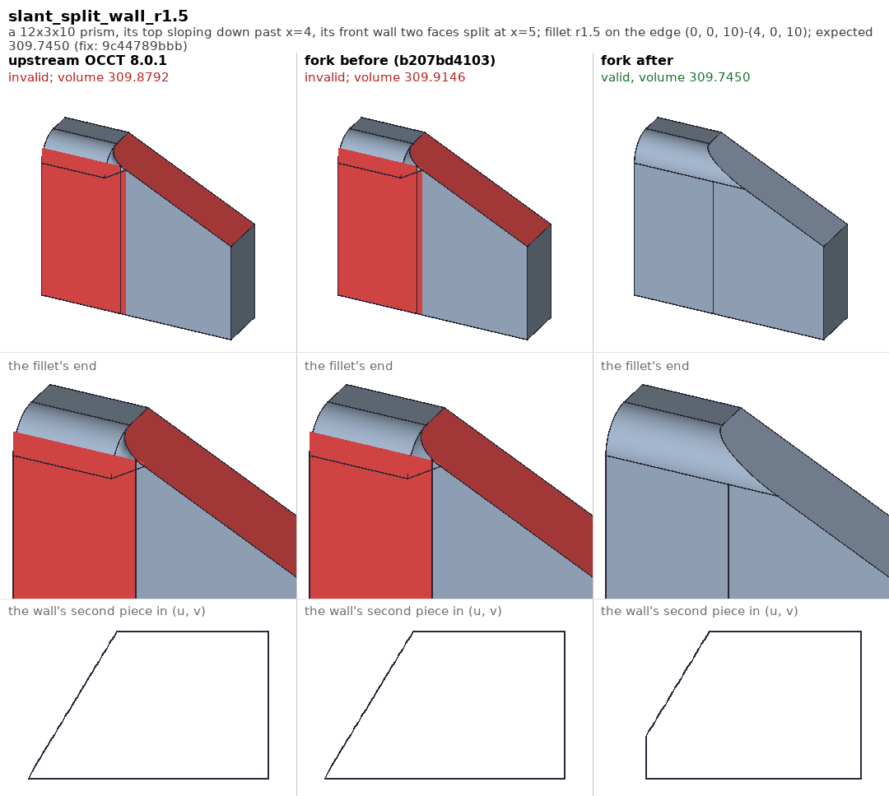

### The same line at a corner of four edges (`7a1fbeffb3`, realthunder/FreeCAD#962)

The rib's chain ends at the rib's foot: its last edge, the wall against
the 45 deg underside of the rib's overhang, comes down to the block's top,
and four edges meet there -- the fillet's, the underside's with the
block's side, the side's with the top, the top's with the wall. Such an
end is cut by the faces around the vertex, from the edge the fillet's line
on one side ends on to the edge its line on the other side ends on. Here
the wall is two coplanar faces, split just past the foot: from radius
0.493 on, the wall's line meets the block's top on the far piece's edge,
which does not reach the vertex. The corner searched the faces at the
vertex for that edge, found none, and took the end for a cap that is not
written: from 0.986 the fillet failed, and below it the end was made off
by up to 0.09 (the exact fillet's line stopped at the split, and the walk
past the end with it).

Now that edge is recognised as the one the edge of the vertex carries on
across the split's foot, and the end is cut as on a wall in one face:
over the block's side and on over its top, the edge of the vertex beside
the split -- under the fillet whole -- left out. Where the line stops in
the first piece, it is carried over the split as at the rib's top. In the
pictures the "before" columns are the input, refused; after, the fillet
runs down the underside's edge and its end lies flat in the block's top,
which grows past its old edge to meet it: the third row is that face, its
bite the end's ellipse. The end matches the refined shape to 1e-5 at every
radius from 0.3 to 3 -- through 0.9852 to 0.9868 as well, where the
split crosses the line within 1e-3 of the spine's end (since `bdaa69edc6`
on the far side of the end, and since the split no longer cuts a sliver
off the line on the near side) -- the chamfer exactly.

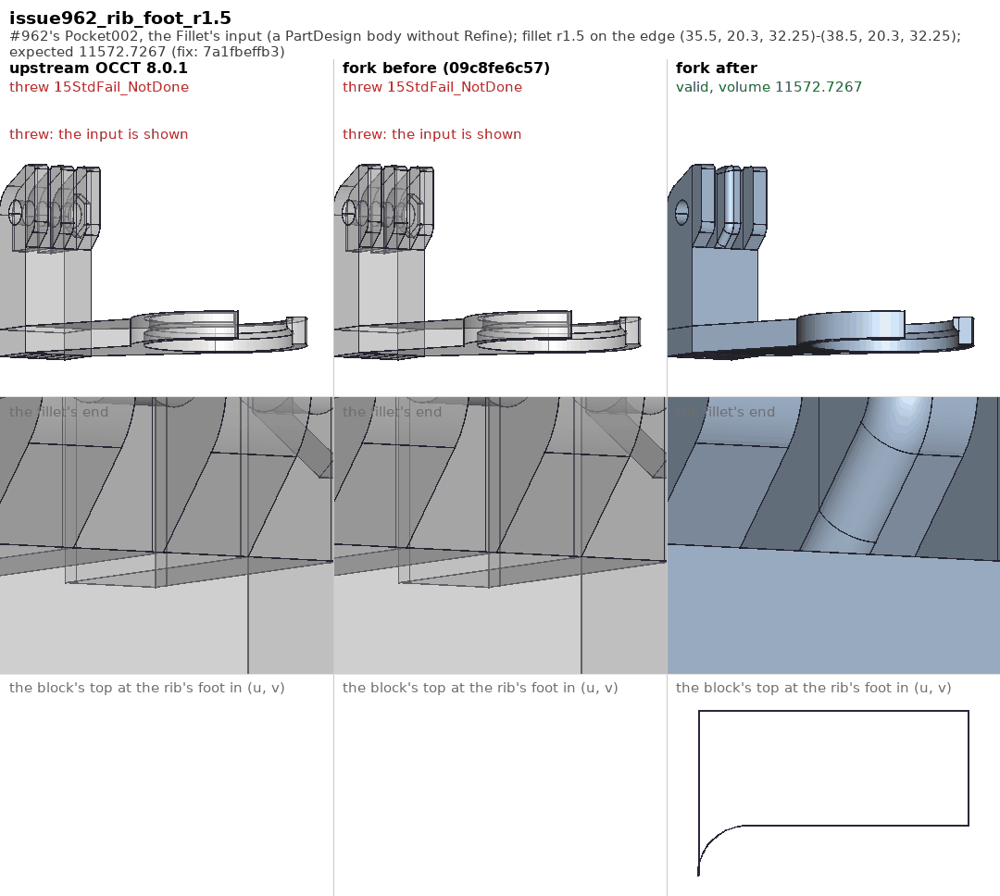

The same made small: a rib with a 45 deg underside standing on a block,
its front wall split at x=1. The fillet's cross-section swept between the
underside's end and the block's top, in closed form, is what it takes, at
every radius tried, either way round; the chamfer's likewise.

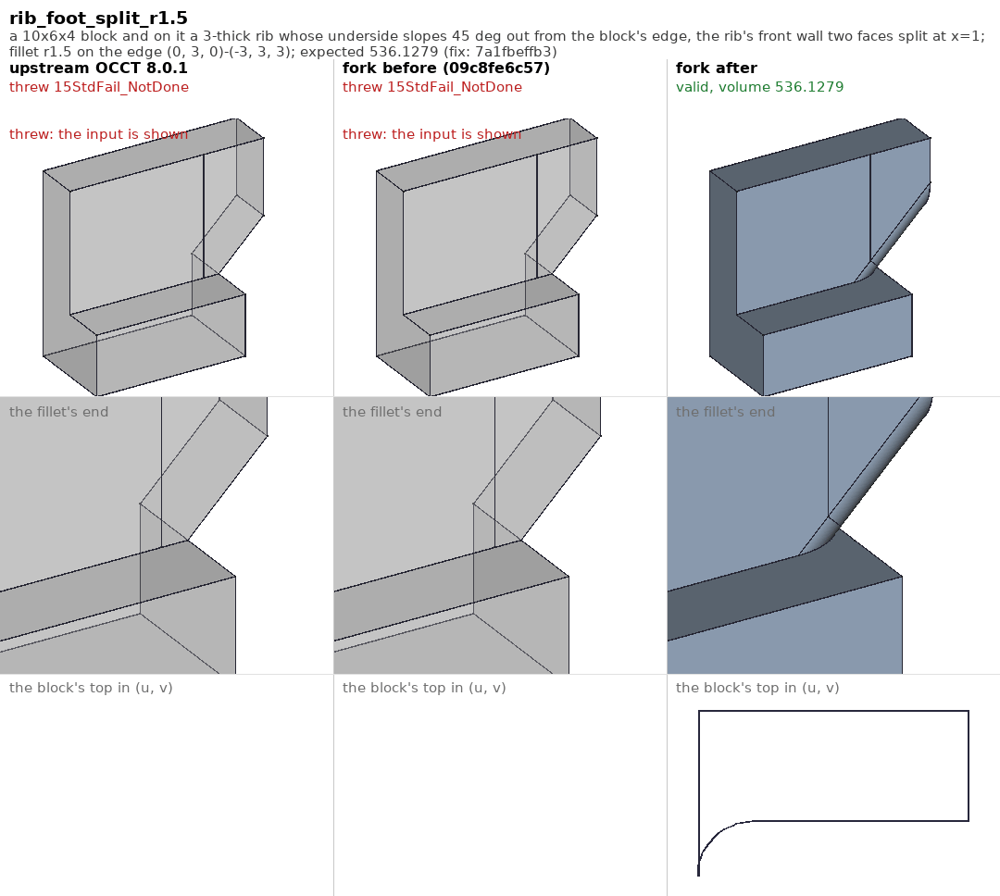

### A flag read before it was set (`09c8fe6c57`, realthunder/FreeCAD#474)

Where a fillet ends at four edges on a B-spline face, the corner extends
that face's surface to cut the fillet on it -- once, and not when the flag
it passes says the surface is extended already. The flag was never set to
zero first: what the stack held decided whether the surface was extended.
The Fillet003 input of #474, edge 51, ends so on a B-spline face, and it was
refused at every radius; it found the stack non-zero. It showed when the
change above moved other results of the same input without running any of
its own code. Now the flag starts at zero, as everywhere else. The
material the fillet takes is its cross-section times the edge's length to
0.1%.

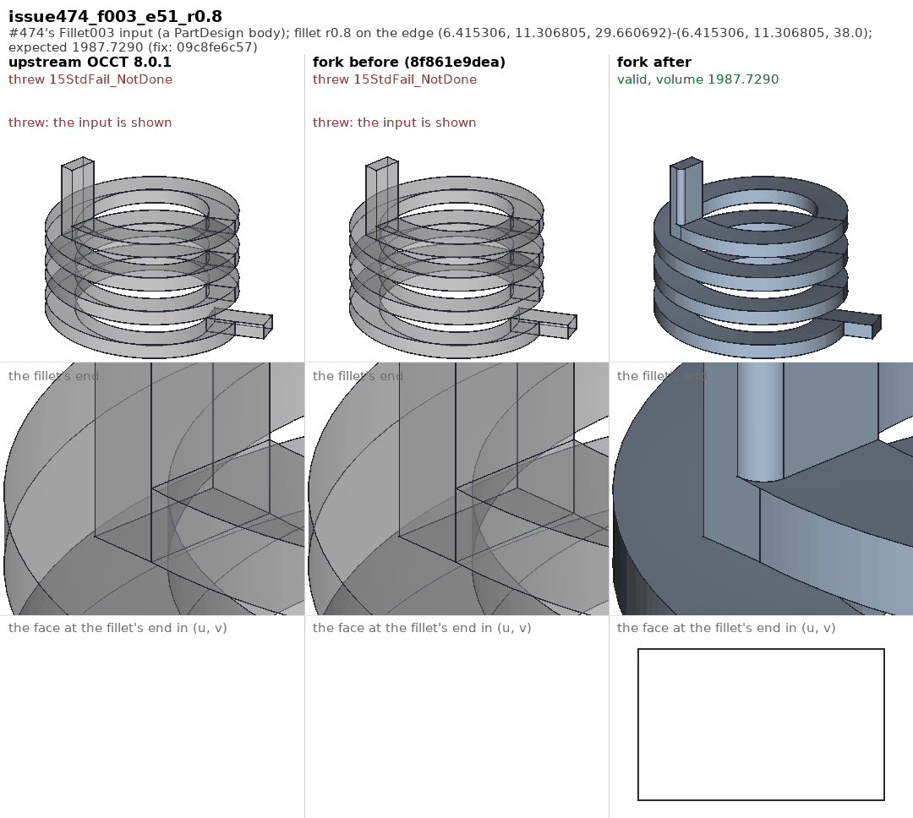

### A spine extended past a corner by the radius (`fff5d20907`)

The rib foot in miniature of the section before last, at radius 2.5. A
fillet's walk runs on past the vertex at its end, and the corner cuts it
back; the spine is extended for that by half its length. This edge is 4.24
long, and the wall's line, carried over the split to the block's top, needs
the walk past the vertex by the radius: from 2.25 on it fell short, and
the corner at the foot was refused, upstream and in the fork alike -- both
"before" columns show the input. Extending every such spine further moved
results made before, so it is a fallback: a fillet that failed, with an
end at a corner on edges short for its radius, is computed again with
those ends extended 1.5 radius, and kept only if valid with every fillet
made; nothing made before changes. In the zoom the fillet runs the whole
underside and its foot lies in the block's top past the split; the third
row is the top, the end's ellipse cut into its corner. The volume is the
closed form's, at 2.3 and 2.8 as well.

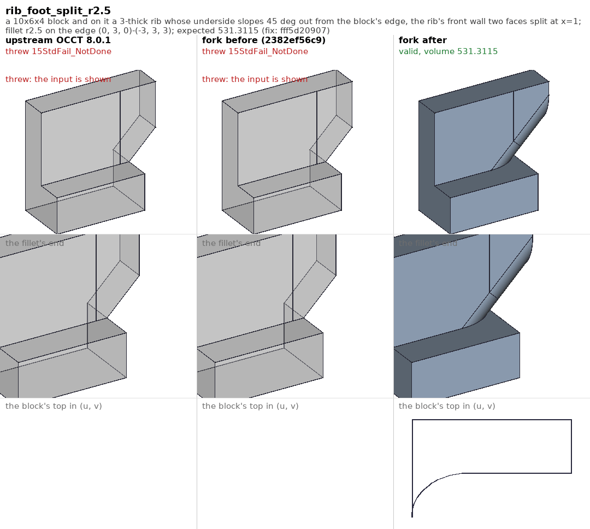

### A corner's curve kept on its face (`8704591b60`, realthunder/FreeCAD#523)

The bottom edges of the box and cylinder at radius 2, the one ending on the
seam and its mirror image. The corner's curve on the cylinder ends at the
cylinder's far vertex, tangent to the bottom circle, and leaves it at fourth
order; its approximation ran up to 1.6e-9 below the face there, a pole
1.1e-6 past the circle, and BRepCheck found the wire crossing itself (the
tops did the same; BRepCheck happened not to see it). The curve is now
refined towards that end and its poles past the circle put on it, the one
next to the end 1e-8 inside: within the hull of its poles it stays on the
face, and leaves the circle at an angle. The shape does not move -- it was
right, its wire was not: the fork's "before" column is the same shape with
the cylinder face red, and its (u, v) outline the same. Upstream's column
is the seam case's old result (1070.5458, invalid) and, across the
diagonal, a refusal. Both bottoms are valid at the tops' volume.

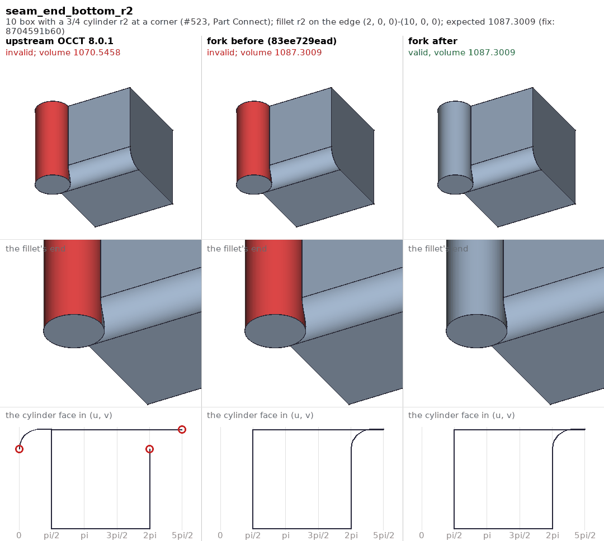
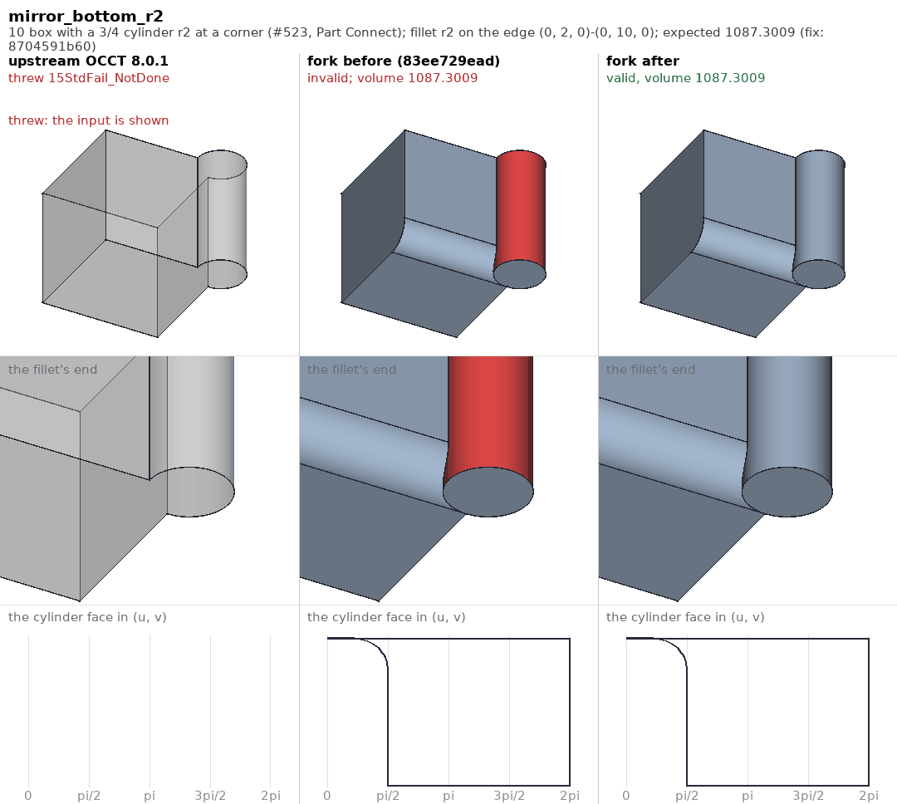

### A split a sliver inside the line's end (`b9e95d0e71`, realthunder/FreeCAD#962)

The rib's foot of "The same line at a corner of four edges", at radii just
above 0.98571, where the wall's line at the edge's end lies on the split.
The exact fillet along the underside's edge is cut where its line on the
wall meets the split, and there that is inside the edge, 4.4e-5 to 6.4e-4
short of its end: a sliver of the exact fillet, then a walk from the cut
back past the end. The underside's line leaves its face exactly at the end,
so the walk began within its tolerance of that face's edge: at 0.9862 and
0.9863 it could not take a first step (refused), and from 0.9865 to 0.9868
it reached the edge and went on past it at a fifth of the sliver's length,
a step under the walk's own idea of two points being one: it stopped at
once, and the end was made of what there was. At 0.9865, the picture's
radius, upstream refuses the fillet (its column shows the input); the
fork's before is invalid, two shells and a face of no area -- in the zoom
the wedge at the fillet's foot is red, and the block's top in the third row
is left open where the fillet's end should bite into it. Now, at the
spine's end, a line is not cut
at a split of its wall that close to where the other line's piece ends: it
runs on over the coplanar piece, as where the split is past the end, and is
carried over the split at the end. Every radius from 0.985 to 1 matches the
refined shape to 3e-6.

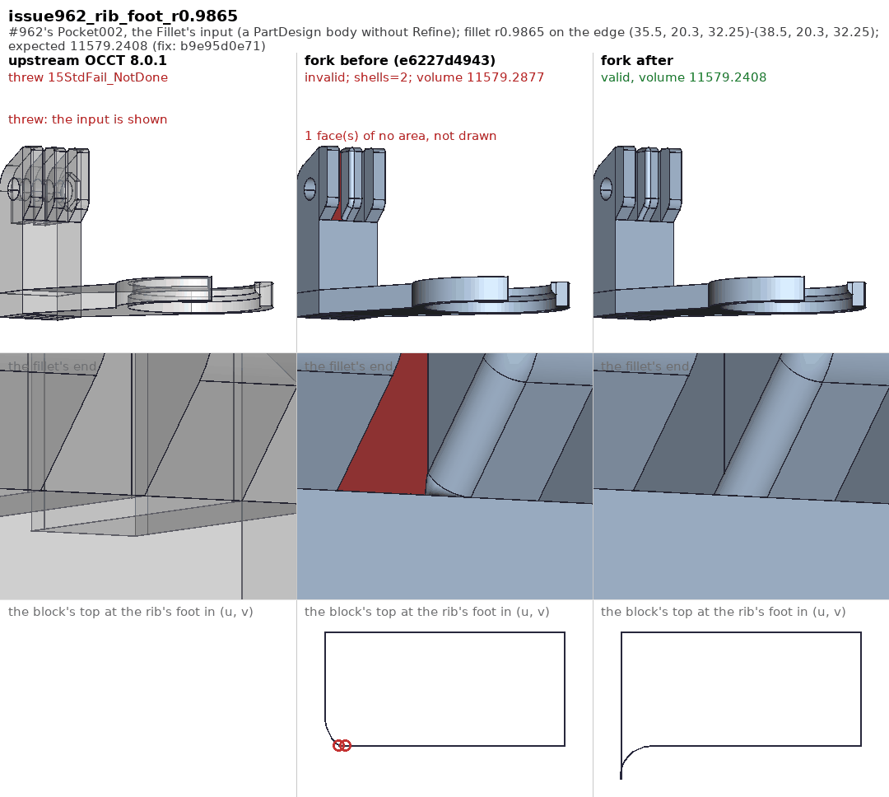

### A face that is two regions touching at a point (`40ba54dcdf`, realthunder/FreeCAD#523)

The box and cylinder at radius 2 once more, the fillet's line on the top
tangent to the cylinder's circle at its far vertex. What is left of the top
is the box's rectangle and the cylinder's whole disc, which touch at that
vertex alone; the corner put a vertex of its own there, 4e-15 from the
cylinder's, and the top was one face whose wire passed through the point
twice, once at each. BRepCheck took it; BOP's argument check called both
vertices self-intersecting -- a boolean on the result could fail on it --
and made one vertex, the wire is unorientable. The result is now touched
after the build: where a face's one wire passes a point twice at two
vertices, one of them the input's, at one point of its parameters, and each
loop from there bounds a region, the corner's vertex is replaced by the
input's and the face split into the two regions, its history -- what the
input's top became, and each face the fillet made -- carried to the pieces.
The cylinder's face holds the same two vertices a period apart in u, as at a
seam, and is only given the one vertex. The views look the same in all three
columns (upstream's cylinder is red for the old seam fault); the third row
is the top: before, one outline, the rectangle with the disc hanging from
its corner; after, the rectangle alone, the disc a face of its own. The volume does not move, and
all four r=2 results, tops and bottoms, pass BOP's check.

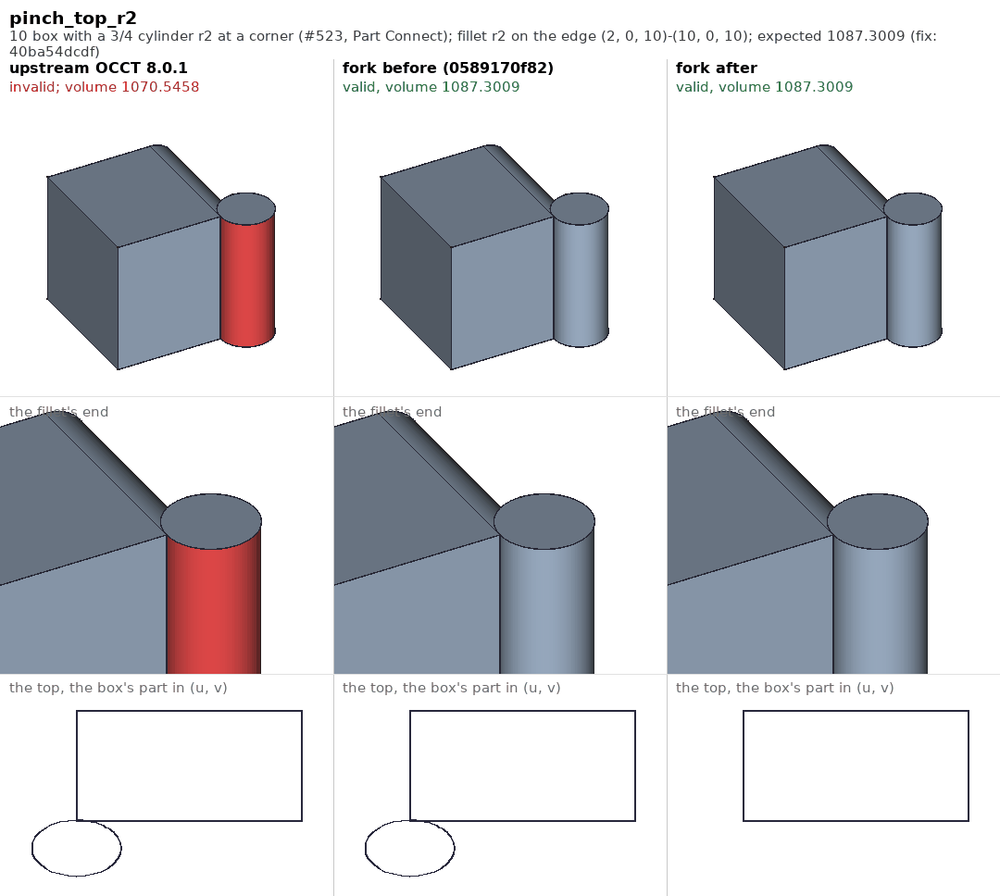

### A corner of five edges, two of them in line (`63c8218a86`, realthunder/FreeCAD#962)

The sweep's invalid results were sorted by one question: is the same
fillet invalid on the shape refined? For 32 of the 40 on single edges it
is -- upstream's behaviour on that geometry. Eight are invalid only on the
shape in pieces, and five of them are one corner of #962: where the arm's
top meets the block's wall, at (38.5,10.2,-3.75). The block's side and the
arm's foot below the top are one plane in two faces, split along the top's
level; the edge up the wall and the edge down the arm's slanting side are
one line, on either side of the two. That makes five edges at the vertex.
On the refined shape there are four, two of them in line, and the corner's
code knows that case: the fillet cuts only the face that is not between
the two, and the face between them takes the piece of that line from the
vertex to the fillet's end.

In pieces, each face at the end was cut for itself, and the fillet's
section in the pieces' plane came out twice, there and back.
In the picture (radius 0.8, the wall's edge) upstream and the fork before
agree: the volume is right and the solid invalid, the fillet and the
block's side below the arm's top red. The zoom is on the vertex: a black
sliver where the fillet's face runs down the section's arc and up again.
The third row is that lower piece of the side: its rectangle with a tab on
its corner, the arc and the line up the wall, where its wire crosses
itself. After, the fillet runs past the wall's end to the arm's slanting
side and is cut by it, and the lower piece is its rectangle.
Now coplanar pieces between two edges in line count as the one face.

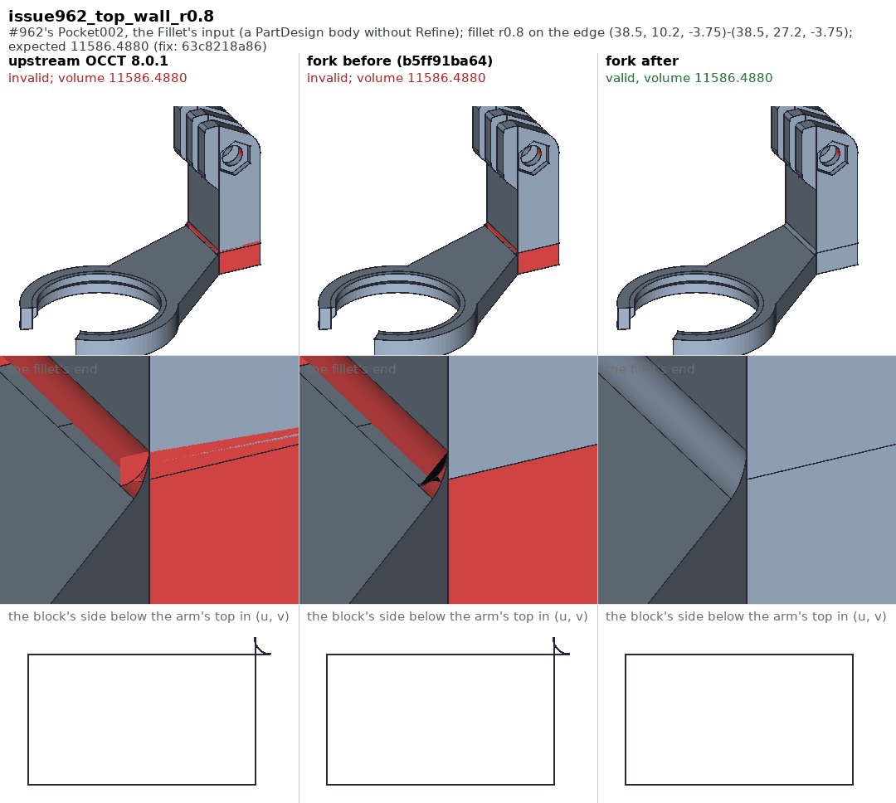

The corner in miniature: a block on a base whose outline turns at the
block's corner. The fillet runs on past the wall's end to the base's
slanting side, which cuts it off, and the volume has a closed form.
Upstream, at 0.8, makes a valid solid 0.094 too large with a dent beside
the vertex. The fork before refused that end and made it with the corner
setback fallback -- a small patch, 5e-3 too much, edges at a tolerance of
0.023; at 2 it was invalid as on #962. After: the fillet cut by the
slanting side, the volume the closed form's.

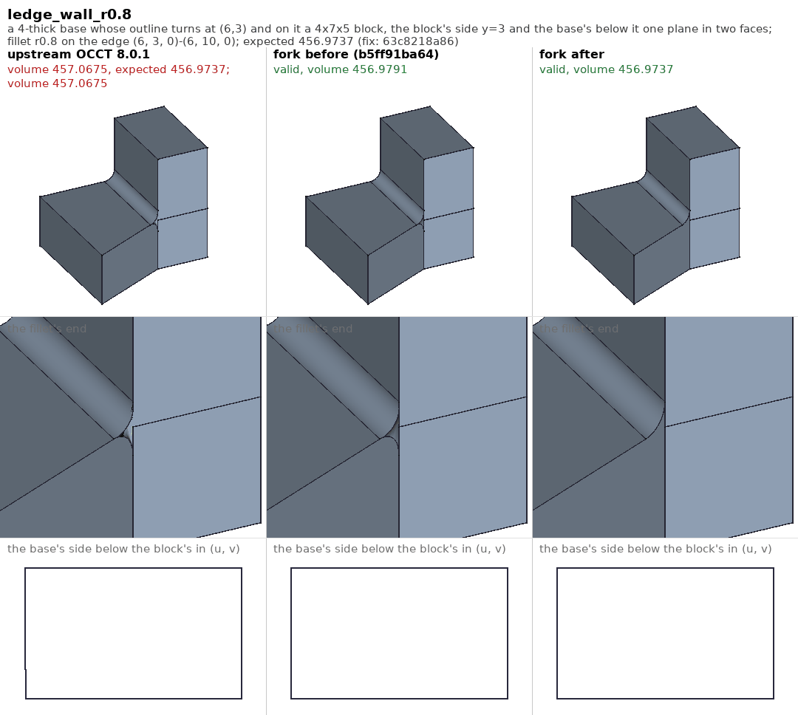

### A long edge crossed close to the corner (`356bfb48a7`, realthunder/FreeCAD#474)

The input of #474's Fillet002, the vertical edge beside the helical ramp.
At its top two faces of the ramp meet in an edge that winds 82 round the axis, and
the fillet crosses that edge a quarter of a unit from the vertex. The
corner looked for the crossing on the edge's whole curve, which is sampled
too coarsely for it, and took the edge for one the fillet misses: the two
ramp faces were intersected anew and the piece of their line from the
vertex to the fillet laid on top of the edge, which stayed whole. On the
refined shape that was a spike both faces ran up and down, valid for
BRepCheck and self-intersecting for BOP's check. With the edge under the
fillet in two pieces the piece kept of the new line was the wrong one --
the vertex was found on it a turn of the ramp away -- and the rest of the
line, 81 long, was kept.
Before, the ramp's two faces are red, 707 of volume too much, and in the
zoom their edges fan out from the vertex over the ramp's underside; the
third row marks the vertex where the ramp face's outline fails.
Now, when the whole curve shows no crossing, the piece of it near the
vertex is tried, and the edge is cut where the fillet crosses it.

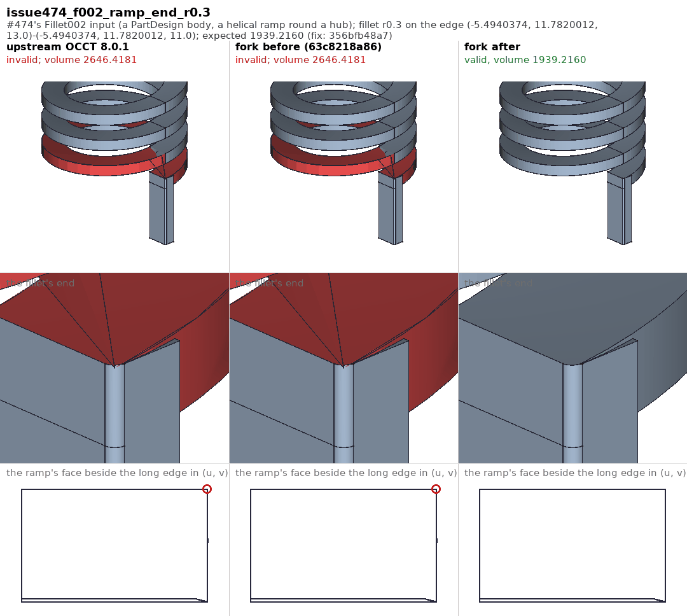

### The closing edge of a corner over a split (`29d7d4d038`, realthunder/FreeCAD#962)

The mouth of the hexagonal pocket in #962's block: its edge lies 0.3 from
the split of the block's side in two coplanar pieces, and at radius 0.8 the
fillet's line on the side lies on the piece beyond the split. At either end
the pocket's next wall cuts the fillet, and the edge between that wall and
the side is carried on from the corner to the line's end -- the edge that
closes the fillet's end. It starts in the pocket's piece and crosses the
split, and was put on the line's piece whole.
Before, the shell is open: the side's piece beside the pocket's is red, and
in the third row its outline has a notch whose two short edges stop in the
air (the circles) -- they belong, half each, to the pocket's piece. The
zoom shows the fillet's strip torn along the split.
It is now stored in two parts, each on its piece, and the split is cut
where it crosses.

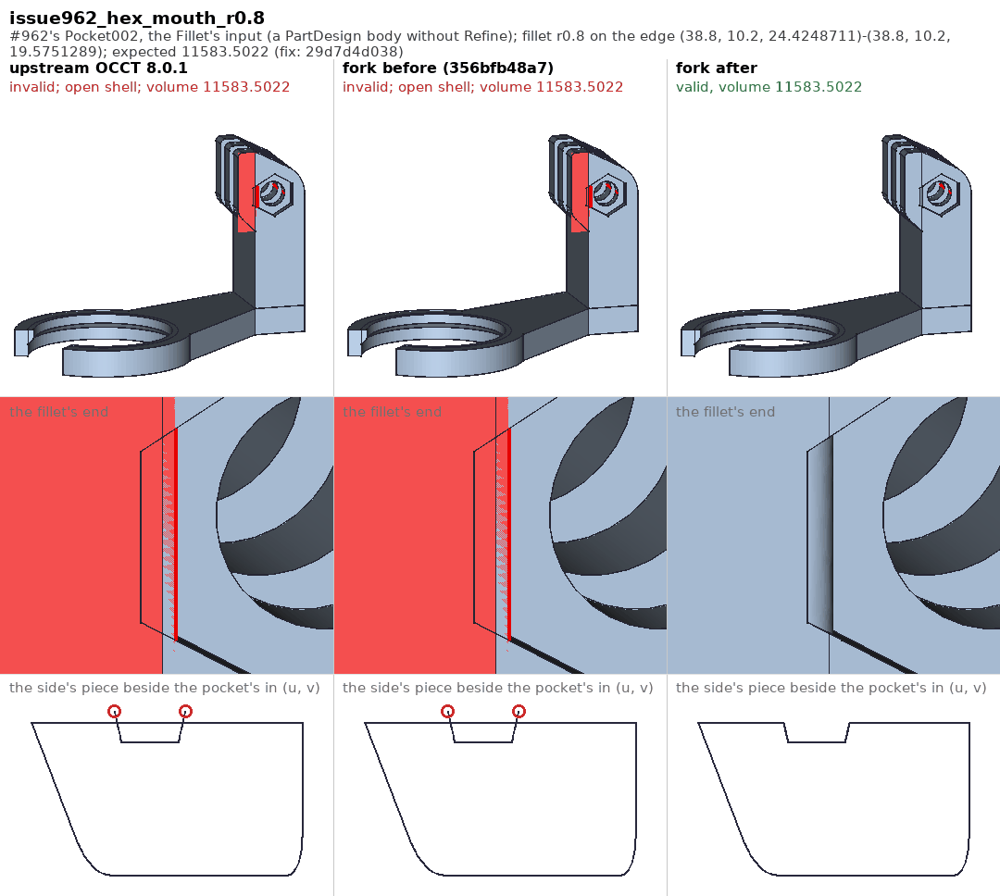

The mouth in miniature, a pocket 0.3 from a split of a box's front:
the front's far piece red, its notch open in the third row, 5.8 of volume
too much; after, the fillet across the split, the far piece's notch closed
and the split cut where the closing edges cross it.

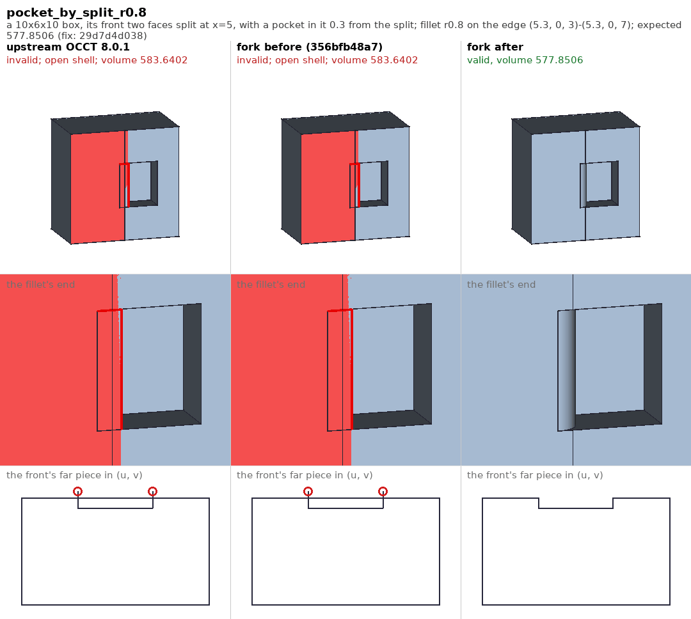

### A fillet as wide as its piece, once more (`c6e2cb496f`, `839d7b46cb`, `f7464716c0`)

At radius 0.3 the fillet's line on the pocket's front runs along the split
itself. The walk takes a point on a split for a point of the far piece
(above, "A fillet as wide as the piece of a split wall") -- but did not
see the split on faces REVERSED in the shell, and a box's front is one: the
fillet was refused on the box as built, and made, wrong, on its mirror
image. With the split seen, the closing edge lies in the pocket's piece
whole and ends on the split, which is cut there.
Before the fillet is refused (the input is shown); after, the fillet's edge
on the front is the split itself, and the far piece, in the third row, is
left whole.

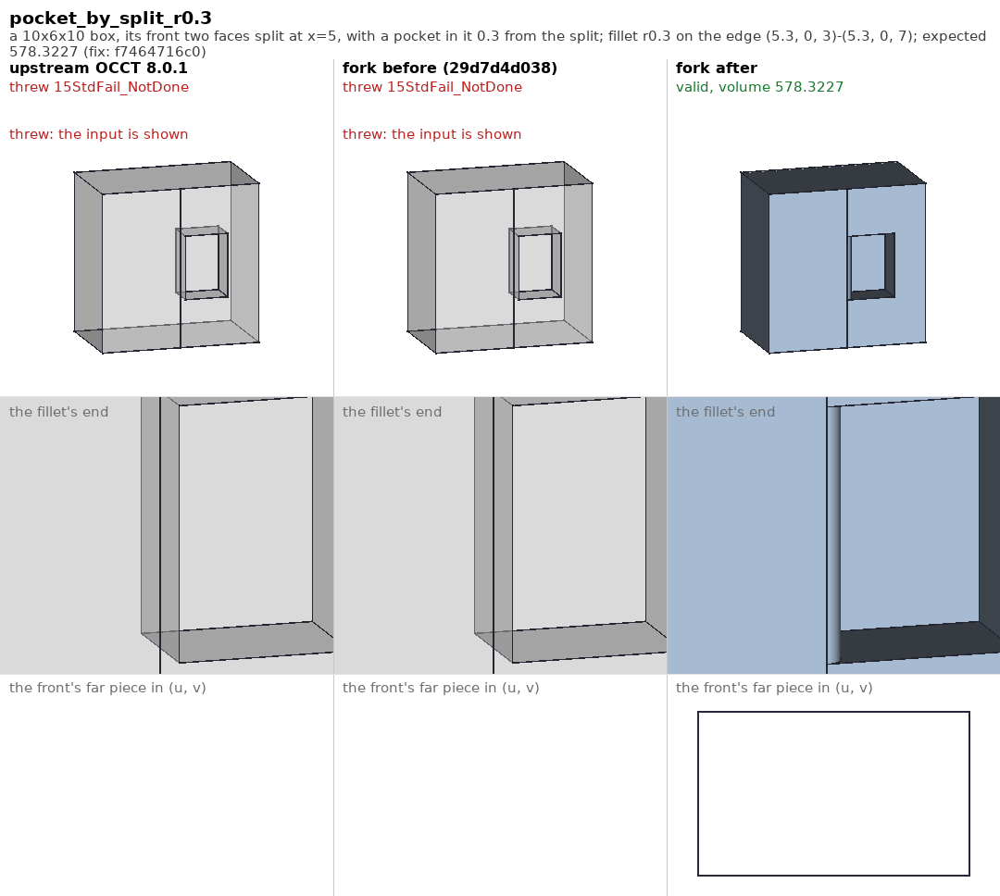

A box whose bottom is split 2 from its edge, the end faces split there
too, filleted at 2: the bottom's piece goes under the fillet whole. The
walk, on the far piece, ended at the split's end vertex on that piece's own
edge, which is no edge of the corner, and the corner was made by the wrong
routine: the near end piece cut, its edge under the fillet left in place.
The line's end is now put on the corner's own edge to that vertex.
Refused before; after, the bottom's strip and the side's edge are gone
under the fillet, and the end face's near piece, in the third row, keeps
what the fillet's arc leaves of it.

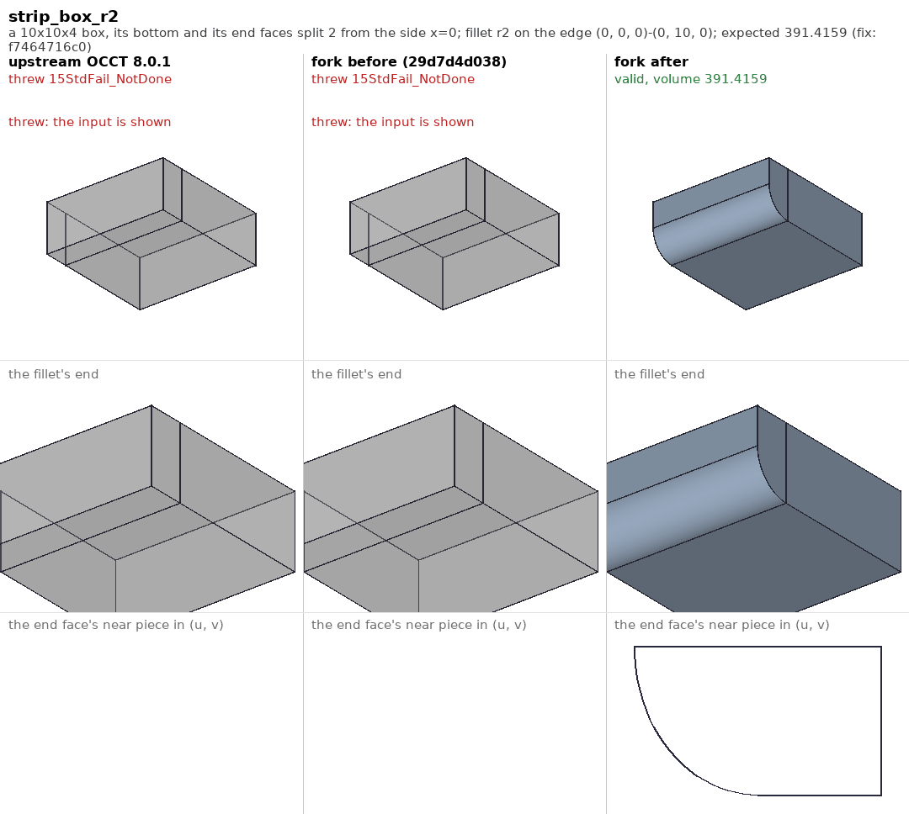

One more thing came with these. A stripe whose walk stops where its face
ends, short of the spine's end, was taken for whole, and the corner at the
far end made of it; such a fillet was refused only when another corner
failed first. A stripe that stops short by more than ten times its width
and half the spine's edge it stops on is now refused outright (#309's edge
3 at radius 2, which the refined shape refuses as well).

### Two fillets of opposite concavity where a split ends (`93759f6d56`)

Two edges filleted together at a vertex where a split of the wall ends, the
one concave, the other convex. The corner between the two fillets is a
three-sided patch, and one of its sides lies in the plane of the face
across the convex fillet -- from that fillet's line on the face to the
point where the concave one ends on an edge of it. With that face in two
pieces, the edge it ends on belongs to the other piece, and the patch's
side was put on the first piece alone.

The slotted block, its outer face split below the slot's floor: the slot's
floor edge and its wall's edge on the outer face. Before, the outer face's
piece below the wall is red, the shell open; the third row shows its
outline running out at two ends (the circles) -- along the wall's old edge,
which the fillet has taken, and down past the split, where the patch's side
stops on the floor's edge, no edge of this piece.
The patch's side passes the split by, through what the concave fillet
adds. The piece of the floor's edge from the vertex to the patch is now
an edge between the two pieces, and the first piece closes along it.

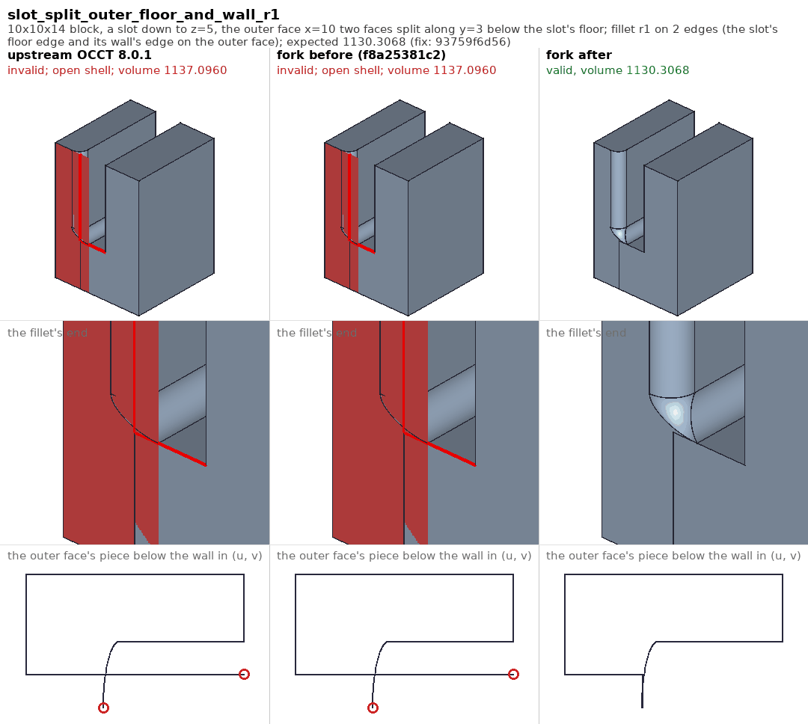

The arm on the block, where they meet at 137 degrees and their tops are
two pieces: the upright edge between them and the block's top edge. Here
the patch's side crosses the split itself. Before, the block's top is red
and its outline open at both ends of the patch's side. The side is now cut
where it crosses, a part on each piece, and the split is cut there.

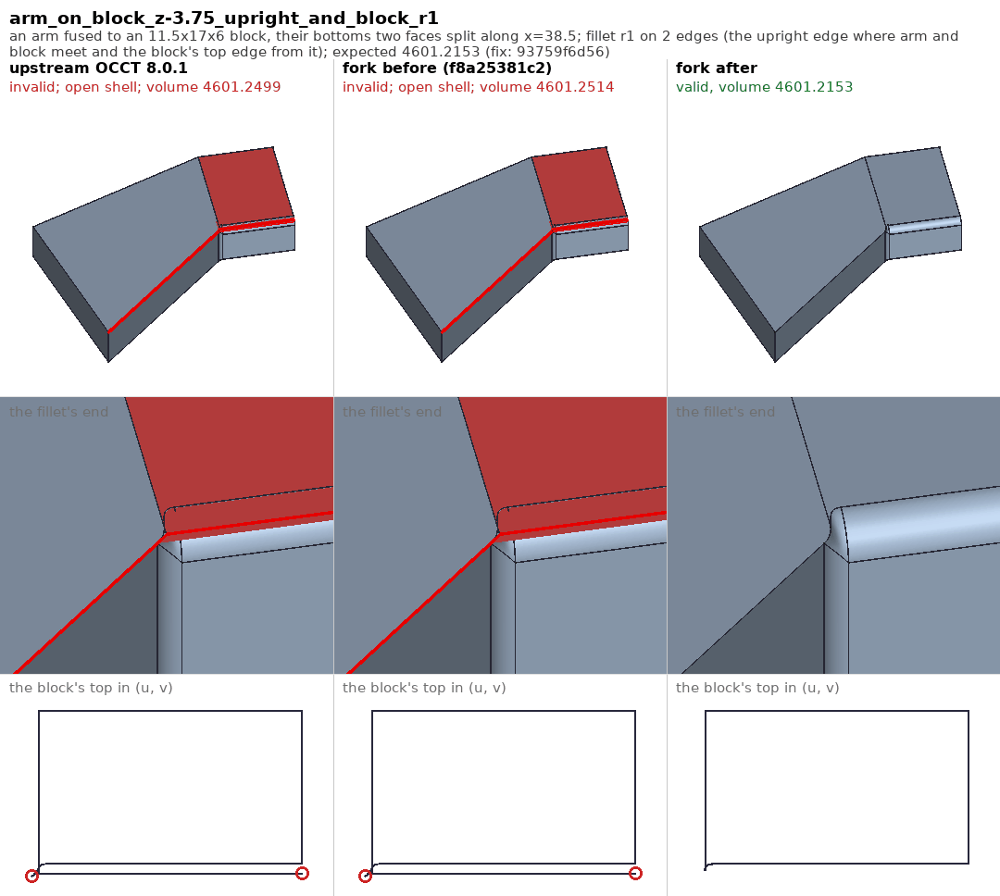

### Two fillets on the two pieces of a wall (`6c4e2bc29f`)

The fin flush with its block's side: the side is an L in two faces, split
from its inner corner. The block's top edge and the fin's upright edge
there have one piece each for their face on the side -- no face in common,
for the corner of two fillets, and the corner was made a plate.
Before, the plate is inside out: the red spikes in the zoom, the side's
lower piece red, and the fin's face, in the third row, drawn out to a
point.
On the side in one face the two fillets' lines meet below the split, on
the block's piece, and the fillets are cut by one another along the curve
from there to the concave edge. That is done now: the upright fillet's
line, which stops on the split, is carried on to the meeting point while
the two are intersected, and its piece past the split is put on the
block's piece. After, the two fillets meet in a mitre, and the fin's face
is the rectangle the fillet leaves of it.

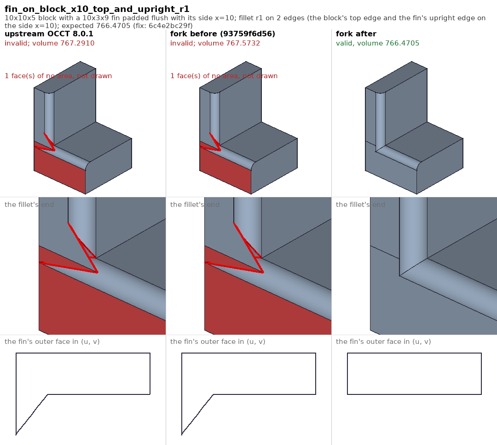

### A corner that read another fillet's surfaces (`74a9a42df4`)

The block's upright edge at its far corner and its bottom edge from there
to the arm. The bottom edge's fillet ends over the split of the bottom, in
two surfaces, and the routine that makes such an end read the surfaces of
the first fillet made -- the upright edge's here -- instead of its own.
Upstream refuses the pair. Before, the result is valid and wrong: the
fillet ends in a round nose on the block's bottom, 0.13 of volume too much,
and the arm's bottom, in the third row, is untouched. After, the fillet
runs out on the arm's bottom, which has its corner cut.

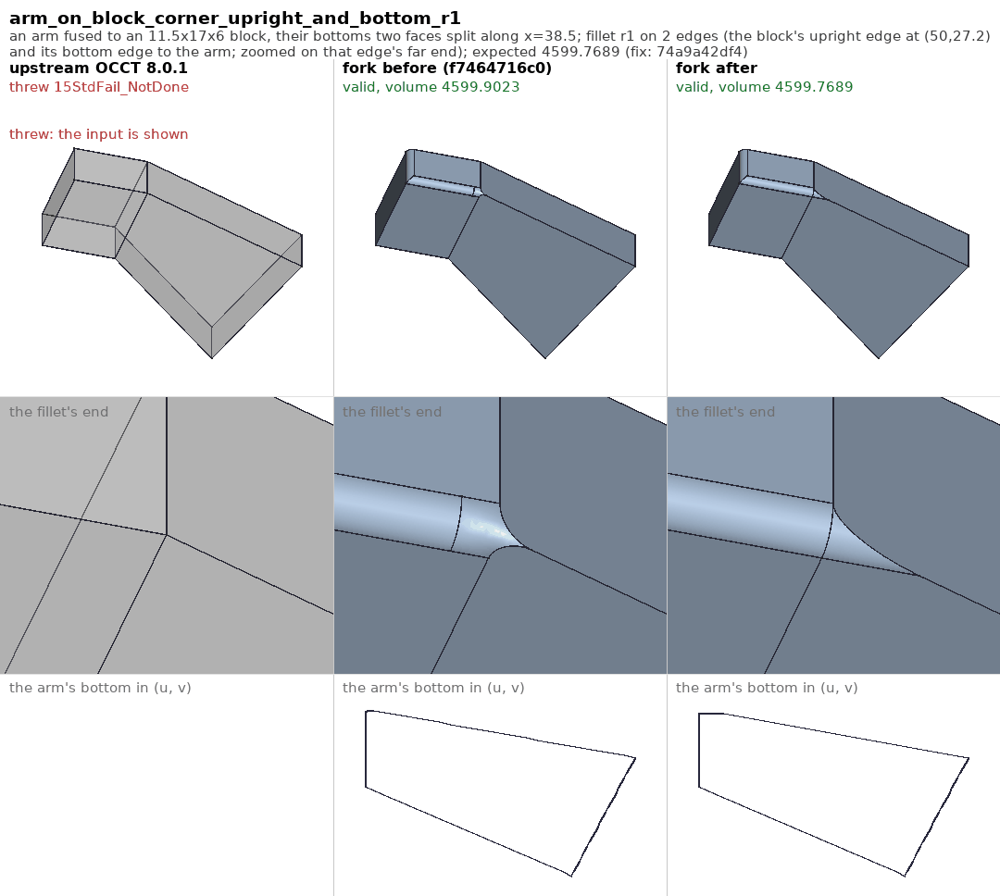

### An intersection curve a turn away on a closed surface (`f8a25381c2`)

The arm's two top edges at its far end. The second fillet is walked (its
line on the top crosses the split) and cuts the first, a cylinder, in a
curve that starts on the cylinder's seam. The intersection gave that
curve's line on the cylinder a full turn away at its start, and it was
kept, the edge 2.8 off its surfaces.
Before, the first fillet's strip is narrowed by a second line along it,
and its outline in the third row runs from the strip (0 to pi/2) far out
to the left, open at both ends. A line that far off its surfaces is now
walked again; after, the two fillets meet in a mitre and the outline is
the strip.

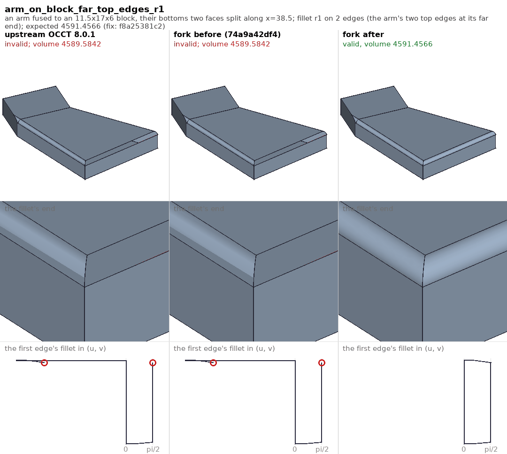

### A fillet's line along a split, at a corner of several fillets (`fbff94bd8b`, realthunder/FreeCAD#962)

The hexagonal pocket in the block's side, its mouth's edge 0.3 from the
split of that side, filleted at 0.3 together with the mouth's next edge.
The first fillet is as wide as the strip between edge and split: the strip
goes under it, and its line lies on the piece beyond, along the split. The
second runs on the pocket's own piece. The corner of two fillets is made
on the faces at their vertex, the far piece is not one of them, and the
two had no face in common: a plate was made of the corner. Upstream
refuses the pair.
Before, the pocket's piece of the side is red; in the zoom the plate is a
sliver standing up the split from the corner, and the far piece's outline,
in the third row, is open where the fillet's line should end and at the
split's top.
While the corner is made, the line is now shown on the pocket's piece, and
the corner is the one the side in one face has; then the line is put back
and the split cut where it ends. After, the two fillets meet in a mitre,
and the far piece closes along the fillet's line.

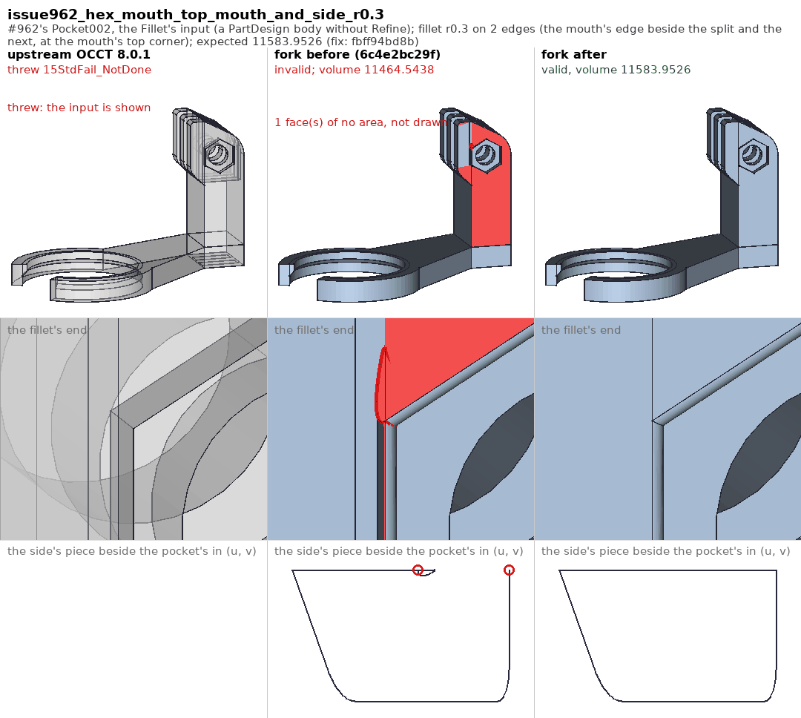

### A plate's edge across an edge that passes the vertex by (`d62136427b`, realthunder/FreeCAD#962)

The same corner at radius 1, all three of its edges: the mouth's two and
the pocket's inner edge. The fillet beside the split now has its line 0.7
inside the far piece, the notch in that piece's outline in the third row.
The corner is a plate, and its edge on the side runs from one fillet's
line to the other's across the split. The plate is made for an edge over
several faces, and cuts the edge between two faces where it crosses; which
part of that edge goes was told by its ends, the one nearer the vertex.
The split passes the vertex by and has no end there.
Before, the plate itself is in place, the three fillets meeting in it, and
the side around it red: the far piece's outline stops where the plate's
edge reaches the split (the circle at the notch) and at the split's top --
the part of the split between the two, which the piece needs, was the part
dropped. The part that goes is now the one the vertex is beside. After, the
outline runs up the plate's edge and on along the split.

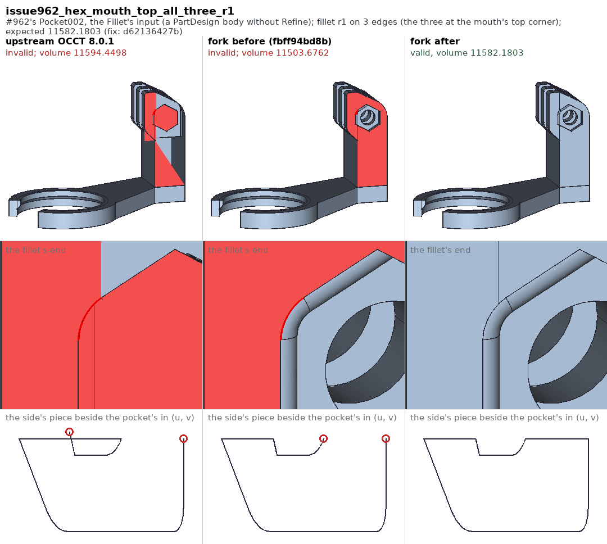

### Two fillets on two pieces of a wall, the split beside the vertex (`6593a88daa`)

A rectangular pocket 0.3 from the split of a box's front, its mouth's edge
beside the split and its bottom edge, at radius 1. The first fillet's line
is on the far piece, the notch in the third row; the second's runs on the
near piece and comes to the split 0.3 past the corner. No face in common
again, and a plate: valid since the fix above, and not the corner two
fillets have.
Before, the upright fillet ends below the corner in a slanting facet, and
the notch has the corner at that end cut off by the plate's edge, 0.035 of
volume missing. On the front in one face the two lines meet on the far
piece and the fillets are cut by one another; that is done now for a split
that passes the vertex by, as it was for one that ends at it. After, the two
fillets meet in a mitre down to where their lines cross, and the notch is
square: the bottom fillet's line crosses the split and ends the upright
one's.

### Two fillets of opposite concavity without a pivot (`3f7ddd4bcc`, realthunder/FreeCAD#962)

The hexagon's corner once more: the mouth's second edge from the split and
the pocket's inner edge, at radius 1 -- one convex, one concave. Their
corner is a three-sided patch between the convex fillet, cut where the two
lines meet on the pocket's wall, and the edge the concave one ends on. It
was made only when the first fillet's line ended on an edge of its face,
the "pivot" two fillets of one concavity turn on; this one's line crosses
the split a little before the corner and stops in the far piece. A plate
then, and its edge on the side left both pieces open.
Before (and upstream), the side's edges are red all round, two faces have
no area, and the outline of the pocket's piece, in the third row, is open
at the hexagon's corner and at the split's top. The patch asks for no
pivot now. After, the convex fillet ends in the patch, which turns down
into the concave one, and the hexagon in the outline has its corner cut by
the patch's edge.

### An exact fillet cut by its end face before a split (`904a86b6c0`, realthunder/FreeCAD#962)

The hexagon's edge second from the split, alone, at radius 1. Its fillet
is a cylinder whose line on the side crosses the split 0.23 before the
corner. An exact fillet is cut where either of its lines leaves its face,
and the rest of the edge is walked: two surfaces, the last a sliver on the
far piece. But the pocket's next wall cuts the fillet 0.58 before the
corner on that side -- the hexagon's corner is 120 degrees -- so of the
sliver only a corner is left, which the curve the fillet ends in crosses.
That end is made on one surface, failed, and the corner setback fallback
took over. Upstream refuses the fillet.
Before, the result is valid and not the fillet asked for: it stops short
of the corner in a rounded cap, and the hexagon in the outline of the
side's piece, third row, has a bump at that corner; 0.025 of volume too
much. Where the end face cuts the line before the split, the exact fillet
now runs on to the spine's end in one surface. After, the fillet is cut
square by the next wall, as on the side in one face.

### Three fillets at a vertex where a split ends (`479cc80ecb`)

The fin flush with its block's side once more, all three edges at the
L's inner corner: the block's top edge, the fin's upright edge and the
concave edge between fin and block. The two convex fillets run on the
side, one on each of its pieces, and the corner of three fillets asks for
a face in common of every two: a plate was made instead.
Before (and upstream), the plate is red and a spike of it lies along the
block's side; the fin's outer face, in the third row, is drawn out to a
point below its corner.
While the corner is made, the upright fillet's line is now shown on the
block's piece, and the corner is the one the side in one face has: a
torus carrying the concave fillet round between the two convex ones. Its
line on the side runs from one fillet's line to the other's across the
split, and is put on the two pieces, cut at the split. After, the torus
is in place, and the fin's outer face is the rectangle with its corner
cut by that line as far as the split.

### A corner's cut over an end face in two pieces (`74c8a201e0`, realthunder/FreeCAD#962, #309)

The fillets the sweeps saw refused were tried on the refined shape, as the
invalid ones had been: of 1370 on single edges, 50 are refused only for
the body being in pieces. Most of them are one situation -- the face the
fillet ends on is in two coplanar pieces, and the piece at the corner is
narrower than the fillet. One side of the fillet then ends on an edge of
the far piece, and the curve the fillet ends in has to run over both
pieces, across the split between them.

The box whose bottom and end faces are split 2 from its side, filleted at
2.5 (at 2 it is "A fillet as wide as its piece, once more", above). Three
convex edges at the corner: both sides of the fillet end on edges, the one
on the end face's far piece, and the corner asked for both on one face.
Refused before, and upstream; after, the fillet runs the edge's length,
and on the end face the split comes down to the fillet's arc and stops
there. The near piece, in the third row, is closed by the arc, which
reaches the split 0.05 above its foot: what was below is cut away, with
the piece's bottom edge.

The slotted block, the slot's wall split 0.7 from the outer face: the
edge of the slot's floor on the outer face, at 0.8. Here the fillet runs
on in the outer face past the corner, and its end is a cap in the wall's
plane, below the floor. The corner had the cut for that -- "The cut over a
drafted wall's cone and plane", above, two curves meeting on the line
between the two faces -- but looked for it too late: with neither side on
an edge of the vertex it took the outer face's far edge, where the
fillet's line ends, for its face at end.
Refused before; after, the fillet's end at the slot's wall is a rounded
cap, and the split in the wall comes down to it. The wall's piece at the
mouth, third row, has grown by the cap at its lower end: the short edge
there is new, the split's line carried on below the floor as far as the
arc.

Just over the piece's width that new edge would be shorter than an edge
can be -- 7e-7 at radius 0.701 -- and the split starts at the arc instead.

### An edge that reaches the vertex through the end face's pieces (`247fc423f1`)

The same block with the outer face split as well, by the edge's own line
below the floor. Now both sides of the fillet stop on edges at the
corner, the floor's side on the edge of the wall's far piece -- an edge
that does not touch the corner's vertex, which the walk took for an
obstacle to run along, and failed. Through the wall's pieces that edge
does reach the vertex, as the wall's edge in one face would: it is the
fillet's end.
Refused before; after, the same cap as above, and the outer face's split
runs up to the cap's lower end.

### A line stopped on a split that ends at the vertex (`faf4f72ee0`, realthunder/FreeCAD#962)

The top of #962's outer rib ends on a slope, and the block's side below
it is split exactly there: the piece of the side under the top's edge
ends with the edge. The fillet's line on that piece stops on the split.
A line that stops in its face a little before a split is carried on over
it ("A fillet's line over a wall kept in coplanar pieces", above); one
that stops on the split, an edge of the corner's vertex, was not.
The fillet here is a chain from the arm's underside up the rib's front
to its top. Refused before, and upstream; after, the fillet runs along
the top to the slope, which cuts it off, and its lower line crosses the
split on the side and ends on the slope's edge. The side's piece past
the split, third row, has that corner rounded off by the line and the
slope's cut.

### The cut over two pieces at a vertex of four edges (`3ba0c94072`, realthunder/FreeCAD#962)

A slot between two walls on a block, the walls overhanging the block's
side by a slope; the slot's wall is split 0.7 from that side. The edge of
the slot's floor on the block's side, at 0.8: the cap of "A corner's cut
over an end face in two pieces" (above), below the floor in the wall's
plane, over the wall's two pieces. But four edges meet at this corner, not
three -- the block's side goes on past it under the slope, in line with
the edge filleted -- and such corners are made another way, which had no
cut over two pieces: with the fillet wider than the piece neither of its
sides ends on an edge of the corner, and that way found nowhere to start.
Refused before, and upstream; after, the fillet ends at the wall in a
rounded cap, and the split in the wall comes down to it. The wall's piece
at the block's side, third row, has grown by the cap at the corner where
the slope's edge ends: a new edge runs on from that corner in the plane of
the block's side as far as the fillet's line, and the arc from there back
up to the split.

On #962 this is the floor of either inner slot against the block's side,
a rib's wall at each end of it, the wall's piece at the floor 0.46 wide.

The miniature's walls are prisms moved into place, and their faces carry
that move with them; the cut over two faces read such a face's surface
where it was made, not where it lies, and gave up (`bc752200fe`). That
failure had been hiding another: on #474's bar, at a radius a hair over
the width of the bar's side, the fillet's surface covers only the last
seventh of its edge, and with the corner there made the result was
invalid. A surface that stops so far short of its edge's end is refused
(`4e97a46b0d`). And where the cut meets the split's line within 1e-5 of the
split's end, the split is now drawn on to the meeting point itself rather
than left that far short of it (`5635c27fba`).

### A meeting kept on a surface that was removed (`726d9533c6`, realthunder/FreeCAD#962)

The same corner with all four of its edges filleted, at radius 1. Four
fillets meet there, and the corner between them is one patch. The
floor's fillet along the wall is in two parts, one for each piece of the
wall; the part on the piece at the corner, 0.7 long, lies wholly under the
patch and is dropped. But the place where that fillet meets the slope's
had been found on the dropped part and was kept as a position along it --
which, read along the part that remained, is a point 0.7 further down the
wall. The patch was given two corners that far apart and nothing between
them.
Before, and upstream: the patch and both pieces of the wall are open (in
red), the body no solid. After: the patch's edge on the wall runs from the
slope's fillet across the split to the floor's, and the wall's piece at
the corner, third row, is closed.

### A set back corner on a fillet whose first edge is short (`543ba5a661`, `f446ee4591`, realthunder/FreeCAD#962)

Two of the corner's four edges: the floor's along the wall, and the
block's side's under the slope. Their fillets do not touch, and the
corner between them is made by cutting each back a radius from the
vertex and closing the opening with one patch. The cut is measured along
the fillet's edge -- and the floor's edge, here, is the wall's piece, 0.7
long: a radius along it was never reached, though the fillet runs on past
it. And once it was measured along the whole fillet, the result was
rejected by a check that every fillet asked for is there, the 0.7 piece
being under the patch and not under a fillet.
Refused before, and upstream; after, the two fillets end a radius from
the corner and the patch joins them over the slope's edge and the wall.

At other radii (0.8, say) the patch came out looser than on the body
refined, until the next fix.

### A set back corner on a wall in pieces (`5b0741a75e`, `5e364dd15b`, `0892d3e167`, `e3c46a01d7`, `2ff60f1efd`, realthunder/FreeCAD#962)

The same corner, other pairs of its four edges. The slope's fillet is
wider than the wall's piece and ends on the piece beyond the split.

With the block's side's edge under the slope: the two fillets do not
touch, and their corner is made set back -- on the wall in one face. In
pieces it was refused. The floor's edge, sharp here, is the wall's piece,
0.7 long; the corner still had the far piece down as the face beside it,
from when the slope's fillet ended there, and the patch's edge on the wall
was drawn over two faces though it lies on one. (Set back farther, past
the piece's end, the cut on the floor's edge is carried on to the edge
beyond the split.)

With the floor's edge: the corner reads the edges round its vertex
starting from the first fillet's face, and the slope's fillet, given
first, has the far piece there -- a face the vertex is not on. Given the
other way round the corner was made.

The floor's edge with the block's side's, above, was made but loose away
from radius 1. A patch's edge that crosses the split was held tangent to
the wall, where the one edge of a wall in one face is held by its
position alone; at this corner that pulled the patch 0.014 off its
boundary. At another -- a fin's wall in two -- tangency is what keeps the
patch on its boundary. The patch is built both ways now and the nearer
one kept: 4e-4 here, as on the body refined.

Two more of the kind at the slot's mouth of a block whose outer face is
split as well, below the vertex: a fillet's leftover surface past the
vertex, with a face on one side only, was taken for its end where two
fillets meet; and set back, the outer face's split, in line with the
wall's edge above it, sent the corner down a path meant for two sharp
edges in line. That corner was a plate 0.11 off the refined shape's
exact one; the picture's after is the fork as it is now, the exact corner
(1131.5944) since the fillet in two surfaces at a corner of two
(`9735ff8875`, below).

### Two fillets past their wall's piece (`2bc692bfc4`)

The slot's wall again, its piece at the mouth 0.7 wide: its top edge and
its upright edge on the outer face, filleted together at radius 1. Both
fillets are wider than the piece and end on the wall beyond the split,
facing each other on a face their vertex is not on. Their corner is made
set back, and the patch's edge between the two cuts lies on that far
piece; it was asked of the piece at the vertex.

### The surfaces a corner removes (`c4bb6a9cf4`, realthunder/FreeCAD#962)

The rib's top corner. The wall under the top's edge is in two pieces,
split by the long edge that comes up to the vertex; the fillet along that
wall is a chain of edges round the wall's piece and touches the long edge
again at its foot, 18 below. Before making a corner the builder drops the
part of each fillet that runs on past the vertex, keeping the surface that
touches an edge beside the fillet's -- and took the one at the foot for
it: of the fillet's six surfaces five were dropped. An upstream fault; any
fillet that comes back to such an edge would meet it.

The corner this fix made was a patch, 0.043 too large at radius 1. The
picture's after is the fork as it is now: since the line carried over a
split to the pivot of two fillets (`2ec760a1d3`, below) it is the exact
corner of the two fillets, the refined shape's to the boolean.

### A fillet past its wall's piece at a pocket's mouth (`7c3d8b9685`, `6163e90334`, `baf699efbb`, `9d58debece`, realthunder/FreeCAD#962)

The round pocket's mouth on #962: the pocket's wall is a cylinder, the
slot's a radial plane in two pieces, 1.25 of it beside the pocket, and
the block's top is split along a circle that starts at the same foot.
Below a step the pocket is wider by that 1.25, and only the wall's far
piece goes on down. The edge between pocket and slot, filleted wider than
the near piece, was the last edge refused only in pieces. On the wall in
one face the fillet -- a cylinder, made without a walk -- runs on down the
wall past the edge's end, to the floor, and is cut by the step, the wider
pocket and the floor on its way.

In pieces two things were missing. The fillet was walked, started from
the far piece, and a walk stops half the edge's length past the edge's
end -- in the middle of the piece, with no edge to end on. The fillet is
now made on the piece its line lies on, as on the whole wall. And the
faces that cut a fillet's end are found along the outline of the
fillet's face, from the vertex: of the far piece, that led down the
split. The outline followed is the wall's, over its pieces -- at the top
as well, where the block's top is in two pieces across an arc and the
cut runs over both.

Two smaller faults showed on the way. The step's own edge, and the ring's
0.05 long one, end where the fillet's line on the wall's piece stops on
the split -- which lies on the wider pocket's wall, the face that cuts the
end. The crossing is the line's last point, was found 1e-15 past it and
counted as none. And at the pocket's other mouth, the mirror image, the
same fillet came out invalid, a third of the volume -- on the refined
shape too, with upstream's code: the wider pocket's circles are arcs from
3.95 to 9.10 on their circle, the fillet cuts them near the end, and the
point came back on the circle's first turn, at 2.81, off the edge.

### The far piece's fillet at an end that runs on (`5052552dd6`)

The fin whose wall is split 0.7 from the block's side: its upright edge
and the block's top edge at the L's inner corner, at radius 1. The upright
edge's fillet is wider than the wall's piece; its line on the wall lies on
the piece beyond, and the fillet was walked from there -- a B-spline, where
the wall in one face has a cylinder. The corner of the two fillets cuts
them by one another ("Two fillets on the two pieces of a wall", above),
and the one that stops on the split has to go on past its end as it is, a
cylinder or a plane; the walked one was left to the plate. Before, the
plate is inside out: the red spikes, the block's side red, and the fin's
outer face, in the third row, drawn out to a point.

The far piece's own fillet, the cylinder, was made for the pocket's mouth
(the section above) and kept from an end where the fillet's face runs on
past the vertex -- as the side does here, down the block. It is made
there as well now. After, the two fillets meet in a mitre, and the fin's
face is the rectangle the fillet leaves of it, as on the fin whose wall is
one face.

### A side stopped on a split in the plane of the face at end (`6505747185`, realthunder/FreeCAD#962)

On #962 the arm is lower than its block, and the block's sides are split at
the arm's top: at each of the two vertices where arm and block meet, the
split is an edge of the vertex, lying in the plane of the arm's top. A
fillet that ends there with a side on the block's side -- the upright edge
between arm and block, the block's own edge above the arm -- has its line
stopped on the split. On the side in one face the line runs on past the
vertex, and the fillet is cut by the arm's top alone, which is extended
over the fillet's end. In pieces every face round the vertex was taken in
turn, the fillet found short of the edge between the arm's top and the
block's wall, and the end left to a plate.

The miniature, the upright edge between arm and block: concave, the
fillet adds material and stops at the arm's top. Before, a small patch at
its end, drawn up into the corner of the top and the block's wall --
valid, with a tolerance of 0.067, and BOP's check fails. After, a flat
end: the arm's top has grown over it, the tab at its corner in the third
row, up to the split, which the top shares with the side's upper piece
from there.

The model's own, the block's edge above the arm at y=27.2. Upstream's
plate is the folded one of "A corner plate folded to stay tangent",
above, 1.8 of volume too much; the fork's, before, is smooth and dips
into the arm's side below the top, 0.31 short, at a tolerance of 0.034.
After, the fillet ends on the arm's top, a quarter round to its end.

### An arch on a plate (`9c45825ba1`, `358d611f3f`, realthunder/FreeCAD#309)

A half cylinder standing on a plate as long as its diameter: the cylinder
comes down to the plate's top where the plate ends, tangent to the end.
The fillet of the edge at the arch's foot is cut at each end by the
cylinder, which grows over the fillet's end down to the plate's top edge
-- an edge that lies on the cylinder and is none of its face's. The end
point's place on the cylinder was read off that edge's curve on the face;
it has none, and the place was left at the surface's origin. Upstream's
fault, and the fork's until now, on a body in one piece: the three
results look alike, and the first two are 671 of volume for 797, with a
vertex at a tolerance of 21. The third row shows it: the cylinder's
outline in (u, v) is the arch's rectangle and stray pieces far from it,
their ends open (red). After, the rectangle with a tongue at either foot,
where the cylinder has grown over the fillet's ends.

The same with the plate's ends split under the arch's end face, as #309
has them. The vertex has five edges there, and the cylinder with the
end's two pieces passed for three tangent faces: the fillet was cut by
the end's plane instead, a little off the point where its other side
stops on the arch's circle. Invalid, the cylinder's wire open. The
pieces of one face are no tangent faces now, and the cylinder is cut as on
the end in one face.

### A fillet's last surface past the vertex (`afb7f305d0`, realthunder/FreeCAD#474)

On #474 the ramp starts on a block, and the block's end wall is in two pieces,
split at the level where the ramp starts. The upright edge between the
wall and the block's side: the ramp rises along the side from the split's
level, so the fillet's line on the side runs on a little past that level
before it meets the ramp's edge. Two surfaces, the second past the
vertex, on the wall's upper piece; on the wall in one face they are one,
and the fillet is cut by the ramp.

Before, as with upstream's code, the end is a plate, a point drawn up the
wall's upper piece: valid, at a tolerance of 0.05, and BOP's check fails.
The surface before the last takes the side's end over now and the last
one goes; the split lies on the ramp's surface, its straight end, and the
ramp alone is cut ("A side stopped on a split in the plane of the face at
end", above). After, the fillet ends under the ramp.

### A line carried over a split to the pivot of two fillets (`2ec760a1d3`)

An arm fused to a block as tall: their tops are one plane in two faces.
The block's top edge and the upright edge between arm and block: on the
top in one face the top edge's fillet runs on past the block to the arm's
top edge, where the upright edge's fillet ends too, and the two are cut
by one another along one curve. In pieces its line on the top stops on
the split, short of that edge, and the corner was a plate: before, the
small patch between the two fillets, at a tolerance of 0.012. The line is
carried over the split to the arm's edge now; after, the two fillets meet
in one curve, and the arm's top, in the third row, has lost its corner to
the fillet as far as the line runs on it.

### The pivot of two fillets in two pieces (`52a5c89410`, realthunder/FreeCAD#962)

The rib's top corner on #962: the top's edge with the rib's slope and its
edge with the wall beside it. The wall is in two pieces, split 0.46 from
the corner, and the split's foot is on the slope's edge with the wall --
the edge both fillets end on, in two pieces itself, the first 0.52 long.
The wall's fillet reaches that edge on its second piece: on the wall in
one face its line runs on past the corner, under the first piece's end,
and the two fillets are cut by one another along one curve. In pieces the
line ended where the fillet's edge does, on no edge, and the corner was a
plate: before, the patch between the two fillets, with a crease to the
wall's fillet. The line is carried over the split to the edge's second
piece now, and the two pieces are taken for one edge; after, one curve
between the two fillets, and the wall's second piece, in the third row,
has lost its corner to the fillet as far as the line runs on it.

### An edge's tolerance over its curves on the faces (`b72e581675`, realthunder/FreeCAD#962)

Nothing to see: a result BOP's check called invalid for one edge whose
curve lay 2.51e-6 off its fillet at a tolerance of 2.29e-6. The builder
gives the edges it makes the largest distance from their curves on the
faces at a set of samples, and a twentieth more; the curve between two
fillets is farthest off a little inside its end, between two samples.
The largest distance is looked for now, as the check does, on every edge
the fillet made that is not a line or a circle.

### A ceiling under a wall (`0669daa0b6`, realthunder/FreeCAD#962)

The arm's upright edge against the block's side, at its top, where the
block's wall stands on the arm's top -- edge 36 of #962's `Fillet`, at
radius 2, seen from below. The fillet ends in the plane of the arm's top,
and half of its section there lies under the wall. Before, as upstream:
a plate over the whole corner, from the vertex to the section, bulging up
between the fillet and the wall; it lay on the arm's top on this side of
the wall, could not be tangent to the fillet standing on it, and came out
valid with a tolerance of 0.061, refused by BOP's check and 0.0103 of
volume off. After: the fillet's end is a clean arc, and between it and the
wall's lower edge is a thin flat face -- the section cuts the arm's top as
far as the wall's edge, and the rest of the corner is closed under the
wall by a face in the top's plane that looks down. The third row draws
that face, which the first two columns do not have: two straight sides,
on the wall's edge and on the block's side, and the section's arc.

The block's side in one face, radius 0.8. Upstream's result is invalid
there; the fork's was the plate. The flat face's third side is a new
edge on the block's side, from the fillet's line to the vertex.

The arm's top tilted 4.9 degrees. Upstream extends the arm's top over the
corner and leaves it invalid, drawn in red. The section is an arc of an
ellipse, the fillet's line on the block's side is cut where it crosses the
tilted plane, and the flat face tilts with the top.

### A fillet in two surfaces at a corner of two (`9735ff8875`, realthunder/FreeCAD#962)

The fin flush with the block, its wall split 0.7 from the outer face. The
split's foot is on the edge under the fin's wall, so that edge is two
edges and its fillet two surfaces, the one at the vertex 0.7 long. With
the block's top edge at radius 1 the two fillets' lines meet on the
block's top 1 from the vertex, past the split's foot -- on the surface
before the last, and a corner of two fillets is made of their last ones.
Upstream refuses the pair. Before, the corner was made set back: both
fillets stopped short, and a four-sided plate between them and the two
faces beside, 0.10 of volume off. After, the two surfaces are one for the
corner, as they are on the wall in one face: each fillet runs to the
other, and a three-sided patch closes the corner.

The same piece with the fin's upright edge. That fillet is wider than the
wall's piece at the vertex and lies on the far piece, where the two lines
meet before the split. Before, the plate again, between the upright
fillet's end and the block's side; after, the patch of two fillets.

On #962 itself: a slot's mouth, the floor's edge along the rib -- its piece
at the mouth 0.69 long -- with the rib's upright edge, at radius 1.5.
Refused upstream and before (the input is shown); after, the upright
fillet coming down, the floor's running in under the rib, and the patch
between them at the mouth.

### The far piece's fillet for an edge of a chain (`8558180119`, realthunder/FreeCAD#962)

Nothing to see: the rib's upright edge at a slot's mouth, wider than the
piece of the wall it is on, had a fillet walked along it -- a B-spline
lying where the cylinder does. The exact surface of the piece the
fillet's line is on was taken for a contour of one edge only; this edge
is the first of five. It is taken for an edge of a chain now, when it is
that edge's surface and no more, and the fillet is the cylinder the
refined shape has.

### An edge of no length (`61f59f6842`, realthunder/FreeCAD#474, #876, #273)

The fillet sweeps now put every valid result to BOP's argument check as
well (`../README.md`, "BOP's check on every valid result"): BRepCheck's
"valid" is not what the next boolean asks. The most reported fault was an
edge with nothing between its ends -- where a fillet ends across a face of
no width (#474's hexagon has two faces with a needle 1.4e-7 wide), or is
thinner at its end than its own tolerance (#876's post, a degree from
flush; #273's handle, two degrees from its wall). Such an edge is dropped
now and its two vertices made one. Nothing to see: the edge is 1e-7 to
1e-4 long, and the shapes are what they were.

### A pinch between two vertices the fillet made (`1a971d66bc`, realthunder/FreeCAD#523)

The pinched top of `40ba54dcdf` again, at the bottom: the cylinder's rim
and the box's bottom edge from it, at radius 1. The rim's fillet touches
the bottom on a whole circle of radius 1, the edge's on a line tangent to
it, and what is left of the bottom is the box's rectangle and the disc,
touching at one point -- but there both vertices are the fillet's, and the
circle runs from one to the other: the pass took neither. It takes two
vertices of the fillet's now, and an edge between them that is itself a
loop of the wire. The views are alike in all three columns; the third row
is the bottom: before, the rectangle with the disc hanging from its
corner, one face; after, the rectangle alone, the disc a face of its own.
The volume does not move, and the result passes BOP's check (two vertices
at one point before). The same at the rim's other end, and with the box's
other bottom edge.

### The roots of a trigonometric equation below zero (`5c531f4938`, realthunder/FreeCAD#474)

Not a fillet's fault: `TKMath`'s solver of a cos^2 + 2b cos sin + c cos +
d sin + e = 0 dropped every root between a lower bound below zero and
zero. BOP finds a point's place on an ellipse through it, and on an arc of
ellipse running from -PI/2 to 0 found none: two fillets at a corner of #474's,
three planes five degrees off square, meet in such an arc, and
BOP took their common edge for a new section and the fillets for
self-intersecting. Nothing to see either: the fillets are the shapes they
were. The fix also lets the new draft make #876's face 44 at 5 degrees,
which it refused for want of a closure.

### A boss flush with the plate's side (`b234546fbe`)

A cylinder boss standing flush with a side of the plate under it: the
boss touches the side's plane along one line, and its foot circle touches
the plate's top edge at one point. A fillet round the foot was refused at
every radius -- an error about a point of index 0, nothing a user can read.
The fillet runs round the boss until its line on the plate reaches the
plate's edge on either side of that point, and stops; both its ends are
then at the one vertex, and no corner took them.

It is made now as the fillet on a plate reaching past the side would be,
then cut by the side: the ring loses what would hang over the edge, and
the side grows a peak above the plate's top under the fillet's two cut
ends, up to the point where the boss touches it at the fillet's height.
The boss's foot is the fillet's line all round. Before, in the first two
columns, nothing; after, the ring and the peak. The third row is the
side: a rectangle before; after, the peak stands out of the edge along
the plate's top (on the right: the side's plane is drawn turned). Checked against that very construction -- the fillet on a wider
plate, cut by the side's plane -- at radius 1 and 2: nothing of either
lies outside the other. The same against a round plate's rim, the boss
inside it.

Not made: a chamfer there (its cut would end in a corner of no angle) and
a rim whose seam runs through the point. A drafted boss, which touches
the side only at its foot, is made since `1d642bfaaf` (below).

### A chamfer carried past a corner where its faces turn tangent (`a2f5c2a5d4`)

x16win's case: a 40x30x10 block with fillet 2 on its edges at the back
(y=30) -- the two verticals and the top one -- and on the bottom edge
under the left side, then chamfer 1 on the top edge of the left side. The
fillet on the top back edge and the one on the left back vertical meet in
a mitre, an ellipse, with no patch at their corner, and the chamfered edge
runs on along it, tangent, to (2,30,8). There both fillets turn flush with
the back face: the angle the chamfer cuts goes to nothing. A fillet ends
at such a point (its section closes to it); a chamfer keeps its width and
has to be carried past it until it reaches the back face.

It was not carried past. The extruded polygon's chamfer stopped at the
point, 0.127 short of the back face, and a patch bridged the gap with three
edges ending 0.38 short of their vertices: "valid", 45.6 off in volume.
makeBox's ran on a little and stopped just short of the back face's
edges: refused. Upstream does the same, both ways.

Now the chamfer is carried past (its guide extended there, as at any
other end of a chamfer), its sides step onto the back face's edges, and
its last section, which lies in the back face, is the cut: the chamfer
meets the back face smoothly along it, and the corner of the back face
beyond it goes. Both blocks give the same solid. With two distances one
side reaches the back face first and runs on over it until the other
does; the chamfer ends in a sliver between the back face and the top
fillet. In the pictures the first two columns hold the polygon's bridge
or nothing; after, the chamfer runs into the back face. The third row is
the back face: a rectangle before, its corner cut off after.

A fillet whose faces turn tangent at its end now stops the same way, once
both its sides are on the face there. On #273's handle, tangent only to
within 0.7, that drops a sliver (a fillet between the handle's cylinder
and itself) and makes 13 invalid corners valid; but the fillet's last
section there is shorter than its points' tolerances, and BOP's check
reports the two as overlapping. Closing such a section to a point was
tried: the overlap goes, but the other side's edge then ends 0.0003 short
of that point. Neither is clean, on an input BOP's check already fails;
it stays as it is.

### Corner plates held to their own miss (`6de00fea30`, realthunder/FreeCAD#631, #273)

Nothing to see: the corners look as they did, and their volumes move by
less than 0.08. What changed is how loose they are. A corner's patch is a
plate that misses the fillets' ends by a little, then approximated, and
the approximation was let off at ten times that miss; the corner, and
every edge and vertex of it, took the approximation's error as its
tolerance. On #631, two fillets of 0.3 meeting with no face in common,
that came to 3.1e-3 over a side of the solid 0.0025 long -- for BOP's
check (what the next boolean asks of a shape), an edge too small and two
vertices on top of each other. The approximation is now held to the
plate's own miss, as a set back corner's already was, and the corner
takes the fit to the fillets' ends as its tolerance: 6.5e-4 there, and
clean. Over the sweeps, 37 corners BOP's check reported are clean now,
none the other way; 128 fillets and 37 chamfers that ended an edge's curve
short of its vertex by more than the edge's tolerance no longer do (on
#273, the corner had been 0.045 loose and covered it), and four corners
refused before are made.

Still reported: corners whose plate falls back to touching the fillets'
ends only, 0.04 off them (#631 at radius 1), and a few at 0.3.

### A drafted boss flush with the plate's side (`1d642bfaaf`)

The boss above, drafted: a cone narrowing upward, radius 5 to 4, its foot
circle touching the plate's top edge at one point. It touches the side's
plane only there, so the fillet's line on the boss never reaches the
side; on the plate it reaches the edge on either side of the point, and
both ends of the fillet came to the one vertex, as the cylinder's had.
Refused at every radius, with the same error of a point of index 0.

Made again on a plate reaching past the side and cut by it, the fillet
stays one ring: the cut runs below its line on the boss, a notch in the
ring's lower edge, not a gap across it. That is what is made now. The
fillet's two ends stay where its line on the plate meets the edge, and
the stretch between them is the fillet's own surface carried on round the
boss, bounded below by the side's cut and above by the line on the boss.
The side grows a bump over the plate's top under it. Checked against that
construction at radii 0.3 to 4 and drafts of 0.6 and 11 deg: nothing of
either lies outside the other, and the volumes agree to 1e-3 (near flush,
at 0.6 deg, to 0.01: the volume's integration over the cut moves that
much, where the bump's area agrees to 8e-6). The same with the cone's
seam turned away, two bosses on one side, a round plate's rim, the foot
and the boss's top together, and a chamfer -- which the cylinder could
not have: the chamfer's cut stays below its line on the boss too.

Still refused: a boss leaning out (a cone widening upward, which crosses
the side), and a seam through the point (made since: the last section
here). #876's post, which the earlier
notes called this case, is not: its drafted corners stand flush with the
plate's rounded corners along an arc, and the fillet carried on would run
along all of it with no other end to close against.

### A thin fillet in one piece (`b4f2f7592c`, realthunder/FreeCAD#876)

#876's post stands flush with the plate's sides, its walls drafted a
degree: a fillet of 0.3 along its foot is 0.005 wide all along. A fillet
that narrow is searched for a place where it closes to a point -- two
faces touching along a curve -- and cut there. The test took any place
where its width stopped shrinking, and along a fillet of nearly constant
width there are many: it came out in up to six pieces, each cut one
vertex 0.005 loose that both of the fillet's edges ran through, and BOP's
check found an edge crossing itself. The test is now the width itself:
one face, its edges at 3e-4 at most, and BOP's check clean on the long
side's foot and the corners'. The picture is the long side's: cut at
x = 4.043 and 9.143 before, zoomed on the first cut. Two of the four-edge
corners there still carry a side as short as that width, under a patch
loose by half of it.

### A flush boss's foot in two equal halves (`892a10b753`)

The flush bosses above, cylinder or cone, turned a quarter: their seam
opposite the point where the foot meets the side, the foot two half
circles. The fillet was refused at every radius. The walk that carries
it past that point ran on round the first half as far as the seam, and
came back with its last point numbered as if it were the start: a line
running backward, which cannot be approximated. That point is dropped
now, and the fillet is made as for the boss turned any other way -- the
same volumes, to the digit, and the same shape as the cylinder's above.
The boss's seam through the point itself: the next section.

### The boss's seam through the point (`e549e29656`)

Turned three quarters, the boss's seam runs up from the point where its
foot meets the side, along the line where it touches the side's plane,
and the foot is one closed edge. Refused at every radius, cylinder and
cone. The walks past the fillet's two ends, run on over the plate's top
carried past the side, stopped on that seam, and what they made was kept
as if the seam were an edge of the boss: the fillet's ends were then not
the ones the corner closes. They are dropped now, as at any other turn.
Then the corner's point, where the fillet's line on the boss meets the
side, lies on the seam, which is split there, its foot under the fillet;
on the drafted boss the line carried across the gap crosses the seam,
and is cut in two there. The same volumes as the boss turned any other
way, fillet and the cone's chamfer.

### A fillet run on past its vertex (`95a3e143e1`, realthunder/FreeCAD#273, #474)

An edge between two faces a degree or two from tangent -- #474's step
along its top, #273's rim under the handle -- takes a fillet a strip a few
hundredths wide. Upstream leaves such an edge out ("no suitable edges");
the fork makes it. At the end, where four sharp edges meet, the strip's
line on one face stops on an edge there, but the other line, nearly along
the next face, meets no edge and runs on as far as the fillet's surface
was carried past the end, half the edge. The face across then cut the
strip along its length rather than across it: #474's came out invalid,
#273's crossing themselves by BOP's check. Such an end -- one side on an
edge, the other free farther than ten times the fillet's width -- is
refused now, and the corner set back from the vertex (the setback
fallback): valid, BOP's check clean, except #273's at 0.3, which keeps
two edges as short as their vertices are loose. With the fallback off it
is refused, as upstream refuses it.

### A set back corner that folds (`31cf3ce134`, realthunder/FreeCAD#273)

#273's handle has a triangular pocket in its top, its apex 22 deg. A
fillet of 0.8 on either rim ends at the apex, against the other wall; the
cap that closes it at 0.3 would run off the top here, and upstream
refuses the fillet. The setback fallback set the corner back and made it
as a patch of four sides, from the top's edge down to the apex: valid,
and folded over itself across the apex (BOP's check: the face crosses
itself). The fallback, and the longer extension tried after it, now
intersect each face they made with itself, as BOP's check does, and
refuse a step that leaves a fold -- a line of some length on two sheets
of the face. None of the steps leaves the patch unfolded, and the fillet
is refused, upstream's answer: the input stands in for a result. At 0.3
it is made as before, the cap in the other wall. #962's three-sided
plate, which BOP's check reports at its pole for a line of no length, is
no fold and stays made. Since the next section the fillet is made, and
the picture made again shows it in its last column; this one is as this
fix left it.

### A cut that runs off the face (`efd99a29b5`, realthunder/FreeCAD#273)

The same pocket. A fillet on one rim ends at the apex, where three edges
meet, and the corner caps it in the other wall's plane, carried on past
the apex by r / sin(22 deg). The top runs on only 1.30 there before the
handle's end: from a radius of 0.49 the cap would run off the top, and the
corner had no form for that -- "cap not written", and upstream refuses
the fillet. Now the cut is carried on into the handle's end: on the other
wall's plane from the rim's corner up to where it meets the end face, and
on the end face from there to where the fillet's line on the top crosses
its edge. The wall's plane meets the end face between that point and the
top's edge; the wall's line on the top is carried on to there; and the
top's edge between that and the fillet's line lies under the fillet. The
groove the fillet leaves runs out through the handle's end, its end the
cap in the other wall. The volume is that of the strip cut away, made by
booleans, to within 5e-4, from 0.49 to 0.95; either rim, and either with
the base filleted too. A chamfer there ends in the same corner, and is
made the same way. At 1 the fillet is refused still: the pocket is 1
deep, and a fillet as wide as its wall does not start.

### The end flat at a vertex (`cd24623b20`, an option, realthunder/FreeCAD#273)

The groove above runs out of the pocket: the cap in the other wall is that
wall carried on past the apex, and it meets the fillet's line on the top
only beyond the tip, so the cut fills the tip's mirror image, out through
the handle's end. Upstream's at r 0.3 does the same, only 0.81 long. With
the flat end on (`ChFi3d_Builder::SetFlatEndAtVertex`, off by default) the
fillet ends at the apex instead, in a flat face square to the rim through
the pocket's corner edge, the shape of the groove's own section. Nothing
past the pocket is cut. The pocket's
base corners, 79 deg, end flat too. The volume is that of the strip from
the apex to the base corner, by booleans, to the digit, from 0.1 to 0.95,
and 0.487, refused before, is made. FreeCAD's Fillet features use it from
their version 1: a new Fillet has it, one from an older file keeps its
shape.

### A piece of the rim the wrong way round (`6fd966afde`, #273's handle)

#273's handle stands on the cup's top, its front and back on the cup's rim,
carrying the cup's wall on up. A fillet along the foot of either side ends
there, at a vertex of four edges, and its line on the cup's top ends on
the rim. The piece of the rim from the vertex to that end bounds the cut,
turned to follow the cut on from the end they share; that end was looked
for within 1e-4, and the cut, computed on the handle's front carried on,
ends 0.003 from the rim point. With no end within reach the piece was
turned regardless, the wrong way round in both its faces: invalid at
every radius, as upstream. The nearer pairing of ends decides now; the
result is the boolean one, the strip between the faces and the fillet's
cylinder cut to the cone the handle's ends lie on.

### The far end's piece of a cut edge kept (`5fe644b95d`, #474's sliver of a top)

#474's Fillet002 has a sliver of a top beside an upright edge: the top's
edge on one side is 0.155 long, on the other 2. Fillet the upright at 0.3
and its line on the narrow side runs on below the top, so the cut at its
end crosses the top's third edge near its far end. Of that edge, the
piece on the vertex's side is under the fillet, told by which of the
edge's ends lies on the fillet's faces -- and here both do, one on each.
The far one was chosen: the result kept the stub by the far vertex and the
short edge, lost the rest, and left the top open with the corner in it.
The end nearer the vertex decides now, and the volume is the boolean
strip's to the digit.

### A corner's point a turn round a circle (`76205151c3`, #962's arm)

#962's arm leaves the curved wall, a cylinder of 19.75 about z, where the
outline turns into the body by 18.6 deg. Fillet the two edges along the
floor there, the arm's side's foot and the wall's, and the corner of two
meets their lines on the floor where they cross. The wall's line is a
circle, and the stripe is carried on past the vertex for the corner, here
3.4 rad of it; of the crossing's parameter and a turn on, the one nearer
that far end was taken -- a turn on. The fillet's edge on the floor ran
8.12 rad, its torus face a turn over itself: invalid, 21233 for 11583 at
0.3 and 21776 for 11570 at 1, as upstream. A line that does not close is
never kept for more than a turn, which rules that one out; the result is
the two strips mitred at the corner by booleans, BOP's difference empty
both ways.

### A fillet whole in the other's end, refused (`0fe893a8a6`, #474's sliver of a top)

The block's upright edge again, at the sliver of a top, now with the top's
short edge beside it in the same face, 0.155 long, filleted too. The
upright's fillet alone, 0.3 wide, takes that edge whole at its end: there
is no corner of the two to make. Their lines on the common face never
meet, and the plate made a corner over the short fillet's own end, its
wire on the block's side crossing itself -- invalid, as upstream. Such a
pair is refused now; the upright alone is made as before. The "after"
column shows the input; the third row before, the block's side, its wire
turning back on itself at the corner, top right.

### A line run onto an edge of its face (`033a83c84b`, #273's rim at 1)

#273's second fillet: the cup's rim already has a fillet of 1 on the far
side of the handle; fillet the rim's near half at 1 too, with the handle's
corner edge where the two meet. The rim's fillet is a torus, its line on
the wall a circle at z 17 -- the very circle the old fillet's lower edge
lies on. The fillet's end at the handle was taken on along the wall to
where its line left the wall, and the line, lying on that edge, "left" at
the edge's vertex across the handle, 5.2 away. The end ran slantwise over
the torus, and the corner's plate on it came out of negative area, 45 of
volume too much taken: invalid at 1 alone (0.98 and 1.05 valid). A line
running onto an edge of its face is not leaving it; the fillet ends at the
handle now, the mirror of the old one. The rim alone was valid but cut 0.2
on under the handle's face; with the handle's foot the pair was refused.
Upstream fails the same way, with a volume of 36840 for 8524. Before, the
plate slants from the handle's corner down along the rim, its wire run off
past the handle; the third row, the cup's wall, its outline with a sliver
hanging past its edge at the handle (left of pi/2), where after there is
only the notch of the corner.

### A chamfer on a split of a flat face, refused (`ce3b4bff39`, #876's top)

#876's flat top is split along a rounded rectangle into two coplanar
faces, an inner one and a band round it: the split's edges are edges only
in name. Chamfer one of its corner arcs (0.69) and there is nothing to
cut. The builder asks whether the two faces are
tangent by sampling the edge's curves on them; the arcs are numbered past
a full turn (2 pi to 3 pi), the sampling took only the first turn, refused
every sample and answered "not tangent". The chamfer was then built: an
invalid solid (8463 upstream, 8750 and an open shell in the fork, for an
input of 8666), and on another corner at 0.3 a crash (`3a0593e01f`). The
samples are taken a whole number of turns back now: the faces are tangent
and the chamfer is refused, as the fillet always was in the end. Before,
the whole top comes out invalid, with knots of bad edges at the corner;
the "after" column shows the input.

### The opposite corner (`e9bd6ed68f`, #631's V11)

A block standing on a hip roof with its corner on the ridge, #631's V11 in
miniature: four edges meet at the vertex -- the block's two feet, its
corner edge, and the ridge. Fillet the two feet together. They are
opposite round the vertex and their faces there share nothing, so the
builder closed the corner with a plate held to both fillets' ends, and the
plate had nothing to span: each fillet, alone, ends in a cap carried out of
the faces beyond the vertex, and the two caps lie on each other's faces.
Before, the result was invalid at every radius (#631's V11 at 0.3 and 1,
and the miniature). Now the plate's result is
checked, and where it is invalid the corner is built again: each fillet
ended as it would be alone, and the four edges told how the ends share the
vertex -- each foot keeps its stub to the other fillet's cap, each sharp
edge keeps the piece from the vertex to its nearer cap (concave between
the two) and loses the piece between the caps, where they meet on one
plane. The result is the union of the two fillets made alone, to 1e-10
here and 2e-8 on #631. It stands in only for a plate that failed: of the
vertex sweep's 392 opposite pairs the plate did not refuse, running the
corner first broke 61 and mended 7.

### The opposite corner, ends that pass the vertex by (`224c0a90f8`, #962's rail)

#962's rail is a row of teeth, each with a top along the rail and a slope
rising from it. Fillet a tooth's top edge and the slope's edge together at
0.3: they are opposite round the vertex, and the plate's result was
invalid. The opposite corner refused it, for the ends are not quite the
miniature's: each fillet alone ends square to its edge, so the slope's edge
lies in the plane of the top fillet's end, the top's edge touches the slope
fillet's end only at the vertex, and on the short edge across the step the
nearer contact is the top fillet's own line ending there, which the
builder adds after the corners. Now an edge with no stub is taken out from
the vertex on, and that line's end is taken as the nearer contact. On the
way, two faults of the builder: an edge's mark went nowhere when the edge
was new to the computation, and the plate's failed attempt left a vertex of
the input at a tolerance of 3.82 for the corner's attempt to keep. The
result is the union of the two fillets made alone, to 1e-4, on all four
teeth and on the Chamfer input's same rail; at 1 the plate's results are
valid and stand.

### Corners set back where the plate's result is invalid (`e352f81743`, #962's groove)

Between two teeth of #962's rail runs a groove, open onto the body's side,
the teeth's slopes overhanging its mouth. Fillet the floor's edge at the
mouth and a wall's foot together: one convex, one concave, at a vertex of
four edges, so the builder made the corner with its plate. The floor
edge's fillet runs on past the vertex on the body's side, which goes on
under the tooth, and the plate built over that end cut into the tooth: the
result was invalid at 0.3 and 1 (upstream's invalid at 0.3, refused at
1). Until now an invalid
result was taken as it came, and the setback fallback ran only where the
computation failed outright. Now, where a result is invalid and a corner
was a plate, the fallback sets those corners back as it would after a
failure; when it finds nothing valid, the result is the one it was. The
groove's corners come out valid, a patch between the two fillets and the
slope, and so do 44 other invalid results of the sweep -- #474's coil on
its block among them; nothing that was valid or refused moves.

### A common point on another edge (`55f74fd428`, #474's coil foot)

#474's coil leaves a block: its side rises from the block's front at an
upright edge, its top runs on from the block's top across an edge barely
sharp. Fillet the block's top edge and the coil's foot together at 1:
convex and concave at a vertex of four edges, the plate's corner. The top
edge's fillet runs on past the vertex over the block's top to its far end,
and the plate stepped the barely-sharp edge back to the fillet's point
there by that point's parameter -- on the far end's edge, not this one.
The fillet's end went out with it, the plate ran across the fillet, and
the block's top came out pinched in two: invalid, and the setback found
nothing valid. Stepped back only to points on the edge itself the corner
is a compact plate. That is the worse corner elsewhere -- where fillets lie
on both sides of the edge the plate spans them far past the vertex, and
the old step's invalid corner, set back, is the better result -- so it is a
last resort: tried only where the result is invalid at a plate after the
setback, and kept only where valid.

### A bisection that could not end (`0198e783ae`, #273's Fillet001)

A fillet of 0.3 on one edge of #273's `Fillet001` -- a B-spline wall's edge
on a flat floor -- never came back: stopped after 17 hours. A corner of the
fillet projects a curve on a B-spline surface, and where the curve leaves
the surface the projection bisects for the point until the two ends are
within a tolerance -- here one smaller than a double can tell apart at
that parameter, so the ends stopped moving and the loop went on for ever.
It now stops where its middle no longer moves, and the fillet is refused
in two seconds. No picture: there is no result to show, before or after.
The same input written out and read back never hung -- two planes' axes
change in their last digits -- which is why the sweep, filleting such a
copy, never saw it.

### The cut off the face into a round (`5847016bbd`, #273's Fillet001)

#273's handle with its pocket, after the next fillet rounded the edges of
its top: the pocket's apex is now 0.29 from a round at the top's end, not
an edge. A fillet of 0.3 on a rim of the pocket ends at the apex with a cap
in the other wall that runs off the top, and the cut is carried on into
the face beyond, as in the handle before -- but that face is now the
round, and the round and the fillet are both tangent to the top: they
touch where the fillet's line meets the top's end, and no intersection
found the curve between them. It is now made of their points, each found
where the two meet a plane across the chord, and kept where it lies on
both within tolerance (1e-7 here). The other rim, the mirror, is still
refused: its fillet stops short of the top's end, and the cut off the top
is taken only from a line that reaches it.

This, and the next section, is the end with the flat end at a vertex off:
OCCT's default, and that of a FreeCAD Fillet from an older file. The cut
runs out of the pocket here, which is what the flat end is for: a new
Fillet has it on, and ends at the apex instead ("The flat end where the
line runs on").

### The cut off the face from the line's end (`57ca3587ff`, #273's Fillet001)

The mirror rim, refused above, is made now. Its fillet stops where its side
on the wall reaches the apex's edge, before its side on the top reaches the
top's end; but its line on the top does run on to the top's end. That end
is now taken as where the cut runs off the top, as if the fillet had
stopped there, and the corner is cut into the round as the first rim's is.
Both rims together are valid too. At 0.8 the apex is now cut the same way,
and what still refuses the rim there is its other end, at the base. The
flat end off again; with it on, see "The flat end where the line runs on".

### The spike of #360 (`fb9200b0fd`)

#360's spike, looked at now: four edges round the side of a block that
stands out of a part's front, filleted at 4. Where the rounded foot meets
the inside corner beside the front, the corner is a patch built to fit its
boundary; it missed it, and its surface ran out of the part, more than
20 mm past it (above in the reporter's file, below with OCCT 8.0.1). In the
picture that patch is not drawn -- by its own measure it has no area --
and the corner shows open, red where it should be. Since a patch that misses its boundary is built again more
loosely (`fb9200b0fd`, 2026-10-03), the fillet is right -- nothing new was
needed, only the check. The reporter's file also holds a vertex with a
tolerance of 37 mm from the pad before, made by their 2021 build; the pad
recomputed now has none.

### The flat end where the line runs on (`2a8844e8e6`, #273's Fillet001)

The two rims above with the flat end at a vertex on (`cd24623b20`), as
FreeCAD's Fillets have it from their version 1: each should end at the
apex, flat, and cut nothing past the pocket. The first rim did. The mirror
did not: the flat end takes the point where the fillet's line on the top
ends, and took the line's own end -- the line that runs on past the
fillet's end to the top's end (above) -- found it on the top's edge, not
inside the top, gave up, and the cut ran into the round as with the flat
end off, 0.44 past the apex. The point is now found on the line, where the
fillet's end lies, and the mirror ends at the apex as the first rim does:
the two within 0.0002 of each other, cutting nothing more than 0.05 past
the apex (the flat face is square to the rim, not to the pocket). The base
rim, whose line runs on past both base corners, was cut past each the same
way, and ends flat at both now. Both rims at once were a corner of the two
fillets, flat end or not: it rounded over the tip, 0.05 deep to 0.13 past
it and fading out by 0.27 (with the flat end, see "Both rims: the tip
filleted"). In the picture the round is the input's own
face in the last column, untouched (the dark mark on its edge is how that
face is drawn); before, it was cut.

### Both rims: the tip filleted (`aeed3655f6`, #273)

With the flat end on, one rim ends flat at the pocket's tip; but both rims
at once met there as a corner of two fillets, and that corner ran out past
the tip into the top -- 0.76 on the handle at 0.8, 2.8 on a clean pocket
of the same 22 deg. Now, with the flat end on, where two fillets end at a
narrow tip (their edges convex, at an acute angle, the third edge
concave), the tip's own edge is filleted too, at their radius: the three
make the corner inside the tip, and nothing is cut past it. Where that
cannot be made, the two make it as before (but see the next section). A right-angled corner is no
narrow tip, and stays as it was; without the flat end nothing changes.
On the cup's `Fillet001` the three were refused, though the result was
valid: the check that each fillet was made asked the middle of the tip's
edge to lie 0.64 inside the filled tip, and the pocket is only 1 deep, its
top and floor 0.5 from that middle. It asks half the radius at most now.

### The tip's edge at a smaller radius (`f5902943f4`, #273)

In a narrower tip the three could not be made at one radius: a concave
edge filleted at r fills a tip of angle a r (1 / sin(a / 2) - 1) back, and
a 10 deg tip 8 long at 0.8 would be filled 8.4 back, past its walls. The
two rims were then left to make the corner alone, the two fillets meeting
each other with no corner face between them -- and running 5.6 past the
apex into the top. Now the tip's edge is tried again at half the rims'
radius, then a quarter, then an eighth, before it is given up; a corner of
fillets of two radii is made as one of one. In the picture the two rims
are 0.8 and the tip's edge 0.4: the corner of three sits inside the tip,
nothing cut past it. Only where the full radius failed does anything
change.

### A face's B-spline bounds at the fillet's end (`2bde18d4b5`, #631)

#631's loft stands on a pad, and its joint with the pad -- the crease under
the loft's overhang -- is filleted at 15. The report: from about 3 on, the
result is valid and wrong. The loft's faces are flat, but each is a
B-spline patch, and a B-spline ends at its bounds where a plane runs on.
The fillet's end on the loft's side lies just past that side's bottom
edge, outside the patch: the cut there was not found, and the end was
closed by a plate instead, which bulged out of the pad's side -- 85 over
at 15, the fillet itself 118. Now the patch is extended for the cut, as a
plane would be, and the fillet ends on the pad's side and the loft's, flat
both: the same volume, at every radius, as the loft rebuilt with plane
faces.

### An invalid result refused (`6271a7f719`, #962's ring)

The builder gave back whatever it, or the last of its fallbacks, had
made, valid or not; FreeCAD's features check the result and fail, but the
long extension, the last fallback, never had its chance at such a result,
and a direct caller of the API got an invalid shape with `IsDone`. Now a
result BRepCheck finds invalid is refused, the long extension tried first:
of every edge and vertex the sweeps fillet, 37 invalid results are refused,
19 more at the radii 4 and 10 and 2 there made valid by the long extension,
and 115 of the chamfer's -- no sweep has an invalid result left. Here #962's ring, its
cone's edge on the gap's end face at 0.3: the fillet's end runs past a
ledge 0.05 wide at z -7, and the result is invalid, upstream and in the
fork alike -- a sheet out of the ring, red, a face of no area, and on the
end face (third row) its outline open at two joints (circled). The "after"
column shows the input.

### A sliver taken out, in FreeCAD (`4e3ee3d5c7`; fcad `967a0656f0`, #962's ring)

The ring's edge at the gap, refused above: its fillet's end runs past a
ledge 0.05 wide, a step left where the ring's cone meets the bore below it
-- two features meant to meet. FreeCAD's Fillet and Chamfer now take such a
face out where they fail (`RemoveSlivers`, on by default): a face at the
failed edges narrower than a quarter of the radius, removed by upstream's
defeaturing, the cone run on to the bore, and the fillet made again --
kept only when fewer edges fail, and only when the shape left is valid and
clean by BOP's check. The kernel still refuses it; the picture is
FreeCAD's feature, the input on the left. The ledge, the doubled line under
the slope, is gone, and the fillet ends in the bore's wall.

### A pocket taken out and put back, in FreeCAD (fcad `386a9ab57b`, #273)

#273's top side edge runs past a triangular pocket in the top. Its fillet
is made up to 1.2; from about 1.26 the fillet's line on the top reaches the
pocket's corner, and past it the fillet would have to run over the
pocket's rim, which the builder does not do. Modeled by hand, the pocket
would come after the fillet and cut into it, and that is what FreeCAD's
Fillet and Chamfer now try where an edge still fails (`PastFeatures`, on by
default). The features near the edge -- faces within the radius, grown
into a pocket or a boss of at most 12 plane, cylinder, cone, sphere or
torus faces -- are taken out by upstream's defeaturing, the edge is
filleted, and the pocket is cut back from the result (a boss is fused
back). This is kept only when fewer edges fail and the result is valid and
clean. The kernel still refuses these radii; the picture is FreeCAD's
feature at 1.5, 2 and 2.5, the input on the left. The fillet passes under
the pocket and the pocket cuts into it, a little further each time.

### A fillet whose line misses the face at its end (`117c549667`, #962's ring)

#962's ring, its outer rim at the floor from the gap's end face to where an
arm leaves the rim, is refused from 1.05, with room 3 and 6 on its faces.
The floor runs on under the arm, so the fillet's end is the cap in the
arm's side, carried back. That side leaves the rim 18.6 deg off its
tangent and, carried back, passes the ring's axis at R cos 18.6 deg; the
fillet's line on the floor, a circle of radius R - r, meets it only while
r < R (1 - cos 18.6 deg) = 1.03. Past that, nothing can end the fillet
there. With the flat end at a vertex on, as FreeCAD's Fillets have it, the
fillet now ends flat at the vertex, square to the rim -- but only once
everything else has failed. The builder's own fallbacks come first, and one
of them still takes #273's D-hole, whose fillet's line misses the hole's
cylinder the same way, smoothly round into the cylinder: the corner setback
fallback, the fillet's end set back from the vertex and the corner made
again. Here at 2, valid and clean by BOP's check; upstream and the fork
before refuse it (the input, greyed).

## Making the pictures

`tests/fork/fillet/pictures/make_pictures.sh` does it all, on Linux or macOS;
a few minutes, most of it building one library per column:

1. `mkold.sh` builds scratch `TKFillet` libraries (and `TKGeomAlgo` where a
   column needs it) -- upstream's files that
   differ from the fork, at `91be8c4c71`, and the fork's sources at each
   stage's "before" commit (`STAGES` in `cases.py`) -- from the build tree's
   own compile commands (`oldbuild.py`).
2. `compute.py` runs every case of `cases.py` under `FreeCADCmd`, once per
   library set and once on the fork as built, keeping each result as a
   `.brep`, the (u, v) outline of the face `UVFACE` picks, and a
   `results.json`. The libraries are loaded ahead of the installed ones with
   `LD_PRELOAD` on Linux and `DYLD_LIBRARY_PATH` on macOS -- set inside the
   run wrapper with `env`, since macOS strips `DYLD_*` from `/bin/bash`.
3. `compose.py jobs` lists the panels, `render.py` draws them in the FreeCAD
   GUI (under `xvfb-run` on Linux; on macOS on the display, run as a
   `.FCMacro`), and `compose.py` lays them out with the (u, v) row (Pillow,
   from the FreeCAD conda env).

The renderer draws with Coin, not the bgfx renderer, so the pictures look
alike on every box. (At first that was forced: on macOS every capture after
the first came back black. A closed document's maximized MDI shell stayed
up as a full-screen window over FreeCAD's main window, macOS reported the
main window occluded, and Qt stopped painting it -- so the renderer, whose
capture needs a frame drawn, never got one. Fixed in FreeCAD; the renderer
captures these panels on Metal now.) Edges are marked
red by counting their uses through the faces' wires; `isSeam()` would count
an edge like #523's leftover seam twice in a face that holds it once. The
wire's edges are its `OrderedEdges` when that has them all: `childShapes()`
lists each edge once, with FreeCAD's element map, a seam too -- until
2026-10-14 every seam in sight was marked red, on valid results as well
(the post's in `post_seam_on_plate`), and the (u, v) row drew one side of
it and circled its corners as open.
