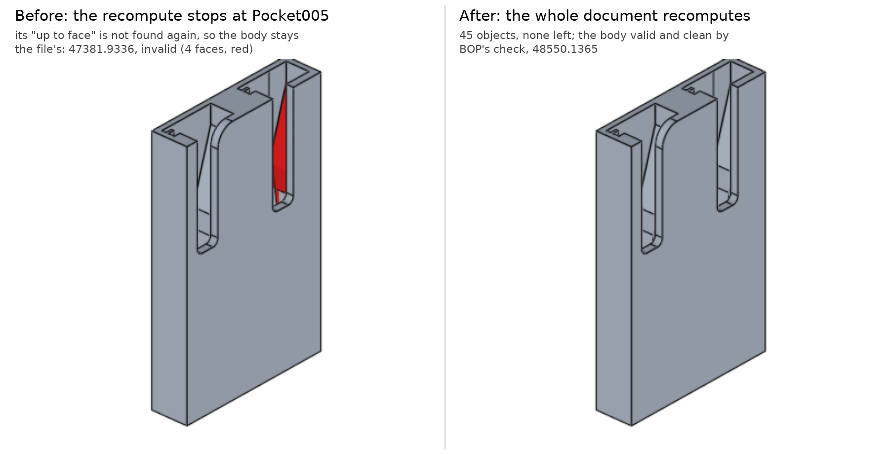

# OCC-labeled issues from realthunder/FreeCAD — model corpus + scan

All issues carrying the `occ` label on github.com/realthunder/FreeCAD
(26 as of 2026-08-01), with every recoverable attachment stored under
`models/`. This is raw material for growing the regression suite
(see `../thickness/`); none of these are fixed yet.

**Scan method:** each model opened in its own `FreeCADCmd` process
(crash-isolated), all objects touched, full recompute, then per-object
error states and `isValid()` checked. Scan stack: `LinkVibe-801` OCCT
(debug) + fcad `build/conda-debug-occt801`. "recomputes clean" means the
stored failure needs interactive steps (an edit, an export, a command) —
those need a scripted repro before they can join the suite.

## Reproduces on recompute (ready to become suite cases)

| # | Model(s) | Problem | Scan result |
|---|----------|---------|-------------|
| 64 | `issue064_boolean_split_seam.FCStd` | Part Split through a cylinder **seam edge** produces a wrong boolean; RT: split incorrect near seam, workaround = split at a different angle | invalid: Body, Split, Split_i0, Boolean, Reference **Rescan 2026-10-28**: the seam split is made at every Tolerance up to 2.5 (the pieces the same with the seam turned away); the file's own Tolerance of 3 mm puts the cut on the seam edge for 24 mm (within 2.83 of it), invalid -- left so. Found on the way and fixed: a plane/cylinder section lost under a fuzzy value (`IntAna_QuadQuadGeo`), `../boolean/` |
| 172 | `issue172_sketch_unclosed.FCStd` | Edges imported into sketch as external geometry become unconnected: curve `First/LastParameter` evaluation is ~0.003 mm off the end vertices | errors: Pad006, Pad008; invalid: Sketch008 **Rescan 2026-11-03**: does not reproduce. Sketch008's external edges (Pad005's line and two arcs) end on their vertices to 1e-11, stored and recomputed, and the sketch's two wires are closed; the GitHub issue is closed. Pad006 is made now. What fails is Sketch009 and Sketch010 ("Missing external geometry reference", so Pad008): their references into Import004, a SubShapeBinder of Pad006, all resolve on the shape the file was saved with (160 edges); the remade Pad006 has 156, and 5 of each sketch's references are gone -- a document matter, not the kernel's. |
| 273 | `issue273_heater_handle*.FCStd` | Fillet whose surface touches a **seam edge** destroys the shape; chamfer on the same edge segfaults (upstream bug 28354; `ShapeUpgrade_ShapeDivideClosed` suggested as seam removal) | invalid: Pad (both variants; crash itself needs the interactive chamfer) |
| 280 | `issue280_pocket_sphere_seam.FCStd` | Pocket through a mirrored sphere fails ("resulting shape is not a solid") once wide enough — cutting with **overlapping seam edges**; tolerance workaround exists | error: Sketch002 **Rescan 2026-10-28**: made. The file's Pocket is the failing case of the report (120 mm, through all, its sketch's edge on the mirror's seam) and recomputes valid, 71245.4350: what it removes is exactly the common of its tool with the part (31428.3242), BOP's check clean. **Rescan 2026-11-12** (fork `c861b8b553`, Linux): that was on another `Mirrored001` (102673.76). On the file's (98639.0377) the Pocket removed nothing, with no error -- the cut the part unchanged, the common and the fuse empty: a section that stops 0.0051 short of the corner it runs into (`../boolean/`, "#280"). Fixed: valid, one solid, 70554.51 (70554.63 by the tool moved 0.001 either way). |
| 333 | `issue333_draft_pad_crooked.FCStd` | Draft feature produces a broken model; Pad on top comes out crooked past depth 44 | **crash on recompute** **Rescan 2026-11-11** (FreeCAD `8e4ef3ccaa`): the document recomputes whole, 38 objects, the Body valid and clean by BOP's check, 51308.7537. Draft001 (the ledge 6 by 2.1 at the top, 85.5 deg) takes off its wedge and nothing else: 168.1031 = 6 x 2.1 x (2.1 / tan 4.5 deg) / 2, where the file's took 895.28 with a side face running out of the model. See "A face not found again for its arc" below |
| 334 | `issue334_draft_artifact.FCStd` | Same model family: artifact after Draft003; RT: side face broken from Draft001 on | **crash on recompute** **Rescan 2026-10-28**: the recompute stops at Sketch006 ("No planar face in AttachEngine3D": its support remapped to a curved face, a document matter), so Draft003's invalid shape is the stored one; recomputed alone it is refused (2026-10-02, below). **Rescan 2026-11-11** (FreeCAD `8e4ef3ccaa`): the document recomputes whole, 45 objects, the Body valid and clean by BOP's check, 48550.1365 (the file's: 47381.9336, invalid). Draft001 as in #333; Draft002 (72 deg, reversed) adds 1106.8212, the file's own figure; Draft003 (the ledge 6 by 2.2, 85.5 deg) takes off 184.4941 = 6 x 2.2 x (2.2 / tan 4.5 deg) / 2. Picture and cause: "A face not found again for its arc" below |
| 346 | `issue346_offset_one_side.FCStd` | Part Offset works from one side, throws "Unknown OCC exception" from the other | error: Offset **Fixed 2026-10-31** (`../thickness/`, sec 40): the Revolve's dome comes down to its axis, a dimple; inward the offset fell short of the axis where a crossing was looked for (`BRepOffset_Offset`), and the sphere closing the gap took a negative radius. The Offset is valid, every face 2 from the input's. With the Intersection join -2 is still refused, +2 valid and wrong, as before |
| 360 | `issue360_fillet_spike.FCStd` | Fillet produces a spike in the model (7 MB model) | **crash on recompute** (closed as OCC bug, still crashes) |
| 363 | `issue363_thickness_multi.FCStd` | "Unexpected result with thickness and other issues" — richest thickness repro in the corpus | errors: Chamfer, Thickness, Thickness001, Thickness002; invalid: Body, Thickness001 **Rescan 2026-10-29**: Thickness001 (both bottoms of a chamfered cylinder with a groove across its bottom removed, -1) was invalid, and so was the top removed; upstream 7.6 the same: two fixes in `BRepOffset_Inter3d` (`5525e72804`, two offset faces sharing two edges apart intersected at each; `0c1693fb61`, arcs of one circle on removed faces share it). Now valid, 5496.0504, the volume booleans give, and the Body with it. The rest stop in FreeCAD: the Part Chamfer finds no edges after the geometry version change, Thickness002 sits on it, and Thickness has an invalid face reference; run on their stored bases both are valid (3678.0536, 2158.7040). `../thickness/`, #363 **Rescan 2026-11-11**: why the Part Chamfer finds no edge. Its reference is `Cylinder.Edge1` by number, into a shape the file holds with no element names; FreeCAD builds a `Part::Cylinder` as a prism now and numbers it otherwise (the top circle is Edge3, Edge1 the seam), and a reference into a shape that had no names is not searched again by geometry when the shape is first named -- a document matter. Changed in FreeCAD (`89045214ca`, 2026-11-11, with the owner's word): a shape saved with no names keeps the map version it was saved with, so its first naming is a version change and the references into it are searched by geometry (one not found stays on its number). With that the Chamfer and the Cut recompute to the file's solids (18711.7185, 14772.5998) and one object is left, `Thickness002`, whose face of the Cut is bounded by intersection B-splines that do not come back the same to 1e-7. Two faces of this model were not found again by geometry though plainly there, the same cylinder written another way: FreeCAD's, fixed -- "A face not found again for its arc" below **Rescan 2026-11-11, later**: `Thickness002`'s face is found again. The two B-splines that bound it (where the cut's cylinder meets the body's) come back on the same points, 1e-9 apart as curves, but written otherwise -- knots 5e-7 and poles 9e-7 from the file's -- and FreeCAD compared poles and knots at 1e-7; it compares such curves as their points now (FreeCAD `f3f19634fb`). Every object of the model recomputes, 35 of 35. What `Thickness002` then makes is the kernel's and wrong: the cut's groove wall removed, 1 outward, Arc join, gives an invalid solid (2098.8735, where some 3500 is due; upstream throws; inward is right, 3223.6398). The wall is a half cylinder, and one of its straight edges lies on the cylinder's seam with both of a seam's pcurves, as the cut left it; the rim round the wall needs that edge the other way round, which picks the pcurve a period away, the rim is taken for a face running round the cylinder and dropped, and the wall's surface is left in the offset whole. **Fixed 2026-11-11** (`b62de1a33a`, `../thickness/` sec 66): the rim is made in two along the seam's line. `Thickness002` is valid, 3678.0197, the volume its stored base gives; the model recomputes whole, 35 of 35, nothing invalid |
| 474 | `issue474_fillet_edit_crash.FCStd` | Editing Fillet003 crashes; root cause per RT: sketch misalignment OCC fillet can't absorb; release crash needs `BUILD_RELEASE_DISABLE_EXCEPTIONS=Off` builds | **crash on recompute** |
| 521 | `issue521_thickness_intersection.FCStd` | Thickness **Intersection option** not working | error: Thickness **Fixed** (2026-10-31 and 2026-11-04, `79eb149f50`, `../thickness/` secs 38 and 45): #521's Connect with the Intersection join is made, the top, the walls and the cylinder removed, both directions |
| 523 | `issue523_fillet_explodes.FCStd` | Face "explodes" when applying a fillet radius | invalid: Fillet. **Fixed 2026-10-02** (`16df68d224`): the cylinder's seam was left on its three-quarter face as an edge with both pcurves, and the fillet corner read the one a period away; see `../fillet/` |
| 580 | `issue580_mirror_crash.FCStd` | Mirror produces an invalid shape; the following fuse crashes (whole-shape mirror via MultiTransform) | error: Chamfer; invalid: Body **Rescan 2026-10-28**: no crash; the mirror of Pad003 was invalid (652.3448), a degenerated edge on a plane losing its only curve in the copy (`BRepTools_TrsfModification`) -- fixed, `../boolean/`. The recompute now stops first at the Chamfer: the two-distance chamfer's first face changed with the rebuild, a FreeCAD matter (`../boolean/`, #580) **2026-11-13**: clean. Two things kept the Chamfer (5 up the side of `Pad001`, 2 on its base, a band 2 wide) from being made again. FreeCAD's: the first size is measured on the edge's first face, and 8.0.1 lists the pad's faces in another order than 7.x did, so the 5 went on the base; the face is kept by name now (FreeCAD `b4ff77d741`). The kernel's: with the sizes on the right faces the chamfer was still refused on the pad as it is made again -- its planes hold no curves of their edges, such an edge was taken for a cutting edge, and a point with no vector was asked for one (occt `17ddf3b4a8`; `../fillet/README.md`, "#580: a chamfer that takes a face's whole width"). Both chamfers are the file's (476.2935, 463.9305), and the mirror after them, the report's own, is made: valid, one solid, 1205.7309 (the file has the broken 700.93), right by 1500 points at random |
| 613 | `issue613_thickness_two_faces.FCStd` | Thickness with two faces selected opens only one of them | error: Fillet; invalid: Body, Thickness **Rescan 2026-10-28**: the recompute stops at the Fillet (its edge references lost), so the Thickness is the stored one. On the stored Fillet the thickness ran for ever, then threw: three fixes (`0b7bc39ad7`, `a9988e61f8`, `5a042c6a55`) -- then refused, the cap kept whole: a pave filler bug for a whole turn with its seam a hair off (`59ca72bbcc`, `../boolean/`). Made now, 10194.8311, one loose end of 0.05 left. **2026-11-01**: outward made too (11247.7097): the enlarged cone a whole turn 2.1e-8 off its seam gave no section in `ExtentFace` (`894ce673c9`, `79b1a21718`). `../thickness/`, #613 and sec 41 **Rescan 2026-11-11**: why the Fillet's references are lost: the `Pocket` before it recomputes to another solid (48986.7081, the file's 51256.4345), and that is the sketch, not the kernel. `Sketch002` is constrained to the start point of `Pad001`'s base circle projected edge on, a line. The file's runs from (-22.4753, 8) to (22.5, 8) -- made from a mesh's box, its start 0.025 short; since FreeCAD `83ace59e43` (2023-08) the line is exact and runs the other way, (22.5, 8) to (-22.5, 8), so the profile now reaches across the centre to +22.5. With the two constraints moved to the line's end the Pocket is 51262.5906 (6.2 off the file's, the 0.025) and the Mirrored 43735.2810, both valid and clean by BOP's check; the Fillet's two face references are then of planes that did move, and stay lost. A document matter **2026-11-13**: the line's direction was FreeCAD's to keep, and is kept (FreeCAD `311fa3fd28`): a full circle seen edge on has no start of its own, and its line now runs the way the line it replaces ran -- the file's, here. No version tells a sketch saved before 2023-08 from one saved since; the stored line does. Made again as the file is: `Sketch002` 76.3226 (the file's 76.2793, its line 0.025 short), the `Pocket` 51262.5906, the `Mirrored` 43735.2810 with the file's 8 faces and 17 edges. The Fillet still fails ("Fillet failed on ?Face4"): the two planes that moved by the 0.025 |
| 617 | `issue617_intersection_pad.FCStd` | Pad from faces built on a revolution/sketch intersection: extremely slow, then broken geometry (`_simple` variant currently recomputes clean) | error: Pad; invalid: Body, Pad **Rescan 2026-10-28**: the Sketch's cut of the revolution was a polyline -- degree 1, 1004 poles, 6.6e-5 off the surface with a tolerance of 1e-7 -- because FreeCAD built the section (`BRepAlgoAPI_Section(shape, plane)`, which performs at once) before setting `Approximation`. Fixed in FreeCAD (fcad `6165d350cc`): degree 5, 101 poles, 2.5e-7 off; the `_simple` model's Pad valid (77980.3452) in 0.6 s where it took 40. The full model's Pad still fails, now as a null shape after 33 s: the pad's wall meets the revolution along the pad's own bottom edge (cut from it) and in a branch leaving that edge at (42.08, 30.18, 0) and rising to z 7.64. That face pair alone (`IntTools_FaceFace`) gives the branch and the edge in 7 pieces in 0.8 s; in the pave filler it fails (`BOPAlgo_AlertIntersectionOfPairOfShapesFailed`), the bottom edge split in 58 pave blocks against the revolution. With the pad's base 0.01 below the sketch plane the fuse is valid in 0.4 s; neither a tolerance of 1e-6 on the profile nor a fuzzy value of 1e-6 or 1e-5 makes it. **2026-11-01**: that profile was not the cut: the sketch simplifies its intersection references (`ExternalBSplineMaxDegree` 5, `ExternalBSplineTolerance` 1e-4), and `Approx_Curve3d` said done at 20 segments with a MaxError of 0.015 -- `AdvApprox_ApproxAFunction` leaves the error code at 0 when the segments run out (`// for now ErrorCode=-1;`), against its own documentation of `IsDone()`. The profile was 0.014 off the revolution; FreeCAD checks the error now (fcad `fd8bdddd82`; the kernel is left as it is, its 16 callers relying on the flag), the cut stays at degree 8, 3.5e-7 off, and the recompute takes 0.8 s. The Pad is still invalid (intersecting wires): the walls' bottom edges, 3.5e-7 off the revolution at a tolerance of 1e-7, are found on it, and the branch rising from (51.10, 23.16, 0) to the wall's seam at z 7.64 comes back down to the bottom edge nearly tangent at (18.47, 46.91), its walking line ending 0.0015 above it. The profile at a tolerance of 1e-5 or a fuzzy value of 1e-5: valid, 5 faces (but wrong, below). Also seen: `BRepGProp` on the prisms (degree 8 B-splines of 30 knots extruded) gives 92341 plain and 14258 adaptive against 71190 (area x height; point classification 69561 +- 2125). The plain integrals took one Gauss rule of at most 61 points over a whole edge or range, a point or two a span: fixed (occt `2c45873435`, span by span; `../boolean/README.md`, "#617: a volume integrated a point or two a span"), the prisms 71190.7994, the shoelace's to 1e-10. The adaptive integral's 14258: fixed (occt `15ce0973f6`; `../boolean/README.md`, "The adaptive integral refined along the edges only"), the prisms to 4e-11. **2026-11-03**: the fuse's right volume is 127114: vertical rays through the prisms' base give their common part with the revolution as 6164 (the base's area to 0.5%), so 62081.90 + 71190.80 - 6164 = 127109, and the fuse with the prisms 0.01 above or below, or 0.001 above, is valid at 127107 to 127121. So the profile at a tolerance of 1e-5 (and a fuzzy value of 1e-5) gives a valid shape that is wrong: 119660, 7450 short, each wall kept whole, the part inside the revolution not cut off; 0.001 below gives three solids, 133275. Why, at 1e-5: the branch rising from the bottom edge is dropped, its end on the edge given no vertex. `IntTools_FaceFace` widens each face's domain by twice the two faces' tolerances (`CorrectSurfaceBoundaries(..., myTol * 2.)`), so a line ending on a boundary ends 2.04e-5 outside it (6.04e-5 at 3e-5, 2.004e-4 at 1e-4), and `PutBoundPaveOnCurve` takes the end only within the curve's tolerance (1e-5). Checked against the widened domain the end is taken, and the fuse is still invalid (the new vertex not on the bottom edge). At the profile's own 1e-7: the walking line coming down to the bottom edge from the filler's start point at the wall's seam stops 0.0015 above it at the tangent point (`IntWalk_PWalking::PutToBoundary` moves an end only within 1e-3 of the smallest parameter range, 5.7e-4 here); moved there, the fuse is still invalid, the other wall keeping a piece of the bottom edge's section that starts 3e-4 above the edge at its tangent point. Each fault uncovers the next, all in the filler's common path; the Pad left open. **2026-11-06**: fixed (occt `3c35c64037`, `11d03d433c`, `6abd543fc8`; `../boolean/README.md`, "#617: the pad's bottom edge projected across the revolution's seam" and "#617: a pad's wall standing on a revolution along its bottom edge"). The pad's bottom edge's pcurve on the revolution was 36.5 off: the profile is a closed B-spline, the revolution closed in v, and the projection's trap guard took v's other bound on its last step; and 16 segments could not follow 29 spans. And the wall, standing on the revolution along that edge, is tangent to it where it turns vertical, and a second branch of their section leaves the edge there: the edge is split at those points now, and a section curve passing them a few 1e-3 off is given them. The Pad: valid, one solid, 94597.28 in 0.3 s (invalid, 62081.89 before); the revolution's 62081.90 and the pad's 35595.40 less their common part, 3079.8 by vertical rays, give 94597.5. **Rescan 2026-11-12**: the `_simple` model's Pad, counted clean since 2026-10-28, added nothing: 77980.3452, the torus under it, in no error and valid. Its profile is the torus' cut as the sketch simplifies it, 6.1e-5 off the torus and across it 44 times, on an edge of 1e-7; the edge says what it is now (FreeCAD `230d1778eb`, 7.3e-5), and the walking lines that lose their way at the two points where the pad's wall is tangent to the torus are cut there and joined to the points by a curve of their own (occt `066e82ba7d`; `../boolean/README.md`, "#617: a pad standing on a torus along its own cut"). The Pad: valid, one solid, 122396.04, which the pad moved 0.01 either way gives between them; the full model's 94597.92, its tangent vertices no longer grown |
| 876 | `issue876_fillet_pocket_flip.FCStd` | Fillet produces invalid geometry; downstream Pocket **adds** material instead of cutting | invalid: Fillet001 |
| 962 | `issue962_fillet_artifact.FCStd` | Strange artifact | invalid: Body001, Fillet, Fillet003, Fillet004 |

## Rescan of the fillet, chamfer and draft models (2026-10-02, macOS)

The same method on the macOS box: release build (`build/mac-relwithdebinfo-801`),
`LinkVibe-801` at `f723999a15`, OCCT installed RelWithDebInfo. Two corrections to
the table above come first:

- **#333, #334 "crash on recompute" was not the recompute.** Both files hold a
  `Mesh::Feature`, and the scan read `getattr(obj, "Shape")` on it, which falls
  back to `Part.getShape()` -> `Mesh::Feature::getSubObject()` with no subname
  -> a null name into `Data::IndexedName`'s list constructor -> `strlen(NULL)`.
  A FreeCAD bug (the sibling constructor guards null), not OCCT's. Read through
  `PropertiesList`, both recompute.
- **#474 no longer crashes**, and **#309's fillet is valid** (Edge8, radius 1:
  12751.0044) -- upstream's 0032929 (`24e4b3c83b`) is in the fork.

| # | Now (fork before `16df68d224`) |
|---|---|
| 273 | Body valid; Pad003 invalid, Sketch003 in error (both files). The chamfer crash needs the interactive chamfer scripted **Rescan 2026-10-25** (`d602360242`): both files recompute with every Fillet valid (8544.4503; 8535.1578, 8525.7094) and Pad003 valid; the one error left is Sketch004's. The sweep's E20 (the top's side edge beside the pocket in the top), refused from about 1.26, is made at 1.5, 2 and 2.5 by FreeCAD's PartDesign Fillet, the pocket taken out and cut back (`PastFeatures`, fcad `386a9ab57b`; fillet README, "Features past which a fillet runs"). **2026-11-09**: the chamfer crash, scripted: the reporter's edge (from their screenshot) is the arc of the disc's top from the handle's foot to the cylinder's seam, chained with its tangent neighbour past the seam. Upstream's FreeCAD 1.1.4 (OCCT 7.8.1) still segfaults there, the reporter's stack (`IntersectMoreCorner` under `PerformIntersectionAtEnd`); upstream's 8.0.1 TKFillet refuses it. The fork: valid at 0.5, 1 and 2 on the stored Pocket and Fillet, in Part and through PartDesign's Chamfer, clean by BOP's check, nothing removed outside the chamfer's ring. Nothing left on the kernel side for #273. |
| 309 | fixed (see above) |
| 333 | no crash; Sketch006 "No planar face in AttachEngine3D" (its support remapped to a curved face) |
| 334 | no crash; Draft003 invalid, Body invalid. Draft001 and Draft003, recomputed alone, are **refused now** (`ca766a8a92`): a drafted ledge whose corner a bevel touches needs a new edge, which a draft cannot make, and it gave an invalid shape; see `../draft/` |
| 360 | not finished: the recompute ran 25 min and the scan was stopped for memory on the 8 GB box. **Fillet008's spike fixed** (2026-10-23 check): made since `fb9200b0fd`, upstream 8.0.1 still makes it; the stored `Pad016` has a vertex at tolerance 37.2 (old build), recomputed now 1e-7. `../fillet/`, "#360" **Rescan 2026-11-10**: the document's `Thickness` (the plate `Mirrored`, 10 thick with square holes 4.3 apart and 2.5 from the outline, Face5 removed, 4 inward, the Arc join, Intersection on) was refused by the fork; the stored shape and upstream's 8.0.1 are 38747.1395. The chain's first commit breaks it (bisected), and with it every plate whose holes are nearer each other, or the outline, than twice the thickness. **Fixed**: made once more with the loops' wires taken by the way their edges run where the first way has no valid answer -- 38747.1395, as stored (`../thickness/`, sec 60). **2026-11-11**: the same plate is made 2, 3 and 5 inward too (33213.1056, 36527.3399, 40288.2902; sec 61 and 63), and in 4 to 8 s where it took 20 to 146 (sec 64; upstream takes under a second, and is invalid at 2) |
| 474 | no crash; Fillet003 and four sketches in error **Rescan 2026-10-25** (`d602360242`): Fillet, Fillet001, Fillet002 valid; Fillet003 errs because its edge reference is lost (`?Edge41`), Sketch017's attachment failing upstream ("No planar face") -- a document error, not the fillet's; on its stored base it is a suite case (`../fillet/`). **Rescan 2026-11-11**: the four sketches' attachment was three faults of FreeCAD's, not the document's, all fixed. (1) Each helix was made wrong on its first recompute: a helix of this fork's earlier files is stored with its sketch's placement, the path was still moved by it and the profile no longer, and the helix came out wound about the sketch's normal, 129.01 where the file has 1783.37 (FreeCAD `930694f3ef`); it is 1783.37 now. (2) The end face the sketches sit on, Face1 in the file and Face17 made again, was not found by geometry: three of its edges were lines and come back straight B-splines of degree 1 (`adf249b4ad`). (3) And was not looked for where it should be: the shape, set a second time while its placement was written, was kept as the one the references had been written against, so each stayed on its number (`ff12ade957`). The sketches attach. What is left is lost for a reason: three datum lines on a helix edge and Fillet002's edge are B-splines of the sweep, and the helix made again is the same curve to 4e-7, not to the 1e-7 a reference is searched at (the earlier build's approximation and this one's); Fillet003 as before |
| 523 | Fillet invalid -- **fixed**, `../fillet/` |
| 631 | valid (10005.3404, alt 42806.4887): wrong-but-valid needs a geometric check. **Fixed** (2026-10-24, `2bde18d4b5`): the Fillet (15, the loft-pad joint, `Edge18` of the loft) bulged out of the pad's side -- its end on the loft's side, a plane made a B-spline, lay past the B-spline's bounds and went to a plate; now 9919.5607, the volume of the loft with plane faces. The alt document (four fillets, r 39 to 49, on an S-bent bar's bends) is unchanged, 42806.4889, and renders clean. `../fillet/`, "A face's B-spline bounds" **2026-11-09**: chamfers on the arm (Fillet002's input) refused at every size where the fillet was made, and wrong where made (0.52 to 1.37 wide at 0.8): the chamfer's guide was bent off the edge by the adjustment of its other end (`1420e35a51`). `../fillet/`, "A chamfer's guide bent at its other end" |
| 876 | valid by `isValid()` and the BOP check through Fillet001; the Pocket result is the 3-face 475.17 solid, still wrong. Its first fillets moved by 0.0173 with the #523 fix (right period, closer to tangent) **Rescan 2026-10-25** (`d602360242`): the whole document recomputes clean; the Pocket cuts, 8558.5252, 69 faces, valid. |
| 962 | Fillet, Fillet003, Fillet004 invalid; Body001 invalid. The recompute stops at Sketch004 ("malformed constraints" after an element remap), so these are the stored shapes. Fillet's five failing edges (101, 102, 104, 105, 50) **fixed**, `../fillet/` (`cf96757c36`: corners on walls split in coplanar pieces); and with all twelve edges since `b38f0d910c` (the pair 36 + 49 rewrote one coplanar seam twice): 11552.7830, `issue962_fillet_r0.8` **Rescan 2026-10-25** (`d602360242`): the stored Fillet, Fillet003 and Fillet004 are shapes from before the recompute broke at Sketch004. Recomputed one by one (each on the one before, the edge references remapped), all three are valid and clean by BOP's check -- 11552.7711, 11540.4466, 11532.3264 -- and Fillet004's corners at the ring's gap (r 1.3) render sound. **2026-10-25**: the sweep's E6 at the gap (and its mirror E9), refused in the kernel -- the fillet's end runs past a ledge 0.05 wide, a step left between the ring's cone and its bore -- is made by FreeCAD's Fillet taking the ledge out (`RemoveSlivers`, fcad `967a0656f0`; `../fillet/README.md`, "Sliver faces taken out"). |

## Recomputes clean — needs a scripted repro (the bug is in a step, not the stored state)

| # | Model(s) | Problem / needed script |
|---|----------|------------------------|
| 309 | `issue309_fillet_crash_shape.brp` (+ `notes/issue309_*`) | Fillet on an arc edge crashes in `ChFi3d_Builder::PerformIntersectionAtEnd` (upstream #32929). Script: load brp, `BRepFilletAPI_MakeFillet` on the reported edge. Upstream workaround patch + crash stack kept in `notes/` |
| 310 | `issue310_step_color_export.FCStd` + 2 `.step` refs | STEP export loses the **top face color** of an untransformed cylinder — top/bottom faces share a TShape (partner shapes) and the color goes to the wrong one. Script: export STEP, parse colors **Fixed 2026-10-28** (`9ba3806e9b`): reproduced with FreeCAD's `ImportGui.export` and in OCCT alone -- a prism's top face, its bottom moved up (FreeCAD's `Part::Cylinder`), lost its STEP colour to the bottom: the writer's shape processing kept its history without the faces' locations. `../exchange/` |
| 423 | `issue423_fill_crash.FCStd`, `issue423_distance_wrong.FCStd` | `BRepOffsetAPI_MakeFilling` crash invoking Part Fill (known OCC bug, see comment at fcad `TopoShapeEx.cpp` filling site); second file: wrong distance measurement **Rescan 2026-10-28**: no crash. `BRepFill_Filling`'s `WireFromList` checks `itl.More()` before `Remove()` in 8.0.1 (upstream's), the fix FreeCAD's comment asked for. The file's three wires, 16.8 to 23.2 apart, given to `BRepOffsetAPI_MakeFilling` as bounds as they are (FreeCAD's wire fix left out), with and without the face's edges: done, the face invalid -- what open bounds ask for. |
| 631 | `issue631_fillet_loft_joint*.FCStd` | Fillet at a loft edge joint gives a wrong **but valid** shape (radius > 3 mm); needs a geometric assertion (volume/area), not validity |
| 652 | `issue652_pad_top_uncovered.FCStd` | Pad on a face whose sketch arc coincides with an existing arc: top surface not covered — tolerance-coincidence case; may need the exact re-pad step **Rescan 2026-11-09** (fork `b85c0a751e`, Linux): does not reproduce. Recomputed, Pad001 is one closed shell, valid and clean by BOP's check, 2750.8513 -- the two pads' 733.2830 and 2017.5683, which only touch -- and every one of its 18 faces meshes to its area (`BRepMesh_IncrementalMesh`, 0.1), the top split by the second pad's arc among them. The same with the stored Pad and Pad001's tool fused in OCCT alone, plain and with a fuzzy value of 1e-5 (20 faces, unrefined). The report was on 7.6.3; nothing left on the kernel side |
| 662 | `issue662_thickness_pads_holes.FCStd` | Thickness produced an invalid shape making later pads become holes (validate-shape option added in FreeCAD because of this one); stored doc now recomputes clean **Rescan 2026-10-31**: the file was saved with the Thickness inside out (-2825.5674, invalid) and everything after it so; recomputed on the fork the Thickness is valid (1908.1731) and so is every feature up to the Pad (14180.0845). Sketch006 stays Invalid ("No planar face"): it is attached to the Pad's Face48 by a hashed name (`#945;:M;FUS`) recorded on the broken model, which now resolves to a cylinder (Face53). Attached to the face it was on -- the Pad's top at z = 5, Face14 now, 1322.46 against the stored 1322.59 -- the Body is valid, 14434.3704. Nothing left on the kernel side; the document needs its sketch attached again |
| 672 | `issue672_recompute_ghost.FCStd` | "Ghost" state: adding a circle to Sketch007 corrupts geometry unless `Support Ring` is recomputed first — recompute-order dependence, possibly not OCC **Rescan 2026-11-10** (fork `10a2414c33`, Linux): the kernel's part is gone. The file's stored `Pad001` (Support Rings) fails BOP's check -- one vertex, at (40, 35, 16), has a tolerance of 139.2 -- and so does every feature after it: the shape the ghost was built on. Made again on the fork, by the plate fused with the ring prism in OCCT alone (plain and fuzzy 1e-5) and by PartDesign's UpToFace Pad on the stored plate and ring sketch, it is 278880.0000, 22 faces, tolerances 1.5e-7, valid and clean by BOP's check. The document itself does not recompute now, for a FreeCAD reason: opening it asks for a recompute on the element map's version change (1.15.70200 -> 1.15.80001), and the recompute moves every reference into `Pad` to another element although the remade `Pad` numbers its faces and edges exactly as the stored one (Sketch001's support Face4 -> Face3, its external Edge13 -> Edge10, Pad001's UpToFace Face2 -> Face1), so Sketch001 fails, "Sketch with malformed constraints". Not the kernel's **2026-11-11**: the remap was FreeCAD moving a reference kept in two properties twice (below, "References moved twice on open"); fixed, and the document recomputes whole, its ten solids as stored |
| 985 | `issue985_uptoface.FCStd` | Extruding circles "up to face" fails (`Bnd_Box is void`); needs the up-to-face pad edit scripted **Rescan 2026-11-09** (fork `b85c0a751e`, Linux): does not reproduce; the GitHub issue is closed. The file's Pocket002 is the failing step itself (Type UpToFace, Pocket001's Face7, a plane 1588.55 in area) and recomputes valid, clean by BOP's check, 27991.8187: both circles of Sketch003 (r 5.415) cut, each tool prism 893.136 (pi r^2 by the 9.695 the hole's centre line runs inside the base, which is empty in the result), the result the base less both to the digit |

## Found in FreeCAD work (no tracker issue)

Problems met while working on FreeCAD itself, recorded here before any fix.
Named `localNN_*`.

| # | Model | Problem | Reproduces |
|---|-------|---------|-----------|
| local01 | `local01_thickness_open_top_cup.FCStd` | PartDesign Thickness with its defaults (Skin, **Arc** join, Reversed = inward) on a plain `Part.makeCylinder(20, 10)` opened at the **top** (Face2): invalid solid, volume 16585.68 where the wall is 4423.36. The `ThicknessIntersection` twin in the same file (Intersection join) is right. Found 2026-09-27 porting upstream's recto-verso thickness (fcad `b498307318`, whose Arc test is an expected failure because of it). The same defect as `../thickness/` case `cyl_bottom_in` (which opens Face2, the **top** -- that README explains why the names are kept): every radius and height tried (r 4-40, h 5-20, offset -1 and -2) fails with the top opened and passes with the bottom opened. **Fixed** in `BRepAlgo_Loop` (a closed edge reached after its seam wire was built kept a wire of its own) -- twice, independently: here on 2026-09-28 and on the peer box as `b93149464b` (2026-09-30); the merge of 2026-10-01 kept `b93149464b`. Now 4423.36, valid. | fixed |
| local02 | `local02_fuse_shared_face_{fail,ok}.brep` + `local02_fuse_shared_face.py` | Booleans of two valid, **overlapping** solids that **share a face TShape** (same orientation in both: the second solid runs from that face back into the first). Each `.brep` is a compound of the two (base, tool) so the sharing survives. In `_fail` every op is wrong: fuse and common come back **empty, with no error**, base-tool 7457.000 (want 8218.270), tool-base 1003.506 (the whole tool; want 501.752). In `_ok` only tool-base is wrong. The two differ by ~1e-14 in their vertices, nothing else. Copying either solid (no sharing) or a fuzzy value of 1e-7 gives the right answers for both. Found 2026-10-01 as a flaky fcad test, `TestLoft.testTwoFacesAdditiveLoftCase` (upstream's issue 19183 model): a PartDesign loft from a pad's curved flank shares that flank face with the pad, and the sketch solver's last-bit noise across processes picks which side of the failure a run lands on (4-6 of 10 runs fail). Same results on upstream FreeCAD 1.1.4's OCCT 7.8.1. A plain box with a prism of its own face, inward or outward, is fine -- the curved face and the B-spline loft walls matter. Only in **non-destructive** mode (which FreeCAD always sets): `UpdateBlocksWithSharedVertices` (nd only) replaces an old vertex both faces share by a new one (`UpdateVertex` copies it, SD 35 -> 96) after it has already filled the faces' `VerticesOn`; nothing fills them again before `MakeBlocks`, which put the old vertex on the section curves, so the section edges ended on vertices the split edges no longer used and the faces they should split stayed whole (`BOPAlgo_AlertSolidBuilderUnusedFaces`). Whether the old vertex is replaced there turns on its on-curve test, hence the 1e-14 sensitivity. **Fixed 2026-10-01** in `BOPAlgo_PaveFiller::UpdateBlocksWithSharedVertices`: the faces' ON vertices are remapped to the replacements. All eight answers right; `TestLoft` 10/10. **Second symptom, same cause:** the ops also **modified their inputs** despite non-destructive mode -- the script now checks that too: FreeCAD 1.1.4 / OCCT 7.8.1 touches 6 input vertices/edges in every op of both pairs (the `_ok` pair included), the fork none. Instrumented, the pre-fix kernel widened the old shared vertices (35, 37, 61, 66) in `PutPaveOnCurve` (`BRep_Builder::UpdateVertex` on the vertex it puts, 2.12e-7 -> 2.15e-7), and with a fuzzy value of 1e-5 in `BOPTools_AlgoTools::MakeEdge`, which widens both ends of every section edge to the curve tolerance (2.12e-7 -> 7.21e-6). The rule both break: in non-destructive mode a section edge must not end on an input vertex, since `PutPaveOnCurve`, `MakeEdge`, `UpdateVertices` (MakePCurves), the micro-edge merge in `PostTreatFF` and `CorrectToleranceOfSE` all write the tolerance of section-edge vertices in place. **Was open, not reproduced here:** `EstimatePaveOnCurve` (which decides the replacement) tested against the curve tolerance, `PutPaveOnCurve` against it plus the fuzzy value -- never below 1e-7 -- so a shared vertex just inside the wider test could still be put on a curve unreplaced. Reproduced and closed as local04 (`2f91019c73`: the estimate adds the fuzzy value too). | fixed |
| local03 | `../thickness/models/issue3_pad_thickness.FCStd` (the thickness suite's `issue3_pad_thickness`) | On the merged kernel of 2026-10-01 (`3b219f881c`, Windows, fcad `PartDesignPort` -- which sets no Immutable flags) the document's **Pad** -- a prism of a one-wire sketch (two arcs and two lines), no boolean -- came out **inside out**: volume -189356.2997, `Unorientable shape`, its Face3 a cylinder of area -9128.6. **Not the Pad: the Thickness on it edited the Pad's shape in place.** The Pad recomputed alone is a valid 9503.3915; a fresh prism given to `Part`'s `makeThickness` (faces 5, 3 and 6 removed) comes back inside out too. The arcs' parameters run past 2 pi (5.99226-6.57411); the generatrix at the arc's far end ended at u = 0.29093 on the removed cylinder, 6.57411 folded by 2 pi. Cause: `BRepAlgo_Loop::FindLoop`'s pruning builds a test face of each wire on the face's own surface and location, from the loop's own edges -- some of them the input's -- and ran `ShapeFix_Shape` on it when it was invalid; ShapeFix shifted a shared edge's pcurve by a period on that surface, i.e. the input face's own pcurve. Reached since `36d34e9d05` (sec 27.95: a periodic face whose edges lie within one period takes the plane path) -- bisected on Linux with scratch TKBool/TKOffset. It reproduces on Linux exactly, but only with `ImmutableShapeValues` off: FreeCAD's Transaction branch freezes shape values when it finds the fork, and copy-on-write protects a frozen input, so the thickness suite (which set nothing) never saw it. **Fixed** in `1e5f89c06f` (ShapeFix works on a copy of the test face; thickness results unchanged, the 712-run sweep identical) and guarded in `e22e4be177`: the thickness suite now runs unfrozen and every case checks its input is left as it was (`sector_outer_arc_input`, `sector_outer_arc_past_period_input`: a padded ring sector straddling angle 0). FreeCAD docs/TransactionLog.md sec 27.104. Windows confirmed 2026-10-01 on `6280dc5215` (TKBool/TKOffset rebuilt, fcad PartDesignPort, unfrozen): thickness suite PASS 94, issue3's Pad valid 9503.3915, Thickness valid 1241.0718. | fixed |
| local04 | `local04_fuzzy_shared_vertex.brep` (made by `local04_fuzzy_shared_vertex.py`) + `local04_fuzzy_shared_vertex.cpp`; picture `local04_fuzzy_shared_vertex.png` (made in the GUI by `local04_fuzzy_shared_vertex_picture.py`): the model, and the two radii at V to scale -- the result shapes are the same before and after the fix, so there is no before/after pair to show | A **non-destructive** Boolean with a **fuzzy value** writes an **input** vertex's tolerance. `UpdateBlocksWithSharedVertices` asks `EstimatePaveOnCurve` whether an old vertex shared by the two faces of an FF pair lies on their section curve, with the curve's tolerance only (`IsVertexOnLine`: distance <= max(2 (tolV + tolC), 1e-6)); a vertex that does is replaced by a new one before anything writes to it. `PutPaveOnCurve` later asks the same question with tolC + fuzzy. A vertex whose distance falls between the two is never replaced, is put on the curve, and `PutPaveOnCurve` raises its tolerance in place (`BRep_Builder::UpdateVertex`) -- the input's own vertex. The model: two prisms whose faces share ONE vertex V (one TShape) at a reflex corner of both, V on A's plane z=0 and 1.74e-6 off B's plane (tilted 10 deg), tolerance 1.94e-6; the section line passes V at 1e-5. Fuzzy 3.162e-7: the estimate's threshold is 9.8e-6 (off the curve), the put's 1.04e-5 (on it), and V goes 1.94e-6 -> 1e-5 in fuse, cut, common and the reversed cut; at 2.512e-7 both agree and nothing changes. A sweep over tilts 5/10/20 deg and distances 1e-5/1e-4 hits 6 of 132 (pair, fuzzy) points, each in the narrow band 2 (tolV + tolC) < d <= 2 (tolV + tolC + fuzzy), tolC there being the curve's tangential tolerance, which grows with the fuzzy value as the angle shrinks. Why only this shape: in non-destructive mode any VF/EF update of an input vertex replaces it first, so the only candidates are vertices shared ON a face of each argument; and at a convex corner the section line crosses V's own edge at the same distance, which splits or snaps first. **FreeCAD's Part booleans do not reach it:** given a fuzzy value they copy the tools (`BRepBuilderAPI_Copy`, an old workaround), which also breaks the sharing -- hence the C++ driver. **Fixed** in `2f91019c73`: `EstimatePaveOnCurve` adds `myFuzzyValue` to the tolerance, as `PutPaveOnCurve` does (it is never below 1e-7, so non-fuzzy runs move by that much too). The same 528 runs: no input touched, every result's volume and validity identical to before; thickness suite PASS 94, local02 0 wrong; FreeCAD on it (Windows, PartDesignPort): Python 3195 OK, ctest 750/750. | fixed |
| local05 | `local05_step_hidden_component.cpp` (C++ driver, builds its own XCAF document); picture `local05_step_hidden_component.png` (made by `local05_step_hidden_component_picture.py`, plain matplotlib): the three cases and what the writer made of each -- nothing differs on screen, before it faults and after it writes | **STEP export crashes** (access violation, a read at 0x18) when an assembly **component is invisible and carries no colour of its own**. `writeColors` styles a component from the component label's own attributes only; invisible with no colour, `MakeSTEPStyles` takes its "default white" branch, which calls `setDefaultInstanceColor(theOverride, aPSA)` for a component -- and `theOverride` is null whenever `getStyledItem` found no styled item for the referred shape, which is the case for the components of an assembly written in one pass (they come before the shape they refer to in the label list). The model: an assembly of two boxes, each its own shape, the second component hidden. Colour on the referred shapes only (`ref`) or nowhere (`none`): crash; on the hidden component itself (`own`): fine. Two components of ONE shape pass with `ref` -- the visible sibling's styling supplies the item. Found 2026-10-04 as a "hang" in FreeCAD: `ImportGui.export` of an App::Part with a hidden child never returned. On this Windows box the fault is swallowed where it crosses the window procedure (a DLP hook, `dgapi64.dll`, sits on that path), leaving the process idle in its event loop; elsewhere it is a crash. FreeCAD has carried a workaround since OCCT 7 (give a hidden component a colour), but tested the colour with `GetInstanceColor`, which falls back to the referred shape's -- and every GUI export colours the shape: case `ref`. Fixed on the FreeCAD side to test the component's own colour and copy the referred shape's onto it (fcad `ExportOCAF2::setInvisible`). **Fixed 2026-10-04** here too: `setDefaultInstanceColor` returns at once without an item to copy from, so the branch keeps its default PSA. The driver: `own`, `ref`, `none` all write, each with its INVISIBILITY; FreeCAD's original repro passes on the fixed kernel with the OLD workaround as well. What the kernel fix cannot do: in `ref` the hidden instance is styled the default white, not the red of its shape (an override item; FreeCAD's own reader ignores it and shows red, other readers may not) -- which is why FreeCAD colours the instance itself. | fixed |

## No usable repro

| # | Problem |
|---|---------|
| 937 | Fillet crash: `BRep_Tool::CurveOnSurface` null deref under `ChFi3d_Builder::StartSol` (OCC 7.7.2). Stack trace only, reporter never posted the file |

## References moved twice on open (2026-11-11, FreeCAD `eb1a503501`)

Every model here was written with another element map version, so opening
one has each reference found again by the geometry of its old element.
`Support` and `AttachmentSupport`, `UpToFace` and `UpToShape` hold one
reference twice, and where the target's faces come out numbered otherwise
(#672's first pad: its sketch's wire starts an edge later now) the
reference was moved twice -- Face4 to Face3, the same face, then Face3 to
Face2 -- the sketch on it failed with malformed constraints, and the
recompute stopped there. That is the "references lost" and "malformed
constraints after an element remap" of the rescans above; it was FreeCAD's
(`App/PropertyLinks.cpp`), not the kernel's, and is fixed there. All 27
models but #360 and #474 (too long to run here) opened and recomputed,
before and after:

| # | Objects left not up to date, before -> after | Solids that differ from the stored ones, after |
|---|---|---|
| 273 (both files) | 4 -> 0, 5 -> 0 | 0 of 8, 3 of 9 |
| 333 | 18 -> 6 | 0 of 16 |
| 334 | 25 -> 13 | 0 of 21 |
| 662 | 4 -> 0 | 8 of 10 |
| 672 | 16 -> 0 | 0 of 10 |
| 962 | 14 -> 0 | 4 of 12 |

The other 20 are as they were, none with more left. A solid "differs" by
its volume, its number of faces or its validity: each is a recompute that
did not run before, to be looked at as the kernel's.

Looked at (2026-11-11), none is the kernel's -- in each the file's solid
is the poor one:

| # | The file's | Recomputed |
|---|---|---|
| 273, fillet file | `Fillet` 8535.1327 and `Fillet001` 8525.6842, valid with a largest tolerance of 0.71; the rim's fillet ends on the handle's feet with corner patches at one side only | 8535.0646 and 8525.6889, valid and clean by BOP's check, largest tolerance 0.0026; a corner patch (0.514 in area) at each of the four feet, the two sides mirror images |
| 662 | everything from the `Thickness` on inside out and invalid (the reporter's) | all valid; the Body 14434.3701 (14434.3704 at the 2026-10-31 rescan, its sketch attached by hand). BOP's check names only the C0 faces the model had from the start |
| 962 | `Fillet`, `Fillet003`, `Fillet004` invalid (the reporter's) | valid and clean by BOP's check: 11552.7810, 11540.4575, 11532.3379 |

## A face not found again for its arc (2026-11-11, FreeCAD `8e4ef3ccaa`)

With the references moved once, #333 and #334 still stopped, 6 and 13
objects short, at `Pocket005`: "Up to face: Failed to extract face". Its
`UpToFace` is `Fillet001`'s Face147, the plane at the top; the Fillet
recomputes to the same solid, to the digit, and Face147 is there, the same
11 edges on the same 11 vertices -- and the search by geometry did not
find it. One of its arcs (r 6, a quarter turn) is the same circle written
another way: the file's runs from 3 pi / 2 to 2 pi, the recomputed one
from pi to 3 pi / 2, its X direction a quarter turn on. FreeCAD's
`Geometry::isSame` compared an arc by the parameters it runs between and
its circle by its X and Y directions, which say where the angle is counted
from and which way round, nothing of the points.

Fixed in FreeCAD (`Part/App/Geometry.cpp`): a circle is the same by its
centre, its radius and the line of its axis; two arcs of one circle are
the same when their ends, in either order, and their middles agree. What
compared the same before still does. Test:
`TopoShapeExpansionTest.searchSubShapeArcWrittenAnotherWay` (a face
bounded by a quarter arc, found again with the arc's circle turned and
with its axis reversed; the arc's complement, with the same ends, is not
the same).

Both documents now recompute whole, valid and clean by BOP's check, and
the drafts the issues are about come out right -- each ledge drafted at
85.5 deg loses its wedge and nothing else (#333's and #334's `Draft001`
168.1031, #334's `Draft003` 184.4941, both to the digit of width x depth
x height / 2), where the file's `Draft001` took 895.28 and left a side
face running out of the model. The other 25 models recompute as before.

The same again for a cylinder (FreeCAD `888c40f688`), met in #363: a cut's
hole came back with its axis the other way round, a pocket's wall with its
origin moved 1.63 along its axis, and neither face was found by geometry
(the pocket's was still found by name; the cut's is lost for another
reason, #363's row). A cylinder is the same by its radius and the line of
its axis. Test: `TopoShapeExpansionTest.searchSubShapeCylinderWrittenAnotherWay`.

The picture: `issue334_arc_reference_shapes.py` (FreeCADCmd; the two
shapes), `issue334_arc_reference_picture.py` (FreeCAD under xvfb-run; the
panels, invalid faces red), `issue334_arc_reference_compose.py`.

## Where the models stand (2026-11-13, OCCT `17ddf3b4a8`, FreeCAD `b4ff77d741`)

Every model opened and every object made again (each touched, then one
recompute), on Linux. 25 of the 29 recompute with no object in error and
no invalid shape. The four that do not:

| Model | What is left | Whose |
|-------|--------------|-------|
| #64 | five shapes invalid | the file's own Tolerance of 3 mm, which puts the cut on the seam; left so (its row) |
| #172 | Sketch009, Sketch010 (external references), Pad008 after them | the sketch: a chord and an arc that cross twice, 0.008 apart; the pad made again differs there from the stored one (its row) |
| #474 | Fillet003, as the file has it: its edge is `?Edge41` in the file as saved, and that edge of the stored `Pad011` is 9e-7 mm long | the file's. `Pad011` is made since FreeCAD `319e756a1d` (1988.87278 mm3 to the stored 1988.87285, without that edge). It failed with "FaceMaker: result shape is null": `Sketch018` lies on a side face of `Pad010` and landed turned a quarter in its plane, its constraints folding it flat. A sketch on a flat face takes its axes from the Placement of the feature the face belongs to; in the file that is the first sketch's (roll 90), as features were placed until 2022-09 (`c1616d2349`), and made again it was identity. Four sketches of the file turned so, three by a half turn which their constraints brought back to the same wire. The owner's ruling (option A of three put): a feature the file holds with a Placement keeps taking one. All 99 placed shapes of the file keep theirs and of its 178 shapes only `Pad011` differs from the stored |
| #613 | Fillet, and the stored Thickness after it | two face references to planes 0.025 mm from where the file has them: the file's projected line was that much short. The Pocket and the Mirrored before it are made as the file has them since FreeCAD `311fa3fd28` (its row) |

What went since the table of 2026-11-11 (#580 on 2026-11-13, its row; the
rest none of it the kernel's):

- **#360 is clean.** `Hole001` ("Adding the thread failed") was a file read
  wrongly, not a thread the kernel cannot fuse, and not the bore of another
  convention as first written here: a hole's thread size is saved as its
  place in its table, and as the file was read the size was looked for
  again by diameter. The file has no ThreadDiameter, so the bore stood in:
  an M3 with its 2.52 mm bore came back as an M2.5 with the M3's bore,
  the crest of whose thread lies on the bore. A file's size is now kept
  (FreeCAD `38645e5008`; the same fault put a fine thread of today's own
  files back at the first pitch of its diameter, 109 of the 171 sizes).
  The hole is made, to the stored volume and the stored 212 faces, with
  the thread profile it was made with -- an earlier hole keeps that by the
  version on the object.
- **#360's patterns** recomputed without error and wrong: `Mirrored004`,
  the mirror of a mirrored pocket offset by 1.4 mm, took 42 mm3 more than
  the file has, and `Mirrored010` filled the two fillets on its original
  back in. Since 2024-09 a pattern made its first instance, which is the
  original, on top of a support that already holds it. It is left out
  again (FreeCAD `6681f43f36`); the patterns made in between keep what
  they have, by their version. Found by comparing each feature made again
  with its stored shape, not by an error.
- **#474's three datum lines and Fillet002** find their edges: a reference
  not found to 1e-7 is looked for once more and taken where it is the one
  element there (the owner's ruling), and two B-splines are the same
  curve whatever their poles and whichever way they run -- the helix edge
  is written with 21 poles of degree 11 in the file and 34 of degree 9
  made again, and the edge where a pad meets the helix comes back
  reversed (FreeCAD `13266c5b84`). How far off the second look goes is a
  setting, as the owner asked, and goes by the shapes: the Part
  preference `ReferenceSearchTolerance` (10 unless set, 0 for no second
  look) times the larger of the tolerance the element had and that of
  the element found (FreeCAD `728cfabf72`; it was a fixed 1e-5). The
  datum lines' edges have 1.3e-7 in the file and 2e-7 made again and lie
  4e-7 off; Fillet002's has 5e-6 and lies 2.4e-7 off. With the datum
  lines found, what follows them is made for the first time, which is
  where `Sketch018` shows.

- **#617's `_simple` Pad** recomputed with no error and added nothing
  (77980.3452, the volume of the torus under it). Found by a third way of
  reading the models, after the errors and the stored shapes: of every
  feature that adds or removes, 1500 points taken at random in its box are
  asked whether they are inside the result where they are inside the base
  and the feature's own solid as the kind of feature says (144 features of
  the 29 models; patterns and dress-ups not yet). It is the kernel's and
  FreeCAD's both, and fixed (its row). The other features answer right, but
  for one point of #474's `Pad006`, which is the next item below.
- **A point said inside a solid it is 3.96 outside of** (the kernel's,
  fixed): `BRepClass3d_SolidClassifier` on #474's `Helix002`, the base of
  `Pad006` (one solid, valid, 1850.69), said IN for (10.875, -12.661,
  17.151), which lies outside the cylinder the helix is in; of 20000 points
  in the corners of its box, beyond that cylinder, 28 were said inside, and
  the common of a line through the solid with it kept the part outside. A
  line crossing a flank of the thread just inside its rim was lost by the
  line/face intersector, whose polyhedron of the flank allowed too little
  for its border (occt `3e81901253`; `../boolean/README.md`, "#474: a point
  outside a helix said inside it"). None of the models changes by it.
- **A closed spline profile was cut in two** (FreeCAD's, fixed
  2026-11-13, FreeCAD `fa38ec098d`): the default face maker since
  2026-10-02 cut every closed B-spline once more, opposite its seam, so a
  pad on one had a side face and a seam too many. Seen on the pad of
  #617's kind on a torus cut through its plane of symmetry, where that
  seam made the fuse invalid (`../boolean/README.md`, "#617: a pad standing
  on a torus along its own cut", the note of 2026-11-13). None of the 29
  models changes by it; a feature made since 2026-10-02 on a closed
  B-spline has one side face fewer when it is made again (the owner's
  word: as it is, no version).
- **The pad of #617's kind on a torus cut through a plane of symmetry**
  (the kernel's, fixed 2026-11-13, occt `dec6b59a04`;
  `../boolean/README.md`, "#617: the same line more than once past a
  tangent point"): valid and one solid, and 5.3 mm3 short with a vertex of
  0.028 mm; with the profile cut in two, invalid. Several walking lines of
  one wall go by one tangent point. The pads are right to 2e-8 now, either
  way and with the profile cut or whole, and so is the pad of FreeCAD's
  `PartDesignTests.TestIntersectionProfile` on both curves of its tilted
  torus (4.6 mm3 short before, a vertex of 0.0135). None of the 29 models
  changes.
- **The patterns, by points at random** (2026-11-13): the reading that
  found #617's `_simple` Pad left patterns out. Of the 26 in the models, 24
  answer right: 1500 points in the pattern's box, each inside the result
  where it is inside the support with every copy but the first of each
  original's add and sub shapes fused in and cut out, in the order the
  originals have in the body (a pattern or a dress-up among the originals
  brings both kinds, packed in its `AddSubShape`). Not read: #360's
  `Mirrored004` (a `TransformOffset`) and #474's `Mirrored001`, which is
  not made again, the fillet under it being in error. Nothing found. The
  two readings are `audit/features.py` and `audit/patterns.py`; at OCCT
  `17ddf3b4a8` and FreeCAD `b4ff77d741` the first reads 139 features and
  the second the 24, #580's mirror among them, and neither finds a point
  out of place.
- **#280's Pocket** recomputed with no error and removed nothing
  (98639.0377, the volume of `Mirrored001` under it; the file has
  98638.9078, the report's own failure). The pocket's tool and the part,
  both valid, overlap, and their cut was the part unchanged, their common
  and their fuse nothing. The kernel's: a section that stops 0.0051 short
  of the corner it runs into (OCCT `c861b8b553`, `../boolean/`, "#280").
  The Pocket is valid, one solid, 70554.51. The row above read this model
  as made on 2026-10-28; `Mirrored001` was then another shape (102673.76)
  and is the file's again. Found by reading every feature's volume with
  and without the FreeCAD change for #474, not by an error: an error and
  a validity check see none of this.

The stored shapes #360 still differs from are the issue itself (the
fillet's spike, which is gone) and two faces fewer from `Mirrored006` on,
0.0007 mm3.

## Themes

- **Seam edges** are the dominant killer: split through seam (#64), fillet
  touching seam (#273, upstream 28354), pocket with overlapping seams
  (#280). Same family as the thickness-chain seam handling in
  `../thickness/`.
- **Fillet/chamfer** is the biggest cluster (273, 309, 360, 474, 523, 631,
  876, 937, 962) — `ChFi3d` crashes and invalid outputs.
- **Thickness/offset** (346, 363, 521, 613, 662) — same `BRepOffset` code
  paths as `../thickness/`; #363 and #613 done (2026-10-28).
- Three models **crash a debug build on plain recompute** (333/334, 360,
  474) — good candidates for crash-isolation work regardless of fix.

Source data (issue JSON + all raw attachments) fetched 2026-08-01;
re-fetch with the GitHub API: `issues?labels=occ&state=all`.
