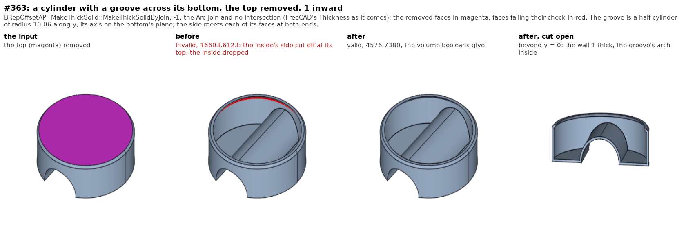
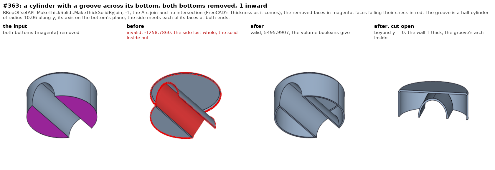
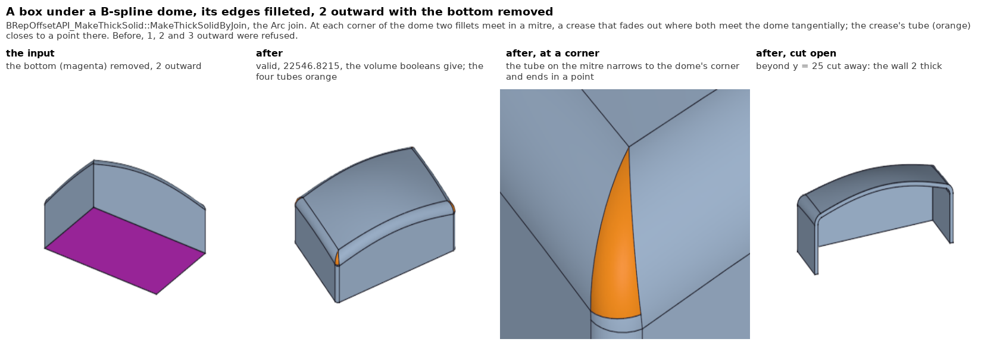
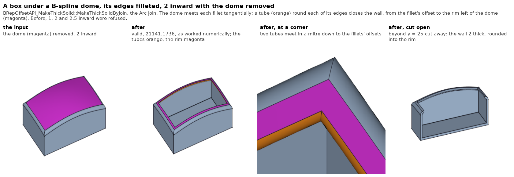
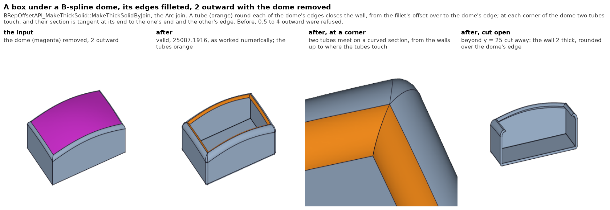

# MakeThickSolid / offset regression tests

Regression suite for the fork's `BRepOffset_MakeOffset` ("MakeThickSolid") fix
chain -- the code that makes thickness/offset work on shapes with **concave
removed faces**, which upstream OCCT does not support. The chain rewrites
loop building (`BRepAlgo_Loop`), offset-edge intersection
(`BRepOffset_Inter2d/3d`) and face rebuilding (`BRepAlgo_FaceRestrictor`),
and has a history of fixing one model while breaking another; this suite
pins down both the fixed models and the known remaining breakage.

## Running

Any FreeCAD build linked against this OCCT tree:

```
FreeCADCmd tests/fork/thickness/run_tests.py
```

The suite runs with FreeCAD's shape values unfrozen (`ImmutableShapeValues`
off), as any build that does not freeze them runs: a frozen input is
protected by copy-on-write from an algorithm that edits it, and the suite
must see such an edit. `THICK_FREEZE=1` runs it frozen. `THICK_FIX_LEVEL=<n>`
runs it at the fork's offset fix level n (`BRepOffset_SetFixLevel`,
`../fix_level.py`), which FreeCAD sets on objects made from now on; a case
with a level of its own (`fix_level=`) runs at that one. Run it at 0 and
at the latest level. Every case also
checks that its input comes back as it went in (valid, the same volume, no
tolerance grown).

Exit code 0 = no regression (every expected-pass case passed). Known-broken
cases are marked `XFAIL` in the script; when one starts passing the suite
prints `UNEXPECTED-PASS` -- promote it to `pass` with its reference volume and
update this file.

Reference volumes were captured on `LinkVibe-801` after the fixes listed
below, cross-checked against the 7.7.2 `LinkVibe` branch (identical to
4 decimals for the document cases), and are stable across runs.

## Document cases (captured user models)

Each `models/*.FCStd` comes from a reported issue. The test forces a full
recompute and requires every feature to produce a valid shape with the
reference volume.

| Case | Model | Issue | What it covers |
|------|-------|-------|----------------|
| `issue1_ellipse_thickness` | PartDesign Pad of an ellipse profile + Thickness | realthunder/OCCT#1 | MakeThickSolid on an elliptic-profile pad: exercises the concave-face loop rebuild (`BRepAlgo_Loop` cut/const edge classification) |
| `issue2_broken_loft` | PartDesign AdditiveLoft (ring sketch -> rectangle) | realthunder/OCCT#2 | Thrusection regression guard: the fork reverts upstream 4607bd0747f (`myPercent` 0.01); the loft breaks if that revert is lost |
| `issue3_pad_thickness` | PartDesign Pad + Thickness | realthunder/OCCT#3 | MakeThickSolid producing hollow walls from a padded profile (volume reference detects silently-wrong results, e.g. non-hollowed solid) |
| `issue4_revolution_thickness` | Part Revolution (quarter revolve, two sphere caps) + Thickness, planar faces removed | realthunder/OCCT#4 | Offset of periodic faces: sphere caps with **degenerated pole edges** + seam handling. Historically: 7.7.2 produced an invalid solid; the 8.0.1 port initially threw `StdFail_NotDone` (hash-order nondeterminism); both fixed on `LinkVibe-801` -- result must now be a fully valid single-shell solid |

`issue2_broken_loft` also broke -- volume 2055.8 -- while FreeCAD built
sketch edges on reversed curves (2026-08-23 to 2026-09-30, fixed there,
FreeCAD docs/TransactionLog.md sec 27.87): the ring's radii come from the
ends of an external edge, which came in reversed.

Fix history for these (branch `LinkVibe-801`):
- `1789444318` -- port of the 7.7.2 MakeThickSolid fix chain to 8.0.1
- `756262b692` -- deterministic wire nesting in `BRepAlgo_FaceRestrictor`
- `933803af41` -- hash-order determinism (`myCutEdges`/wire-set iteration) + latent-bug fixes (`AsDes::Replace(x,x)`, vertex chain compression, `Bubble` dedup, `GetCenter`, unguarded `MakeWire`)
- `72aae3644f` -- degenerated pole edges re-embedded into the wire crossing the singularity (turns issue4 from invalid to fully valid)

## Programmatic cases (plain solids -- the "don't break normal thickness" guard)

The fix chain used to break thickness on ordinary solids. These cases build
primitives in-code (no model files) and hollow them removing **one face at a
time**, both outward (`+1`) and inward (`-1`), with mode=Skin, join=Arc:

- `cyl_*` -- `Part.makeCylinder(4, 20)`: Face1 = lateral (has a seam edge),
  Face2 = bottom, Face3 = top.
- `hole_*` -- `makeCylinder(5, 10).cut(makeCylinder(2, 10))`: Face1 = outer
  lateral, Face2 = bottom, Face3 = top, Face4 = hole lateral (reversed
  orientation, seam edge).

The case names are older than a look at the faces: `makeCylinder` puts its
top (z = height) at Face2 and its bottom at Face3, so `*_bottom_*` removes the
top. The names are kept.

Status on `LinkVibe-801` (2026-10-01):

| Case | Status | Symptom |
|------|--------|---------|
| `cyl_*_out/in` (top, bottom), `hole_*` (all eight) | PASS | |
| `cyl_side_out/in` (remove lateral face) | PASS since sec 11 | was `StdFail_NotDone`, upstream too: not the seam but the caps left in two pieces (`BRepOffset_NotConnectedShell`). Now a compound of two discs, see "Faces left in pieces" below |

Six of these were XFAIL from 2026-08-01 to 2026-09-30 and are fixed (models/Thickness.md sec 2). All six were casualties of the fix chain,
not limits of OCCT: upstream's `BRepAlgo_Loop`/`BRepOffset` (at 91be8c4c71,
built into scratch libraries and preloaded) passes them with the volumes above.
Three causes, all in the fork's `BRepAlgo_Loop`:

- `cyl_bottom_in`, `hole_bottom_in`: on a periodic face the seam wire replaced
  the closed-edge wires found before it, but the search found the other
  closed edge again afterwards and kept it as a wire of its own -- the inner
  wall came out with wires [1, 3, 1] and the floor went missing. A wire made
  only of a seam wire's edges is now dropped.
- `hole_outer_*`, `hole_inner_*`: a removed cylinder leaves a wall at each
  end, each closed by its own piece of the seam; `FindLoop` allowed one seam
  wire per face, so the second wall was built from two bare circles. Two
  seam wires may now share a face if they share no edge.
- (found by the wider sweep) the concave-face pass in `Perform` rebuilt the
  const edges as FORWARD copies whenever their count changed, so a closed edge
  lost its orientation and the seam wire closed on two circles running the
  same way (`pocket_bottom_in`).

The 2026-08-01 leads (`TrimEdge`'s end-vertex skip, `ContextIntByArc`'s
second `UpdateVertex`, the `Inter2d::Compute` pair skip, `WireInfo`'s
orientation-blind equality) were not the cause of any of these and are
unverified.

## Regression cases from the upstream comparison (2026-09-30)

A sweep of 712 thickness runs -- 16 solids, every face, +-1, intersection
on/off, Arc/Intersection join -- against upstream's libraries found the fork
worse than upstream in 144 runs and better in 51, counting as right only a
valid closed solid whose volume is plausible for a skin (upstream returns the
input unhollowed in places, a valid solid that is wrong). After the fixes of
sec 2: worse in 26, better in 53, and in 36 more the fork throws where
upstream returns a wrong solid without a word. Cases added for each cause:

| Case | Model | What it covers |
|------|-------|----------------|
| `ellipse_*` | a single closed ellipse edge, extruded | the offset of an ellipse is a closed B-spline that is not periodic; `ExtentEdge` stretched it 100 lengths past its ends (points at 1e34): the top came back unhollowed, the bottom as two shells |
| `pocket_bottom_*` | cylinder with a blind pocket in its top | the const edge orientation (inward), and the re-found closed edge (outward) |
| `boxhole_hole_*` | box with a through hole, the hole removed | two seam wires on one face |
| `pocket_inter_join_no_crash` | box with a pocket, inward, intersection on, Intersection join | `BuildSplitsOfTrimmedFaces` never sets the trimmed-to-infinite edge map and `UpdateIntersectedEdges` dereferenced it (upstream code, reached only with the fork's edges); still invalid, as upstream's result is |

## Concave corners and removed faces, Arc join (2026-09-30, sec 3)

| Case | Model | What it covers |
|------|-------|----------------|
| `lbox_arm_end_out`, `tshape_arm_end_out` | L-box, T: the end face of an arm, outward | past a concave corner the arc face along one edge is cut by the arc of the next; the corner piece beyond the cut, closed by the arc's own end, came out as a face of its own (the loop keeps every piece of an edge). A wire through a piece beyond the edge's own span now loses to a rival that stays inside |
| `pocketbox_wall_out` | box with a pocket, a pocket wall, outward | the same; no reference volume (upstream's result is invalid) |
| `tshape_bar_top_out` | T: the bar top beside the post (a concave removed face), outward | the removed face's stretched edge ran on along the back of the T and a piece of it lay on an arc face's tangent line (dropped now), and a corner sphere met before the face that renewed its edge kept the old one (faces are gone over again). Upstream fails it; the reference is the fork's own |

## Inward, intersection mode, the Intersection join (2026-09-30, sec 4-5)

| Case | Model | What it covers |
|------|-------|----------------|
| `tshape_bar_top_in` | T: the concave bar top, inward | the stretched removed face crossed the far end wall's inner edge above the bar's inner top, and the crossing counted as that edge's own end; the corner above the bar's inner arc came out as a face of its own. Worked out by hand (upstream fails it) |
| `lbox_top_inter_join_*`, `tshape_back_inter_join_*` | L-box top, T back; intersection on, Intersection join | an edge two faces share was trimmed twice (an indexed map's `Add()` is never 0) and the second pass cut the section short. Upstream's volumes |
| `conehole_bottom_inter_in` | cone with a through hole, bottom removed, inward, intersection on | a circle running round the hole's offset beyond the seam's span came out as a face of no area. Worked out by hand, = upstream |
| `tshape_bar_top_right_join_in`, `pocket_floor_join_*` | Intersection join, intersection off | the thick solid came back inside out (the quilt's shells met in an order that turned them); now oriented by classification |
| `blindhole_floor_join_*` | box with a blind hole, the floor removed, Intersection join | the floor meets the wall at a concave edge; the section on the wall's offset was the wrong way round. Worked out by hand |
| `lbox_notch_wall_inter_join_out`, `tshape_post_wall_inter_join_in`, `pocket_wall_inter_join_in` | concave removed faces, intersection on, Intersection join | the splits of the offset faces left the rim uncut; such shapes are built as with intersection off |
| `filletbox_end_*`, `filletbox_side_*` | box with its vertical edges filleted, an end or side face removed (Arc join) | the removed face is tangent to the fillets, whose offsets never meet it (inward) or meet it far round the cylinder (outward, a lip). A tube round the tangent edge closes the gap, turning into the removed face, and outward an eighth of a sphere closes each corner with the top and bottom edges' tubes (sec 6). Worked out by hand (Steiner for outward) |
| `filletbox_fillet_*` | the same box, a fillet removed (Arc join) | the removed face is curved: the tubes and corners are built on its cylinder; the loop on that periodic surface kept a dozen wires and now walks the angles, its edges lying within one period; inward a piece of the floor's offset cut off by the cylinder's circle hung on the shell and is dropped (sec 8). Worked out by hand |
| `case5829_fillet_in` | `models/case5829_fillet.brep`: FreeCAD's PartDesign case 5829, a box filleted all round at 8 with a wedge on its back, as filleted with every corner plate held tangent; the large face removed, inward (Arc join) | 19564.4844. The corner vertices have tolerances up to 0.058, and two walls not yet cut back meet 0.38 from the vertex they share at a fillet's end. `BRepAlgo_Loop`'s crossing vertices (planar faces) looked for a vertex where it stands, not where it sits on the edge, and planted a second one at its parameter: the wall had no wire, the offset no face. The same solid as the kernel fillets it today (creased corner plates, `SetPlateG0Fallback` at its default) is not in the suite: no version of the offset thickens it |
| `filletbox_*_join_*`, `filletbox25_fillet_join_*` | the same box, an end, side or fillet face removed, Intersection join (a fillet of 2.5 too) | that join builds no tubes: the neighbour's offset ran round its cylinder into a lip (outward) or never met the removed face (inward, unhollowed). The gap is closed with the tube's sharp counterpart -- a strip of the neighbour's tangent plane a thickness into the removed face, offset with it, and a wall square to the removed face at its far edge; cubes at the corners (sec 9). Worked out by hand |

## A cavity sealed below the removed face (2026-10-01, sec 10)

| Case | Model | What it covers |
|------|-------|----------------|
| `conehole_top_in_sealed_*` | cone with a through hole, top removed, inward, all four modes | the wall is 1.4 thick at the top and the inner offsets cross at z=6.485: no cavity reaches the removed face. The right result (the user's choice) is two shells: the input's skin, the top kept, and a closed void. The loop let the band above the crossing take the crossing circle from the cavity's band below it; the cavity's band is built now, from the seam's pcurves, and a thick solid whose offset faces all close up is the skin and its voids. With intersection off the two offsets were never intersected; walls beside a removed face too thin for it are built with intersection on. Hand values: skin 471.2389, void 112.9243. Upstream's intersection mode gives this; its default mode is invalid |
| `conehole_bottom_in`, `conehole_bottom_join_in` | the same cone, bottom removed, inward, intersection off | the same crossing near the top face, never intersected: the cavity ran on to z=7, a sliver inside out, "valid" and 0.761 too much. Built with intersection on now. Worked out by hand |

The 712-run sweep against upstream after these: the fork right in all 150
runs of every mode (upstream 106-112, counting the sealed void right),
worse than upstream in no run.

## Faces left in pieces, and a short wall (2026-10-01, sec 11)

`BRepOffset_MakeOffset::CheckInputData` refuses a shape whose faces that stay
fall apart into pieces sharing no edge once the removed faces are gone
(`BRepOffset_NotConnectedShell`), upstream too. `MakeThickSolidByPieces` now
makes each piece a thick solid of its own -- the shape with the other pieces
removed as well -- and returns their union: a compound of solids, fused where
they overlap; one solid left is returned as it is. The pieces' history is
merged, so `Generated`/`Modified` answer as for one shape (FreeCAD's element
names carry `THK`). A piece that is not one valid closed shell of positive
volume refuses the whole, as before: a pocket's walls and floor, with the
outside of the shape removed around them (a blind hole's top removed), did
not come out right, and their union would pass for an answer (sec 13
below).

Making the short cases right needed a fix of its own, in `BRepAlgo_Loop`:
keeping only the bottom of a box shorter than twice the thickness, inward,
the loop split each removed side at the bottom's offset and kept the piece
nearer an end of the side's edge -- above the offset there. Now the piece
from the end on a const edge (the face that stays) is kept when only one end
is; otherwise the nearer end's, as before. The thick solid had come out as
the box with the plate's complement as a void (sec 10's sealed cavity)
and, before that, with an empty shell; upstream is right.

| Case | Model | What it covers |
|------|-------|----------------|
| `cyl_side_*` | cylinder, side removed (Arc join, intersection off and on) | two discs of 16 pi, a compound |
| `box_sides_*` | box 10 x 10 x 20, four sides removed | two plates of 100 |
| `ring_walls_in` | cylinder with a hole, both walls removed | two rings of 21 pi |
| `short_cyl_side_in` | cylinder 1.5 high, side removed, inward | the discs overlap and fuse: the whole cylinder, 24 pi |
| `short_box_bottom_in*`, `short_cyl_bottom_in` | box and cylinder 1.5 high, everything but the bottom removed, inward | the loop's piece above the offset; a plate, one shell |

The sweep: the 150 runs of every mode in scope are unchanged. Of the runs out
of scope -- a face whose removal leaves pieces -- the cylinder's, the cone's and
the elliptic pad's side, Arc join, are answered now, by hand: 2 x 16 pi; the
frustum slabs 84.58 + 10.36 = 94.94 outward and 72.80 + 15.07 = 87.87 inward;
2 x 50 pi. The pocket shapes (`boxhole2` Face3 and Face7, `pocket` Face3,
`cylpocket` Face2, `cylboss` Face2) stay refused.

## The Intersection join with one face left (2026-10-01, sec 12)

Where one face stays beside the removed ones -- a cylinder down to its top, a
box down to its bottom -- the Intersection join threw `BRepAlgo_Image::Bind`
in `BuildOffsetByInter`: the fork puts the removed faces in its face list
for the intersections, a removed face already has its own image, and its
enlarged face had been split. A removed face now goes the way it goes when
not split -- its edges recorded, nothing bound. That gave the box's plate,
and the cylinder's cap outward as the whole cylinder: `ContextIntByInt`
takes a removed face's edges from a map, which holds a seam once, where
`ContextIntByArc`'s explorer meets it once each way; given once, the loop on
the side built no band and kept all of it. The stretched seam is recorded
both ways now. Upstream answers these (the cap outward inside out).

| Case | Model | What it covers |
|------|-------|----------------|
| `cyl_cap_alone_join_*` | cylinder, side and bottom removed, Intersection join | the throw, and the seam once: a disc of 16 pi |
| `box_bottom_alone_join_in` | box, all but the bottom removed, Intersection join, inward | the throw: a plate of 100 |
| `cyl_side_join_*` | cylinder, side removed, Intersection join | the pieces of sec 11 with this join, refused until now |

The sweep: in scope unchanged; the cylinder's, cone's and elliptic pad's
side are answered with the Intersection join too, at the Arc join's volumes
(one face to a piece, no edge between faces that stay for the joins to
differ on). The pocket shapes and the torus's face stay refused, NotDone
now instead of `Bind` or `NoSuchObject` thrown.

## Pockets left in pieces (2026-10-01, sec 13)

Remove the face round a pocket's rim and the pocket's walls and floor are a
piece of their own. Two faults kept such pieces refused. A piece was the
shape with the other pieces removed as well, and the removed faces that do
not touch it came back as a shell of their own -- the outside of the box
round the pocket (upstream does the same). A piece is now an open shell: its
faces and the removed faces beside it. Then the removed top's free rim: a
removed face's edges that no kept face shares are stretched and put in its
loop, where an edge between two removed faces belongs; a free one bounds no
material, and the loop closed the stretched square round the hole's rim and
the offset rim, so the wires nested a step off and the ring between them was
never built. Free edges are left out of the loop now (upstream drops them
only because they happen not to chain). And with the Intersection join and
intersection on, the outside's piece threw (`NoSuchObject`) asking the
analysis for the ancestors of the top's free rim, which it does not know.

| Case | Model | What it covers |
|------|-------|----------------|
| `blind_top_*` | box 10 x 10 x 5, a blind hole of radius 2, 3 deep, top removed | outward two solids, 300 + 15 pi + 2 pi / 3 and the pot, 10 pi; inward the pot sits on the floor's plate and they fuse (Arc join, and Intersection join with intersection on). By hand |
| `blind_wall_out_join` | the same, the hole's wall removed | the outside with the hole cut through its top plate, and the floor's plate |
| `blind_pot_shell_*` | the hole's wall and floor and the top as an open shell, the top removed | the free rim alone: the fork gave the pot without its ring outward (invalid) and the hole itself inward; upstream is right |
| `pocket_top_*` | box with a square pocket, top removed | inward the pocket's piece floats in the cavity, two solids |
| `cylpocket_top_out_join`, `cylboss_shoulder_in` | round pocket in a cylinder, boss on one, the face round it removed | 127 pi + 19 pi; 69 pi + 24 pi |

The sweep: in scope unchanged. Every pocket and boss shape is answered now,
in every mode -- `boxhole2` Face3 and Face7, `pocket` Face3, `cylpocket`
Faces 1, 2 and 4, `cylboss` Faces 1, 2 and 4 -- and all 68 runs check by
hand. The torus's face is the one refusal left.

## The input left as it was (2026-10-01, sec 14)

A PartDesign Pad of an arc whose parameters run past 2 pi, under a Thickness
removing the arc's face and the caps, came back inside out on the Windows
box (`issue3_pad_thickness`: Pad -189356.2997, occ-issues `local03`): the
thickness had edited the Pad's shape. The loop's pruning builds a test face
of each wire on the face's own surface from the loop's own edges, some of
them the input's, and ran `ShapeFix_Shape` on it when it was invalid;
ShapeFix shifted the pcurve of a shared edge by a period, on that surface --
the input face's own pcurve. Reached since a periodic face whose edges lie
within one period takes the plane path (sec 8). ShapeFix now works on a
copy. It showed only unfrozen: FreeCAD freezes the values it finds this fork
for, and this suite ran frozen -- it runs unfrozen now, and every case
checks its input.

| Case | Model | What it covers |
|------|-------|----------------|
| `issue3_pad_thickness` | the captured model, unfrozen | the Pad stays valid under the Thickness |
| `sector_outer_arc_input`, `sector_outer_arc_past_period_input` | a ring sector straddling angle 0 padded 27, its outer arc's face and caps removed | the input as it was (inside out before, frozen or not: shapes made in Python are not frozen) |

The sweep, with an input check added: no run alters its input, before the
fix or after, and every line is unchanged -- its 16 solids never cut a
periodic face across its seam.

## Every face removed (2026-10-02, sec 15)

The sweep's last refusal was the torus, its one face removed -- rightly: no
face stays to be thickened. The sphere, a one-face shape too, came back as
the sphere itself, "valid" and unhollowed, and so did a box with all six
faces removed: an answer that is the input. `MakeThickSolid` now refuses
when no face stays (the user's choice).

| Case | Model | What it covers |
|------|-------|----------------|
| `sphere_face_refused_*`, `sphere_face_join_refused_in` | sphere, its face removed | refused; was the sphere back, 523.60 |
| `torus_face_refused_*` | torus, its face removed | refused, as before |
| `box_all_faces_refused_in`, `box_all_faces_inter_refused_out` | box, all six faces removed | refused; was the box back, 600 |

## A face closed at a pole (2026-10-02, sec 16)

On a periodic face the loop builds a seam wire from a closed edge, a piece
of the seam and the closed edge at its far end. Where the seam ends at a
pole the closed edge there is the pole's degenerated edge, which the loop
keeps out of its vertex map: no seam wire was built, and the one circle was
left as a wire of its own, bounding nothing -- a face of no area and an
invalid result, since the chain was ported (upstream is right). The band is
now closed by the pole's edge (`BRepAlgo_Loop::FindLoop`). The rim is closed
in the removed face's plane, so the volumes are differences of sphere caps,
pi h^2 (3R - h) / 3; the cone's is worked out in `models/Thickness.md`,
"Sec 16".

| Case | Model | What it covers |
|------|-------|----------------|
| `dome_flat_out/in`, `dome_flat_join_out`, `dome_flat_inter_in` | half a sphere of radius 5, flat face removed, 0.5 | 86.6556 out, 70.9476 in; was invalid, 216.5455 and 231.5055 |
| `bowl_flat_out` | the lower half | the pole below: 86.6556 |
| `cap_flat_in` | the sphere above latitude 30 | 33.6412; was invalid, 71.3403 |
| `segment_flat_out` | the sphere below latitude 30 | 127.8890; was invalid, 387.9306 |
| `cone_base_out`, `cone_up_base_out` | cone with its apex, radius 4, height 6, base removed | 52.4095, the apex rounded; was invalid, 62.5293 |

The cone inward and half a dome, found beside these: the next section.

## A cone with its apex, half a dome, a split box (2026-10-02, sec 17)

`models/Thickness.md`, "Sec 17", has the causes and the hand values.

| Case | Model | What it covers |
|------|-------|----------------|
| `cone_base_in`, `cone_up_base_in` | cone with its apex, base removed, inward 0.5, Arc join | 38.8428; threw (`BRep_Builder::Infinite parameter`, `NCollection_DataMap::Find`): the edge at the offset cone's new apex had an infinite range |
| `cone_*_base_join_in/out` | the same, Intersection join | 38.8428 and 52.4563; apex down the cone came back unhollowed, 100.5310 |
| `halfdome_bottom_out/in`, `halfdome_bottom_join_in` | a quarter ball, bottom removed | 66.1779, 51.3127; outward threw (`BRepAlgo_Image::Bind`), the Intersection join threw |
| `halfdome_side_out/in`, `halfdome_other_side_out` | one of its two coplanar side faces removed, Arc join | 79.7628, 58.8944; were invalid |
| `splitbox_top_piece_out/in` | a box fused of two, one piece of its top removed, Arc join | 417.3038, 274.7124: right before, pinned here |
| `*_not_the_input`, `*_not_the_box` | the Intersection-join cases below | refused; the split box came back whole, 480 |

The five cases this section left known broken are answered in the next.

## Coplanar pieces, a wall on a sphere, a sphere round its pole (2026-10-02, sec 18)

`models/Thickness.md`, "Sec 18", has the causes and the hand values.
No case of these is marked `XFAIL` any more.

| Case | Model | What it covers |
|------|-------|----------------|
| `halfdome_other_side_in` | a quarter ball, the second of its two coplanar sides removed, inward, Arc join | 58.8944; was invalid: the wire round what was cut away, through the removed side's meridian stretched past the pole |
| `splitbox_top_piece_join_*`, `_inter_join_*`, `splitbox_top_other_piece_join_*`, `splitbox_side_piece_join_*` | a box fused of two, a piece of a face removed, Intersection join | 440 / 276, 420 / 264, 448 / 280; were refused (upstream: the box back): the wall intersected twice, coplanar pieces intersected with each other's neighbours, one section edge shared by three faces |
| `splitbox_end_join_*` | the same, an end face removed | 400 / 264: no removed face beside a coplanar one, the joint alone |
| `topsplit_top_piece_join_*` | a box with its top only in two pieces | 440 / 276: the face at the joint's end is one face |
| `halfdome_side_join_in`, `halfdome_other_side_join_in`, `halfdome_side_inter_join_in` | the quarter ball, a side removed, Intersection join, inward | 59.1071; were refused: the wall's end edge on the sphere was never intersected, and the removed side's section was the half circle beyond the pole |
| `halfdome_bottom_join_out`, `_inter_join_out`, `halfdome_side_join_out`, `halfdome_other_side_join_out` | the same, outward | 67.0206, 81.7345; were refused: the offset sphere has to run round its pole, and is put on the same sphere with its axis turned |
| `lune_side_join_*`, `eighth_ball_*_join_out`, `dome120_*_join_*` | a quarter ball on its side (both poles), an eighth of a ball, a third of a dome | the turned axis on other faces at a pole: 67.0206 / 51.3127, 46.7279, 53.3701 / 57.4660 / 41.2951 |
| (`halfball_side_join_refused_*`, until sec 20) | half a ball cut through both poles, a flat half removed, Intersection join | was refused: no axis is clear of its outline, and the wall built outside its band was a valid solid that is not the skin (111.2647 for 113.0909). Answered since sec 20 (`halfball_flat_join_*`); a wall outside its band is still refused |

## More than half a turn, three tubes at a pole, the sphere removed (2026-10-02, sec 19)

`models/Thickness.md`, "Sec 19", has the causes; the volumes are worked
by `sweep/polehand.py`.

| Case | Model | What it covers |
|------|-------|----------------|
| `dome270_bottom_join_out`, `dome270_bottom_inter_join_out` | three quarters of a dome, bottom removed, Intersection join | 87.3133; came back the input, 196.3495: the sphere's axis was turned off a face of half a turn at most |
| `dome270_side_join_out/in`, `dome270_other_side_join_*` | a side removed, Intersection join | 113.7486, 83.7681; refused: on the turned sphere the old pole's edge kept the two meridians apart |
| `dome270_side_in`, `dome270_other_side_in` | a side removed inward, Arc join | 83.7681; invalid, or refused: the piece of the stretched meridian past the pole kept a pcurve off the sphere's range |
| `dome270_side_join_out_thick` | a side removed outward at a thickness of 1 | 260.9367; a valid solid on the wrong side of the kept face, 89.196: the turned sphere grown too little |
| `eighth_ball_bottom_out`, `dome120_bottom_out` | an eighth of a ball, a third of a dome, bottom removed outward, Arc join | 45.5612, 52.4334; refused: no piece of sphere where three tubes meet at the pole |
| `dome120_side_in`, `dome120_other_side_in` | a third of a dome, a side removed inward, Arc join | 41.2951; refused: the other side's offset extended to the far crossing |
| `eighth_ball_sphere_*`, `dome120_sphere_*`, `halfdome_sphere_*`, `lune_sphere_*`, `dome270_sphere_*` | the sphere itself removed | the wall on the ball of 5 past the pole, on a turned twin of the removed face: 32.3576 / 33.2167 / 25.7418, 35.2709 / 35.8993, 41.0976 / 41.6307 / 36.6474, 49.5532 / 50.0446 / 47.3132 / 47.5529; outward refused or threw, each one |
| `dome270_sphere_out_thick`, `dome270_sphere_join_out_thick` | the same at a thickness of 1 | 99.0413, 100.7985; threw |
| `halfball_flat_out/in`, `halfball_sphere_in` | half a ball cut through both poles | 111.6001, 88.5482, 39.1390: right before, pinned here |
| `halfball_flat_join_out/in`, `halfball_sphere_out`, `halfball_sphere_join_out` | the same, the modes that need its sphere past both poles | 113.0909, 89.0272, 39.1390; `XFAIL` until sec 20 |

## Half a ball, and a shape that is placed or turned (2026-10-02, sec 20)

`models/Thickness.md`, "Sec 20", has the causes. No case was marked
`XFAIL` after it; sec 21 marks eight, and sec 22 answers them.

| Case | Model | What it covers |
|------|-------|----------------|
| `halfball_flat_join_out/in`, `halfball_flat2_join_out/in` | half a ball cut through both poles, a flat half removed, Intersection join | 113.0909, 89.0272; were refused: the sphere, a whole great circle for its outline, is now cut along its equator first (`MakeThickSolidOfSplit`) |
| `halfball_sphere_out`, `halfball_sphere_join_out`, `halfball_sphere_join_in` | the same, the sphere removed | 39.1390; outward refused or threw: the removed face is cut along a meridian into two lunes, each with a twin |
| `luneball_spheres_*` | the half ball with its sphere in two lunes already, both removed | 39.1390; outward invalid (a twin's pcurve ended where the edge did; a crossing before an edge's start was lost), inward a segmentation fault (a section's block without an edge) |
| `eqball_flat_join_out/in`, `eqball_flat_out/in` | the half ball with its sphere in two domes already, a flat half removed | 113.0909 (threw), 89.0272 (a valid solid of 90.2265: the equator's pcurve on the turned sphere 0.23 off its curve); 111.6001 and 88.5482 with the Arc join, right before |
| `placed_cyl_side_pieces_out`, `placed_cyl_top_in_after`, `placed_cyl_top_out_after` | a cylinder under a location: its side removed, then its top, on the same shape | 2 x 25.1327, then 89.9281 and 110.4400; the first left two of the input's vertices at a tolerance of 8.5, and the second was a valid solid of 272.73: a seam's second pcurve checked without the edge's location |
| `placed_dome_flat_*`, `placed_cone_base_*`, `placed_coneup_base_out`, `placed_halfdome_*`, `placed_dome270_side_join_out`, `placed_halfball_*` | shapes with a pole under a location | their plain volumes; were refused (a pole not known for one), or the cone's offset ran to the apex before the move, or the apex circle's normal was no vector |
| `turned_filletbox_fillet*_out`, `turned_filletbox_fillet_in`, `placed_filletbox_fillet_out` | the filleted box turned in space, a fillet removed | 405.9034, 267.0193; outward a valid solid of 459.398 or refused: the corner arc on the cap was taken from a section whose lines join elsewhere once the shape is turned |
| `halfcap_*`, `turned_halfcap_*`, `placed_halfcap_*` | half of a sphere's cap above latitude 30: the sphere, the bottom, a side removed inward | 19.2316, 22.0431, 28.8642; turned or placed, the sphere removed was refused (Arc) or a valid solid of 8.126 (Intersection join): a whole circle of section lost the piece its own vertex lies in, and a section was turned by its far side |
| `bullet_side_join_out`, `turned_`, `placed_` | a dome on a cylinder, the cylinder removed outward, Intersection join | a disc of 39.2699 and the dome's skin, 61.4616; turned, 151.12: of two section circles as near as each other the first found was taken |

## A rim in two arcs, and the half ball with one disc (2026-10-02, sec 21)

`models/Thickness.md`, "Sec 21", has the causes. Eight cases were
marked `XFAIL`, each with the volume it should give; sec 22 answers all
eight.

| Case | Model | What it covers |
|------|-------|----------------|
| `dome2_flat_*` | half a sphere with a seam, its rim in two arcs, the flat removed | 86.6556, 70.9476; with the Arc join an invalid solid of 240.68 / 247.66, upstream right: the band between seam and rim was only built on a rim of one closed edge. The face is walked in (u, v) with its seam |
| `dome2_sphere_*` | the same, the sphere removed | 39.1390; invalid, or threw with the Arc join: both arcs of the flat's rim were replaced by one half of the section circle, and a stretched seam's piece had its pcurves the other way round |
| `dome2f_sphere_*` | the same with its flat in two halves | 39.1390; threw with the Arc join: the section circle was cut by the line between the halves at the one point it starts on |
| `halfball1_disc_*`, `halfball1_sphere_*` | half a ball cut through both poles, refined: one disc for its flat | 86.6556, 70.9476, 39.1390; the Intersection join with the disc removed hung, then was refused; the sphere removed was refused outward and with the Arc join. Its sphere is put on one turned onto its middle (`TurnHalfSphereOntoMiddle`) |
| `cutball_*` | the same from a cut by a box: a compound of one solid | the same volumes; refused, the compound not being looked at |
| `placed_halfball1_*`, `turned_halfball1_*` | the same under a location, and turned in space | the same volumes |
| `ball270_sphere_in`, `ball270_sphere_join_in`, `ball240_sphere_join_in` | a ball wedge from pole to pole on three quarters and two thirds of a turn, the sphere removed inward | 41.0978, 41.6307, 40.5784 |
| `ball270_sphere_out`, `ball270_sphere_join_out`, `ball240_sphere_out`, `ball240_sphere_join_out`, `ball240_sphere_in`, `ball150_sphere_out` | ball wedges, the sphere removed | `XFAIL` until sec 22: 36.6474, 37.6996, 39.7919; refused. `ball240_sphere_in` gave 40.4447 all along, which is right: its hand value of 39.9613 was wrong (sec 22) |
| `luneball_flat_join_out/in` | the half ball with its sphere in two lunes, a flat half removed, Intersection join | 113.0909, 89.0272; refused, and inward a valid solid of 182.21: faces of one sphere with one thing done to them are joined first |
| `eqball_spheres_*` | the half ball with its sphere in two domes, both removed | 39.1390; refused or invalid but for inward with the Intersection join: the same |
| `dome2f_flat_join_out/in` | the dome with its rim in two arcs and its flat in two halves, one half removed, Intersection join | `XFAIL` until sec 22: 113.0909, 89.0272; refused, the wall between the halves outside its band |

## The rest of the ball, a sphere on another axis, and an edge in pieces (2026-10-03, sec 22)

`models/Thickness.md`, "Sec 22", has the causes. No case is marked
`XFAIL`.

| Case | Model | What it covers |
|------|-------|----------------|
| `ball270_sphere_*out`, `ball240_sphere_*out`, `ball150_sphere_*out`, `placed_ball270_sphere_out`, `turned_ball240_sphere_join_out`, `turned_ball150_sphere_out` | ball wedges, the sphere removed outward | 36.6474, 37.6996, 39.7919 (Arc) and 39.8071 (Intersection); refused. The thick solid inward of the rest of the ball |
| `ball240_sphere_in` | the same inward, Arc join | 40.4447, right before: `sweep/polehand.py` took the missing wedge of a reflex wedge for a quadrant, right at 270 degrees only, and gave 39.9613 |
| `dome2f_flat_*`, `placed_dome2f_flat_join_in`, `turned_dome2f_flat_join_out` | the dome with its flat in two halves, one half removed | 113.0909, 89.0272 with the Intersection join, refused; 111.6001, 88.5482 with the Arc join. The dome is put on the axis through its rim's ends: the half ball |
| `boxsplit_e1_*`, `placed_boxsplit_e1_f1_out` | a box with a vertex at the middle of an edge, a face beside it removed | the box's 177.6136, 181.5, 147.5, 170.8282, 142.5; refused or the box itself back, where upstream is right with the Arc join. The pieces are joined |
| `cylsplit_rim_*`, `cylsplit_seam_*` | a cylinder with a vertex on its top circle, on its seam | 110.4400, 89.9281, 111.9192; invalid. Its side removed with the seam in two: two discs of 25.1327, as the cylinder's |
| `halfdomesplit_rim_*`, `conesplit_seam_*` | half a dome with a vertex on its rim, a cone with one on its seam | 36.6474, 67.0206, 58.8944; 52.4095, 38.8428. The half dome's sphere inward with the Arc join was an invalid solid of 130.90 |
| `ball270split_sphere_*`, `turned_ball270split_sphere_join_in` | the 270 degree ball wedge with a vertex on a meridian | 36.6474, 41.0978, 41.6307; wrong every way |
| `axiswedge270_*`, `axiswedge240_*`, `axiswedge150_*` | a ball made on an axis through the middle of its face, cut by the wedge that is missing | the ball wedge's volumes; wrong every way, inward with the Intersection join a valid solid of 264.29 for 41.6307 |

## Two faces of one sphere, one removed (2026-10-03, sec 23)

`models/Thickness.md`, "Sec 23", has the causes and the rule; the hand
values are `sweep/onedome.py`. The Arc join's eight cases were marked `XFAIL`
here and pass since sec 25.

| Case | Model | What it covers |
|------|-------|----------------|
| `eqball_sphere1_join_*`, `eqball_sphere2_join_*`, `placed_eqball_sphere2_join_out`, `turned_eqball_sphere2_join_in` | the half ball with its sphere in two domes, one removed, Intersection join | 91.1786 outward, 74.1857 inward; refused. The kept dome runs on a thickness round the sphere to a wall, a cone from its centre |
| `luneball_sphere1_join_*`, `luneball_sphere2_join_*`, `placed_luneball_sphere2_join_in`, `turned_luneball_sphere2_join_out` | the same in two lunes | the same volumes: the half ball turned a quarter about its flat's normal; refused |
| `eqball_sphere1_out/in`, `eqball_sphere2_out/in`, `luneball_sphere1_out/in`, `luneball_sphere2_out/in` | the same, Arc join | 89.1638 outward, 73.5777 inward; refused until sec 25 |

## A seam in pieces, and the crossing at a negative parameter (2026-10-03, sec 24)

`models/Thickness.md`, "Sec 24", has the causes. No case is marked `XFAIL`.

| Case | Model | What it covers |
|------|-------|----------------|
| `capsplit_seam_*`, `placed_capsplit_seam_f1_out` | the cap above latitude 30 with a vertex at the middle of its seam | the cap's 31.285 and 27.358; an invalid 105.98, or refused. The joined seam is put back on its iso line |
| `bulletsplit_seam_*` | a dome on a cylinder with a vertex on the cylinder's seam | the bullet's 97.2749, 69.8169, 152.629, 130.6379, and its side removed two solids, 93.0859 or 76.8543 and 39.2699; invalid (808.26) or refused |
| `dome270split_e4/e6/e7_f3_out` | three quarters of a dome with a vertex on an edge, a flat side removed outward, Arc join | 111.7391; invalid or refused after sec 23's crossings on a sphere |

## The Arc join between two faces of one sphere (2026-10-03, sec 25)

`models/Thickness.md`, "Sec 25", has the causes, the ruling on the sliver
face and its picture (`pictures/sliver/make_sliver.sh` makes it again). No
case is marked `XFAIL`.

| Case | Model | What it covers |
|------|-------|----------------|
| `eqball_sphere1_out/in`, `eqball_sphere2_out/in`, `placed_eqball_sphere2_out`, `turned_eqball_sphere2_in` | the half ball with its sphere in two domes, one removed, Arc join | 89.1638 outward, 73.5777 inward; refused. The flat's offset is closed by a step between two circles that never meet, an edge of the ball round the tangent edge's end; no sliver face |
| `luneball_sphere1_out/in`, `luneball_sphere2_out/in`, `placed_luneball_sphere2_in`, `turned_luneball_sphere2_out` | the same in two lunes | the same volumes; refused. The line between the flat's halves is cut at the section and both halves have it cut |

## A seam that is none, and a face beyond its tangent edge (2026-10-03, sec 26)

`models/Thickness.md`, "Sec 26", has the causes: the two sec 24 found and
left. No case is marked `XFAIL`. `sweep/survey.sh` runs the two surveys
behind sec 22, 24 and 26 -- a vertex on an edge (`split`) and the solid's
faces in another order (`order`) must change nothing -- over 25 shapes,
plain, `placed` or `turned`; both are clean. `sweep/probe.py` runs one of
their runs and lists the fork's dumps on the way; `models/Thickness.md`,
"Where the chase stands", says what holds and what has not been asked.

| Case | Model | What it covers |
|------|-------|----------------|
| `cutballsplit_rim_*` | half a ball cut from a ball by a box, a vertex on the half of its rim that was the ball's seam | 39.1390, 86.6556, 70.9476; refused. The edge has two pcurves on the sphere and the face runs along it once: no seam, and its pieces are joined |
| `luneball_flatsfirst_sphere1/2_join_out/in`, `turned_luneball_flatsfirst_sphere1_join_out` | the half ball in two lunes, its faces in the order flat, flat, lune, lune; one lune removed, Intersection join | 91.1786 outward, 74.1857 inward; an invalid 87.4583 and 72.4404. The flat's half beside the removed lune built the other half's face a second time, beyond the line between them |
| `luneballsplit_meridian_*`, `luneballsplit_rim_*`, `placed_luneballsplit_meridian_f1_join_in` | the same solid as made, a vertex on the meridian between the lunes or on the rim beside the removed one | the same volumes; refused. Joined, it is the solid in that order |

## #613: a filleted part, its hang, its null object and its cap (2026-10-28)

`../occ-issues/`'s #613: a thickness 2 inward with two faces removed, the
top and bottom of a filleted part (its input is the issue file's stored
Fillet, `models/issue613_fillet.brep`, faces 7 and 16; the document no
longer recomputes to it: its Fillet's edge references are lost). It ran
for ever: a section edge is stretched 100 times its length on its own
curves (upstream's `ExtentEdge`, and the fork's step case beside it,
"enough for analytic edges"), and a B-spline is nothing past its ends --
its pcurve came 2e27 out of its face, and the offset surface evaluated
there tried to shift its point by 1e-9, which at 2e27 does not move it,
so its loop never ended. Fixed: the evaluation gives up when a shift
leaves the point where it was (`0b7bc39ad7`, `Geom_OffsetSurfaceUtils`),
and the stretch stops where the edge's curves end (`a9988e61f8`). Then
`ExtentFace` set two edges' ranges from a pcurve and from vertex
parameters 2e-5 past their B-splines: on a plane the pcurve is made by
trimming the 3D curve to the range, a trim past the end is refused, and
the 2D intersection threw a null object (`5a042c6a55`, the ranges kept to
the curves too; `BRepOffset_Tool::KeepToCurvesDomain`). Then it was
refused: the top (the cap, at the ridge's top, between the ridge's walls,
four blends and the cone at its two ends) was kept whole. The cap is cut
by its neighbours' offsets enlarged; the cone's, its seam 2.1e-8 off where
the circle the cap's plane cuts from it starts, gave no section at all --
a pave filler bug for any whole turn with its seam a hair off
(`59ca72bbcc`, `PutClosingPaveOnCurve`; `../boolean/`, #613). Made now:
10194.8311, every face on the input or 2 inside it. One loose end is left
and allowed in the cases: the inner cone's seam ends where the offset cone
and cylinder meet (z 7.9476 at 2), its vertex at z 8, the corner moved by
the cylinder's normal only (0.0524 at 2, 0.0131 at 0.5). Outward is still
invalid (-14917.4397, inside out).

| Case | Model | What it covers |
|------|-------|----------------|
| `issue613_fillet_top_bottom_in`, `_top_in`, `_top_bottom_in_half` | #613's part, faces 7 and 16 (or 7) removed, -2 (or -0.5), Arc | 10194.8311, 12835.3408, 2647.5510; it ran for ever, then threw, then was refused. A loose end of 0.0524 (0.0131) allowed |
| `issue613_fillet_top_bottom_out` | the same, +2 | `XFAIL`: invalid |

## #363: a groove across a cylinder's end (2026-10-28)

`../occ-issues/`'s #363, Thickness001: a thickness 1 inward of a Pad
(a cylinder r 25.81 with a chamfered top) cut by a half cylinder r 10.06
along y, its axis on the bottom's plane -- a groove across the bottom --
with both bottom faces removed, the Arc join and no intersection
(FreeCAD's Thickness as it comes). Its input is the document's base,
`models/issue363_thickness001_base.brep`, faces 3 and 5. It was invalid,
and so was the plain top removed; upstream (7.6) the same. Two faults,
both in `BRepOffset_Inter3d`.

The side meets each face of the groove at both of the groove's ends, and
the bottom in two arcs where the side's seam splits the bottom's: two
faces that share two edges apart. `ConnexIntByArc` intersected each pair
of offset faces once, for the first of their edges, and `Inter3D` kept the
piece of the section nearest that edge; the other end was never
intersected, the side's offset had nothing to close it there and was cut
off at its top. The top removed: invalid, the inside dropped. Now every
edge the two faces share is given (`5525e72804`, an `Inter3D` that takes
several), and the piece nearest each kept: the top removed is valid, at
the volume the intersection mode gives.

With a bottom removed, the side's arc on it is offset onto the side's
offset and stretched round the whole circle (`ExtentEdge`), to reach
whatever it is to be cut by. Two such arcs on one circle -- both bottoms
removed, or a bottom whose arc the side's seam splits in two -- gave two
whole circles lying on each other, and the side's loops were made of the
slivers between them: refused, or invalid. Arcs of one circle on one
offset face now share it (`0c1693fb61`, `ShareTurns` in
`ContextIntByArc`): each is stretched to the middle of the gap on either
side of it, to a vertex the arc beyond it takes too. Thickness001 is
valid: 5496.0504 (the groove's walls cut by booleans give the same to
1e-5), and 5816.1031 outward; a bottom alone, the seam's or the other,
5600.67 and 5600.58 on the radius 5 groove; both bottoms outward, which
the fork refused, 5749.5607 as upstream gives.

Still wrong, and as before: the groove a single face whose own seam lies
on its edge with one bottom, the other bottom removed -- valid and wrong
(2142.0698 for 5600.58 on the radius 5 groove; the issue's own left
bottom, -3798.5363, inside out: its groove is such a face). And
Thickness001 with the Intersection join is invalid.

| Case | Model | What it covers |
|------|-------|----------------|
| `issue363_groove5_top_in`, `_groove10_top_in`, `_groove10_chamfer_top_in`, `_groove5_seam90_top_in`, `_thickness001_top_in` | the groove of radius 5, 10.06 (the issue's), 10.06 under a chamfer, 5 with the side's seam turned 90 deg, the issue's base; the top removed, -1 | 4340.4816, 4344.8435, 4576.7380, 4340.2907, 4576.7701; invalid before (the inside dropped) |
| `issue363_groove5_top_in_inter` | the radius 5 groove, the top removed, -1, intersection on | 4340.4816: the intersection mode, right before too, the reference |
| `issue363_groove5_bottom_in`, `_groove10_chamfer_bottom_in`, `_groove5_seam90_bottom1_in`, `_bottom2_in` | a bottom without the side's seam vertex removed, -1 | 5600.5842, 5933.2710, 5600.3995 |
| `issue363_groove5_seam_bottom_in` | the bottom whose arc the seam splits, -1 | 5600.6746; invalid before |
| `issue363_groove5_both_bottoms_in`, `_groove5_seam90_both_bottoms_in`, `_groove10_both_bottoms_in`, `_thickness001_in` | both bottoms removed, -1 | 4927.3387, 4927.0697, 5403.7097, 5496.0504; invalid, then refused |
| `issue363_groove10_both_bottoms_out`, `_thickness001_out` | both bottoms removed, +1 | 5749.5607, 5816.1031; refused before |
| `issue363_groove5_groove_seam_left_bottom_in`, `_thickness001_left_bottom_in` | the groove a single face with its seam on the right bottom's edge, the left bottom removed | `XFAIL`: valid and wrong (2142.0698, -3798.5363) |
| `issue363_thickness001_in_join` | Thickness001, the Intersection join | `XFAIL`: invalid |

`models/issue363_groove.cpp` is the C++ driver of both (the groove of
radius 5, 10.06 and 10.06 under a chamfer, the top, both bottoms or the
seam's bottom removed), and `pictures/make_fix_pictures.sh` makes its
pictures (macOS or Linux; the libraries before the first fix linked from
the build's own objects, `../boolean/pictures/mkold.py`).





**Validation** (each fix against the kernel before it, `ca991d3f27` and
`5525e72804`): Part 390 and PartDesign 486 tests OK; thickness PASS=398
XFAIL=4 (with these cases), draft 105, boolean 39; the three draft sweeps
not one result changed; the thickness sweep right in all 928 runs, not one
changed.

## A filleted dome, 2 inward (2026-10-29)

A box (80 x 50 x 40) under a B-spline dome, the dome's four edges filleted
(r 3), the bottom removed, 2 inward, the Arc join: refused, the offset
shell empty. At each corner of the dome two fillets meet in a mitre and
both meet the dome tangentially; their offsets' section ended a hair
outside one of them and was given no edge, and the mitres were never cut.
A pave filler fix (`e9ded0215d`, `../boolean/`, "A section's tangent end at
a corner"): valid, 20254.4308, as booleans give (20254.4292).

| Case | Model | What it covers |
|------|-------|----------------|
| `dome_tangent_corner_in`, `_in_inter` | `../boolean/models/dome_fillet_r3.brep`, face 4 removed, -2; the Arc join, without and with intersection | 20254.4308; refused before |

1 inward is valid now too (10416.5544). Still refused, as before: outward
(the next section), 4 inward (past the fillets' radius), and the dome
itself removed.

**Validation** as `../boolean/README.md` gives it: thickness PASS=400
XFAIL=4, the thickness sweep right in all 928 runs, not one changed.

## A filleted dome, outward (`8097862fb0`, 2026-10-29)

**What was broken.** The same shape, the bottom removed, 1, 2 or 3 outward,
the Arc join: refused (`BRepOffset_UnknownError`), the offset shell dropped
for a free edge. At each corner of the dome the mitre between two fillets
is a crease, convex, and it fades out where both fillets meet the dome
tangentially. The Arc join puts a tube on a convex crease, its section an
arc of the angle between the faces, so the tube closes to nothing at the
dome's corner. `BRepOffset_Offset` makes that end a degenerated edge when
the two faces' offsets share the vertex there -- and they did not.
`MakeOffsetFaces` shares a vertex among the offset faces only where every
edge at it is tangential, and the mitre is not: each fillet's offset made a
vertex of its own at the corner, 1.8e-6 from the other's (the faces 1 to
2e-6 rad off tangent there, within the vertex's tolerance, 1.9e-5). The
tube's end became an edge of no length that no other face shared.

**The fix.** The offset faces also share a vertex where the offsets of it
by every face around it -- the vertex moved along each face's normal by its
offset -- lie within the vertex's tolerance of each other: where the faces
are tangent at the vertex, whatever their edges are elsewhere. A face
whose normal is not defined there (a pole) never counts as meeting. Then
the tube's end is degenerated, a point, and the corner closes.

| Case | Model | What it covers |
|------|-------|----------------|
| `dome_crease_fades_out`, `_out_inter` | `../boolean/models/dome_fillet_r3.brep`, face 4 removed, +2; without and with intersection | 22546.8215 (booleans 22546.8191); refused before |
| `dome_crease_fades_out_1`, `_out_3` | the same, +1 and +3 | 10990.0549 and 34682.8741 (booleans 10990.0527, 34682.8715); refused before |

`models/dome_crease_fades.cpp` runs the three against the volumes booleans
give: the part above z = 0 of the offset of the shape carried down to
z = -10, less the shape. Still refused then: the dome itself removed
(inward since the next section), 4 inward, and the Intersection join
either way (inward since sec 30, outward from fix level 1 since sec 31).



**Validation** (against the kernel before it, `f80ed3ac78`): Part 390 and
PartDesign 486 tests OK; thickness PASS=404 XFAIL=4 (with these cases),
fillet 815, draft 105, boolean 43; the fillet and draft sweeps not one
result changed; the thickness sweep right in all 928 runs, not one
changed.

## A filleted dome, the dome removed (`6004240f16`, 2026-10-29, sec 34)

**What was broken.** The same shape with the dome itself removed, 0.5, 1,
2 or 2.5 inward, the Arc join: refused (`BRepOffset_UnknownError`), the result
the input itself, unhollowed. The dome meets each fillet tangentially, and
a removed face tangent to its neighbour along an edge is closed by a tube
round the edge (`ToContext`, the filleted box's sec 6); none was built here,
and four faults lay behind that one:

1. The edges were not taken as tangent. The dome and its B-spline fillets
   meet 2e-6 rad off, and the test was the angular precision (1e-12) where
   the analysis works to the angle the tolerance allows over half the offset
   -- which `TreatTangentCaps`, the Intersection join's counterpart, already
   used. Now the tube's test uses it too (a helper, `analyseTolAngle`).
2. The tube's edge on the dome had no pcurve for two of the four edges: its
   projection onto the dome came back empty, and the edge was never cut into
   the dome. The pcurve is now fitted through the points' parameters on the
   dome, which the intersection that finds them gives anyway (and the same
   for the corner arc on the dome outward, `TangentCornerArcOnCap`).
3. That edge ended where the dome's edge does, short of the dome's next edge
   at each corner (the lines and circles of the box and the sphere cases run
   on): the corner of the rim was never cut off. It now runs on past each
   end until it has left the dome, and a step further.
4. Two tubes meet at a corner of the dome along a curve that should end on
   both tubes' edges on the dome where they cross, and at the vertex both
   tubes start from on the fillets' offsets. It ended 7e-6 off one of the
   edges -- the 2D intersection works to 1e-7 and missed it, and the edge was
   not cut -- and 3e-4 to 1e-3 off the vertex, where the tubes all but touch
   and their section is ill-conditioned. `EdgeInter` (`BRepOffset_Inter2d`)
   now takes an end of one edge lying on the other within their tolerances
   as an intersection (at an end of the other, the two ends meeting), and
   `PipeInter` (`BRepOffset_Tool`) ends the section at a vertex both tubes
   have when it ends that near it (within a thousandth of the tubes' size),
   the end poles of its curve and pcurves moved onto the vertex.
   Where the two touch to within 1e-7 the 2D intersection found nothing on
   purpose, and that stays as it was: a vertex put there broke the wire of
   a half dome's offset.

| Case | Model | What it covers |
|------|-------|----------------|
| `dome_cap_removed_in`, `_in_0_5`, `_in_1`, `_in_2_5` | `../boolean/models/dome_fillet_r3.brep`, face 9 (the dome) removed, -2, -0.5, -1 and -2.5 | 21141.1736, 5536.3514, 10903.6446, 26016.1291; refused before |

The volumes are the rule the tube follows, worked numerically (to about
1e-5): the input less the points more than the thickness from every face
kept -- the input shrunk by the thickness (a closed offset), and the
channel under the dome, the points within the thickness below it and
further than that from its edges (near the dome a kept face's nearest point
is on the dome's edge, the fillets meeting it tangentially). A Gauss-rule
integral over a grid on the dome, it gives 21141.268, 5536.421, 10903.572
and 26016.161 at 1200 x 800; at 600 x 400 it moves by 0.5 (0.11 at 0.5).
`models/dome_cap_removed.cpp` runs the four against those to 1e-4. The mitre between the fillets'
offsets ends up to 1e-3 off the vertex at the dome's corner (1.04e-3 at
0.5 inward: the thinner, the closer to tangent the two cross there), where
the two all but touch; the vertex's tolerance covers it, and the cases allow it, as
for the bottom removed.

Still refused: 3 and 4 inward (the fillets' radius). Outward, which was
refused too, has its own section below ("A filleted dome, the dome removed,
outward").



**Validation** (against the kernel before it, `047a9e432d`): Part 390 and
PartDesign 486 tests OK; thickness PASS=407 XFAIL=4 (with these cases),
plain and frozen, fillet 815, draft 105, boolean 43; the fillet and draft
sweeps not one result changed; the thickness sweep right in all 928 runs,
plain and frozen, not one changed.

## Two adjacent top fillets, the Intersection join (`779e6acceb`, 2026-10-29, sec 28)

A box with two adjacent top edges filleted, the bottom removed, the
Intersection join: the fillets' offsets meet on an ellipse, which the
filler cut at its origin. At three corners of the four that origin is
where the section crosses the fillet's tangent line with the wall, and the
run-on beyond it was an edge of its own outside the faces, walked out and
back by the loops. `Inter3D` joins such pieces again between elementary
faces (`models/Thickness.md` sec 28).

| Case | Model | What it covers |
|------|-------|----------------|
| `mitrebox_x0y0_join_in`, `_out` | box 10 x 8 x 6, the top edges at x = 0 and y = 0 filleted r2, the bottom removed, Intersection join, -1 and +1 | 228.2242 and 334.7817, worked out by hand; right before too (the ellipse's origin lies off the section) |
| `mitrebox_x0y8_join_*`, `mitrebox_x10y0_join_*`, `mitrebox_x10y8_join_*` | the same at the other three corners | the same volumes; invalid inward and refused outward before |

Still refused then: all four top edges filleted (the next section), and
the filleted dome, with the Intersection join.

**Validation** (against `047a9e432d`): Part 397 and PartDesign 499 tests
OK; thickness PASS=412 XFAIL=4 unfrozen and frozen (FAIL=6 before), fillet
815/1, boolean 43, draft 104 with `new_roof_L_a-30` failing on this box with
the kernel from before as well; the thickness sweep right in all 928 runs,
not one changed.

## A top whose every edge is tangent, the Intersection join (`9e58e47a29`, 2026-10-29, sec 29)

The same box with all four top edges filleted: the top's offset met no
section, was not extended, and kept the edges its offset was made with,
while the fillets' faces were rebuilt with new ones along the same lines --
the shell held each of the top's edges once, refused. A face that meets no
section is extended, and rebuilt, with a neighbour across a tangent edge
that is (`models/Thickness.md` sec 29).

| Case | Model | What it covers |
|------|-------|----------------|
| `roundtop_join_in`, `_out` | box 10 x 8 x 6, all four top edges filleted r2, the bottom removed, Intersection join, -1 and +1 | 217.7906 and 313.2065, worked out by hand; refused before |

Still refused then: the filleted dome with the Intersection join (inward,
the next section).

## The filleted dome inward, the Intersection join (`09d6ab9ac2`, `ad76ead2ad`, 2026-10-29, sec 30)

Two faults. The offset of a tangent edge between a wall and a B-spline
fillet was given a range past the ends of its curve, a B-spline that does
not go there, and came out under a tolerance of 1.87; it goes no further
than its curve now. And at each corner of the dome's top the end of one offset edge was
stored on the next where they cross without a parameter on it, which the
loops threw on; `TrimEdge` keeps the parameter it projected it to
(`models/Thickness.md` sec 30).

| Case | Model | What it covers |
|------|-------|----------------|
| `dome_join_in`, `dome_join_in_2` | `../boolean/models/dome_fillet_r3.brep`, face 4 removed, Intersection join, -1 and -2 | 10416.5477 and 20254.4292, by the volume booleans, as the Arc join gives; refused before |

Still refused then: the dome outward with the Intersection join (the next
section).

**Validation** (against `193f97a680`): Part 397 and PartDesign 499 tests
OK; thickness PASS=416 XFAIL=4 unfrozen and frozen (FAIL=2 before), fillet
815/1, boolean 43, draft 104 with `new_roof_L_a-30` failing as before; the
thickness sweep right in all 928 runs, not one changed. The first fix
alone changes none of these.

## The filleted dome outward, the Intersection join, from fix level 1 (`b68a0320fa`, `e87e3c2289`, 2026-10-29, sec 31)

A fix that changes a shape some input already had is made only at a level
the caller sets (`BRepOffset_SetFixLevel`, 0 by default on every thread);
FreeCAD sets it from each feature's `_OffsetFixLevel`, the latest for an
object made now, 0 for one an older file brings. The dome outward needs
four, all level 1: the wall-to-fillet edges go past their B-spline curves,
made again from the pcurve; a vertex where two edges cross is as far from
them as it is where it lies, not their whole tolerance; a vertex at the
top corners, where three faces share one normal and the edges meet
nowhere; and `TrimEdge` keeps a projected end's parameter and lets a
trimmed edge's tolerance take in how far it ends from its vertices
(`models/Thickness.md` sec 31).

| Case | Model | What it covers |
|------|-------|----------------|
| `dome_join_out`, `dome_join_out_2` | `../boolean/models/dome_fillet_r3.brep`, face 4 removed, Intersection join, +1 and +2, at every level since sec 32 | 11010.6637 and 22629.5034 since sec 33 (11009.9518 and 22626.4034 before), the results; the Arc join's solid plus the Intersection join's less it gives 11010.25 and 22628.7 for both; refused before |
| `dome_join_out_level0` | the same, +1, level 0 | what a document saved before gets: `XFAIL`, refused, until sec 32; made since, 11010.6637 since sec 33 |

**Validation** (against `92cc9effb6`): the thickness suite PASS=418
XFAIL=5 unfrozen and frozen, at level 0 and at level 1, and the sweep, all
928 runs: at level 0 the same as before case for case and run for run; at
level 1 the same but for `dome_join_in_2`'s last place (20254.6086 for
20254.6087). Fillet 815/1, boolean 43 and draft 104 with
`new_roof_L_a-30` failing as before, the same at both levels. FreeCAD with
`_OffsetFixLevel` (Sketch3D `719e37a112`): its Python suite 4064 tests OK
and its gtests 1085 of 1085, frozen and unfrozen.

## The dome outward at every fix level (`8b5beb449a`, 2026-10-29, sec 32)

What sec 31's four fixes move in the cases the suite had lies within those
shapes' tolerances, measured to full precision over the suite and the sweep:
no status, no topology, tolerances tighter in 526 of 529, volumes 9e-7 at
most but `dome_join_in_2`'s -1.05e-4, a strip 1.2e-7 wide on one face, the
two shapes within 2e-6 of each other but at two corners inside their
tolerance. A fix within tolerance needs no level, so they are made at every
one; level 1 makes nothing differently (`models/Thickness.md` sec 32).

| Case | Model | What it covers |
|------|-------|----------------|
| `dome_join_out_level0` | as above, +1, level 0 | made, 11009.9518, as at level 1 |

The +2 dome's tolerance of 1.16e-2 is found, not fixed: the wall-to-fillet
edges end 0.011 short of their corners, the fillet's pcurve and the curve
made again from the wall's running at different speeds past the old end.
The exact volumes of `dome_join_out` and `dome_join_out_2` are likely low by
about 0.7 and 3.1 for it (sec 32; 0.30 and 2.25, sec 33). Fixed in sec 33.

**Validation** (against `7543d139db`): the thickness suite PASS=419
XFAIL=4 unfrozen and frozen (FAIL=3 before), the same as level 1 before
case for case and to full precision but for `dome_join_out_level0`; the
sweep, all 928 runs, the same; fillet 815/1, boolean 43, draft 104 with
`new_roof_L_a-30` failing as before.

## The dome outward's edges reach their corners (`35036a8034`, `6847e84646`, 2026-10-29, sec 33)

`ExtentEdge` makes a prolonged B-spline edge's other pcurves again, its
new curve projected on their surfaces: the wall-to-fillet edges of the
dome outward end at their corners, where they ended 0.0027 (+1) and 0.011
(+2) short under a tolerance that took the gap in. And
`BRepLib::UpdateTolerances` pads a vertex tolerance it sets to a gap, so
the vertex still covers it after a BRep text write and read (15 digits for
points and ranges), which one corner of the +2 dome did not.

Every passing thickness case is now written and read back and checked
again (`round_trip`), and the outward domes hold their widest curve-end
gap to 0.002 (`max_gap`, `../loose_ends.py`'s `widest`).

| Case | Model | What it covers |
|------|-------|----------------|
| `dome_join_out`, `dome_join_out_level0`, `dome_join_out_2` | as above | widest gap 0.0012 and 0.0015 (0.00271 and 0.0111 before); +2's widest tolerance 2.42e-3, from 1.16e-2 |

Only the five dome cases move, within their tolerances: no vertex, the
shapes within 1.4e-3 of each other beside edges of 1.4e-3 to 2.8e-3; the
exact volumes by 0.71 and 3.10 outward, which booleans show to be the
integration round pcurves a tolerance off their edges, not the shape
(`models/Thickness.md` sec 33).

**Validation** (against `6847e84646`): the thickness suite PASS=419
XFAIL=4 unfrozen and frozen (PASS=416 FAIL=3 before), every case valid
after the round trip; the sweep, all 928 runs, the same to full precision;
fillet 815/1, boolean 43, draft 104 with `new_roof_L_a-30` failing as
before, case for case; FreeCAD's Python suite 4064 OK and C++ tests 1086 of
1086, frozen and unfrozen.

## A filleted dome, the dome removed, outward (`c8e8866490` to `ec6c703cfc`, 2026-10-30, sec 35)

**What was broken.** The dome removed as above, but outward, 0.5 to 4, the
Arc join: refused (`BRepOffset_UnknownError`). Outward the tubes round the
dome's edges stand above the dome, and two of them touch at each corner of
it; their section is tangent at its end to the one tube's end and to the
other's edge on the dome. Five faults, one after the other:

1. `ToContext` built the outward corner sphere (`72267e6608`) at each corner:
   the convex edge it found ending there is the mitre between the two
   fillets, whose tube closes to a point, and the sphere came out a sliver
   with an arc on the dome 1.1 off it. Where another tangent edge of the same
   cap ends at the vertex, the two tubes meet each other, as inward, and no
   sphere is built now.
2. `PipeInter` gave the section a second line 3.4e-4 long whose two ends both
   took the vertex the tubes share: an edge of no length, and a construction
   error. Such a line is dropped; the section's other line reaches the vertex.
3. `BRepAlgo_Loop::CutEdge`, keeping every piece, put the section's own first
   vertex after the vertex its end on the tube's edge had been cut at, both at
   the one parameter: the piece kept started on the section's own vertex, and
   the tube's wire did not close there. The first vertex now goes first.
4. `FindLoopsByAngle` orders the edges leaving a vertex by their end tangents
   in (u, v). The section's pcurve ends 3.9 deg the wrong side of the tube's
   end at 1 outward (6.1 deg at 2.5; 0.9 deg of the other tube's edge),
   though the curve runs on the right side of it, and two faces of the tube
   were walked as one: the tube came out a triangle. Directions closer than
   0.2 rad now go by the chords a tenth along each, as exact ties did; one
   leaving all but the way the walk came in goes first or last, on its
   chord's side.
5. Where the two fillets' mitre shrinks to nothing, `MakeLoops::BuildFaces`
   merged its end into the corner vertex and replaced it on its own faces'
   edges only: the tube's edge on the dome took the new vertex, the section
   kept the old, and the tube's wire came apart
   (`BRepCheck_NotConnected`). The replacement now runs over every face built.

Fault 2's line threw at 3 inward too, which was what refused it: without it
3 inward came back done, invalid, the input's skin round two scraps of the
offset, each bounded by one edge from a vertex back to it. After
`SelectShells` an offset with none of the faces built round the removed
ones, open or with a wire that does not close, is now refused
(`ec6c703cfc`); a cavity sealed below a removed face (FreeCAD's
`test_thickness_sealed_below_a_removed_face`) is closed and stays.

| Case | Model | What it covers |
|------|-------|----------------|
| `dome_cap_removed_out`, `_out_0_5`, `_out_1`, `_out_1_5`, `_out_2_5`, `_out_3`, `_out_4` | `../boolean/models/dome_fillet_r3.brep`, face 9 (the dome) removed, 2, 0.5, 1, 1.5, 2.5, 3 and 4 | 25087.1916, 5783.3046, 11891.1761, 18325.2602, 32178.6178, 39601.1865, 55446.3703; refused before |
| `dome_cap_removed_in_3_refused`, `_in_4_refused` | the same, -3 and -4 | refused, as before (3 answered invalid without `ec6c703cfc`) |

The volumes are the same rule as inward, the input grown and the channel
above the dome away from its edges, at 1200 x 800: 25087.299, 5783.383,
11891.124, 18325.236, 32178.671, 39601.142 and 55446.448, within 1.4e-5 of
the results (0.5) and within 4.4e-6 for the rest; at 400 x 400 they move
by up to 0.9. 5 outward comes out valid too (72635.996, the rule's 72636.049
at its default grid). Every curve end is within 2.8e-5 of its vertex.
`models/dome_cap_removed.cpp` runs these with the inward four, to 1e-4.



**Validation** (on `eebc4a98b5`, then again merged with `c4fe0d5bd6` and
`ee8f75c149`): Part 390 and PartDesign 486 tests OK; thickness PASS=432
XFAIL=4 at fix levels 0 and 1, plain and frozen, the nine cases above
among them (PASS=423 before them); fillet 815/1, draft 105, boolean 43;
the thickness sweep right in all 928 runs at both levels, plain and
frozen, not one changed; the fillet sweeps (vertex, edge, flat, big radii,
chamfer) and the draft sweeps (1222 valid, 500 refused, 114 chains) the
same as before, case for case.

## Determinism cases (intersection mode, Arc join)

`arc_inter_boss_same_every_run`, `arc_inter_lbox_same_every_run`,
`arc_inter_boxhole_same_every_run` run one thickness (intersection on,
join=Arc, +1) eight times on freshly built shapes and require one result.
`BuildOffsetByArc` iterated its offsets (`MapSF`, a DataMap) in hash order,
and a shape's hash is its TShape's address, so the order -- and with it the
result -- changed from run to run: up to four results in eight runs of the
same input. The offsets are now taken in the shape's topological order
(models/Thickness.md sec 1). The cases check that the result is
the same every run, not that it is right. The boss and the box with a blind
hole settled on an invalid solid until sec 2's loop fixes; all three are
valid now, the boss and the box with the hole at upstream's volumes.

## The sweep (2026-10-02, sec 16, 19 and 20)

The suite pins chosen cases; the sweep covers the ground between them: 24
solids, every face removed in turn, +1 and -1, intersection off and on, the
Arc and the Intersection join -- 928 runs. It is what found most of the
faults above, and it lived in a scratch directory until sec 16. Six
solids are sec 19's: a ball cut by its equator and by planes through
its axis, a face of a sphere at a pole with flat neighbours. The last two
are sec 20's: a third and half of a ball from pole to pole.

```
sweep/sweep.sh out.txt            # the fork as built; about three minutes
sweep/sweep.sh up.txt <libdir>    # another build's TKBool/TKOffset (and TKTopAlgo, TKGeomBase) preloaded
python3 sweep/check.py out.txt    # exit 1 unless every run is right
SWEEP_PLACE=placed sweep/sweep.sh placed.txt   # every solid under a location
SWEEP_PLACE=baked sweep/sweep.sh baked.txt     # every solid's geometry turned and moved
SWEEP_PLACE=baked SWEEP_PLACEMENT="-7 2 11 -2 1 0.5 137" sweep/sweep.sh baked2.txt   # elsewhere
```

A solid weighs the same wherever it lies, so `reference.txt` judges the
placed and the turned sweep as it does the plain one. Sec 20 added the
two: placed, 144 of 228 probe runs on pole solids differed from plain
before it, and turned, six of the sweep's did. (`baked` is FreeCAD's
`transformShape` with a copy: the geometry is turned, and the shape is left
with a location that is the identity -- not none, which is its own case.)

`check.py` judges a run by `sweep/reference.txt`: the volume to 2e-3, the
number of solids and of shells, or a refusal, and the input left alone. The
sweep used to be judged by a ratio -- valid, closed, a volume plausible for
a skin -- which passed what it should not have: a lip of 382.017 where
422.796 is right, 577.918, and 307.955 beside 307.1946. Every reference
line says where its value comes from:

| | Runs | The value is |
|---|---|---|
| `U` | 492 | what upstream's chain gives too: two implementations agree |
| `H` | 296 | worked by hand in `sweep/hand.py`, from the closing and join rules the fixes settled; the formulas are there. The pole solids' 146 are worked numerically by `sweep/polehand.py` (its table is `polehand.txt`), which at a thickness of 0.5 gives the 76 volumes the suite had for the first six of them |
| `S` | 120 | the reference volume of a case of `run_tests.py`, worked by hand there (matched by value, not by case) |
| `R` | 20 | a ruling: a sphere's or a torus's one face removed is refused (16); the holed cone's top inward is a skin and a sealed void (4) |

The fork is right on 928 of 928 -- plain, frozen, placed and turned;
upstream's chain on 494 (the 492, and the sealed void with intersection
on). `check.py out.txt --write-ref up.txt`
rebuilds the reference from a sweep of the fork and one of upstream, and
refuses a run none of the four confirms: a changed value needs a hand value
or a suite case before it can become the reference.

The sweep has no cone with its apex, no shape cut across a seam, and no
ball wedge from pole to pole on more than half a turn (its sphere removed,
wrong at sec 21, is right since sec 22 and in the suite as `ball270_*`);
what it does not cover it does not vouch for (sec 14, sec 16).

Since 2026-10-21 a valid run with an edge whose curve ends short of its
vertex (`loose_ends.py`) is reported `LOOSE:<gap>` in place of `OK`, and
`check.py` counts it wrong as it does `BAD`. Run so the same day: 928 of
928 right, none `LOOSE` (the fillet sweep, which has marked `LOOSE` since
2026-10-15, has such results; the thickness one has none).

## Pictures

`models/pictures/<case>.png` shows, for each case a fix turned from failing
to passing, the shape given with its removed faces in magenta and three
results beside it -- upstream's chain files at `91be8c4c71`, the fork just
before the fix, the fork now -- each whole and cut open. `models/Thickness.md` walks through them fix by fix and says
how to read them. `pictures/make_pictures.sh` makes them again (scratch
libraries for upstream and for each stage, the cases run on each, rendered
under Xvfb, or on the screen on macOS); add a case to `pictures/cases.py`,
with its stage, to picture it, and `ONLY="<case> ..."` draws just those.
`pictures/mkpage.py` then makes the "Thickness Before and After" page from
them, published again after every fix.

## Layout

```
tests/fork/thickness/
  README.md          this file
  run_tests.py       the suite (FreeCADCmd script)
  models/            captured user models, one per reported issue
    Thickness.md     the fixes, before and after, in pictures
    pictures/        before and after, one PNG per fixed case
  pictures/          the tools that make them (make_pictures.sh)
    sliver/          the Arc join's sliver face, a figure of its own (sec 25)
  sweep/             the 928-run sweep, its reference and its hand values,
                     the two surveys (survey.sh), and one run looked into
                     (probe.py)
```
