# MakeThickSolid / offset regression tests

Regression suite for the fork's `BRepOffset_MakeOffset` ("MakeThickSolid") fix
chain -- the code that makes thickness/offset work on shapes with **concave
removed faces**, which upstream OCCT does not support. The chain rewrites
loop building (`BRepAlgo_Loop`), offset-edge intersection
(`BRepOffset_Inter2d/3d`) and face rebuilding (`BRepAlgo_FaceRestrictor`),
and has a history of fixing one model while breaking another; this suite
pins down both the fixed models and the known remaining breakage.

## Running

Any FreeCAD build linked against this OCCT tree:

```
FreeCADCmd tests/fork/thickness/run_tests.py
```

The suite runs with FreeCAD's shape values unfrozen (`ImmutableShapeValues`
off), as any build that does not freeze them runs: a frozen input is
protected by copy-on-write from an algorithm that edits it, and the suite
must see such an edit. `THICK_FREEZE=1` runs it frozen. `THICK_FIX_LEVEL=<n>`
runs it at the fork's offset fix level n (`BRepOffset_SetFixLevel`,
`../fix_level.py`), which FreeCAD sets on objects made from now on; a case
with a level of its own (`fix_level=`) runs at that one. Run it at 0 and
at the latest level. Every case also
checks that its input comes back as it went in (valid, the same volume, no
tolerance grown).

Exit code 0 = no regression (every expected-pass case passed). Known-broken
cases are marked `XFAIL` in the script; when one starts passing the suite
prints `UNEXPECTED-PASS` -- promote it to `pass` with its reference volume and
update this file.

Reference volumes were captured on `LinkVibe-801` after the fixes listed
below, cross-checked against the 7.7.2 `LinkVibe` branch (identical to
4 decimals for the document cases), and are stable across runs.

## Document cases (captured user models)

Each `models/*.FCStd` comes from a reported issue. The test forces a full
recompute and requires every feature to produce a valid shape with the
reference volume.

| Case | Model | Issue | What it covers |
|------|-------|-------|----------------|
| `issue1_ellipse_thickness` | PartDesign Pad of an ellipse profile + Thickness | realthunder/OCCT#1 | MakeThickSolid on an elliptic-profile pad: exercises the concave-face loop rebuild (`BRepAlgo_Loop` cut/const edge classification) |
| `issue2_broken_loft` | PartDesign AdditiveLoft (ring sketch -> rectangle) | realthunder/OCCT#2 | Thrusection regression guard: the fork reverts upstream 4607bd0747f (`myPercent` 0.01); the loft breaks if that revert is lost |
| `issue3_pad_thickness` | PartDesign Pad + Thickness | realthunder/OCCT#3 | MakeThickSolid producing hollow walls from a padded profile (volume reference detects silently-wrong results, e.g. non-hollowed solid) |
| `issue4_revolution_thickness` | Part Revolution (quarter revolve, two sphere caps) + Thickness, planar faces removed | realthunder/OCCT#4 | Offset of periodic faces: sphere caps with **degenerated pole edges** + seam handling. Historically: 7.7.2 produced an invalid solid; the 8.0.1 port initially threw `StdFail_NotDone` (hash-order nondeterminism); both fixed on `LinkVibe-801` -- result must now be a fully valid single-shell solid |

`issue2_broken_loft` also broke -- volume 2055.8 -- while FreeCAD built
sketch edges on reversed curves (2026-08-23 to 2026-09-30, fixed there,
FreeCAD docs/TransactionLog.md sec 27.87): the ring's radii come from the
ends of an external edge, which came in reversed.

Fix history for these (branch `LinkVibe-801`):
- `1789444318` -- port of the 7.7.2 MakeThickSolid fix chain to 8.0.1
- `756262b692` -- deterministic wire nesting in `BRepAlgo_FaceRestrictor`
- `933803af41` -- hash-order determinism (`myCutEdges`/wire-set iteration) + latent-bug fixes (`AsDes::Replace(x,x)`, vertex chain compression, `Bubble` dedup, `GetCenter`, unguarded `MakeWire`)
- `72aae3644f` -- degenerated pole edges re-embedded into the wire crossing the singularity (turns issue4 from invalid to fully valid)

## Programmatic cases (plain solids -- the "don't break normal thickness" guard)

The fix chain used to break thickness on ordinary solids. These cases build
primitives in-code (no model files) and hollow them removing **one face at a
time**, both outward (`+1`) and inward (`-1`), with mode=Skin, join=Arc:

- `cyl_*` -- `Part.makeCylinder(4, 20)`: Face1 = lateral (has a seam edge),
  Face2 = bottom, Face3 = top.
- `hole_*` -- `makeCylinder(5, 10).cut(makeCylinder(2, 10))`: Face1 = outer
  lateral, Face2 = bottom, Face3 = top, Face4 = hole lateral (reversed
  orientation, seam edge).

The case names are older than a look at the faces: `makeCylinder` puts its
top (z = height) at Face2 and its bottom at Face3, so `*_bottom_*` removes the
top. The names are kept.

Status on `LinkVibe-801` (2026-10-01):

| Case | Status | Symptom |
|------|--------|---------|
| `cyl_*_out/in` (top, bottom), `hole_*` (all eight) | PASS | |
| `cyl_side_out/in` (remove lateral face) | PASS since sec 11 | was `StdFail_NotDone`, upstream too: not the seam but the caps left in two pieces (`BRepOffset_NotConnectedShell`). Now a compound of two discs, see "Faces left in pieces" below |

Six of these were XFAIL from 2026-08-01 to 2026-09-30 and are fixed (models/Thickness.md sec 2). All six were casualties of the fix chain,
not limits of OCCT: upstream's `BRepAlgo_Loop`/`BRepOffset` (at 91be8c4c71,
built into scratch libraries and preloaded) passes them with the volumes above.
Three causes, all in the fork's `BRepAlgo_Loop`:

- `cyl_bottom_in`, `hole_bottom_in`: on a periodic face the seam wire replaced
  the closed-edge wires found before it, but the search found the other
  closed edge again afterwards and kept it as a wire of its own -- the inner
  wall came out with wires [1, 3, 1] and the floor went missing. A wire made
  only of a seam wire's edges is now dropped.
- `hole_outer_*`, `hole_inner_*`: a removed cylinder leaves a wall at each
  end, each closed by its own piece of the seam; `FindLoop` allowed one seam
  wire per face, so the second wall was built from two bare circles. Two
  seam wires may now share a face if they share no edge.
- (found by the wider sweep) the concave-face pass in `Perform` rebuilt the
  const edges as FORWARD copies whenever their count changed, so a closed edge
  lost its orientation and the seam wire closed on two circles running the
  same way (`pocket_bottom_in`).

The 2026-08-01 leads (`TrimEdge`'s end-vertex skip, `ContextIntByArc`'s
second `UpdateVertex`, the `Inter2d::Compute` pair skip, `WireInfo`'s
orientation-blind equality) were not the cause of any of these and are
unverified.

## Regression cases from the upstream comparison (2026-09-30)

A sweep of 712 thickness runs -- 16 solids, every face, +-1, intersection
on/off, Arc/Intersection join -- against upstream's libraries found the fork
worse than upstream in 144 runs and better in 51, counting as right only a
valid closed solid whose volume is plausible for a skin (upstream returns the
input unhollowed in places, a valid solid that is wrong). After the fixes of
sec 2: worse in 26, better in 53, and in 36 more the fork throws where
upstream returns a wrong solid without a word. Cases added for each cause:

| Case | Model | What it covers |
|------|-------|----------------|
| `ellipse_*` | a single closed ellipse edge, extruded | the offset of an ellipse is a closed B-spline that is not periodic; `ExtentEdge` stretched it 100 lengths past its ends (points at 1e34): the top came back unhollowed, the bottom as two shells |
| `pocket_bottom_*` | cylinder with a blind pocket in its top | the const edge orientation (inward), and the re-found closed edge (outward) |
| `boxhole_hole_*` | box with a through hole, the hole removed | two seam wires on one face |
| `pocket_inter_join_no_crash` | box with a pocket, inward, intersection on, Intersection join | `BuildSplitsOfTrimmedFaces` never sets the trimmed-to-infinite edge map and `UpdateIntersectedEdges` dereferenced it (upstream code, reached only with the fork's edges); still invalid, as upstream's result is |

## Concave corners and removed faces, Arc join (2026-09-30, sec 3)

| Case | Model | What it covers |
|------|-------|----------------|
| `lbox_arm_end_out`, `tshape_arm_end_out` | L-box, T: the end face of an arm, outward | past a concave corner the arc face along one edge is cut by the arc of the next; the corner piece beyond the cut, closed by the arc's own end, came out as a face of its own (the loop keeps every piece of an edge). A wire through a piece beyond the edge's own span now loses to a rival that stays inside |
| `pocketbox_wall_out` | box with a pocket, a pocket wall, outward | the same; no reference volume (upstream's result is invalid) |
| `tshape_bar_top_out` | T: the bar top beside the post (a concave removed face), outward | the removed face's stretched edge ran on along the back of the T and a piece of it lay on an arc face's tangent line (dropped now), and a corner sphere met before the face that renewed its edge kept the old one (faces are gone over again). Upstream fails it; the reference is the fork's own |

## Inward, intersection mode, the Intersection join (2026-09-30, sec 4-5)

| Case | Model | What it covers |
|------|-------|----------------|
| `tshape_bar_top_in` | T: the concave bar top, inward | the stretched removed face crossed the far end wall's inner edge above the bar's inner top, and the crossing counted as that edge's own end; the corner above the bar's inner arc came out as a face of its own. Worked out by hand (upstream fails it) |
| `lbox_top_inter_join_*`, `tshape_back_inter_join_*` | L-box top, T back; intersection on, Intersection join | an edge two faces share was trimmed twice (an indexed map's `Add()` is never 0) and the second pass cut the section short. Upstream's volumes |
| `conehole_bottom_inter_in` | cone with a through hole, bottom removed, inward, intersection on | a circle running round the hole's offset beyond the seam's span came out as a face of no area. Worked out by hand, = upstream |
| `tshape_bar_top_right_join_in`, `pocket_floor_join_*` | Intersection join, intersection off | the thick solid came back inside out (the quilt's shells met in an order that turned them); now oriented by classification |
| `blindhole_floor_join_*` | box with a blind hole, the floor removed, Intersection join | the floor meets the wall at a concave edge; the section on the wall's offset was the wrong way round. Worked out by hand |
| `lbox_notch_wall_inter_join_out`, `tshape_post_wall_inter_join_in`, `pocket_wall_inter_join_in` | concave removed faces, intersection on, Intersection join | the splits of the offset faces left the rim uncut; such shapes are built as with intersection off |
| `filletbox_end_*`, `filletbox_side_*` | box with its vertical edges filleted, an end or side face removed (Arc join) | the removed face is tangent to the fillets, whose offsets never meet it (inward) or meet it far round the cylinder (outward, a lip). A tube round the tangent edge closes the gap, turning into the removed face, and outward an eighth of a sphere closes each corner with the top and bottom edges' tubes (sec 6). Worked out by hand (Steiner for outward) |
| `filletbox_fillet_*` | the same box, a fillet removed (Arc join) | the removed face is curved: the tubes and corners are built on its cylinder; the loop on that periodic surface kept a dozen wires and now walks the angles, its edges lying within one period; inward a piece of the floor's offset cut off by the cylinder's circle hung on the shell and is dropped (sec 8). Worked out by hand |
| `case5829_fillet_in` | `models/case5829_fillet.brep`: FreeCAD's PartDesign case 5829, a box filleted all round at 8 with a wedge on its back, as filleted with every corner plate held tangent; the large face removed, inward (Arc join) | 19564.4844. The corner vertices have tolerances up to 0.058, and two walls not yet cut back meet 0.38 from the vertex they share at a fillet's end. `BRepAlgo_Loop`'s crossing vertices (planar faces) looked for a vertex where it stands, not where it sits on the edge, and planted a second one at its parameter: the wall had no wire, the offset no face. The same solid as the kernel fillets it today (creased corner plates, `SetPlateG0Fallback` at its default) is not in the suite: no version of the offset thickens it |
| `filletbox_*_join_*`, `filletbox25_fillet_join_*` | the same box, an end, side or fillet face removed, Intersection join (a fillet of 2.5 too) | that join builds no tubes: the neighbour's offset ran round its cylinder into a lip (outward) or never met the removed face (inward, unhollowed). The gap is closed with the tube's sharp counterpart -- a strip of the neighbour's tangent plane a thickness into the removed face, offset with it, and a wall square to the removed face at its far edge; cubes at the corners (sec 9). Worked out by hand |

## A cavity sealed below the removed face (2026-10-01, sec 10)

| Case | Model | What it covers |
|------|-------|----------------|
| `conehole_top_in_sealed_*` | cone with a through hole, top removed, inward, all four modes | the wall is 1.4 thick at the top and the inner offsets cross at z=6.485: no cavity reaches the removed face. The right result (the user's choice) is two shells: the input's skin, the top kept, and a closed void. The loop let the band above the crossing take the crossing circle from the cavity's band below it; the cavity's band is built now, from the seam's pcurves, and a thick solid whose offset faces all close up is the skin and its voids. With intersection off the two offsets were never intersected; walls beside a removed face too thin for it are built with intersection on. Hand values: skin 471.2389, void 112.9243. Upstream's intersection mode gives this; its default mode is invalid |
| `conehole_bottom_in`, `conehole_bottom_join_in` | the same cone, bottom removed, inward, intersection off | the same crossing near the top face, never intersected: the cavity ran on to z=7, a sliver inside out, "valid" and 0.761 too much. Built with intersection on now. Worked out by hand |

The 712-run sweep against upstream after these: the fork right in all 150
runs of every mode (upstream 106-112, counting the sealed void right),
worse than upstream in no run.

## Faces left in pieces, and a short wall (2026-10-01, sec 11)

`BRepOffset_MakeOffset::CheckInputData` refuses a shape whose faces that stay
fall apart into pieces sharing no edge once the removed faces are gone
(`BRepOffset_NotConnectedShell`), upstream too. `MakeThickSolidByPieces` now
makes each piece a thick solid of its own -- the shape with the other pieces
removed as well -- and returns their union: a compound of solids, fused where
they overlap; one solid left is returned as it is. The pieces' history is
merged, so `Generated`/`Modified` answer as for one shape (FreeCAD's element
names carry `THK`). A piece that is not one valid closed shell of positive
volume refuses the whole, as before: a pocket's walls and floor, with the
outside of the shape removed around them (a blind hole's top removed), did
not come out right, and their union would pass for an answer (sec 13
below).

Making the short cases right needed a fix of its own, in `BRepAlgo_Loop`:
keeping only the bottom of a box shorter than twice the thickness, inward,
the loop split each removed side at the bottom's offset and kept the piece
nearer an end of the side's edge -- above the offset there. Now the piece
from the end on a const edge (the face that stays) is kept when only one end
is; otherwise the nearer end's, as before. The thick solid had come out as
the box with the plate's complement as a void (sec 10's sealed cavity)
and, before that, with an empty shell; upstream is right.

| Case | Model | What it covers |
|------|-------|----------------|
| `cyl_side_*` | cylinder, side removed (Arc join, intersection off and on) | two discs of 16 pi, a compound |
| `box_sides_*` | box 10 x 10 x 20, four sides removed | two plates of 100 |
| `ring_walls_in` | cylinder with a hole, both walls removed | two rings of 21 pi |
| `short_cyl_side_in` | cylinder 1.5 high, side removed, inward | the discs overlap and fuse: the whole cylinder, 24 pi |
| `short_box_bottom_in*`, `short_cyl_bottom_in` | box and cylinder 1.5 high, everything but the bottom removed, inward | the loop's piece above the offset; a plate, one shell |

The sweep: the 150 runs of every mode in scope are unchanged. Of the runs out
of scope -- a face whose removal leaves pieces -- the cylinder's, the cone's and
the elliptic pad's side, Arc join, are answered now, by hand: 2 x 16 pi; the
frustum slabs 84.58 + 10.36 = 94.94 outward and 72.80 + 15.07 = 87.87 inward;
2 x 50 pi. The pocket shapes (`boxhole2` Face3 and Face7, `pocket` Face3,
`cylpocket` Face2, `cylboss` Face2) stay refused.

## The Intersection join with one face left (2026-10-01, sec 12)

Where one face stays beside the removed ones -- a cylinder down to its top, a
box down to its bottom -- the Intersection join threw `BRepAlgo_Image::Bind`
in `BuildOffsetByInter`: the fork puts the removed faces in its face list
for the intersections, a removed face already has its own image, and its
enlarged face had been split. A removed face now goes the way it goes when
not split -- its edges recorded, nothing bound. That gave the box's plate,
and the cylinder's cap outward as the whole cylinder: `ContextIntByInt`
takes a removed face's edges from a map, which holds a seam once, where
`ContextIntByArc`'s explorer meets it once each way; given once, the loop on
the side built no band and kept all of it. The stretched seam is recorded
both ways now. Upstream answers these (the cap outward inside out).

| Case | Model | What it covers |
|------|-------|----------------|
| `cyl_cap_alone_join_*` | cylinder, side and bottom removed, Intersection join | the throw, and the seam once: a disc of 16 pi |
| `box_bottom_alone_join_in` | box, all but the bottom removed, Intersection join, inward | the throw: a plate of 100 |
| `cyl_side_join_*` | cylinder, side removed, Intersection join | the pieces of sec 11 with this join, refused until now |

The sweep: in scope unchanged; the cylinder's, cone's and elliptic pad's
side are answered with the Intersection join too, at the Arc join's volumes
(one face to a piece, no edge between faces that stay for the joins to
differ on). The pocket shapes and the torus's face stay refused, NotDone
now instead of `Bind` or `NoSuchObject` thrown.

## Pockets left in pieces (2026-10-01, sec 13)

Remove the face round a pocket's rim and the pocket's walls and floor are a
piece of their own. Two faults kept such pieces refused. A piece was the
shape with the other pieces removed as well, and the removed faces that do
not touch it came back as a shell of their own -- the outside of the box
round the pocket (upstream does the same). A piece is now an open shell: its
faces and the removed faces beside it. Then the removed top's free rim: a
removed face's edges that no kept face shares are stretched and put in its
loop, where an edge between two removed faces belongs; a free one bounds no
material, and the loop closed the stretched square round the hole's rim and
the offset rim, so the wires nested a step off and the ring between them was
never built. Free edges are left out of the loop now (upstream drops them
only because they happen not to chain). And with the Intersection join and
intersection on, the outside's piece threw (`NoSuchObject`) asking the
analysis for the ancestors of the top's free rim, which it does not know.

| Case | Model | What it covers |
|------|-------|----------------|
| `blind_top_*` | box 10 x 10 x 5, a blind hole of radius 2, 3 deep, top removed | outward two solids, 300 + 15 pi + 2 pi / 3 and the pot, 10 pi; inward the pot sits on the floor's plate and they fuse (Arc join, and Intersection join with intersection on). By hand |
| `blind_wall_out_join` | the same, the hole's wall removed | the outside with the hole cut through its top plate, and the floor's plate |
| `blind_pot_shell_*` | the hole's wall and floor and the top as an open shell, the top removed | the free rim alone: the fork gave the pot without its ring outward (invalid) and the hole itself inward; upstream is right |
| `pocket_top_*` | box with a square pocket, top removed | inward the pocket's piece floats in the cavity, two solids |
| `cylpocket_top_out_join`, `cylboss_shoulder_in` | round pocket in a cylinder, boss on one, the face round it removed | 127 pi + 19 pi; 69 pi + 24 pi |

The sweep: in scope unchanged. Every pocket and boss shape is answered now,
in every mode -- `boxhole2` Face3 and Face7, `pocket` Face3, `cylpocket`
Faces 1, 2 and 4, `cylboss` Faces 1, 2 and 4 -- and all 68 runs check by
hand. The torus's face is the one refusal left.

## The input left as it was (2026-10-01, sec 14)

A PartDesign Pad of an arc whose parameters run past 2 pi, under a Thickness
removing the arc's face and the caps, came back inside out on the Windows
box (`issue3_pad_thickness`: Pad -189356.2997, occ-issues `local03`): the
thickness had edited the Pad's shape. The loop's pruning builds a test face
of each wire on the face's own surface from the loop's own edges, some of
them the input's, and ran `ShapeFix_Shape` on it when it was invalid;
ShapeFix shifted the pcurve of a shared edge by a period, on that surface --
the input face's own pcurve. Reached since a periodic face whose edges lie
within one period takes the plane path (sec 8). ShapeFix now works on a
copy. It showed only unfrozen: FreeCAD freezes the values it finds this fork
for, and this suite ran frozen -- it runs unfrozen now, and every case
checks its input.

| Case | Model | What it covers |
|------|-------|----------------|
| `issue3_pad_thickness` | the captured model, unfrozen | the Pad stays valid under the Thickness |
| `sector_outer_arc_input`, `sector_outer_arc_past_period_input` | a ring sector straddling angle 0 padded 27, its outer arc's face and caps removed | the input as it was (inside out before, frozen or not: shapes made in Python are not frozen) |

The sweep, with an input check added: no run alters its input, before the
fix or after, and every line is unchanged -- its 16 solids never cut a
periodic face across its seam.

## Every face removed (2026-10-02, sec 15)

The sweep's last refusal was the torus, its one face removed -- rightly: no
face stays to be thickened. The sphere, a one-face shape too, came back as
the sphere itself, "valid" and unhollowed, and so did a box with all six
faces removed: an answer that is the input. `MakeThickSolid` now refuses
when no face stays (the user's choice).

| Case | Model | What it covers |
|------|-------|----------------|
| `sphere_face_refused_*`, `sphere_face_join_refused_in` | sphere, its face removed | refused; was the sphere back, 523.60 |
| `torus_face_refused_*` | torus, its face removed | refused, as before |
| `box_all_faces_refused_in`, `box_all_faces_inter_refused_out` | box, all six faces removed | refused; was the box back, 600 |

## A face closed at a pole (2026-10-02, sec 16)

On a periodic face the loop builds a seam wire from a closed edge, a piece
of the seam and the closed edge at its far end. Where the seam ends at a
pole the closed edge there is the pole's degenerated edge, which the loop
keeps out of its vertex map: no seam wire was built, and the one circle was
left as a wire of its own, bounding nothing -- a face of no area and an
invalid result, since the chain was ported (upstream is right). The band is
now closed by the pole's edge (`BRepAlgo_Loop::FindLoop`). The rim is closed
in the removed face's plane, so the volumes are differences of sphere caps,
pi h^2 (3R - h) / 3; the cone's is worked out in `models/Thickness.md`,
"Sec 16".

| Case | Model | What it covers |
|------|-------|----------------|
| `dome_flat_out/in`, `dome_flat_join_out`, `dome_flat_inter_in` | half a sphere of radius 5, flat face removed, 0.5 | 86.6556 out, 70.9476 in; was invalid, 216.5455 and 231.5055 |
| `bowl_flat_out` | the lower half | the pole below: 86.6556 |
| `cap_flat_in` | the sphere above latitude 30 | 33.6412; was invalid, 71.3403 |
| `segment_flat_out` | the sphere below latitude 30 | 127.8890; was invalid, 387.9306 |
| `cone_base_out`, `cone_up_base_out` | cone with its apex, radius 4, height 6, base removed | 52.4095, the apex rounded; was invalid, 62.5293 |

The cone inward and half a dome, found beside these: the next section.

## A cone with its apex, half a dome, a split box (2026-10-02, sec 17)

`models/Thickness.md`, "Sec 17", has the causes and the hand values.

| Case | Model | What it covers |
|------|-------|----------------|
| `cone_base_in`, `cone_up_base_in` | cone with its apex, base removed, inward 0.5, Arc join | 38.8428; threw (`BRep_Builder::Infinite parameter`, `NCollection_DataMap::Find`): the edge at the offset cone's new apex had an infinite range |
| `cone_*_base_join_in/out` | the same, Intersection join | 38.8428 and 52.4563; apex down the cone came back unhollowed, 100.5310 |
| `halfdome_bottom_out/in`, `halfdome_bottom_join_in` | a quarter ball, bottom removed | 66.1779, 51.3127; outward threw (`BRepAlgo_Image::Bind`), the Intersection join threw |
| `halfdome_side_out/in`, `halfdome_other_side_out` | one of its two coplanar side faces removed, Arc join | 79.7628, 58.8944; were invalid |
| `splitbox_top_piece_out/in` | a box fused of two, one piece of its top removed, Arc join | 417.3038, 274.7124: right before, pinned here |
| `*_not_the_input`, `*_not_the_box` | the Intersection-join cases below | refused; the split box came back whole, 480 |

The five cases this section left known broken are answered in the next.

## Coplanar pieces, a wall on a sphere, a sphere round its pole (2026-10-02, sec 18)

`models/Thickness.md`, "Sec 18", has the causes and the hand values.
No case of these is marked `XFAIL` any more.

| Case | Model | What it covers |
|------|-------|----------------|
| `halfdome_other_side_in` | a quarter ball, the second of its two coplanar sides removed, inward, Arc join | 58.8944; was invalid: the wire round what was cut away, through the removed side's meridian stretched past the pole |
| `splitbox_top_piece_join_*`, `_inter_join_*`, `splitbox_top_other_piece_join_*`, `splitbox_side_piece_join_*` | a box fused of two, a piece of a face removed, Intersection join | 440 / 276, 420 / 264, 448 / 280; were refused (upstream: the box back): the wall intersected twice, coplanar pieces intersected with each other's neighbours, one section edge shared by three faces |
| `splitbox_end_join_*` | the same, an end face removed | 400 / 264: no removed face beside a coplanar one, the joint alone |
| `topsplit_top_piece_join_*` | a box with its top only in two pieces | 440 / 276: the face at the joint's end is one face |
| `halfdome_side_join_in`, `halfdome_other_side_join_in`, `halfdome_side_inter_join_in` | the quarter ball, a side removed, Intersection join, inward | 59.1071; were refused: the wall's end edge on the sphere was never intersected, and the removed side's section was the half circle beyond the pole |
| `halfdome_bottom_join_out`, `_inter_join_out`, `halfdome_side_join_out`, `halfdome_other_side_join_out` | the same, outward | 67.0206, 81.7345; were refused: the offset sphere has to run round its pole, and is put on the same sphere with its axis turned |
| `lune_side_join_*`, `eighth_ball_*_join_out`, `dome120_*_join_*` | a quarter ball on its side (both poles), an eighth of a ball, a third of a dome | the turned axis on other faces at a pole: 67.0206 / 51.3127, 46.7279, 53.3701 / 57.4660 / 41.2951 |
| (`halfball_side_join_refused_*`, until sec 20) | half a ball cut through both poles, a flat half removed, Intersection join | was refused: no axis is clear of its outline, and the wall built outside its band was a valid solid that is not the skin (111.2647 for 113.0909). Answered since sec 20 (`halfball_flat_join_*`); a wall outside its band is still refused |

## More than half a turn, three tubes at a pole, the sphere removed (2026-10-02, sec 19)

`models/Thickness.md`, "Sec 19", has the causes; the volumes are worked
by `sweep/polehand.py`.

| Case | Model | What it covers |
|------|-------|----------------|
| `dome270_bottom_join_out`, `dome270_bottom_inter_join_out` | three quarters of a dome, bottom removed, Intersection join | 87.3133; came back the input, 196.3495: the sphere's axis was turned off a face of half a turn at most |
| `dome270_side_join_out/in`, `dome270_other_side_join_*` | a side removed, Intersection join | 113.7486, 83.7681; refused: on the turned sphere the old pole's edge kept the two meridians apart |
| `dome270_side_in`, `dome270_other_side_in` | a side removed inward, Arc join | 83.7681; invalid, or refused: the piece of the stretched meridian past the pole kept a pcurve off the sphere's range |
| `dome270_side_join_out_thick` | a side removed outward at a thickness of 1 | 260.9367; a valid solid on the wrong side of the kept face, 89.196: the turned sphere grown too little |
| `eighth_ball_bottom_out`, `dome120_bottom_out` | an eighth of a ball, a third of a dome, bottom removed outward, Arc join | 45.5612, 52.4334; refused: no piece of sphere where three tubes meet at the pole |
| `dome120_side_in`, `dome120_other_side_in` | a third of a dome, a side removed inward, Arc join | 41.2951; refused: the other side's offset extended to the far crossing |
| `eighth_ball_sphere_*`, `dome120_sphere_*`, `halfdome_sphere_*`, `lune_sphere_*`, `dome270_sphere_*` | the sphere itself removed | the wall on the ball of 5 past the pole, on a turned twin of the removed face: 32.3576 / 33.2167 / 25.7418, 35.2709 / 35.8993, 41.0976 / 41.6307 / 36.6474, 49.5532 / 50.0446 / 47.3132 / 47.5529; outward refused or threw, each one |
| `dome270_sphere_out_thick`, `dome270_sphere_join_out_thick` | the same at a thickness of 1 | 99.0413, 100.7985; threw |
| `halfball_flat_out/in`, `halfball_sphere_in` | half a ball cut through both poles | 111.6001, 88.5482, 39.1390: right before, pinned here |
| `halfball_flat_join_out/in`, `halfball_sphere_out`, `halfball_sphere_join_out` | the same, the modes that need its sphere past both poles | 113.0909, 89.0272, 39.1390; `XFAIL` until sec 20 |

## Half a ball, and a shape that is placed or turned (2026-10-02, sec 20)

`models/Thickness.md`, "Sec 20", has the causes. No case was marked
`XFAIL` after it; sec 21 marks eight, and sec 22 answers them.

| Case | Model | What it covers |
|------|-------|----------------|
| `halfball_flat_join_out/in`, `halfball_flat2_join_out/in` | half a ball cut through both poles, a flat half removed, Intersection join | 113.0909, 89.0272; were refused: the sphere, a whole great circle for its outline, is now cut along its equator first (`MakeThickSolidOfSplit`) |
| `halfball_sphere_out`, `halfball_sphere_join_out`, `halfball_sphere_join_in` | the same, the sphere removed | 39.1390; outward refused or threw: the removed face is cut along a meridian into two lunes, each with a twin |
| `luneball_spheres_*` | the half ball with its sphere in two lunes already, both removed | 39.1390; outward invalid (a twin's pcurve ended where the edge did; a crossing before an edge's start was lost), inward a segmentation fault (a section's block without an edge) |
| `eqball_flat_join_out/in`, `eqball_flat_out/in` | the half ball with its sphere in two domes already, a flat half removed | 113.0909 (threw), 89.0272 (a valid solid of 90.2265: the equator's pcurve on the turned sphere 0.23 off its curve); 111.6001 and 88.5482 with the Arc join, right before |
| `placed_cyl_side_pieces_out`, `placed_cyl_top_in_after`, `placed_cyl_top_out_after` | a cylinder under a location: its side removed, then its top, on the same shape | 2 x 25.1327, then 89.9281 and 110.4400; the first left two of the input's vertices at a tolerance of 8.5, and the second was a valid solid of 272.73: a seam's second pcurve checked without the edge's location |
| `placed_dome_flat_*`, `placed_cone_base_*`, `placed_coneup_base_out`, `placed_halfdome_*`, `placed_dome270_side_join_out`, `placed_halfball_*` | shapes with a pole under a location | their plain volumes; were refused (a pole not known for one), or the cone's offset ran to the apex before the move, or the apex circle's normal was no vector |
| `turned_filletbox_fillet*_out`, `turned_filletbox_fillet_in`, `placed_filletbox_fillet_out` | the filleted box turned in space, a fillet removed | 405.9034, 267.0193; outward a valid solid of 459.398 or refused: the corner arc on the cap was taken from a section whose lines join elsewhere once the shape is turned |
| `halfcap_*`, `turned_halfcap_*`, `placed_halfcap_*` | half of a sphere's cap above latitude 30: the sphere, the bottom, a side removed inward | 19.2316, 22.0431, 28.8642; turned or placed, the sphere removed was refused (Arc) or a valid solid of 8.126 (Intersection join): a whole circle of section lost the piece its own vertex lies in, and a section was turned by its far side |
| `bullet_side_join_out`, `turned_`, `placed_` | a dome on a cylinder, the cylinder removed outward, Intersection join | a disc of 39.2699 and the dome's skin, 61.4616; turned, 151.12: of two section circles as near as each other the first found was taken |

## A rim in two arcs, and the half ball with one disc (2026-10-02, sec 21)

`models/Thickness.md`, "Sec 21", has the causes. Eight cases were
marked `XFAIL`, each with the volume it should give; sec 22 answers all
eight.

| Case | Model | What it covers |
|------|-------|----------------|
| `dome2_flat_*` | half a sphere with a seam, its rim in two arcs, the flat removed | 86.6556, 70.9476; with the Arc join an invalid solid of 240.68 / 247.66, upstream right: the band between seam and rim was only built on a rim of one closed edge. The face is walked in (u, v) with its seam |
| `dome2_sphere_*` | the same, the sphere removed | 39.1390; invalid, or threw with the Arc join: both arcs of the flat's rim were replaced by one half of the section circle, and a stretched seam's piece had its pcurves the other way round |
| `dome2f_sphere_*` | the same with its flat in two halves | 39.1390; threw with the Arc join: the section circle was cut by the line between the halves at the one point it starts on |
| `halfball1_disc_*`, `halfball1_sphere_*` | half a ball cut through both poles, refined: one disc for its flat | 86.6556, 70.9476, 39.1390; the Intersection join with the disc removed hung, then was refused; the sphere removed was refused outward and with the Arc join. Its sphere is put on one turned onto its middle (`TurnHalfSphereOntoMiddle`) |
| `cutball_*` | the same from a cut by a box: a compound of one solid | the same volumes; refused, the compound not being looked at |
| `placed_halfball1_*`, `turned_halfball1_*` | the same under a location, and turned in space | the same volumes |
| `ball270_sphere_in`, `ball270_sphere_join_in`, `ball240_sphere_join_in` | a ball wedge from pole to pole on three quarters and two thirds of a turn, the sphere removed inward | 41.0978, 41.6307, 40.5784 |
| `ball270_sphere_out`, `ball270_sphere_join_out`, `ball240_sphere_out`, `ball240_sphere_join_out`, `ball240_sphere_in`, `ball150_sphere_out` | ball wedges, the sphere removed | `XFAIL` until sec 22: 36.6474, 37.6996, 39.7919; refused. `ball240_sphere_in` gave 40.4447 all along, which is right: its hand value of 39.9613 was wrong (sec 22) |
| `luneball_flat_join_out/in` | the half ball with its sphere in two lunes, a flat half removed, Intersection join | 113.0909, 89.0272; refused, and inward a valid solid of 182.21: faces of one sphere with one thing done to them are joined first |
| `eqball_spheres_*` | the half ball with its sphere in two domes, both removed | 39.1390; refused or invalid but for inward with the Intersection join: the same |
| `dome2f_flat_join_out/in` | the dome with its rim in two arcs and its flat in two halves, one half removed, Intersection join | `XFAIL` until sec 22: 113.0909, 89.0272; refused, the wall between the halves outside its band |

## The rest of the ball, a sphere on another axis, and an edge in pieces (2026-10-03, sec 22)

`models/Thickness.md`, "Sec 22", has the causes. No case is marked
`XFAIL`.

| Case | Model | What it covers |
|------|-------|----------------|
| `ball270_sphere_*out`, `ball240_sphere_*out`, `ball150_sphere_*out`, `placed_ball270_sphere_out`, `turned_ball240_sphere_join_out`, `turned_ball150_sphere_out` | ball wedges, the sphere removed outward | 36.6474, 37.6996, 39.7919 (Arc) and 39.8071 (Intersection); refused. The thick solid inward of the rest of the ball |
| `ball240_sphere_in` | the same inward, Arc join | 40.4447, right before: `sweep/polehand.py` took the missing wedge of a reflex wedge for a quadrant, right at 270 degrees only, and gave 39.9613 |
| `dome2f_flat_*`, `placed_dome2f_flat_join_in`, `turned_dome2f_flat_join_out` | the dome with its flat in two halves, one half removed | 113.0909, 89.0272 with the Intersection join, refused; 111.6001, 88.5482 with the Arc join. The dome is put on the axis through its rim's ends: the half ball |
| `boxsplit_e1_*`, `placed_boxsplit_e1_f1_out` | a box with a vertex at the middle of an edge, a face beside it removed | the box's 177.6136, 181.5, 147.5, 170.8282, 142.5; refused or the box itself back, where upstream is right with the Arc join. The pieces are joined |
| `cylsplit_rim_*`, `cylsplit_seam_*` | a cylinder with a vertex on its top circle, on its seam | 110.4400, 89.9281, 111.9192; invalid. Its side removed with the seam in two: two discs of 25.1327, as the cylinder's |
| `halfdomesplit_rim_*`, `conesplit_seam_*` | half a dome with a vertex on its rim, a cone with one on its seam | 36.6474, 67.0206, 58.8944; 52.4095, 38.8428. The half dome's sphere inward with the Arc join was an invalid solid of 130.90 |
| `ball270split_sphere_*`, `turned_ball270split_sphere_join_in` | the 270 degree ball wedge with a vertex on a meridian | 36.6474, 41.0978, 41.6307; wrong every way |
| `axiswedge270_*`, `axiswedge240_*`, `axiswedge150_*` | a ball made on an axis through the middle of its face, cut by the wedge that is missing | the ball wedge's volumes; wrong every way, inward with the Intersection join a valid solid of 264.29 for 41.6307 |

## Two faces of one sphere, one removed (2026-10-03, sec 23)

`models/Thickness.md`, "Sec 23", has the causes and the rule; the hand
values are `sweep/onedome.py`. The Arc join's eight cases were marked `XFAIL`
here and pass since sec 25.

| Case | Model | What it covers |
|------|-------|----------------|
| `eqball_sphere1_join_*`, `eqball_sphere2_join_*`, `placed_eqball_sphere2_join_out`, `turned_eqball_sphere2_join_in` | the half ball with its sphere in two domes, one removed, Intersection join | 91.1786 outward, 74.1857 inward; refused. The kept dome runs on a thickness round the sphere to a wall, a cone from its centre |
| `luneball_sphere1_join_*`, `luneball_sphere2_join_*`, `placed_luneball_sphere2_join_in`, `turned_luneball_sphere2_join_out` | the same in two lunes | the same volumes: the half ball turned a quarter about its flat's normal; refused |
| `eqball_sphere1_out/in`, `eqball_sphere2_out/in`, `luneball_sphere1_out/in`, `luneball_sphere2_out/in` | the same, Arc join | 89.1638 outward, 73.5777 inward; refused until sec 25 |

## A seam in pieces, and the crossing at a negative parameter (2026-10-03, sec 24)

`models/Thickness.md`, "Sec 24", has the causes. No case is marked `XFAIL`.

| Case | Model | What it covers |
|------|-------|----------------|
| `capsplit_seam_*`, `placed_capsplit_seam_f1_out` | the cap above latitude 30 with a vertex at the middle of its seam | the cap's 31.285 and 27.358; an invalid 105.98, or refused. The joined seam is put back on its iso line |
| `bulletsplit_seam_*` | a dome on a cylinder with a vertex on the cylinder's seam | the bullet's 97.2749, 69.8169, 152.629, 130.6379, and its side removed two solids, 93.0859 or 76.8543 and 39.2699; invalid (808.26) or refused |
| `dome270split_e4/e6/e7_f3_out` | three quarters of a dome with a vertex on an edge, a flat side removed outward, Arc join | 111.7391; invalid or refused after sec 23's crossings on a sphere |

## The Arc join between two faces of one sphere (2026-10-03, sec 25)

`models/Thickness.md`, "Sec 25", has the causes, the ruling on the sliver
face and its picture (`pictures/sliver/make_sliver.sh` makes it again). No
case is marked `XFAIL`.

| Case | Model | What it covers |
|------|-------|----------------|
| `eqball_sphere1_out/in`, `eqball_sphere2_out/in`, `placed_eqball_sphere2_out`, `turned_eqball_sphere2_in` | the half ball with its sphere in two domes, one removed, Arc join | 89.1638 outward, 73.5777 inward; refused. The flat's offset is closed by a step between two circles that never meet, an edge of the ball round the tangent edge's end; no sliver face |
| `luneball_sphere1_out/in`, `luneball_sphere2_out/in`, `placed_luneball_sphere2_in`, `turned_luneball_sphere2_out` | the same in two lunes | the same volumes; refused. The line between the flat's halves is cut at the section and both halves have it cut |

## A seam that is none, and a face beyond its tangent edge (2026-10-03, sec 26)

`models/Thickness.md`, "Sec 26", has the causes: the two sec 24 found and
left. No case is marked `XFAIL`. `sweep/survey.sh` runs the two surveys
behind sec 22, 24 and 26 -- a vertex on an edge (`split`) and the solid's
faces in another order (`order`) must change nothing -- over 25 shapes,
plain, `placed` or `turned`; both are clean. `sweep/probe.py` runs one of
their runs and lists the fork's dumps on the way; `models/Thickness.md`,
"Where the chase stands", says what holds and what has not been asked.

| Case | Model | What it covers |
|------|-------|----------------|
| `cutballsplit_rim_*` | half a ball cut from a ball by a box, a vertex on the half of its rim that was the ball's seam | 39.1390, 86.6556, 70.9476; refused. The edge has two pcurves on the sphere and the face runs along it once: no seam, and its pieces are joined |
| `luneball_flatsfirst_sphere1/2_join_out/in`, `turned_luneball_flatsfirst_sphere1_join_out` | the half ball in two lunes, its faces in the order flat, flat, lune, lune; one lune removed, Intersection join | 91.1786 outward, 74.1857 inward; an invalid 87.4583 and 72.4404. The flat's half beside the removed lune built the other half's face a second time, beyond the line between them |
| `luneballsplit_meridian_*`, `luneballsplit_rim_*`, `placed_luneballsplit_meridian_f1_join_in` | the same solid as made, a vertex on the meridian between the lunes or on the rim beside the removed one | the same volumes; refused. Joined, it is the solid in that order |

## #613: a filleted part, its hang, its null object and its cap (2026-10-28)

`../occ-issues/`'s #613: a thickness 2 inward with two faces removed, the
top and bottom of a filleted part (its input is the issue file's stored
Fillet, `models/issue613_fillet.brep`, faces 7 and 16; the document no
longer recomputes to it: its Fillet's edge references are lost). It ran
for ever: a section edge is stretched 100 times its length on its own
curves (upstream's `ExtentEdge`, and the fork's step case beside it,
"enough for analytic edges"), and a B-spline is nothing past its ends --
its pcurve came 2e27 out of its face, and the offset surface evaluated
there tried to shift its point by 1e-9, which at 2e27 does not move it,
so its loop never ended. Fixed: the evaluation gives up when a shift
leaves the point where it was (`0b7bc39ad7`, `Geom_OffsetSurfaceUtils`),
and the stretch stops where the edge's curves end (`a9988e61f8`). Then
`ExtentFace` set two edges' ranges from a pcurve and from vertex
parameters 2e-5 past their B-splines: on a plane the pcurve is made by
trimming the 3D curve to the range, a trim past the end is refused, and
the 2D intersection threw a null object (`5a042c6a55`, the ranges kept to
the curves too; `BRepOffset_Tool::KeepToCurvesDomain`). Then it was
refused: the top (the cap, at the ridge's top, between the ridge's walls,
four blends and the cone at its two ends) was kept whole. The cap is cut
by its neighbours' offsets enlarged; the cone's, its seam 2.1e-8 off where
the circle the cap's plane cuts from it starts, gave no section at all --
a pave filler bug for any whole turn with its seam a hair off
(`59ca72bbcc`, `PutClosingPaveOnCurve`; `../boolean/`, #613). Made now:
10194.8311, every face on the input or 2 inside it. One loose end is left
and allowed in the cases: the inner cone's seam ends where the offset cone
and cylinder meet (z 7.9476 at 2), its vertex at z 8, the corner moved by
the cylinder's normal only (0.0524 at 2, 0.0131 at 0.5). Outward was
invalid (-14917.4397, inside out); made in sec 41.

| Case | Model | What it covers |
|------|-------|----------------|
| `issue613_fillet_top_bottom_in`, `_top_in`, `_top_bottom_in_half` | #613's part, faces 7 and 16 (or 7) removed, -2 (or -0.5), Arc | 10194.8311, 12835.3408, 2647.5510; it ran for ever, then threw, then was refused. A loose end of 0.0524 (0.0131) allowed |
| `issue613_fillet_top_bottom_out`, `_top_out`, `_top_bottom_out_half` | the same, +2 (or +0.5) | 11247.7097, 14889.3719, 2713.3574; invalid before sec 41. The same loose ends allowed |

## #363: a groove across a cylinder's end (2026-10-28)

`../occ-issues/`'s #363, Thickness001: a thickness 1 inward of a Pad
(a cylinder r 25.81 with a chamfered top) cut by a half cylinder r 10.06
along y, its axis on the bottom's plane -- a groove across the bottom --
with both bottom faces removed, the Arc join and no intersection
(FreeCAD's Thickness as it comes). Its input is the document's base,
`models/issue363_thickness001_base.brep`, faces 3 and 5. It was invalid,
and so was the plain top removed; upstream (7.6) the same. Two faults,
both in `BRepOffset_Inter3d`.

The side meets each face of the groove at both of the groove's ends, and
the bottom in two arcs where the side's seam splits the bottom's: two
faces that share two edges apart. `ConnexIntByArc` intersected each pair
of offset faces once, for the first of their edges, and `Inter3D` kept the
piece of the section nearest that edge; the other end was never
intersected, the side's offset had nothing to close it there and was cut
off at its top. The top removed: invalid, the inside dropped. Now every
edge the two faces share is given (`5525e72804`, an `Inter3D` that takes
several), and the piece nearest each kept: the top removed is valid, at
the volume the intersection mode gives.

With a bottom removed, the side's arc on it is offset onto the side's
offset and stretched round the whole circle (`ExtentEdge`), to reach
whatever it is to be cut by. Two such arcs on one circle -- both bottoms
removed, or a bottom whose arc the side's seam splits in two -- gave two
whole circles lying on each other, and the side's loops were made of the
slivers between them: refused, or invalid. Arcs of one circle on one
offset face now share it (`0c1693fb61`, `ShareTurns` in
`ContextIntByArc`): each is stretched to the middle of the gap on either
side of it, to a vertex the arc beyond it takes too. Thickness001 is
valid: 5496.0504 (the groove's walls cut by booleans give the same to
1e-5), and 5816.1031 outward; a bottom alone, the seam's or the other,
5600.67 and 5600.58 on the radius 5 groove; both bottoms outward, which
the fork refused, 5749.5607 as upstream gives.

Still wrong then: the groove a single face whose own seam lies on its edge
with one bottom, the other bottom removed -- valid and wrong (2142.0698 for
5600.58 on the radius 5 groove; the issue's own left bottom, -3798.5363,
inside out: its groove is such a face). Made since, sec 36 below. And
Thickness001 with the Intersection join is invalid (refused since sec 37,
which makes a step cut off the side right with that join).

| Case | Model | What it covers |
|------|-------|----------------|
| `issue363_groove5_top_in`, `_groove10_top_in`, `_groove10_chamfer_top_in`, `_groove5_seam90_top_in`, `_thickness001_top_in` | the groove of radius 5, 10.06 (the issue's), 10.06 under a chamfer, 5 with the side's seam turned 90 deg, the issue's base; the top removed, -1 | 4340.4816, 4344.8435, 4576.7380, 4340.2907, 4576.7701; invalid before (the inside dropped) |
| `issue363_groove5_top_in_inter` | the radius 5 groove, the top removed, -1, intersection on | 4340.4816: the intersection mode, right before too, the reference |
| `issue363_groove5_bottom_in`, `_groove10_chamfer_bottom_in`, `_groove5_seam90_bottom1_in`, `_bottom2_in` | a bottom without the side's seam vertex removed, -1 | 5600.5842, 5933.2710, 5600.3995 |
| `issue363_groove5_seam_bottom_in` | the bottom whose arc the seam splits, -1 | 5600.6746; invalid before |
| `issue363_groove5_both_bottoms_in`, `_groove5_seam90_both_bottoms_in`, `_groove10_both_bottoms_in`, `_thickness001_in` | both bottoms removed, -1 | 4927.3387, 4927.0697, 5403.7097, 5496.0504; invalid, then refused |
| `issue363_groove10_both_bottoms_out`, `_thickness001_out` | both bottoms removed, +1 | 5749.5607, 5816.1031; refused before |
| `issue363_groove5_groove_seam_left_bottom_in`, `_thickness001_left_bottom_in` | the groove a single face with its seam on the right bottom's edge, the left bottom removed | 5600.5842, 5933.2710; valid and wrong before (2142.0698, -3798.5363), until sec 36 |
| `issue363_thickness001_in_join` | Thickness001, the Intersection join | 5495.9827; invalid, refused since sec 37, made in sec 42 |

`models/issue363_groove.cpp` is the C++ driver of both (the groove of
radius 5, 10.06 and 10.06 under a chamfer, the top, both bottoms or the
seam's bottom removed), and `pictures/make_fix_pictures.sh` makes its
pictures (macOS or Linux; the libraries before the first fix linked from
the build's own objects, `../boolean/pictures/mkold.py`).

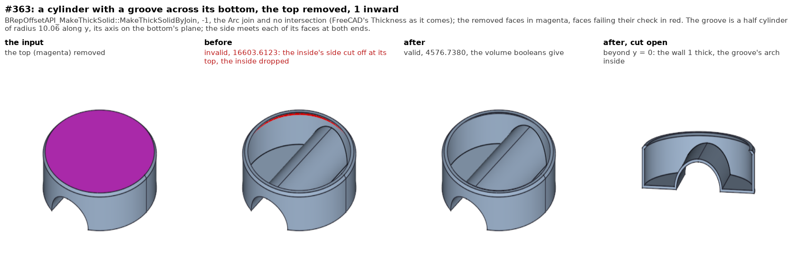

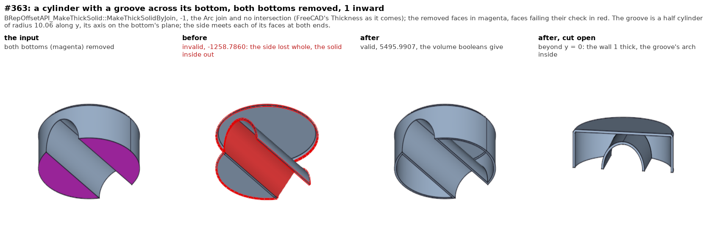

**Validation** (each fix against the kernel before it, `ca991d3f27` and
`5525e72804`): Part 390 and PartDesign 486 tests OK; thickness PASS=398
XFAIL=4 (with these cases), draft 105, boolean 39; the three draft sweeps
not one result changed; the thickness sweep right in all 928 runs, not one
changed.

## A filleted dome, 2 inward (2026-10-29)

A box (80 x 50 x 40) under a B-spline dome, the dome's four edges filleted
(r 3), the bottom removed, 2 inward, the Arc join: refused, the offset
shell empty. At each corner of the dome two fillets meet in a mitre and
both meet the dome tangentially; their offsets' section ended a hair
outside one of them and was given no edge, and the mitres were never cut.
A pave filler fix (`e9ded0215d`, `../boolean/`, "A section's tangent end at
a corner"): valid, 20254.4308, as booleans give (20254.4292).

| Case | Model | What it covers |
|------|-------|----------------|
| `dome_tangent_corner_in`, `_in_inter` | `../boolean/models/dome_fillet_r3.brep`, face 4 removed, -2; the Arc join, without and with intersection | 20254.4308; refused before |

1 inward is valid now too (10416.5544). Still refused, as before: outward
(the next section), 4 inward (past the fillets' radius), and the dome
itself removed.

**Validation** as `../boolean/README.md` gives it: thickness PASS=400
XFAIL=4, the thickness sweep right in all 928 runs, not one changed.

## A filleted dome, outward (`8097862fb0`, 2026-10-29)

**What was broken.** The same shape, the bottom removed, 1, 2 or 3 outward,
the Arc join: refused (`BRepOffset_UnknownError`), the offset shell dropped
for a free edge. At each corner of the dome the mitre between two fillets
is a crease, convex, and it fades out where both fillets meet the dome
tangentially. The Arc join puts a tube on a convex crease, its section an
arc of the angle between the faces, so the tube closes to nothing at the
dome's corner. `BRepOffset_Offset` makes that end a degenerated edge when
the two faces' offsets share the vertex there -- and they did not.
`MakeOffsetFaces` shares a vertex among the offset faces only where every
edge at it is tangential, and the mitre is not: each fillet's offset made a
vertex of its own at the corner, 1.8e-6 from the other's (the faces 1 to
2e-6 rad off tangent there, within the vertex's tolerance, 1.9e-5). The
tube's end became an edge of no length that no other face shared.

**The fix.** The offset faces also share a vertex where the offsets of it
by every face around it -- the vertex moved along each face's normal by its
offset -- lie within the vertex's tolerance of each other: where the faces
are tangent at the vertex, whatever their edges are elsewhere. A face
whose normal is not defined there (a pole) never counts as meeting. Then
the tube's end is degenerated, a point, and the corner closes.

| Case | Model | What it covers |
|------|-------|----------------|
| `dome_crease_fades_out`, `_out_inter` | `../boolean/models/dome_fillet_r3.brep`, face 4 removed, +2; without and with intersection | 22546.8215 (booleans 22546.8191); refused before |
| `dome_crease_fades_out_1`, `_out_3` | the same, +1 and +3 | 10990.0549 and 34682.8741 (booleans 10990.0527, 34682.8715); refused before |

`models/dome_crease_fades.cpp` runs the three against the volumes booleans
give: the part above z = 0 of the offset of the shape carried down to
z = -10, less the shape. Still refused then: the dome itself removed
(inward since the next section), 4 inward, and the Intersection join
either way (inward since sec 30, outward from fix level 1 since sec 31).

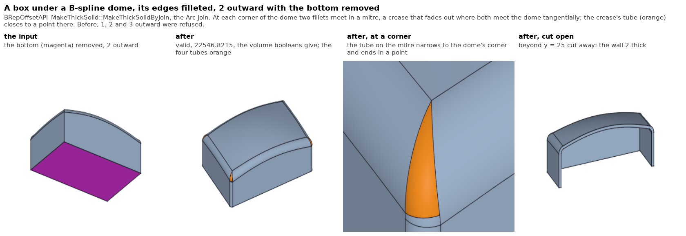

**Validation** (against the kernel before it, `f80ed3ac78`): Part 390 and
PartDesign 486 tests OK; thickness PASS=404 XFAIL=4 (with these cases),
fillet 815, draft 105, boolean 43; the fillet and draft sweeps not one
result changed; the thickness sweep right in all 928 runs, not one
changed.

## A filleted dome, the dome removed (`6004240f16`, 2026-10-29, sec 34)

**What was broken.** The same shape with the dome itself removed, 0.5, 1,
2 or 2.5 inward, the Arc join: refused (`BRepOffset_UnknownError`), the result
the input itself, unhollowed. The dome meets each fillet tangentially, and
a removed face tangent to its neighbour along an edge is closed by a tube
round the edge (`ToContext`, the filleted box's sec 6); none was built here,
and four faults lay behind that one:

1. The edges were not taken as tangent. The dome and its B-spline fillets
   meet 2e-6 rad off, and the test was the angular precision (1e-12) where
   the analysis works to the angle the tolerance allows over half the offset
   -- which `TreatTangentCaps`, the Intersection join's counterpart, already
   used. Now the tube's test uses it too (a helper, `analyseTolAngle`).
2. The tube's edge on the dome had no pcurve for two of the four edges: its
   projection onto the dome came back empty, and the edge was never cut into
   the dome. The pcurve is now fitted through the points' parameters on the
   dome, which the intersection that finds them gives anyway (and the same
   for the corner arc on the dome outward, `TangentCornerArcOnCap`).
3. That edge ended where the dome's edge does, short of the dome's next edge
   at each corner (the lines and circles of the box and the sphere cases run
   on): the corner of the rim was never cut off. It now runs on past each
   end until it has left the dome, and a step further.
4. Two tubes meet at a corner of the dome along a curve that should end on
   both tubes' edges on the dome where they cross, and at the vertex both
   tubes start from on the fillets' offsets. It ended 7e-6 off one of the
   edges -- the 2D intersection works to 1e-7 and missed it, and the edge was
   not cut -- and 3e-4 to 1e-3 off the vertex, where the tubes all but touch
   and their section is ill-conditioned. `EdgeInter` (`BRepOffset_Inter2d`)
   now takes an end of one edge lying on the other within their tolerances
   as an intersection (at an end of the other, the two ends meeting), and
   `PipeInter` (`BRepOffset_Tool`) ends the section at a vertex both tubes
   have when it ends that near it (within a thousandth of the tubes' size),
   the end poles of its curve and pcurves moved onto the vertex.
   Where the two touch to within 1e-7 the 2D intersection found nothing on
   purpose, and that stays as it was: a vertex put there broke the wire of
   a half dome's offset.

| Case | Model | What it covers |
|------|-------|----------------|
| `dome_cap_removed_in`, `_in_0_5`, `_in_1`, `_in_2_5` | `../boolean/models/dome_fillet_r3.brep`, face 9 (the dome) removed, -2, -0.5, -1 and -2.5 | 21141.1736, 5536.3514, 10903.6446, 26016.1291; refused before |

The volumes are the rule the tube follows, worked numerically (to about
1e-5): the input less the points more than the thickness from every face
kept -- the input shrunk by the thickness (a closed offset), and the
channel under the dome, the points within the thickness below it and
further than that from its edges (near the dome a kept face's nearest point
is on the dome's edge, the fillets meeting it tangentially). A Gauss-rule
integral over a grid on the dome, it gives 21141.268, 5536.421, 10903.572
and 26016.161 at 1200 x 800; at 600 x 400 it moves by 0.5 (0.11 at 0.5).
`models/dome_cap_removed.cpp` runs the four against those to 1e-4. The mitre between the fillets'
offsets ends up to 1e-3 off the vertex at the dome's corner (1.04e-3 at
0.5 inward: the thinner, the closer to tangent the two cross there), where
the two all but touch; the vertex's tolerance covers it, and the cases allow it, as
for the bottom removed.

Still refused: 3 and 4 inward (the fillets' radius). Outward, which was
refused too, has its own section below ("A filleted dome, the dome removed,
outward").

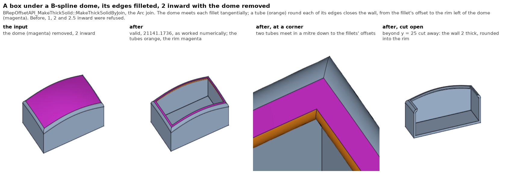

**Validation** (against the kernel before it, `047a9e432d`): Part 390 and
PartDesign 486 tests OK; thickness PASS=407 XFAIL=4 (with these cases),
plain and frozen, fillet 815, draft 105, boolean 43; the fillet and draft
sweeps not one result changed; the thickness sweep right in all 928 runs,
plain and frozen, not one changed.

## Two adjacent top fillets, the Intersection join (`779e6acceb`, 2026-10-29, sec 28)

A box with two adjacent top edges filleted, the bottom removed, the
Intersection join: the fillets' offsets meet on an ellipse, which the
filler cut at its origin. At three corners of the four that origin is
where the section crosses the fillet's tangent line with the wall, and the
run-on beyond it was an edge of its own outside the faces, walked out and
back by the loops. `Inter3D` joins such pieces again between elementary
faces (`models/Thickness.md` sec 28).

| Case | Model | What it covers |
|------|-------|----------------|
| `mitrebox_x0y0_join_in`, `_out` | box 10 x 8 x 6, the top edges at x = 0 and y = 0 filleted r2, the bottom removed, Intersection join, -1 and +1 | 228.2242 and 334.7817, worked out by hand; right before too (the ellipse's origin lies off the section) |
| `mitrebox_x0y8_join_*`, `mitrebox_x10y0_join_*`, `mitrebox_x10y8_join_*` | the same at the other three corners | the same volumes; invalid inward and refused outward before |

Still refused then: all four top edges filleted (the next section), and
the filleted dome, with the Intersection join.

**Validation** (against `047a9e432d`): Part 397 and PartDesign 499 tests
OK; thickness PASS=412 XFAIL=4 unfrozen and frozen (FAIL=6 before), fillet
815/1, boolean 43, draft 104 with `new_roof_L_a-30` failing on this box with
the kernel from before as well; the thickness sweep right in all 928 runs,
not one changed.

## A top whose every edge is tangent, the Intersection join (`9e58e47a29`, 2026-10-29, sec 29)

The same box with all four top edges filleted: the top's offset met no
section, was not extended, and kept the edges its offset was made with,
while the fillets' faces were rebuilt with new ones along the same lines --
the shell held each of the top's edges once, refused. A face that meets no
section is extended, and rebuilt, with a neighbour across a tangent edge
that is (`models/Thickness.md` sec 29).

| Case | Model | What it covers |
|------|-------|----------------|
| `roundtop_join_in`, `_out` | box 10 x 8 x 6, all four top edges filleted r2, the bottom removed, Intersection join, -1 and +1 | 217.7906 and 313.2065, worked out by hand; refused before |

Still refused then: the filleted dome with the Intersection join (inward,
the next section).

## The filleted dome inward, the Intersection join (`09d6ab9ac2`, `ad76ead2ad`, 2026-10-29, sec 30)

Two faults. The offset of a tangent edge between a wall and a B-spline
fillet was given a range past the ends of its curve, a B-spline that does
not go there, and came out under a tolerance of 1.87; it goes no further
than its curve now. And at each corner of the dome's top the end of one offset edge was
stored on the next where they cross without a parameter on it, which the
loops threw on; `TrimEdge` keeps the parameter it projected it to
(`models/Thickness.md` sec 30).

| Case | Model | What it covers |
|------|-------|----------------|
| `dome_join_in`, `dome_join_in_2` | `../boolean/models/dome_fillet_r3.brep`, face 4 removed, Intersection join, -1 and -2 | 10416.5477 and 20254.4292, by the volume booleans, as the Arc join gives; refused before |

Still refused then: the dome outward with the Intersection join (the next
section).

**Validation** (against `193f97a680`): Part 397 and PartDesign 499 tests
OK; thickness PASS=416 XFAIL=4 unfrozen and frozen (FAIL=2 before), fillet
815/1, boolean 43, draft 104 with `new_roof_L_a-30` failing as before; the
thickness sweep right in all 928 runs, not one changed. The first fix
alone changes none of these.

## The filleted dome outward, the Intersection join, from fix level 1 (`b68a0320fa`, `e87e3c2289`, 2026-10-29, sec 31)

A fix that changes a shape some input already had is made only at a level
the caller sets (`BRepOffset_SetFixLevel`, 0 by default on every thread);
FreeCAD sets it from each feature's `_OffsetFixLevel`, the latest for an
object made now, 0 for one an older file brings. The dome outward needs
four, all level 1: the wall-to-fillet edges go past their B-spline curves,
made again from the pcurve; a vertex where two edges cross is as far from
them as it is where it lies, not their whole tolerance; a vertex at the
top corners, where three faces share one normal and the edges meet
nowhere; and `TrimEdge` keeps a projected end's parameter and lets a
trimmed edge's tolerance take in how far it ends from its vertices
(`models/Thickness.md` sec 31).

| Case | Model | What it covers |
|------|-------|----------------|
| `dome_join_out`, `dome_join_out_2` | `../boolean/models/dome_fillet_r3.brep`, face 4 removed, Intersection join, +1 and +2, at every level since sec 32 | 11010.6637 and 22629.5034 since sec 33 (11009.9518 and 22626.4034 before), the results; the Arc join's solid plus the Intersection join's less it gives 11010.25 and 22628.7 for both; refused before |
| `dome_join_out_level0` | the same, +1, level 0 | what a document saved before gets: `XFAIL`, refused, until sec 32; made since, 11010.6637 since sec 33 |

**Validation** (against `92cc9effb6`): the thickness suite PASS=418
XFAIL=5 unfrozen and frozen, at level 0 and at level 1, and the sweep, all
928 runs: at level 0 the same as before case for case and run for run; at
level 1 the same but for `dome_join_in_2`'s last place (20254.6086 for
20254.6087). Fillet 815/1, boolean 43 and draft 104 with
`new_roof_L_a-30` failing as before, the same at both levels. FreeCAD with
`_OffsetFixLevel` (Sketch3D `719e37a112`): its Python suite 4064 tests OK
and its gtests 1085 of 1085, frozen and unfrozen.

## The dome outward at every fix level (`8b5beb449a`, 2026-10-29, sec 32)

What sec 31's four fixes move in the cases the suite had lies within those
shapes' tolerances, measured to full precision over the suite and the sweep:
no status, no topology, tolerances tighter in 526 of 529, volumes 9e-7 at
most but `dome_join_in_2`'s -1.05e-4, a strip 1.2e-7 wide on one face, the
two shapes within 2e-6 of each other but at two corners inside their
tolerance. A fix within tolerance needs no level, so they are made at every
one; level 1 makes nothing differently (`models/Thickness.md` sec 32).

| Case | Model | What it covers |
|------|-------|----------------|
| `dome_join_out_level0` | as above, +1, level 0 | made, 11009.9518, as at level 1 |

The +2 dome's tolerance of 1.16e-2 is found, not fixed: the wall-to-fillet
edges end 0.011 short of their corners, the fillet's pcurve and the curve
made again from the wall's running at different speeds past the old end.
The exact volumes of `dome_join_out` and `dome_join_out_2` are likely low by
about 0.7 and 3.1 for it (sec 32; 0.30 and 2.25, sec 33). Fixed in sec 33.

**Validation** (against `7543d139db`): the thickness suite PASS=419
XFAIL=4 unfrozen and frozen (FAIL=3 before), the same as level 1 before
case for case and to full precision but for `dome_join_out_level0`; the
sweep, all 928 runs, the same; fillet 815/1, boolean 43, draft 104 with
`new_roof_L_a-30` failing as before.

## The dome outward's edges reach their corners (`35036a8034`, `6847e84646`, 2026-10-29, sec 33)

`ExtentEdge` makes a prolonged B-spline edge's other pcurves again, its
new curve projected on their surfaces: the wall-to-fillet edges of the
dome outward end at their corners, where they ended 0.0027 (+1) and 0.011
(+2) short under a tolerance that took the gap in. And
`BRepLib::UpdateTolerances` pads a vertex tolerance it sets to a gap, so
the vertex still covers it after a BRep text write and read (15 digits for
points and ranges), which one corner of the +2 dome did not.

Every passing thickness case is now written and read back and checked
again (`round_trip`), and the outward domes hold their widest curve-end
gap to 0.002 (`max_gap`, `../loose_ends.py`'s `widest`).

| Case | Model | What it covers |
|------|-------|----------------|
| `dome_join_out`, `dome_join_out_level0`, `dome_join_out_2` | as above | widest gap 0.0012 and 0.0015 (0.00271 and 0.0111 before); +2's widest tolerance 2.42e-3, from 1.16e-2 |

Only the five dome cases move, within their tolerances: no vertex, the
shapes within 1.4e-3 of each other beside edges of 1.4e-3 to 2.8e-3; the
exact volumes by 0.71 and 3.10 outward, which booleans show to be the
integration round pcurves a tolerance off their edges, not the shape
(`models/Thickness.md` sec 33).

**Validation** (against `6847e84646`): the thickness suite PASS=419
XFAIL=4 unfrozen and frozen (PASS=416 FAIL=3 before), every case valid
after the round trip; the sweep, all 928 runs, the same to full precision;
fillet 815/1, boolean 43, draft 104 with `new_roof_L_a-30` failing as
before, case for case; FreeCAD's Python suite 4064 OK and C++ tests 1086 of
1086, frozen and unfrozen.

## A filleted dome, the dome removed, outward (`c8e8866490` to `ec6c703cfc`, 2026-10-30, sec 35)

**What was broken.** The dome removed as above, but outward, 0.5 to 4, the
Arc join: refused (`BRepOffset_UnknownError`). Outward the tubes round the
dome's edges stand above the dome, and two of them touch at each corner of
it; their section is tangent at its end to the one tube's end and to the
other's edge on the dome. Five faults, one after the other:

1. `ToContext` built the outward corner sphere (`72267e6608`) at each corner:
   the convex edge it found ending there is the mitre between the two
   fillets, whose tube closes to a point, and the sphere came out a sliver
   with an arc on the dome 1.1 off it. Where another tangent edge of the same
   cap ends at the vertex, the two tubes meet each other, as inward, and no
   sphere is built now.
2. `PipeInter` gave the section a second line 3.4e-4 long whose two ends both
   took the vertex the tubes share: an edge of no length, and a construction
   error. Such a line is dropped; the section's other line reaches the vertex.
3. `BRepAlgo_Loop::CutEdge`, keeping every piece, put the section's own first
   vertex after the vertex its end on the tube's edge had been cut at, both at
   the one parameter: the piece kept started on the section's own vertex, and
   the tube's wire did not close there. The first vertex now goes first.
4. `FindLoopsByAngle` orders the edges leaving a vertex by their end tangents
   in (u, v). The section's pcurve ends 3.9 deg the wrong side of the tube's
   end at 1 outward (6.1 deg at 2.5; 0.9 deg of the other tube's edge),
   though the curve runs on the right side of it, and two faces of the tube
   were walked as one: the tube came out a triangle. Directions closer than
   0.2 rad now go by the chords a tenth along each, as exact ties did; one
   leaving all but the way the walk came in goes first or last, on its
   chord's side.
5. Where the two fillets' mitre shrinks to nothing, `MakeLoops::BuildFaces`
   merged its end into the corner vertex and replaced it on its own faces'
   edges only: the tube's edge on the dome took the new vertex, the section
   kept the old, and the tube's wire came apart
   (`BRepCheck_NotConnected`). The replacement now runs over every face built.

Fault 2's line threw at 3 inward too, which was what refused it: without it
3 inward came back done, invalid, the input's skin round two scraps of the
offset, each bounded by one edge from a vertex back to it. After
`SelectShells` an offset with none of the faces built round the removed
ones, open or with a wire that does not close, is now refused
(`ec6c703cfc`); a cavity sealed below a removed face (FreeCAD's
`test_thickness_sealed_below_a_removed_face`) is closed and stays.

| Case | Model | What it covers |
|------|-------|----------------|
| `dome_cap_removed_out`, `_out_0_5`, `_out_1`, `_out_1_5`, `_out_2_5`, `_out_3`, `_out_4` | `../boolean/models/dome_fillet_r3.brep`, face 9 (the dome) removed, 2, 0.5, 1, 1.5, 2.5, 3 and 4 | 25087.1916, 5783.3046, 11891.1761, 18325.2602, 32178.6178, 39601.1865, 55446.3703; refused before |
| `dome_cap_removed_in_3_refused`, `_in_4_refused` | the same, -3 and -4 | refused, as before (3 answered invalid without `ec6c703cfc`) |

The volumes are the same rule as inward, the input grown and the channel
above the dome away from its edges, at 1200 x 800: 25087.299, 5783.383,
11891.124, 18325.236, 32178.671, 39601.142 and 55446.448, within 1.4e-5 of
the results (0.5) and within 4.4e-6 for the rest; at 400 x 400 they move
by up to 0.9. 5 outward comes out valid too (72635.996, the rule's 72636.049
at its default grid). Every curve end is within 2.8e-5 of its vertex.
`models/dome_cap_removed.cpp` runs these with the inward four, to 1e-4.

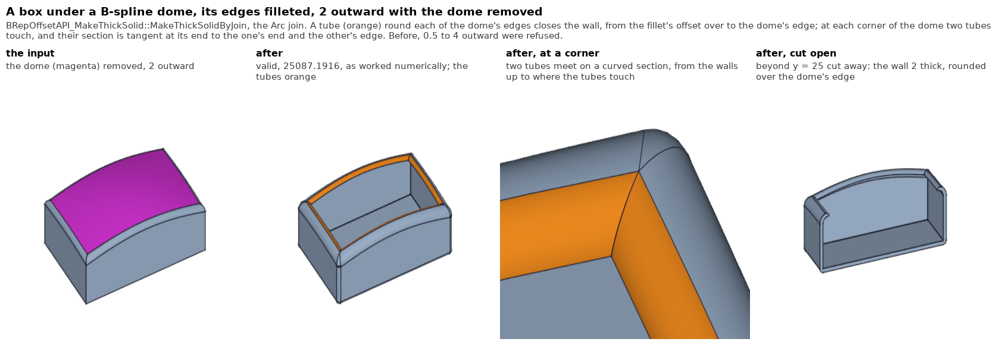

**Validation** (on `eebc4a98b5`, then again merged with `c4fe0d5bd6` and
`ee8f75c149`): Part 390 and PartDesign 486 tests OK; thickness PASS=432
XFAIL=4 at fix levels 0 and 1, plain and frozen, the nine cases above
among them (PASS=423 before them); fillet 815/1, draft 105, boolean 43;
the thickness sweep right in all 928 runs at both levels, plain and
frozen, not one changed; the fillet sweeps (vertex, edge, flat, big radii,
chamfer) and the draft sweeps (1222 valid, 500 refused, 114 chains) the
same as before, case for case.

## A grooved cylinder's bottom away from the groove's seam (`1b6b556d93`, 2026-10-30, sec 36)

**What was broken.** #363's grooved cylinder with the groove one face whose
own seam lies on its edge with one bottom, the other bottom removed, 1
inward, the Arc join: valid and wrong, 2142.0698 for 5600.5842; the issue's
own base the same way, -3798.5363 (inside out) for 5933.2710. The groove's
offset and the kept bottom's were missing, and a plane on the removed
bottom's level closed the solid under them.

The side's offset is walked in (u, v) (sec 8): the removed bottom's arc on
it, stretched round the whole circle, runs on under the groove's offset and
the kept bottom's, and the walk makes wires of the pieces down there as
well as the side's own face. Those pieces run past the span the arc's
intersections gave it, and a wire through such a piece loses to the wire
inside that shares an edge with it (`DropOutsideWires`) -- unless it has a
piece of the seam, which is left to the seam bands. With the groove in two
faces that never mattered: the piece under the groove is one wire, the
strip under the kept bottom another, which runs through the side's seam
and is dropped later as hanging. With the groove one face, its loop
cuts the section with the side first and keeps it only down to where the
kept bottom's offset cuts it; the short piece below, which parts the two
regions, never reaches the side's loop, and they became one wire, through
the seam: kept. Its arc pieces cut the removed face, which
then had a piece under it too, and with that the shell held it, while the
groove's offset and the bottom's were dropped as hanging.

On a face walked in (u, v) a piece of the seam is a border like any other,
the walk parting a region where it crosses the seam: such a wire is no
longer exempt there (`BRepAlgo_Loop`). The result is the same solid the
groove in two faces gives -- each boolean difference with it is 0 -- at
5600.4573 (5600.5842 integrated over the other faces) and 5933.3055.

| Case | Model | What it covers |
|------|-------|----------------|
| `issue363_groove5_groove_seam_left_bottom_in`, `_thickness001_left_bottom_in` | the groove a single face with its seam on the right bottom's edge, the left bottom removed, -1 | 5600.5842, 5933.2710; `XFAIL` before, valid and wrong |

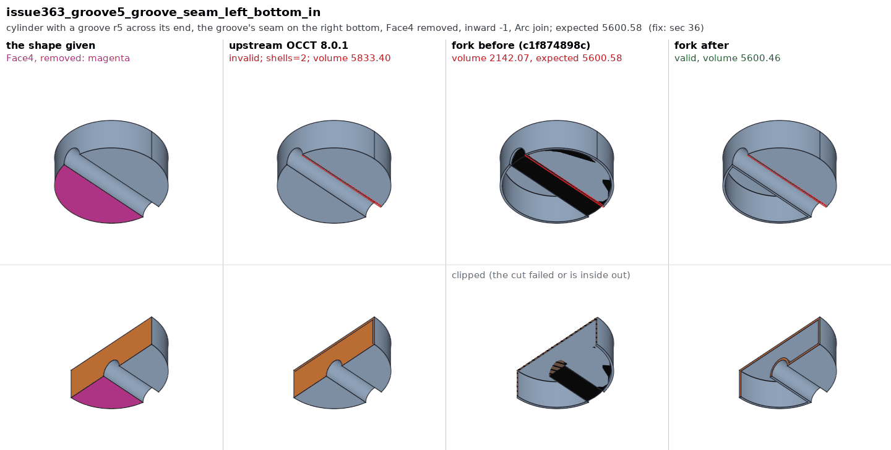

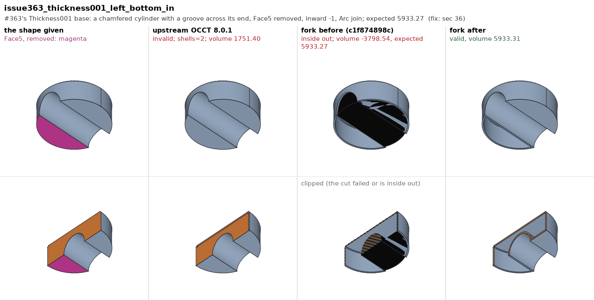

**Validation** (on `1b6b556d93`): Part 390 and PartDesign 486 tests OK;
thickness PASS=434 XFAIL=2 at fix levels 0 and 1, plain and frozen, the two
cases above among them (PASS=432 XFAIL=4 before); fillet 815/1, draft 105,
boolean 43; the thickness sweep right in all 928 runs at both levels, plain
and frozen, not one changed; the fillet sweeps (vertex, edge, flat, big
radii, chamfer) and the draft sweeps (1222 valid, 500 refused, 114 chains)
the same as before, case for case.

## A cylinder with a step cut off its side, the Intersection join (`6eb5f7566e`, 2026-10-31, sec 37)

**What was broken.** #363's Thickness001 with the Intersection join is
invalid (`issue363_thickness001_in_join`), and so is any cylinder with
something cut across the edge of its end, upstream too. The simplest: the
cylinder r 25.807914 h 14 with a square step cut off its side (x <
-10.062591, z < 10.062591), 1 in or out, any one face removed: refused
(`CannotFuseVertices`, or nothing to say), inside out (the ceiling removed
outward), or valid and wrong -- 656.1071 for 5501.2992 with the step's wall
removed inward, in two shells, 10008.8856 for 4443.8934 with the top removed
outward. Three faults, in `BRepOffset_Inter3d` and `BRepOffset_MakeOffset`.

The side meets the step's wall in two edges apart, one at each end of the
step. The Intersection join intersected each pair of offset faces once, for
the first edge of theirs it met (`ConnexIntByInt`), keeping the section's
piece nearest it, and the second edge then took that piece too: the side's
offset was cut by the same line at both ends of the step. The Arc join had
the same fault, fixed in #363's first fix (the section on #363 above); here
every edge of one type the two faces share is given, and each takes the
pieces nearest it -- all of them where the section is one piece, a whole
circle the two arcs of a bottom the side's seam splits lie on. A removed
face meeting a face in two edges -- the step's wall removed -- is
intersected the same way (`ContextIntByInt`), where the second edge had no
section at all.

The side's section with the bottom is a whole circle, and the Intersection
join extends each offset face as far as it goes: the circle runs on under
the step and closes a piece of the side's offset there, and one of the
bottom's, as well as their own -- both kept, and the solid came out inside
out. Of the pieces an extended face is split into, the ones a point inside
lies off the face's own offset, and that a point inside the face's offset
does not lie on, are dropped (`PiecesOnTheFace`) -- all of
them, if none lies on it: the face's own piece was never made, and what the
rest closed was valid and wrong (Thickness001's base, the bottom beside the
groove removed: the solid less a pocket, 22819.0551 for 5933.3055); a removed face's rim, which may run past its face (the
step's wall removed: up its plane to the ceiling's offset), is held not to
its face but to the solid (where the shape is one solid), and a piece on
the side of it away from the thickness is dropped; and a section's piece that only a dropped piece is
bounded by goes to no rim.

The volumes are exact: the solid less its offset by 1 with sharp corners,
open through the face removed.

| Case | Model | What it covers |
|------|-------|----------------|
| `step_top_in_join`, `_wall_in_join`, `_ceiling_in_join`, `_bottom_in_join` | the step, each face removed but the side, -1, the Intersection join | 4028.4994, 5501.2992, 5434.6552, 4555.7822; refused or wrong before |
| `step_top_out_join`, `_wall_out_join`, `_ceiling_out_join`, `_bottom_out_join` | the same, +1 | 4443.8934, 6205.8133, 6148.6061, 4996.9311; refused or wrong before |

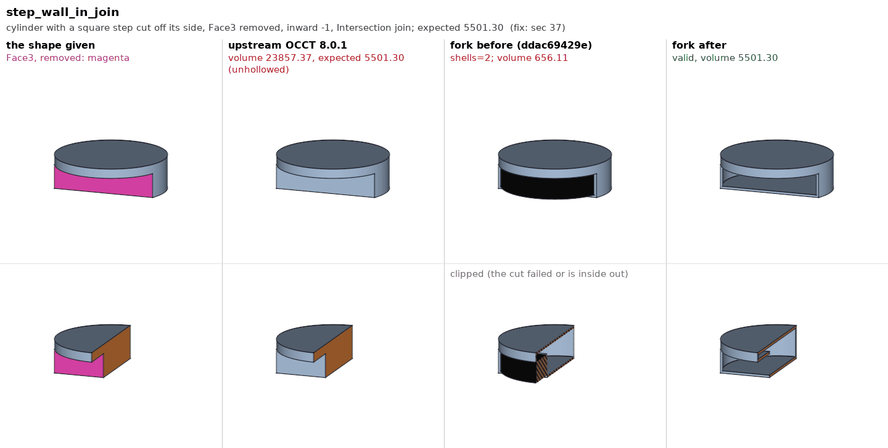

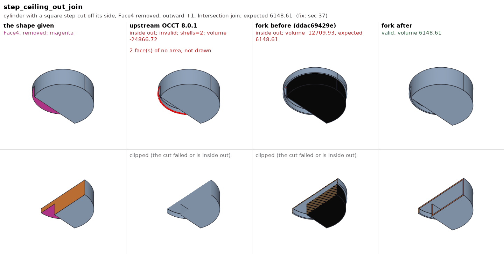

Still wrong: the groove with the Intersection join -- #363's own
(`issue363_thickness001_in_join`, now refused; made in sec 42), the groove of radius 5 in
two faces (the side's offset walked in (u, v) and cut by the offsets of the
groove's two faces, which are one cylinder once extended), a slot with flat
sides across the end (the side's loop gives the slot ceiling's offset two
of the four arcs of its circle). Some of these, refused at once before, are
refused after up to a minute now: they get past the vertices, and the
side's loop spends its search's steps (`THE_LOOP_SEARCH_STEPS`) before
giving up. Over eight shapes of the kind (the step, the slot, grooves of
radius 5 and 10, with chamfers, on a box, Thickness001's base), each face
removed alone, +/-1 and +/-0.5, 224 runs: 88 right for 72 before, none valid
and wrong for 12 (the input solid among them), 12 invalid for 27, 124
refused for 113. Four runs refused before come out invalid now:
Thickness001's base with its right bottom removed, outward (1 and 0.5), and
the slot with its top removed, inward (1 and 0.5). The Arc join is wrong on
the step with its ceiling removed (refused inward, -12745.7787 outward), as
it was before.

**Validation** (on `6eb5f7566e`): Part 390 and PartDesign 486 tests OK,
with shape values frozen and not; thickness PASS=442 XFAIL=2 at fix levels
0 and 1, plain and frozen, the eight cases above among them; fillet 815/1
and draft 105, plain and frozen; boolean 43; the thickness sweep right in
all 928 runs at both levels, plain and frozen, not one changed; the fillet
sweeps (vertex, edge, flat, big radii, chamfer) and the draft sweeps (1222
valid, 500 refused, 114 chains) the same as before, case for case (run
before the piece test was made two-way -- a change neither fillet nor draft
reaches). A first form of the piece test, one-way, refused six outward runs
of the sweep that were right (a box with a hole, a cone's hole, a T, the
Intersection join): a piece grown past its face had its point there.

## #521: a three-quarter cylinder on a box's edge, the Intersection join (`79eb149f50`, 2026-10-31, sec 38)

**What was broken.** The issue's Connect -- a box 10 fused with a cylinder
r 2 h 10 standing on its corner edge, refined: three quarters of the
cylinder stand out of the box -- given a Thickness of -0.5 with the
Intersection join and its top removed: refused. So was any of its faces
removed but the two walls beside the cylinder; the wall x = 0 came out valid
and wrong (315.4663 for 270.4120), and the wall y = 0 invalid, with the Arc
join too. Upstream gives the top removed valid and wrong (324.75) and hands
either wall's back unhollowed.

The Intersection join extends each offset face before it is cut by its
neighbours'. A periodic face is taken round a tenth of the turn it leaves
free on each side -- here a tenth of the missing quarter, 9 degrees. The
cylinder's offset, r 1.5, meets the walls' offsets, x = 0.5 and y = 0.5,
19.5 degrees past its own ends (the angle whose sine is 0.5 over 1.5), so
the extended face did not reach them: the crossings found were the ones on
the far side, and the loops failed. A face of the Intersection join that
covers more than half a turn is now taken round half of what it leaves free
each way, a whole turn (`BRepOffset_Tool::EnLargeFace`, a new extension
mode 3, from `ConnexIntByInt` and `ContextIntByInt`); a face of less than
half a turn -- a groove of two quarters -- taken so far would reach into its
neighbour's turn, and keeps the tenth. (0.45, tried first, reached the walls
up to an offset of 0.78 here; half, up to 0.83.)

The wall y = 0 removed -- the other wall beside the cylinder, where its
seam ends -- was invalid with either join. The issue's cylinder is
left-handed (its axis down, the Pad's way) and its face reversed, and the
edge it shares with that wall is closed on it: two pcurves, u = 0 and
u = 2 pi, of which the face runs to the second only. The wall's rim cut the
edge in three, and the cylinder's face was rebuilt with the pieces
(`BRepAlgo_Loop`): its wires, made on the face as reversed, went to the
face's forward copy as they were, and a closed edge picks its pcurve by its
orientation on the face -- each piece took u = 0, and the face came out as
the quarter of the cylinder inside the box. On a reversed face the wires go
to the forward one reversed now (`WiresToFaces`), every edge keeping the
pcurve it had. A right-handed cylinder, its face forward, was right.

The volumes are exact: the box and the cylinder less their offset by 0.5
with sharp corners, open through the face removed.

| Case | Model | What it covers |
|------|-------|----------------|
| `issue521_connect_top_in_join`, `_bottom_in_join` | the Connect, the top (the issue's Face6) or the bottom removed, -0.5, the Intersection join | 262.7776; refused before |
| `issue521_connect_wall_x10_in_join`, `_wall_y10_in_join` | the same, a wall away from the cylinder removed | 266.0392; refused before |
| `issue521_connect_wall_x0_in_join` | the same, the wall x = 0 beside the cylinder removed | 270.4120; 315.4663 before |
| `issue521_connect_wall_y0_in_join`, `issue521_connect_wall_y0_in` | the same, the wall y = 0 at the seam's end removed; and with the Arc join | 270.4120, 269.8020; invalid before, both |

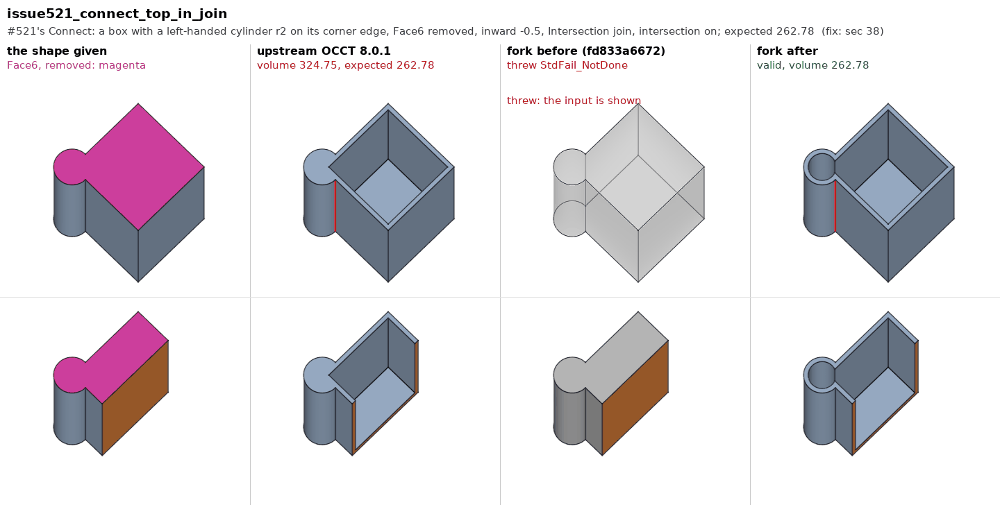

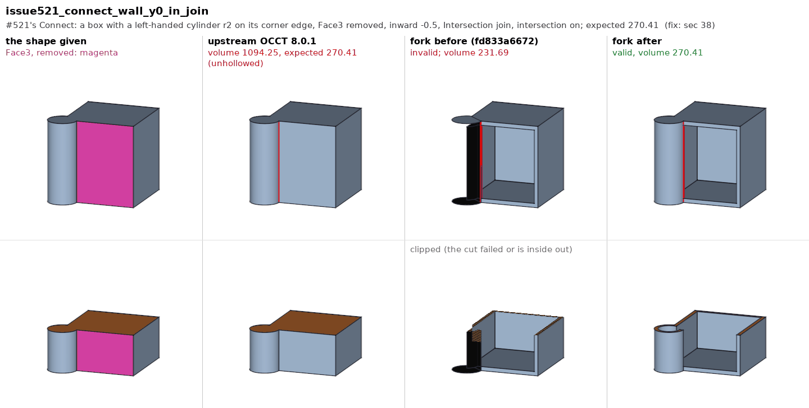

(The red line down the cylinder's edge with the wall y = 0, in the pictures,
is the input's own: the edge closed on the cylinder, which the drawing
counts as used the wrong way round; upstream's panel, the input handed
back, has it too.)

Still wrong: the cylinder removed is refused (the Arc join's invalid). The
crossing moves round as the offset grows, 45 degrees past the ends at about
0.83 here and the whole free quarter at 1, where the cylinder's offset only
touches the walls'; past 0.83 the top, the bottom and the walls away from
the cylinder are refused, as before, and either wall beside the cylinder
removed comes out valid and wrong (483.0689 at 0.9, the Arc join 449.4422)
-- as the wall x = 0 did before; the wall y = 0 was invalid. Outward nothing
changes; it was right.

**Validation** (on `79eb149f50`): Part 390 and PartDesign 486 tests OK,
with shape values frozen and not; thickness PASS=449 XFAIL=2 at fix levels
0 and 1, plain and frozen, the seven cases above among them; fillet 815/1
and draft 105, plain and frozen; boolean 43; the thickness sweep right in
all 928 runs at both levels, plain and frozen, not one changed. Over the 224
runs of the groove, slot and step shapes of sec 37 nothing changed but two
invalid runs, invalid still (the box with the groove, its far wall removed,
outward). The fillet and draft sweeps were not run: neither reaches the
offset or `BRepAlgo_Loop`. A whole turn at first took the groove of
Thickness001's base too, half a turn by its bounds and a hair over, and
twelve of its runs (three faces, four offsets) threw where they were
refused or invalid: a face must be more than half a turn by a margin now.

## A step cut off a cylinder, its ceiling removed, the Arc join (`36d0345d8e`, 2026-10-31, sec 39)

**What was broken.** The step of sec 37 with its ceiling removed, the Arc
join: refused inward, inside out outward (-12745.7787); upstream invalid
inward and the input handed back outward. Found by the corpus of sec 37,
where it was the reference.

The ceiling meets the side in an arc of 137 degrees. `ContextIntByArc`
stretches the offset of each edge a removed face shares with a kept one
before the removed face is cut by its neighbours' offsets (`ExtentEdge`); a
periodic edge was stretched until it closed, a whole circle. The circle cut
the side's offset all the way round, z = 10.06, the ceiling's rim came out
a disc of radius 26.81, and the solid closed above it. An arc of less than
half a turn is stretched 0.45 of what it leaves free each way now, short of
closing; a whole circle, a half (a seam's two arcs), and the three
quarters of #521 are stretched as they were.

| Case | Model | What it covers |
|------|-------|----------------|
| `step_ceiling_in`, `step_ceiling_out` | the step, its ceiling removed, -1 and +1, the Arc join | 5434.6552 (the Intersection join's: no concave edge is left to round), 6078.0044; refused and inside out before |

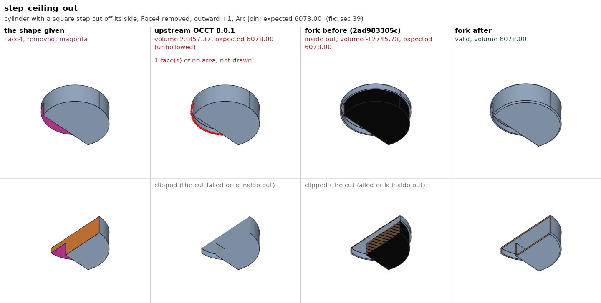

Over the corpus of sec 37 with the Arc join, the eight runs of the ceiling
(+/-1, +/-0.5) change and nothing else (one 1e-4 in the volume of
Thickness001's base, its left bottom removed, +1).

**Validation** (on `36d0345d8e`): Part 390 and PartDesign 486 tests OK,
with shape values frozen and not; thickness PASS=451 XFAIL=2 at fix levels
0 and 1, plain and frozen, the two cases above among them; fillet 815/1 and
draft 105, plain and frozen; boolean 43; the thickness sweep right in all
928 runs at both levels, plain and frozen, not one changed (464 of them the
Arc join). The fillet and draft sweeps were not run: neither reaches the
offset.

## #346: an offset inward where a dome comes to a point (`e306bb1ae4`, 2026-10-31, sec 40)

**What was broken.** The issue's Revolve -- a shell, a cone and a dome
turned about y -- given a Part Offset of -2 with the Arc join: "Unknown OCC
exception" (`StdFail_NotDone` from a projection); +2 was fine. Upstream too.

The dome's meridian is an arc whose centre is 1.05 off the axis: it rises
past its own top and comes down to the axis, 0.015 below the flat -- the top
is a dimple, 0.9 degrees deep. The offset of a face coming to a point is
trimmed where its meridians cross the axis, or extended to it where they
fall short (`BRepOffset_Offset`), and which of the two was told by the sign
of the offset alone: a cone point is crossed inward and falls short outward.
At a dimple it is the other way round: inward the offset's meridians end
0.03 short of the axis, and the trim looked for their crossing beyond the end
of the surface. Such a gap is told by where the generatrix meets the axis
now, and with the Arc join left open, as one is outward: the sphere round the
apex closes it (`BRepOffset_MakeOffset::CorrectConicalFaces`), of radius
|offset| and reversed inward, where it took the offset as its radius and
threw on a negative one.

Where the apex is crossed -- a peak inward, or a dimple on a solid inward,
its outside being the other side -- the face is trimmed there, and that was
invalid with any such surface of revolution: the seam trimmed at the apex
got its second curve on the face after its range was set, a new
representation with none, and ran from -2e100 to 2e100. The range is set
on the pair now.

| Case | Model | What it covers |
|------|-------|----------------|
| `issue346_revolve_in`, `_in_0.5`, `_in_10` | the Revolve (`models/issue346_revolve.brep`), -2, -0.5, -10, the Arc join | areas 5966.6887, 5626.8200, 7949.8995, every face at the offset distance from the input's; refused before |
| `issue346_revolve_out` | the same, +2 | 5002.0810, as before |
| `issue346_peak_shell_in` | the profile with its arc centred 1.05 to the other side (a peak), -2 | 5991.6768; invalid before |
| `issue346_dimple_solid_in`, `issue346_peak_solid_in` | each profile closed by the axis and a disc, a solid, -1 and -0.5 | 14455.0033, 18078.0821 (volumes); invalid and refused before |
| `issue346_dimple_solid_thick`, `issue346_peak_solid_thick` | the same, a thickness with the disc removed, -1 and -0.5 | 5287.5411, 2712.9873; invalid and refused before |

The offset cases (`offset_case`) are new to the suite: an offset of the
whole shape, its area (a shell) or volume (a solid), and the points inside
each of its faces at the offset distance from the input's faces, to 1e-4.

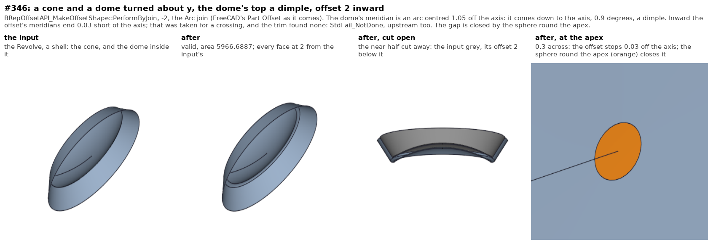

Still wrong: the Intersection join on the dimple, -2: refused, as before
(its gap is extended to the axis, and the extension threw where the trim
did); +2 valid and wrong, as before -- the dome's offset never gets its
section with the cone's, and the two share no edge. (Both made in sec 43.) A shell of revolution
with its apex cut off is refused with that join either way (an iso line of
the offset evaluated off its surface, `BRepOffset_Inter2d`). Offsets past a
solid's own thickness at the axis (2.78 at the dimple) cross the far side:
valid and wrong, as anywhere.

**Validation** (on `e306bb1ae4`): Part 390 and PartDesign 486 tests OK,
with shape values frozen and not; thickness PASS=460 XFAIL=2 at fix levels
0 and 1, plain and frozen, the nine cases above among them; the thickness
sweep right in all 928 runs at both levels, plain and frozen, not one
changed; the issue's document recomputes, its Offset valid. Fillet, draft
and boolean were not run: none reaches `BRepOffset_Offset`.

## #613 outward: a whole turn enlarged a hair off its seam (`894ce673c9`, `79b1a21718`, 2026-11-01, sec 41)

**What was broken.** #613's part (above) with its ridge's top and bottom
removed, thickness +2 with the Arc join: invalid, inside out, -14917.4397;
the top alone, +2: invalid, two shells. Upstream inside out both.

The cap at the ridge's top is cut by its neighbours' offsets enlarged, and
inward the cone's gave no section with it until the pave filler's fix
(`59ca72bbcc`). Outward it still gave none, now in `ExtentFace`: the
enlarged cone offset is a whole turn, and its u bounds came out of
`CompactUVBounds` at 2.1e-8 to 2 pi + 2.1e-8 -- a hair off the seam, where
the circle cut by the cap's plane starts. That start fell outside the face,
the filler made no paves to bound the curve, and no section edge came of
it: the cone's offset top was left 0.05 above the plane, and the face
between collapsed. A whole turn that `EnLargeFace` makes within 1e-6 of
its seam starts at the seam now (`BRepOffset_Tool`).

With that, the part's top blend removed and +0.5 with the Intersection
join, no longer throwing, came back as the input itself -- the blend split
in two, valid, at the input's volume -- and was taken for a thick solid.
A skin outward reaches past the shape by the offset wherever a face stays,
so a result whose bounds are the input's, to 1e-3 of the offset, is
unhollowed now (`BRepOffset_MakeOffset`), and refused as before.

| Case | Model | What it covers |
|------|-------|----------------|
| `issue613_fillet_top_bottom_out`, `_top_out` | #613's part, faces 7 and 16 (or 7) removed, +2, Arc | 11247.7097, 14889.3719: every face on the input or 2 outside it, but the rim; invalid before |
| `issue613_fillet_top_bottom_out_half` | the same, faces 7 and 16, +0.5 | 2713.3574 |

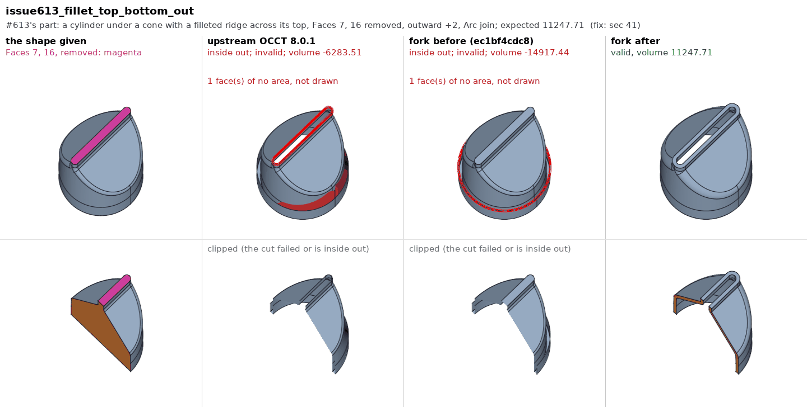

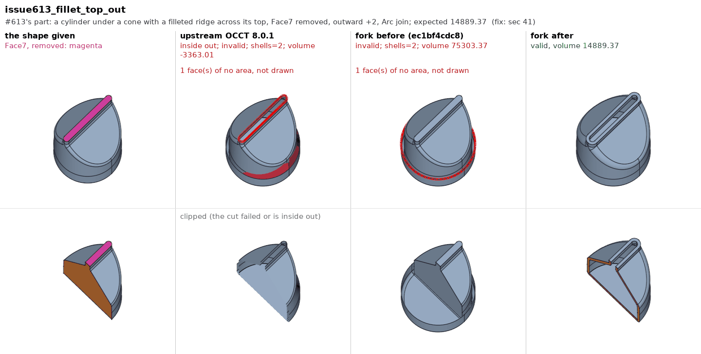

Over 1088 runs -- thicknesses of each face and offsets of the whole, +/-1
and +/-0.5, both joins, on the groove, step and #521 shapes of secs 36
to 39, the apex corpus of sec 40 and #613's part -- 82 change, all on #613's
part, 80 of them refused before and 2 invalid: 10 come out valid (the 2
invalid among them), 64 are still refused, and 8 refusals throw now, in an
evaluation of a surface or a trim. None comes back unhollowed.

Still wrong: the same window in the face-face intersection itself --
`IntTools_FaceFace` loses the curves of a whole turn bounded 0 to 2 pi +
eps for eps of 1e-9 to 1e-7. Nothing in the suite reaches it now.

**Validation** (on `79b1a21718`): Part 390 and PartDesign 486 tests OK,
with shape values frozen and not; thickness PASS=463 XFAIL=1 at fix levels
0 and 1, plain and frozen, the three outward #613 cases among them; the
thickness sweep right in all 928 runs at both levels, plain and frozen, not
one changed. Fillet, draft and boolean were not run: none reaches
`EnLargeFace` or the unhollowed check.

## #363 with the Intersection join: a circle the two bottoms' arcs lie on (`a151b3b0df`, 2026-11-03, sec 42)

**What was broken.** #363's Thickness001 -- the chamfered cylinder with a
groove across its end, both bottoms removed -- with the Intersection join:
refused at -1 and -0.5, invalid at +1 and +0.5 (28082.3223, 26668.3828);
upstream too. It was the suite's last `XFAIL`.

Each removed bottom is cut by the offsets of the faces it meets, the side's
among them, and with the Intersection join that cut is the section of the
bottom's plane, enlarged, with the side's offset enlarged: the whole circle,
r 24.81. Each bottom's edges on the side were given all of it -- the right
bottom's two arcs (the side's seam splits its arc) and the left bottom's one
-- and on the side's offset the two circles lay on each other. The side's
loops took the slivers between them: its image kept a wire of the top
circle alone and the two pieces under the groove, the parts that are cut
away, and the shell builder dropped every face as hanging. The Arc join had
the same overlap with the arcs' offsets, each stretched round, and shares
the circle out (`ShareTurns`, sec 36): each arc stretched to the middle of
the gap on either side of it, to a vertex the arc beyond takes too. The
Intersection join's sections are shared out the same way now
(`ShareSection`, `BRepOffset_Inter3d`): where a bottom's section is one
closed edge and each of its edges on that face has a share, each gets its
piece of the circle -- the right bottom two quarters meeting at the seam,
the left one half, all three ending on the same vertices at the middles of
the gaps. Only a circle the arcs of two caps or more lie on: one cap's arc
that the seam splits keeps the whole circle, which the step cut off a
cylinder (sec 37) needs -- shared out there, its bottom removed came out
invalid or refused at three offsets that are made.

Inward the results are the Arc join's to the digit, every edge between kept
faces convex there; outward the Intersection join's square corners hold
more: 27.2932 at +1 and 7.0707 at +0.5, a quarter of it, the Arc join's
result inside the Intersection join's (their boolean difference that way
0), the extra within 1.8 of the kept faces' edges and corners.

| Case | Model | What it covers |
|------|-------|----------------|
| `issue363_thickness001_in_join`, `_in_half_join` | Thickness001, both bottoms removed, -1 and -0.5, the Intersection join | 5495.9827, 2792.2176 (the Arc join's); refused before |
| `issue363_thickness001_out_join`, `_out_half_join` | the same, +1 and +0.5 | 5843.3934, 2879.0411; invalid before |

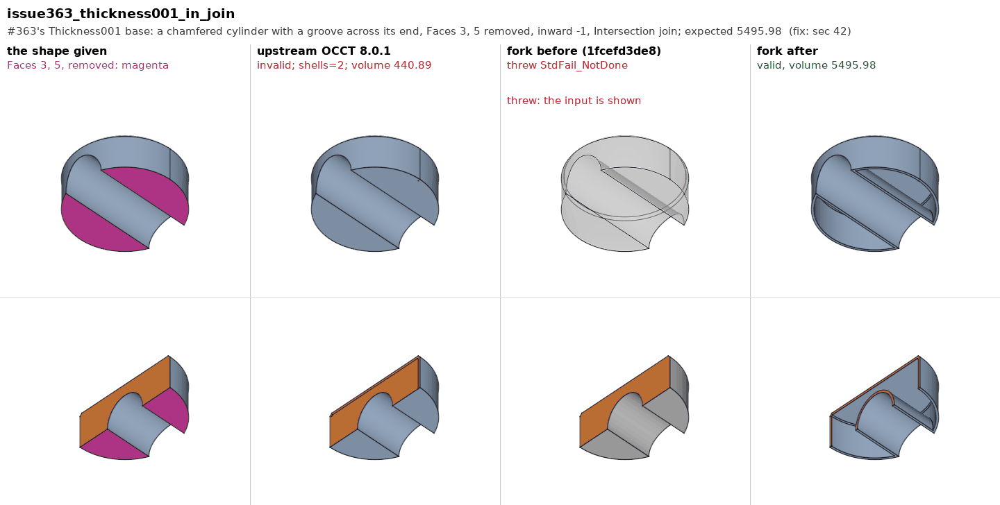

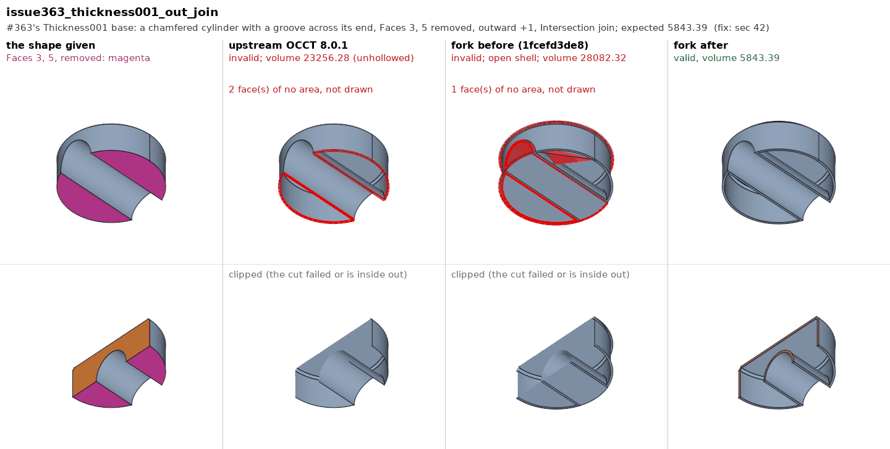

Over the 224 runs of the Intersection join corpus of sec 37 -- the step,
the slot, the grooves of radius 5 and 10, the chamfered one, #363's base
and two more, each face removed alone, +/-1 and +/-0.5 -- not one changes:
none has two caps on one circle.

Still wrong: the same groove built in FreeCAD -- the grooves of radius 5
and 10 and the chamfered one, their side a right-handed cylinder, both
bottoms removed -- refused as before at all four offsets. The circle is
shared out there too; what fails is another fault: the groove is two faces,
and the side's offset image comes out unbounded (z to 1e7). And #363's base
with one bottom removed, the Intersection join, invalid or refused: sharing
its one bottom's seam-split circle out made it valid, at the cost of the
step's three runs above.

**Validation** (on `a151b3b0df`): Part 390, PartDesign 486 and ShapeStorage
63 tests OK, with shape values frozen and not; thickness PASS=467 at fix
levels 0 and 1, plain and frozen, the four cases above among them (PASS=463
XFAIL=1 before); the thickness sweep right in all 928 runs at both levels,
plain and frozen, not one changed. Fillet, draft and boolean were not run:
none reaches `ContextIntByInt` or `ShareTurns`.

## #346 with the Intersection join: the dimple's apex closed by a sphere (2026-11-03, sec 43)

**What was broken.** #346's Revolve (sec 40) with the Intersection join:
inward (-2, -1, -0.5) a throw, the projection sec 40 took out of the Arc
join's way; outward (+2, +1, +0.5) valid and wrong, area 6965.7364 at +2
where the right one is 5002.0810. Thickened with the cone removed, refused
or a throw. Upstream too.

At the dimple the offset's meridians fall short of the axis inward and cross
it outward. Sec 40 left the gap open for the Arc join, for the sphere round
the apex; the Intersection join still extended the offset to the axis
outward and trimmed it inward, both the wrong way round at a dimple: the
extension ran on 8 past the axis and folded the dome's offset over itself,
never cut by the cone's. Decided 2026-11-03: the apex is left open with
either join and closed by the sphere, as the Arc join does --
`BRepOffset_Offset` opens it where the generatrix meets the axis on the
other side from a cone point's, and `CorrectConicalFaces` runs for both
joins. Three more faults stood behind it:

- The open apex is a circle 0.06 across that keeps the degenerated flag
  (`CorrectConicalFaces` finds it by it). `BRepAlgo_Loop` held it back as a
  pole, for a wire through its vertex, and the dome's face came out a
  sliver along the rim. A degenerated edge that is no point in 3D bounds the
  face as any closed edge does now.
- The Intersection join enlarges the dome's offset, its surface of
  revolution made a rational B-spline, and the offset of that B-spline is
  unstable at its pole: a hair either side of it, the normal came out
  along the parallel, 2 off. The result was valid as made, and invalid once
  written and read back: the topology section of a BRep file was written to
  15 digits (the curves and surfaces to 17), and the seam's range, ending on
  the pole, came back 1.5e-15 past it. `TopTools_ShapeSet` and
  `TopTools_LocationSet` write 17 digits now -- every double reads back as
  it was. That is any BRep text file, FreeCAD's documents among them.
- The same instability gave `CorrectConicalFaces` the two ends of the
  apex circle 3e-5 apart, taken off the surface at u 0 and 2 pi, and the
  sphere stopped short of a whole turn: its seam two edges, each on one
  face, the thickness invalid. A circle on one vertex ends where it starts.

Outward the Intersection join gives the Arc join's area to 6e-3 in 5002
(the rim between cone and dome is concave there, a sharp corner with
either join; the dome's offset is a B-spline with this join). Inward the rim
is convex, a sharp corner where the Arc join rounds it, every point at 2
from the input but the corner's, at most 1.263 times the offset away. The
thicknesses with the cone removed are the dome's area and its offset's,
averaged, times the thickness, to 0.1%. With the Arc join they stay refused.

| Case | Model | What it covers |
|------|-------|----------------|
| `issue346_revolve_in_join`, `_in_0.5_join` | the Revolve, -2 and -0.5, the Intersection join | areas 6053.7243, 5648.2105; a throw before |
| `issue346_revolve_out_join` | the same, +2 | 5002.0869; 6965.7364 before |
| `issue346_revolve_thick_out_join`, `_thick_in_join` | the Revolve, the cone (face 1) removed, +2 and -1, the Intersection join | volumes 6198.1628, 2896.5118; refused and a throw before |

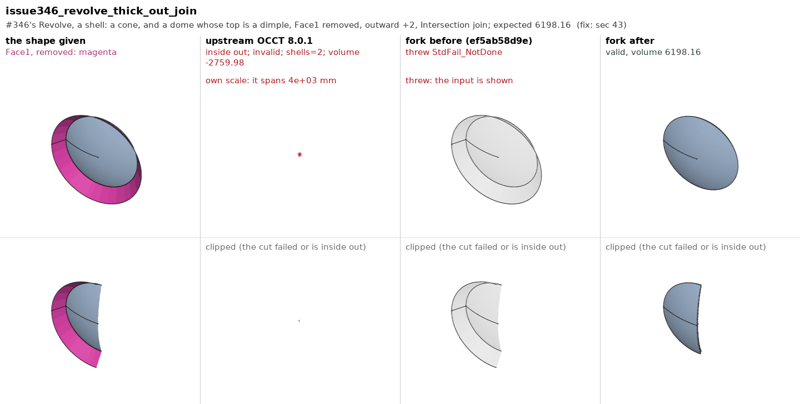

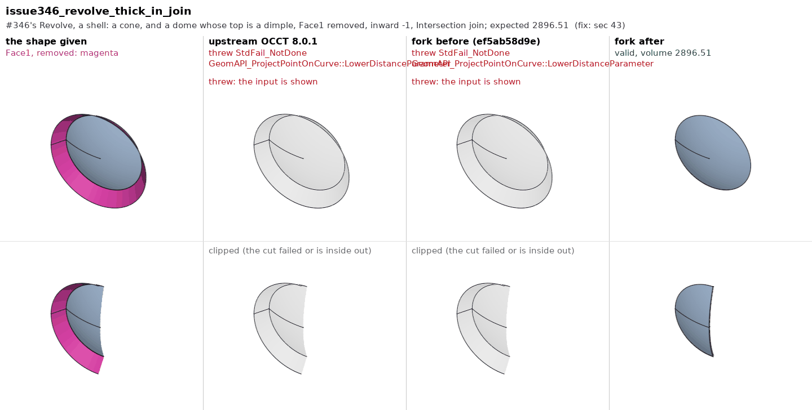

Over 952 runs -- sec 41's corpus (thicknesses of each face and offsets of
the whole, +/-1 and +/-0.5, both joins, on the groove, step and #521 shapes,
the apex corpus of sec 40 and #613's part) and #346's Revolve -- 87 change,
all on the Revolve and the apex corpus: 55 are made, valid, that were
refused (31), threw (16) or were invalid (8); 14 that were valid and wrong
(the dome's offset folded over the axis, up to 7.7 from the input at an
offset of 1) are right now (6) or invalid (8); 12 refused or throwing are
invalid now, and 6 stay invalid. All the invalid ones are the Intersection
join on the apex corpus's dimples and peaks made otherwise than the
issue's file -- the dimpled shell, the dimpled solid outward and the
peaked shell, offsets and thicknesses -- where the dome's face comes out of
`BRepAlgo_Loop`'s angle loops turned over, its wire open in (u, v). Still
wrong, those (made in sec 44); and with the Arc join, #346's Revolve with
the cone removed stays refused.

**Validation** (on `3dc75258b5`): Part 390, PartDesign 486 and
ShapeStorage 63 tests OK, with shape values frozen and not; thickness
PASS=472 at fix levels 0 and 1, plain and frozen, the five cases above among
them (PASS=467 before); the thickness sweep right in all 928 runs at both
levels, plain and frozen, not one changed; fillet PASS=815 XFAIL=1, draft
105 and boolean 65, as before, fillet and draft frozen too -- run for the
17-digit writing, which every BRep text file goes through, and for
`BRepAlgo_Loop`.

## #346's apex made otherwise, the Intersection join: a seam walked by angle, a peak's end not a point (2026-11-04, sec 44)

**What was broken.** Sec 43 made the issue's Revolve with the Intersection
join; the apex corpus of sec 40, the same profile made in FreeCAD, still
came out invalid with it: the dimpled shell and the peaked shell, both
ways, and the dimpled solid outward (valid before sec 43, and wrong, its
dome's offset 7.6 from the input). Two faults:

- The Intersection join enlarges the dome's offset into a B-spline closed
  in u and not periodic, and `BRepAlgo_Loop` searches a face that is not
  periodic by walking its edges by angle in (u, v). The walk takes an
  edge's one pcurve both ways, and a seam's other side is its other pcurve:
  the dome's face came out with the seam's two sides each where the other
  should be, its wire open in (u, v) whichever way it was turned, or -- the
  dome ending at a pole -- with no wire at all. A seam across a face, from
  one vertex to another, now makes its search the periodic one, seam bands
  and the walk in (u, v) that knows a seam's two sides. A closed edge lying
  on a seam does not: an Arc join thickness of #346 cut its enlarged dome
  only far out on the extension, and that face is left out as before.
- The dimpled solid's top is a peak of the solid, and outward the dome's
  offset is rightly carried on to the axis. The extension is an
  approximation, and it ended round a loop 1.3e-3 across where the face
  ends at the apex: `CorrectConicalFaces`, which runs for the Intersection
  join since sec 43, took it for an open apex and closed it by a sphere the
  dome's edge did not lie on. The end row of the extension's poles is made
  the apex point now, and the end is that point.

The areas run in step across the corpus: outward at +1, peaked shell
5278.6022, flat top 5266.8614, dimpled 5255.6140; the dimpled solid's dome
at 1 from the input to 2e-4 (the offset's approximation).

| Case | Model | What it covers |
|------|-------|----------------|
| `issue346_dimple_shell_out_join`, `_in_join` | #346's profile, a dimple, a shell, +1 and -1, the Intersection join | areas 5255.6140, 5782.0144; invalid before (and a throw before sec 43) |
| `issue346_peak_shell_out_join`, `_in_join` | the same with a peak | 5278.6022, 5810.5123; invalid before |
| `issue346_dimple_solid_out_join`, `_in_join` | the dimple closed by a disc, +1 and -1 | volumes 34447.9224, 14455.0033; invalid before |
| `issue346_dimple_solid_thick_out_join` | the same, the disc (face 3) removed, +1 | 5749.7112; invalid before, refused before sec 43 -- upstream makes it, the fork had lost it |

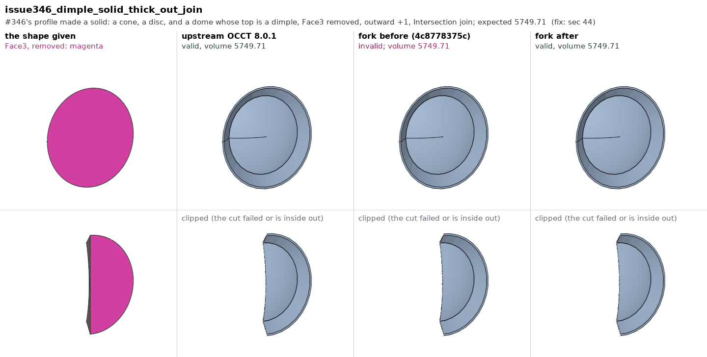

Over sec 43's 952 runs (thicknesses of each face and offsets of the whole,
+/-1 and +/-0.5, both joins, on the groove, step and #521 shapes, the apex
corpus and #613's part, and #346's Revolve) 38 change, all on the apex
corpus and all to valid: 32 that were invalid -- every Intersection join
offset of the dimpled and peaked shells and of the dimpled solid, and the
dimpled solid's disc removed -- and 6 refused, the dimpled solids' cone
removed (two solids, the dome's and the disc's, as with the Arc join). Not
one is worse. Still invalid on the apex corpus, as before: a shell with its
dome removed, thickened inward, with either join, and the flat-topped
shell's cone removed with the Arc join.

**Validation** (on `b7774e0a77`): Part 390, PartDesign 486 and
ShapeStorage 63 tests OK, with shape values frozen and not; thickness
PASS=479 at fix levels 0 and 1, plain and frozen, the seven cases above among
them (PASS=472 before); the thickness sweep right in all 928 runs at both
levels, plain and frozen, not one changed; fillet PASS=815 XFAIL=1, draft
105 and boolean 65, as before, fillet and draft frozen too -- run for
`BRepAlgo_Loop`.

## #521 with the cylinder removed, inward (2026-11-04, sec 45)

**What was broken.** #521's Connect -- a box 10 with a three-quarter
cylinder r 2 at a corner (sec 38) -- thickened inward with the cylinder
removed: invalid with the Arc join (990.5 at -0.5, near the solid's whole
volume: the inner walls ran on across the cylinder), refused with the
Intersection join. Four faults, each needed:

- The removed face is the stop the neighbours' offsets are extended to, and
  it was enlarged a tenth of the quarter it leaves free, 9 degrees each way.
  The walls' offsets cross the three-quarter cylinder past its ends, by the
  angle whose sine is the thickness over the radius -- 14.5 degrees at 0.5,
  30 at 1 -- and the crossing found was the one on the far side. The
  removed face is taken round as the Intersection join's own offset faces
  are (`EnLargeFace` mode 3: half the free part each way), in
  `BRepOffset_Tool::ExtentFace` (Arc) and
  `BRepOffset_Inter3d::ContextIntByInt` (Intersection).
- The cylinder's edge at 2 pi is closed on it -- two pcurves, at 0 and at
  2 pi -- and the face uses it once. Its pieces, cut by the inner top and
  bottom, kept both, and made the removed face's lips a seamed face and its
  search a periodic one, which found ten cylinder faces lying over each
  other. In `BRepAlgo_Loop` a piece cut from such an edge keeps the pcurve
  the face reaches, when the face is at most a period round.
- At 1 the lips span 330 degrees, and `IsInOnePeriod` gave up past nine
  tenths of a turn; a hundredth short is enough for the sampling.
- With the Intersection join the inner top's section ran from 75 degrees on
  past 2 pi to 375, and the 2D intersection read the edge at 2 pi at 0 and
  never met it: the section was not cut there and the lip past it never
  closed. `BRepOffset_Inter2d` tries two edges of a periodic face that do
  not cross again a period apart, and takes what it finds only when every
  crossing is inside both edges: one at an end is the two's common vertex
  read across the seam, and #363's Thickness001 with both bottoms removed
  and the Intersection join (sec 42), whose bottoms' quarter arcs end on the
  side's seam line, was cut there and lost its shell -- refused inward,
  invalid outward, until the shift was held to that.

Both joins now give the volume worked out by hand -- the box less the hollow
9 high over its inner square and the disc: 264.8641 at 0.5, 484.2380 at 1.
Outward the cylinder removed stayed invalid: there the edge at 2 pi is not
cut, it is the input's own, and taken for no seam of the face (its other
pcurve beyond the face) it put a groove's quarter cylinders' lips inside
out -- tried and dropped here, made in sec 50.

| Case | Model | What it covers |
|------|-------|----------------|
| `issue521_connect_cylinder_in`, `_in_1` | #521's Connect, the cylinder (face 4) removed, -0.5 and -1, the Arc join | 264.8641, 484.2380; invalid before |
| `issue521_connect_cylinder_in_join`, `_in_1_join` | the same, the Intersection join, intersection on | the same; refused before |

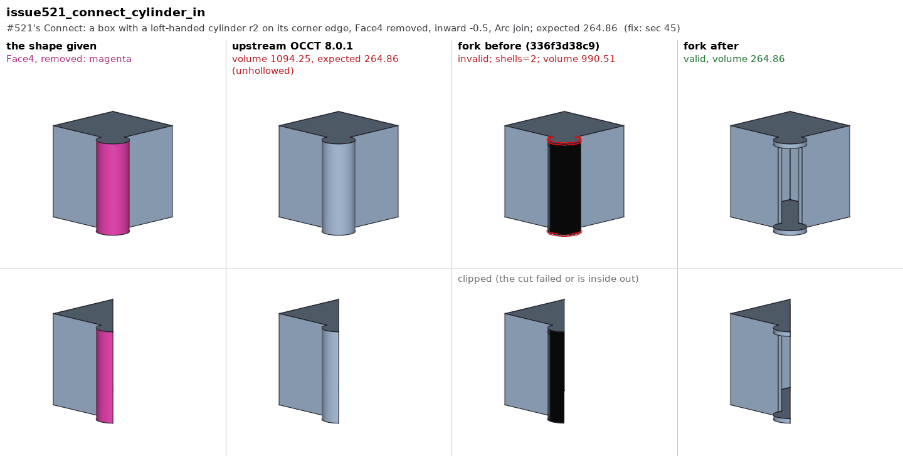

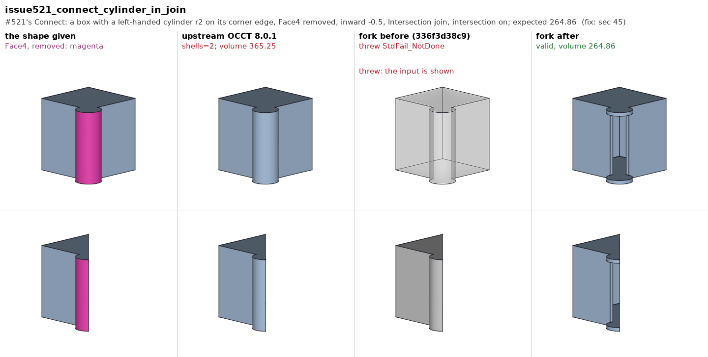

Over the 952 runs of sec 44's corpus 4 change: these, #521's cylinder
removed inward at 0.5 and 1 with both joins, from invalid or refused to
valid. Not one other moves.

**Regression** (`5aa0a2e5ff`): Part 390, PartDesign 486 and ShapeStorage 63
OK, plain and frozen; thickness PASS=483 at fix levels 0 and 1, plain and
frozen, the four cases above among them (PASS=479 before); the thickness
sweep right in all 928 runs at both levels, plain and frozen, not one
changed; fillet PASS=815 XFAIL=1, draft 105 and boolean 65, as before,
fillet and draft frozen too. The first run, the shift taken at an end too,
failed Thickness001's four Intersection join cases; the corpus, one face
removed at a time, had not caught them.

## #363's Thickness001 and the slotted cylinder with the Intersection join, whole or one face removed (2026-11-04, sec 46)

**What was broken.** Thickness001's base -- the chamfered cylinder with a
groove across its end -- with the Intersection join: offset whole a null
shape at all four offsets; one face removed refused or invalid in all 24
runs. The same cylinder with a square slot across its end instead: offset
whole a shell of two faces, the rest dropped; a face removed refused or
invalid. Upstream too. Sec 42 made Thickness001 with both bottoms removed;
that was all. Four faults:

- The side's offset and the groove's cross in a loop on either side, split
  in two at the groove's seam; the bottoms' offset crosses each piece once,
  and a piece with one vertex of its own was not trimmed (`TrimEdge` needs
  two): neither was cut, and the side lost its notch over the groove. A
  piece of a section split at a seam -- the two a period apart there on a
  periodic surface they lie on -- each piece crossed, is trimmed between its
  vertex and the end the two share. Not at the edge between a groove's two
  quarter cylinders: there each quarter's section runs on over the other's,
  and trimmed to it lay on it, cut at thousands of points (FreeCAD's grooves
  of two faces took four times as long to be refused).
- The right bottom's section with the side is the whole circle, starting on
  the side's seam where the bottom's two arcs meet; trimmed from the least
  of its vertices' parameters to the greatest it stayed whole, on under the
  groove and over the left bottom's arc. A closed section whose vertices
  span all of it so keeps the run of spans between them that the edges it
  is the image of lie on, across its start if that is where they lie. One
  whose vertices span less is left as it was: #521's circle round the
  removed cylinder starts inside the span kept, and is trimmed right.
- The top removed, at 1: the chamfer's piece from the side's offset up to
  the top's plane, 14.41 to 15, lies only in part on the chamfer's offset,
  14.71 to 15.71, neither one's point inside the other, and it was dropped
  as off the face (`PiecesOnTheFace`, sec 37). Points over the piece are
  tried too, any of them on the face.
- The slot's ceiling removed meets the side at both ends of the slot, and
  its section with the side's offset is the whole circle. Sec 42 shares
  such a circle out among the arcs of two caps or more on it
  (`ShareArcs`), not one cap's: one arc that the seam splits keeps the
  whole circle. A cap's arcs apart from each other are shared out too now;
  given whole, the arc across the left bottom made a face over it, and
  inward the thickness came out valid and wrong (9476.6104 for 5519.7372).

Every volume made is the one worked out by hand to the digit: the offset
with the removed face left in place -- each face's surface moved, the
removed one not -- less the input outward, taken from it inward
(Thickness001's revolved profile less the groove's offset cylinder, the
slot's cylinder less its box). Still refused: the side or the chamfer of
Thickness001 removed, and the slotted cylinder's side, which leave the
faces in two parts, nothing between them (upstream too); and the slot's
left wall removed inward, its right wall made (made in sec 48).

| Case | Model | What it covers |
|------|-------|----------------|
| `issue363_thickness001_offset_out_join`, `_out_half_join`, `_in_join`, `_in_half_join` | Thickness001's base offset whole, +1, +0.5, -1, -0.5, the Intersection join | 30406.3251, 26730.8567, 16885.7222, 19976.4777; a null shape before |
| `issue363_thickness001_bottom_out_join`, `_bottom_in_join` | the right bottom (face 3) removed, +1 and -1 | 6496.7206, 5933.2689; invalid and refused before |
| `issue363_thickness001_groove_out_join`, `_groove_in_join` | the groove (face 4) removed, +1 and -1 | 5491.6348, 4891.6354; refused before |
| `issue363_thickness001_top_out_join`, `_top_out_half_join`, `_top_in_join` | the top (face 6) removed, +1, +0.5 and -1 | 5071.2208, 2471.8739, 4576.7300; refused before |
| `slot_offset_out_join`, `slot_offset_in_join` | the slotted cylinder offset whole, +1 and -1 | 26534.8013, 12532.8398; two faces before |
| `slot_top_*_join`, `slot_ceiling_*_join`, `slot_wall_*_join`, `slot_bottom_*_join` | the top, the ceiling, the right wall, the right bottom removed, +1 and -1 | the hand volumes; refused or invalid before |

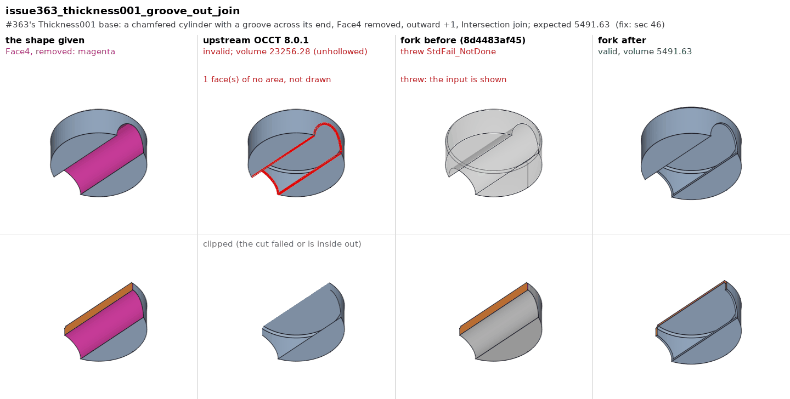

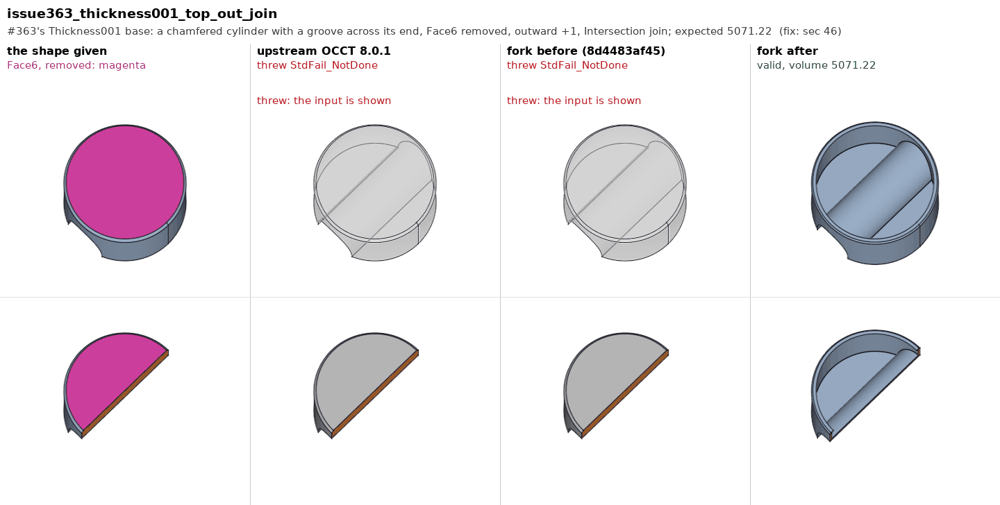

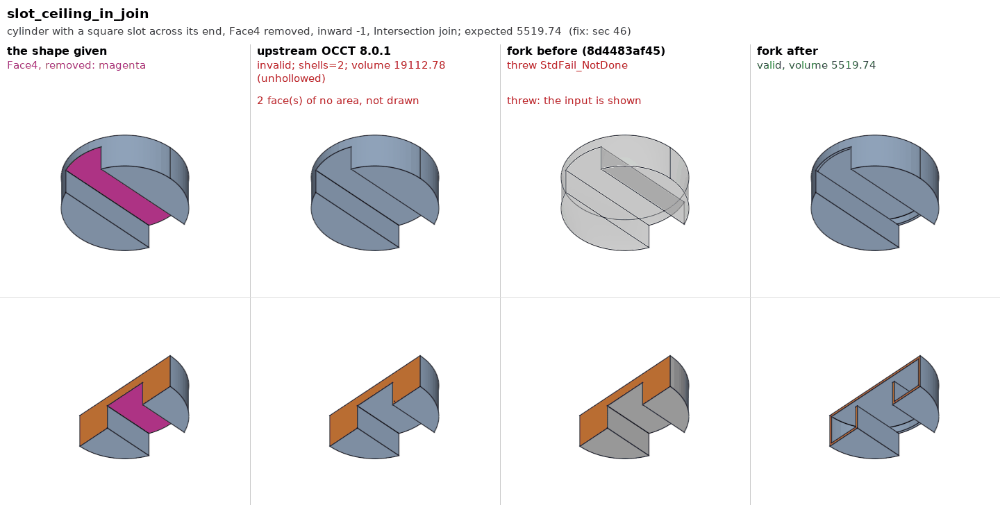

Over the 952 runs of sec 44's corpus 46 change, all to valid -- 30
refused before, 16 invalid: Thickness001's 20 (offset whole, faces 3 to 6
removed, at +/-1 and +/-0.5) and the slotted cylinder's 26; every one the
hand value. Not one other moves. Two first cuts did: the joint taken at the
edge between two quarter cylinders slowed FreeCAD's grooves of two faces
to four times as long to be refused, and the closed section's run taken
whatever its vertices spanned refused #521's cylinder removed and the
step's ceiling, inward (sec 45, sec 37).

**Regression** (`3f21992bf2`): Part 390, PartDesign 486 and ShapeStorage 63
OK, plain and frozen; thickness PASS=504 at fix levels 0 and 1, plain and
frozen, the 21 cases above among them (PASS=483 before, unchanged with the
fix before the cases went in); the thickness sweep right in all 928 runs at
both levels, plain and frozen, not one changed; fillet PASS=815 XFAIL=1,
draft 105 and boolean 65, as before, fillet and draft frozen too.

## #363's groove of two faces with the Intersection join (2026-11-04, sec 47)

**What was broken.** The grooved cylinder as FreeCAD's Groove makes it --
the groove two quarter cylinders, tangent where they meet -- with the
Intersection join: offset whole a null shape, a face removed refused, at
both radii (5 and 10.062591) and with the chamfer; upstream too.
Thickness001 (sec 46) has its groove one face.

Each quarter's offset meets the side's in a loop, and the loop is split
where the quarters meet: the quarter's own piece, cut once by the bottoms'
offset, and a piece on over the other quarter, crossed by nothing -- the
vertex on it lies on its end, another vertex at the same point, and was
taken for a crossing. The own piece was never trimmed (one vertex), the
side's offset image came out unbounded, and the shape null. `TrimEdges`
counts a vertex at a piece's end as that end, trims the crossed piece to
the end it shares with an uncrossed one -- matched by point, the two
pieces' vertices there not the same -- and drops the uncrossed piece, which
would lie on the other quarter's own. Only a section of an edge between two
kept faces: beside a removed face the lips took it inside out (both
quarters removed, invalid).

Every volume made is the hand value, as in sec 46: whole offsets, the top
removed, one bottom removed. Still refused: a quarter removed, both
quarters, the side; both bottoms removed come out valid at 1 (5805.6776)
and invalid at three offsets, refused before -- PartDesign's Thickness
refuses an invalid result as it does a failed one.

| Case | Model | What it covers |
|------|-------|----------------|
| `issue363_groove10_offset_out_join`, `_in_join`, `issue363_groove5_offset_*_join`, `issue363_groove10_chamfer_offset_out_join` | the grooves of two faces offset whole, +1 and -1 | 28356.1872, 14965.5810, 34357.3848, 21003.0681, 30406.3251 (Thickness001's); a null shape before |
| `issue363_groove10_top_*_join`, `issue363_groove5_top_*_join`, `issue363_groove10_chamfer_top_out_join` | the top removed, +1 and -1 | the hand volumes; refused before |
| `issue363_groove10_bottom_*_join`, `issue363_groove10_both_bottoms_out_join` | one bottom removed, +1 and -1; both, +1 | 6459.0048, 5840.9880, 5805.6776; refused before |

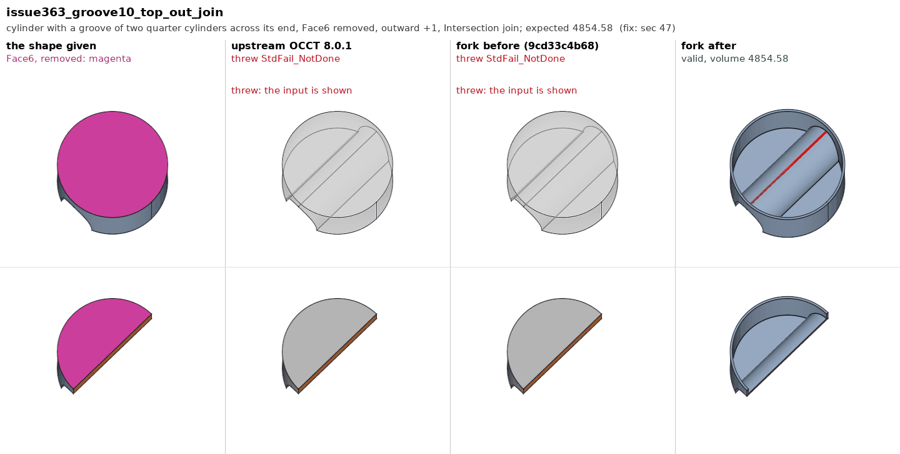

The red line along the groove's top is the input's own edge: the groove
cylinder's seam, where the cut split it into the two quarters, each using
it once -- the picture's check takes an edge with two pcurves on a face's
surface for a seam of that face.

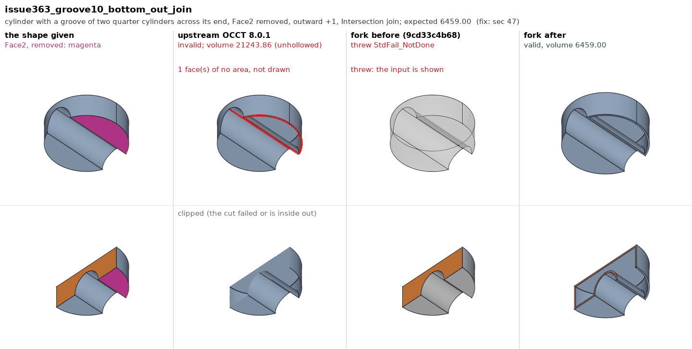

Over the 952 runs of sec 44's corpus 52 change, all to valid -- 40
refused before, 12 invalid -- the grooves of two faces' (radius 5, 10 and
the chamfered one; whole, the top, a bottom removed, and the chamfer
removed, two parts then); every one the hand value, the chamfer removed
inward the Arc join's. Not one other moves. Two first cuts did worse:
dropping the piece run on beside a removed face took both quarters'
lips inside out (invalid, refused before), and holding it off wherever a
neighbour was removed lost the top and the bottoms removed again.

**Regression** (`4d2a9f941a`): Part 390, PartDesign 486 and ShapeStorage 63
OK, plain and frozen; thickness PASS=517 at fix levels 0 and 1, plain and
frozen, the 13 cases above among them (PASS=504 before); the thickness
sweep right in all 928 runs at both levels, plain and frozen, not one
changed; fillet PASS=815 XFAIL=1, draft 105 and boolean 65, as before,
fillet and draft frozen too.

## The slotted cylinder's left wall removed inward (2026-11-04, sec 48)

**What was broken.** Sec 46's slotted cylinder with its left wall removed,
inward, the Intersection join: refused, at -1 and -0.5, its mirror -- the
right wall -- made; upstream too.

The ceiling's offset meets the side's in a circle, the image of the
ceiling's two arcs, and it is trimmed to one span from the right wall's
offset round over the far side to the right wall's offset again: the arc
between the two ends of the slot, over the left bottom, splits the side's
offset in two. The first piece holds the right wall's edges, the second
the left's. With the right wall removed its lip's edges -- cut where the
lip meets the ceiling -- are the first piece's, and `MakeFaces` rebuilt
that piece with the cuts; with the left wall removed they are the second's,
and `MakeFaces` went over each face's first piece only. The second kept the
lip's edges whole, the lip had free edges there, and it was dropped as
hanging. Each piece is gone over now.

The volumes are the hand values, the right wall's to the digit: the offset
with the removed face left in place, taken from the input.

| Case | Model | What it covers |
|------|-------|----------------|
| `slot_left_wall_in_join`, `slot_left_wall_in_half_join` | the slotted cylinder, the left wall removed, -1 and -0.5 | 6128.2407, 3160.6653; refused before |

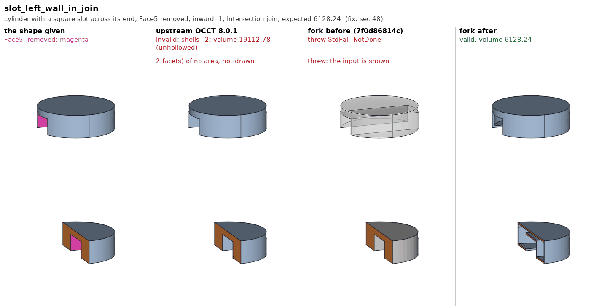

Over the 936 runs of sec 44's corpus 2 change, both to valid: these, the
left wall removed inward at 1 and 0.5, refused before, the hand values.
Not one other moves. (The corpus is 936 runs, not 952: #613's model had
dropped out of it since sec 44 -- sec 49.)

**Regression** (`9e7dcb27bd`): Part 390, PartDesign 486 and ShapeStorage 63
OK, plain and frozen; thickness PASS=519 at fix levels 0 and 1, plain and
frozen, the 2 cases above among them (PASS=517 before); the thickness sweep
right in all 928 runs at both levels, plain and frozen, not one changed;
fillet PASS=815 XFAIL=1, draft 105 and boolean 65, as before, fillet and
draft frozen too.

## #363's groove of two faces, both bottoms removed, with the Intersection join (2026-11-04, sec 49)

**What was broken.** The groove of two faces (sec 47) with both bottoms
removed and the Intersection join: valid only at 1, invalid at 0.5 (both
radii) and at 1 with radius 5, refused inward; refused before sec 47,
upstream too.

Each bottom's section with the side's offset is the circle the bottoms'
plane cuts from it, split at the side's seam into two halves that share
one curve. The seam's vertex holds its parameter on that curve from the
first half, 2 pi; `FindParameter` gave the second half -- its range from 0
to pi/2 -- that parameter, and `TrimEdge` trimmed it from its crossing with
the groove's offset round to 2 pi, the long way, over the first half. The
side's offset then had two edges along the same arc, its loops closed on
them and on the top's circle alone, and the shell came out inside out. A
parameter a period outside the edge's range on a periodic curve is brought
into it now when that lands inside.

Every volume is the hand value -- the offset with the bottoms left in
place, against the input (`grvexp`).

| Case | Model | What it covers |
|------|-------|----------------|
| `issue363_groove10_both_bottoms_in_join`, `_out_half_join`, `_in_half_join` | radius 10.062591, both bottoms removed, -1, +0.5, -0.5 | 5403.7018, 2853.0372, 2752.5724; refused or invalid before |
| `issue363_groove5_both_bottoms_out_join`, `_in_join`, `_out_half_join`, `_in_half_join` | radius 5, both bottoms removed, +1, -1, +0.5, -0.5 | 5245.5567, 4927.2864, 2583.1450, 2503.5899; invalid or refused before |

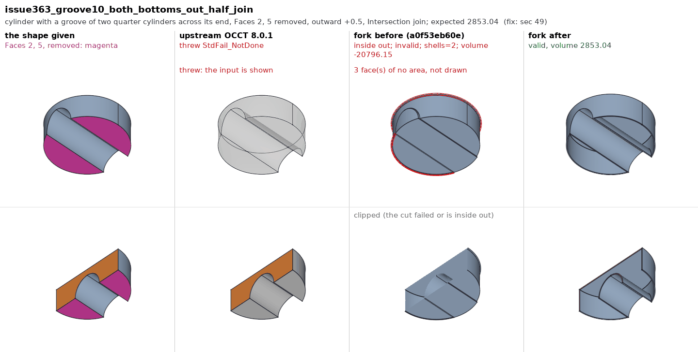

Over sec 44's corpus nothing moves -- the both-bottoms cases remove two
faces, the corpus one at a time. The corpus is 936 runs, not the 952 the
sections since sec 44 give: the scratch copy of #613's model had been
purged, and its 16 lines ran nothing. Its runs on the suite's own copy
(`models/issue613_fillet.brep`, 176: every face of 21 and the whole, +/-1
and +/-0.5, both joins), with sec 47's library and with this one: not one
changes.

The red along the groove's top in the cut is the input's own seam edge,
as in sec 47.

**Regression** (`427507ac59`): Part 390, PartDesign 486 and ShapeStorage 63
OK, plain and frozen; thickness PASS=526 at fix levels 0 and 1, plain and
frozen, the 7 cases above among them (PASS=519 before); the thickness sweep
right in all 928 runs at both levels, plain and frozen; fillet PASS=815
XFAIL=1, draft 105 and boolean 65, as before, fillet and draft frozen too.

## #521 with the cylinder removed, outward (2026-11-05, sec 50)

**What was broken.** #521's Connect with its three-quarter cylinder removed,
outward: invalid with both joins, at 0.5 and 1 (sec 45 made it inward).

The cylinder's edge at 2 pi is closed on its surface -- pcurves at 0 and at
2 pi -- and the cylinder uses it once, reaching only the one at 2 pi.
Inward the lips cut it and its pieces keep the pcurve the face reaches
(sec 45); outward nothing cuts it, it is the input's own edge, and
`BRepAlgo_Loop` took it for a seam of the lips: doubled in the edge map,
and no single period for the search, which closed the lips inside out. An
edge of the face itself, closed on its surface, is no seam of it now when
the face, at most a period round, reaches only one of its pcurves
(`IsSeamOfFace`), for `IsInOnePeriod` and the edge map. Cut pieces are left
to sec 45's rule: taken so too, the wall at y = 0 removed inward turned
invalid.

The groove of two quarter cylinders (sec 47) shares such an edge between
its quarters, each using one pcurve. With a quarter removed, its lip's wire
was reversed for `MakeTest`'s test face, the edge took its other pcurve
and the test face ran round the whole cylinder (inward, refused). The test
face takes a copy whose such edges carry the face's pcurve both ways, and
the wire is kept as it was walked.

By hand: the box grown -- with sharp edges for the Intersection join,
rounded for the Arc join -- with the disc left in place, less the input:
688.9322 and 315.9061 (Intersection), 664.0403 and 310.0678 (Arc), at 1
and 0.5. Every one made to the digit.

| Case | Model | What it covers |
|------|-------|----------------|
| `issue521_connect_cylinder_out`, `_out_1` | #521's Connect, the cylinder removed, +0.5 and +1, the Arc join | 310.0678, 664.0403; invalid before |
| `issue521_connect_cylinder_out_join`, `_out_1_join` | the same, the Intersection join, intersection on | 315.9061, 688.9322; invalid before |

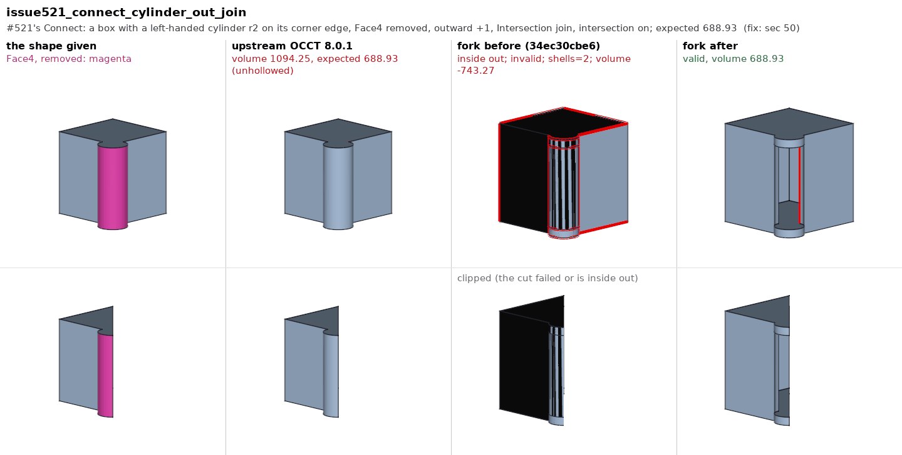

The red edge in the result, the vertical one at (2, 0), is the input's own:
it is closed on the cylinder it bounds, two pcurves, and the marks count such
an edge both ways (upstream's unhollowed input carries the same mark).

Over the corpus (1072 runs, sec 44's with #613's model back) 12 change:
these 4 to valid; the box with a groove of two faces, one quarter removed
outward (`bg10` face 7), 4 from invalid to valid -- the Intersection join's
volumes the hand value with the kept quarter's offset carried a thickness
into the removed one before its wall, as the tangent caps make it
(8212.2444 at 1, 3971.0866 at 0.5), the Arc join's not worked out by hand;
and its mirror (face 6) 4 from invalid to invalid. Not one other moves.

**Regression** (`a697362c0f`): Part 390, PartDesign 486 and ShapeStorage 63
OK, plain and frozen; thickness PASS=530 at fix levels 0 and 1, plain and
frozen, the 4 cases above among them (PASS=526 before); the thickness sweep
right in all 928 runs at both levels, plain and frozen; fillet PASS=815
XFAIL=1, draft 105 and boolean 65, as before, fillet and draft frozen too.

## The groove's other quarter removed, outward (2026-11-05, sec 51)

**What was broken.** The box with #363's groove of two quarter cylinders
across its bottom, the left quarter (x < 0) removed, outward: invalid with
both joins, at 0.5 and 1. The right quarter, its mirror, was made in sec 50.

The kept quarter's offset goes on a thickness into the removed one (the
tangent caps' strip) and the loop of that face finds the strip, the face
beyond it over the removed quarter, and the rest. The edge at the groove's
top, where the quarters meet, is closed on the cylinder, each quarter
reaching one of its pcurves (sec 50). The walk by angle took each edge's
pcurve FORWARD on the face, and on the left the offset face is reversed:
FORWARD there is the pcurve at 0 where the face lies by 2 pi. The angles at
the vertices are the same on either pcurve, the areas are not: the strip's
loop came out negative and was dropped, the outline round the strip and
the face beyond it positive, and the two became one face, the strip's
inside the other's hole. An edge closed on the surface and no seam of the
face (`IsSeamOfFace`) is walked with the pcurve the face reaches now
(`ReachedPCurve`, the test `IsSeamOfFace` made, factored out).

That alone let the same quarter on #363's grooved cylinder further than
before, outward with the Arc join, where both quarters are refused: its
offset's faces all hang there, and the one left was the removed quarter's
face built round the other three quarters -- the wire, run the way that
takes the edge's far pcurve, made the face it leaves free -- and the
thickness of it invalid (vol 32189.9992, from refused). A face that runs
further round a period than its wires do, measured as walked, is dropped
now, and those come out refused again, like their mirrors. The cylinder
with a quarter removed outward stays open.

By hand, the Intersection join (the tangent caps' design, the reference
since 2026-11-05): the offset with the removed quarter left in place, the
quarters stepped at x = 0 (8159.5179 at 1, 3958.0416 at 0.5), plus the
strip between the groove and the kept quarter's offset, the integral of
sqrt(r^2 - x^2) - (r - t) over 0..t times the groove's length 2 R + 2 t
(52.7265, 13.0450): 8212.2444 and 3971.0866, to the digit, both quarters.
The Arc join not worked out by hand: the two quarters agree to the digit.

| Case | Model | What it covers |
|------|-------|----------------|
| `issue363_box_groove10_left_out`, `_out_half` | the grooved box, the left quarter removed, +1 and +0.5, the Arc join | 8085.1319, 3940.0897; invalid before |
| `issue363_box_groove10_left_out_join`, `_out_half_join` | the same, the Intersection join | 8212.2444, 3971.0866; invalid before |
| `issue363_box_groove10_right_out` ... `_out_half_join` | the right quarter, the four the same | made in sec 50, cased here |

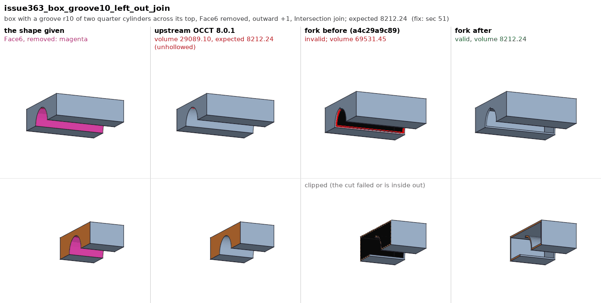

Over the corpus (1072 runs) 4 change: these, the left quarter, invalid to
valid. The grooved cylinders' quarters stay refused, with the walk alone 6
of them had turned invalid. Not one other moves.

**Regression** (`b0fe073f00`): Part 390, PartDesign 486 and ShapeStorage 63
OK, plain and frozen; thickness PASS=538 at fix levels 0 and 1, plain and
frozen, the 8 cases above among them (PASS=530 before); the thickness sweep
right in all 928 runs at both levels, plain and frozen; fillet PASS=815
XFAIL=1, draft 105 and boolean 65, as before, fillet and draft frozen too.

## The groove's quarter removed from the cylinder, the Intersection join (2026-11-06, sec 52)

**What was broken.** #363's cylinder with its groove of two quarter
cylinders across the bottom, one quarter removed, the Intersection join:
refused, inward and outward, at 0.5 and 1, either quarter, on the groove
of radius 10 and of 5 and on the chamfered cylinder -- 24 runs. The box
with the same groove was made in secs 50 and 51.

The kept quarter meets the removed one tangentially at the groove's top,
and the tangent caps close that edge (`BRepOffset_Analyse::TreatTangentCaps`,
the design taken as the reference on 2026-11-05): a strip, the kept
quarter's tangent plane there, carried a thickness into the removed
quarter, and a wall across it down to the removed quarter. On the box the
strip ends on the box's sides, planes; on the cylinder both its ends are
on the side, a cylinder. Two things went wrong there, and a third once
it was made.

- The strip's end edges are lines and have no pcurve on the side: they
  were given no type, and `BRepOffset_Inter3d` skips an edge that is neither
  convex nor concave -- the strip was intersected with the side by neither
  end, its wall's loop found nothing to close on and kept the grown plane
  (`WallOutOfBand`). The wall's end edges had the same want on a sphere and
  were typed by hand, by where the wall runs against the face's normal;
  the strip's are now typed the same way.
- Typed, the strip, a plane grown across the whole shape, met the side's
  offset in one circle. Both its ends share the pair of faces and the pair
  is intersected once: the whole circle went to the first end, the second
  had none, and the result came out invalid or refused. The strip is held
  in its band now (`KeepStripInItsBand`, as a sphere cap's wall is): a
  polygon on its own surface, a tenth of the band wider each side, along
  the edge its length and a hundred bands. The circle comes out in two
  arcs, one at each end. (Grown as far as the plane was, forty million,
  the polygon's edges lose the section altogether.)
- Made, the right quarter outward came back right with its input edited:
  the two vertices at the removed quarter's bottom corners, (10.06,
  +-23.77, 0), grown from 3.760e-7 to 3.906e-7 (the suite's check of the
  input). The side's edge with the removed quarter is cut at x = t, where
  the strip ends; the piece from there to the corner is the edge's curve
  copied and trimmed, and `UpdateTolerance` (`BRepOffset_MakeOffset`)
  measured it again: over the shorter range its samples fall elsewhere and
  find the gap a little wider than the whole edge's, and the piece's
  vertices were grown to it -- the corner is the input's. The caps' own
  edges are not measured again there (upstream's rule); a piece of one,
  the same curve under the same parameters, is not either now, and keeps
  the tolerance it was copied with. The left quarter's corners happen to
  measure no wider.

By hand, in the tangent caps' design: the offset with the removed quarter
left in place, the quarters stepped at x = 0, then outward the strip
between the kept quarter's tangent plane at the apex, offset, and the
removed quarter's arc, x in 0..t, inside the side's offset, added; inward
the band between the arc and that plane taken off; the chamfer's offset
the half-space r + z <= R + 14 + o sqrt 2. Every run is the hand value,
both quarters (the left 1e-4 off at two of them).

| Case | Model | What it covers |
|------|-------|----------------|
| `issue363_groove10_left_out_join`, `_in_join`, `_out_half_join`, `_in_half_join` | the grooved cylinder, r 10, the left quarter removed, +-1 and +-0.5 | 6335.8399, 5589.2394, 3058.4144, 2872.1103; refused before |
| `issue363_groove10_right_out_join` ... `_in_half_join` | the right quarter, the four the same | refused before |
| `issue363_groove5_left_out_join`, `_in_join` | the groove of radius 5 | 6702.6587, 5950.5199; refused before |
| `issue363_groove10_chamfer_left_out_join`, `_in_join` | the chamfered cylinder | 6373.5557, 5681.5203; refused before |

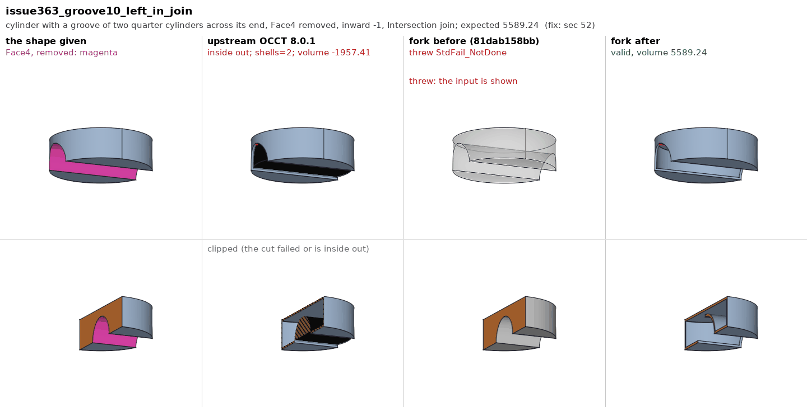

Over the corpus (1072 runs) 24 change: these, all the grooved cylinders'
quarters with the Intersection join, refused to valid at the hand values.
Not one other moves; the box's eight stay as they were. Still open there:
a quarter removed outward with the Arc join (the side's loop cuts the edge
it shares with the kept quarter's offset at a vertex not the edge's own,
and the two hold the edge in two copies, each free), and the side removed
with the Intersection join.

**Regression** (`55418a9ae2`): Part 390, PartDesign 486 and ShapeStorage 63
OK, plain and frozen; thickness PASS=550 at fix levels 0 and 1, plain and
frozen, the 12 cases above among them (PASS=538 before); the thickness sweep
right in all 928 runs at both levels, plain and frozen; fillet PASS=815
XFAIL=1, draft 105 and boolean 65, as before, fillet and draft frozen too.

## The groove's quarter removed from the cylinder, outward, the Arc join (2026-11-06, sec 53)

**What was broken.** #363's grooved cylinder with one quarter of its
groove removed, outward, the Arc join: refused, at 0.5 and 1, either
quarter, on the groove of radius 10 and of 5 and on the chamfered
cylinder -- 12 runs. Inward they were made already; sec 52 made the
Intersection join.

The kept quarter meets the removed one tangentially along the groove's
crown, and with the Arc join that edge is closed by a tube round it,
turning into the removed quarter, with an eighth of a ball at each end
where it meets the tube round the kept quarter's edge with the side (sec
6). That design is kept here (chosen on 2026-11-06 over a ball rolled on
along the side's edge, which would change sec 6's own results). On the box
(sec 51) the side is a plane square to the crown; on the cylinder it is
round. Two things went wrong.

- `ToContext` rebuilds the side's offset beside the removed quarter, with a
  new edge for its boundary with the tube round the kept quarter's edge
  with the side. That tube ends at the crown's end, a tangent edge's
  vertex, and is not rebuilt: `BuildOffsetByArc` gave it the edge whole
  beside the face's new one, two copies, each free, every face hanging. A
  tube now takes the pieces the face was cut into, where they run on the
  edge's own curve under its parameters, given the tube's pcurve of the
  edge.
- The crown's tube has its edge on the removed quarter a thickness off the
  crown, square-ended at the crown's ends. On the box the removed
  quarter's edge with the side runs through that end; on the cylinder the
  side bends in, and that edge crosses the tube's 0.019 short of its end
  (y = -25.789 at x = -1, against -25.808). Nothing put a vertex there: the
  cap's loop, its own edges taken whole, left them hanging and closed the
  removed quarter over -- done, invalid, 3137.0, the opening's rim free. The
  crossing goes on the tube's section with the cap now, as its ends do
  (`CutAtCapEdgeCrossings`, `BRepOffset_Inter3d.cxx`): the tube and the cap
  are cut there, and the cap's loop cuts its edge at the vertex as it does
  where a section ends on it. The strip of the removed quarter under the
  tube, the rim round the opening and the opening come out three faces.

By booleans, in sec 6's design: the input offset by the ball (the Arc
join, no face removed), with the kept faces' offsets beside the removed
quarter stretched to its cylinder -- the side's ring, the bottom's slab and
the round between them, as `ToContext` stretches them -- less the input and
the removed quarter's side of its cylinder, plus the tube round the crown
between the crown's ends and an eighth of a ball at each. (The ball offset
alone leaves a notch along the removed quarter's edges with the side; with
the top removed, whose plane the side already ends on, it is the result
exactly, 4782.0194.) Every run is that solid: the boolean differences are
nil both ways, the volumes within 3e-6, both quarters alike.

| Case | Model | What it covers |
|------|-------|----------------|
| `issue363_groove10_left_out`, `_out_half` | the grooved cylinder, r 10, the left quarter removed, +1 and +0.5, the Arc join | 6238.2052, 3034.5634; refused before |
| `issue363_groove10_right_out`, `_out_half` | the right quarter | the same; refused before |
| `issue363_groove5_left_out` ... `_right_out_half` | the groove of radius 5 | 6605.4533, 3216.9085; refused before |
| `issue363_groove10_chamfer_left_out` ... `_right_out_half` | the chamfered cylinder | 6304.7451, 3067.6649; refused before |

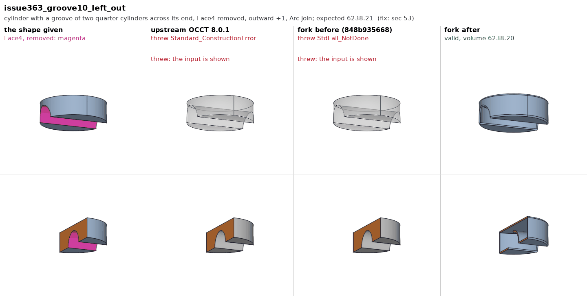

Over the corpus (1072 runs) 12 change: these, refused to valid at the
boolean values. Nothing else moves; inward the same runs are as they were.
Still open on these shapes: the side removed with the Intersection join.

**Regression** (`c722c6e42b`): Part 390, PartDesign 486 and ShapeStorage 63
OK, plain and frozen; thickness PASS=562 at fix levels 0 and 1, plain and
frozen, the 12 cases above among them (PASS=550 before); the thickness sweep
right in all 928 runs at both levels, plain and frozen; fillet PASS=815
XFAIL=1, draft 105 and boolean 65, as before, fillet and draft frozen too.

## The side removed beside a step or a slot, the Intersection join (2026-11-06, sec 54)

**What was broken.** #363's cylinder with a square step cut off its end
(sec 37) or a square slot across it (sec 46), its side removed, the
Intersection join: refused, in and out, at 1 and 0.5 -- 8 runs. The Arc
join made them. (The grooved cylinders' side removed stays refused: the
groove's two quarters' offsets, one cylinder, are not trimmed by the side.)

The step's bottom meets the side's cylinder, offset, in a whole circle.
The side's seam splits the bottom's edge with it into two arcs, and the
circle is given to both as one compound (it is left whole: sec 37's step
with its bottom removed needs it so); the wall's offset meets the side in
a line, given to the side's two edges with the wall alike. Two things went
wrong.

- `ContextIntByInt` stores a removed face's sections on the face itself,
  and `ConnexIntByInt` looked them up on the face's enlarged copy, which
  holds none: a compound of one section edge was none of the copy's, and
  its corner with the section beside it was never intersected. The bottom's
  offset was left whole, its piece under the step taken for it and dropped
  as off the face. Such a section, none of it found on the copy, is looked
  up on the face (`GetEdgesOrientedInFace`). Sections in pieces are left as
  they were: with a groove's quarter removed (sec 52) the side's sections
  beyond the groove's ends are built without that corner, and intersected
  they were refused. The corner such a section makes with one of the
  face's own edges that is offset itself is taken as made but not
  intersected: that edge's section bounds the face in its place, and where
  the two cross is no vertex of it. #363's Thickness001 with both tops
  removed inward (sec 46) is that case: the circle the inner wall makes
  with a top crossed the trough's edge past its corner with the trough's
  section, and the circle's piece, reaching there, left the result invalid.
  The side's seam, not offset, still cuts the circle the bottom makes with
  the side.
- Outward, the circle starts at the seam, where the bottom's two arcs meet;
  the wall's offset crosses it twice, and `TrimEdge` kept the span from the
  lesser crossing to the greater -- the arc under the step, not the one
  round the other way the arcs lie on. A closed section took the run of
  spans its edges lie on only when a vertex lay at its start (#363's
  Thickness001, sec 46); it does so now too when the span from the least to
  the greatest holds none of them.

By booleans: the profile across the step (or the slot), its offset with
sharp corners (`makeOffset2D`, the Intersection join), extruded across,
inside the side's cylinder, less the input outward or taken from it
inward. Every run is that solid: nil boolean difference both ways, the
volumes to the digit. Two solids each: the top's plate, the disk under it
(pi r^2 times the thickness, 2092.4528 at 1), is apart from the rest.

| Case | Model | What it covers |
|------|-------|----------------|
| `step_side_out_join`, `_out_half_join` | the step, its side removed, +1 and +0.5, the Intersection join | 2566.3058 + 2092.4528, 1284.2815 + 1046.2264; refused before |
| `step_side_in_join`, `_in_half_join` | the same, -1 and -0.5 | 2574.8315 + 2092.4528, 1286.4121 + 1046.2264; refused before |
| `slot_side_out_join`, `_out_half_join` | the slot, its side removed, +1 and +0.5 | 3057.2102 + 2092.4528, 1526.5977 + 1046.2264; refused before |
| `slot_side_in_join`, `_in_half_join` | the same, -1 and -0.5 | 3040.1587 + 2092.4528, 1522.3365 + 1046.2264; refused before |

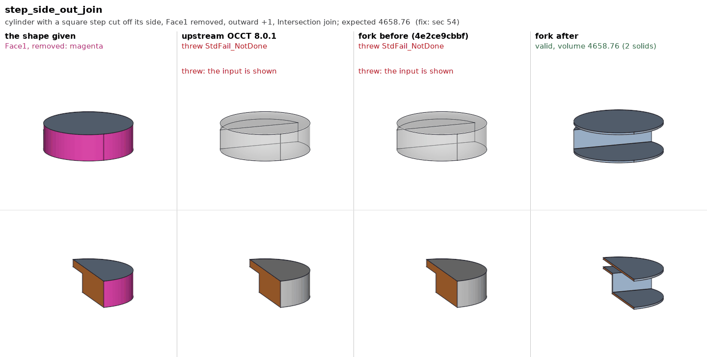

Over the corpus (1072 runs) 8 change: these, refused to valid at the
boolean values. Nothing else moves. Still open: the grooved cylinders' side
removed with the Intersection join.

**Regression** (`5cf9b386ac`): Part 390, PartDesign 486 and ShapeStorage 63
OK, plain and frozen; thickness PASS=570 at fix levels 0 and 1, plain and
frozen, the 8 cases above among them (PASS=562 before; #363's Thickness001
cases unchanged); the thickness sweep right in all 928 runs at both levels,
plain and frozen; fillet PASS=815 XFAIL=1, draft 105 and boolean 65, as
before, fillet and draft frozen too.

The corpus itself now lives here, in `corpus/` (its README says how to build
its tools and run it); `corpus/baseline.txt` is the result with this fix.

## The grooved cylinders' side removed, the Intersection join (2026-11-06, sec 55)

**What was broken.** #363's grooved cylinders -- the groove of radius 10.06
or 5 across the bottom, two quarter cylinders, and the one under a chamfered
top -- and #363's Thickness001 base (its groove one half cylinder), their
side removed, the Intersection join: refused, in and out, at 1 and 0.5 --
16 runs. The Arc join made them.

The groove's two quarters are one cylinder, so their offsets are one
cylinder too: each quarter's offset, grown, is the other's surface. Its
section with the side runs on over the other quarter, and comes split in
two where the quarters meet: its own piece, crossed by the bottom's offset,
and the piece beyond, over the other quarter, crossed by nothing and lying
on the other's own piece. Two things went wrong.

- On the side, removed, the corner of each quarter's section with the
  bottom's was looked up on the side's enlarged copy, which holds none of
  it (sec 54); a section in pieces is not looked up on the side itself
  (sec 52's sections beyond a removed quarter's ends need that), and
  `GetEdgesOrientedInFace`, ordering the empty set found, took the closed
  set's way and looked up its first vertex, null: `Standard_NoSuchObject`.
  None found returns none now, and the corner is left as the caller leaves
  any it finds no section for.
- Sec 47 trims such a pair -- the crossed piece to the end it shares with
  the uncrossed one, which is dropped -- only for the section of an edge
  between two kept faces: beside a removed face the section is a lip's,
  and with the groove's two quarters removed the trim took the lips inside
  out. Here the edge is beside the removed side, and nothing was trimmed:
  the quarters' offsets came out unbounded along the groove (1e7 each way)
  and every face was dropped as hanging. The trim is made now also for an
  edge beside a removed face whose kept face runs on, tangent, into another
  kept face at the edge's end (`TrimEdges`): there the piece beyond is the
  other kept face's own.

Thickness001's base needed only the first: its groove is one face, and its
section with the side, split at the groove's own seam, has no piece run on.

By booleans: the cross-section across the groove, widened past the side,
its offset with sharp corners (`makeOffset2D`, the Intersection join), the
band between extruded across, inside the side's cylinder; the top's (with
the chamfer) the same, revolved. Every run is that solid: nil boolean
difference both ways, the volumes to the digit. Two solids each: the top's
plate (with the chamfer's ring) is apart from the rest.

| Case | Model | What it covers |
|------|-------|----------------|
| `issue363_groove10_side_out_join`, `_out_half_join`, `_in_join`, `_in_half_join` | the groove of radius 10.06, its side removed, +1, +0.5, -1, -0.5 | 2674.0809 + 2092.4528, 1330.3737 + 1046.2264, 2626.3101 + 2092.4528, 1318.4968 + 1046.2264; refused before |
| `issue363_groove5_side_*_join` | the groove of radius 5, the same | 2409.5300 + 2092.4528, 1197.4376 + 1046.2264, 2363.0471 + 2092.4528, 1186.0962 + 1046.2264; refused before |
| `issue363_groove10_chamfer_side_*_join` | the 10.06 groove under a chamfered top, the same | 2674.0809 + 2144.8725, 1330.3737 + 1075.8071, 2626.3101 + 2171.6161, 1318.4968 + 1082.4930; refused before |
| `issue363_thickness001_side_*_join` | #363's Thickness001 base (the groove one face), the same | as the chamfered one; refused before |

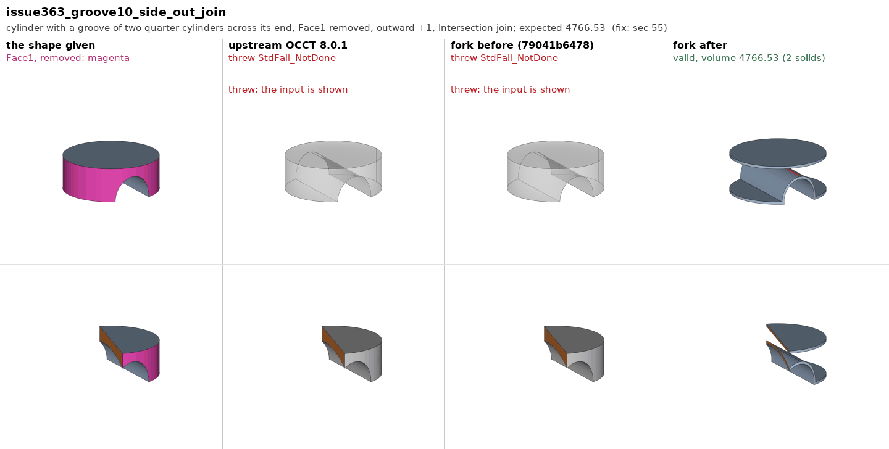

Over the corpus (1072 runs) 16 change: these, refused to valid at the
boolean values. Nothing else moves.

**Regression** (`6d01a232c8`, on Linux): Part 390, PartDesign 486 and
ShapeStorage 63 OK, plain and frozen; thickness PASS=586 at fix levels 0 and
1, plain and frozen, the 16 cases above among them (PASS=570 before); the
thickness sweep right in all 928 runs at both levels, plain and frozen;
fillet PASS=815 XFAIL=1, draft 104 + 1 FAIL (`new_roof_L_a-30`, Linux's
standing one, sec 54's run there the same) and boolean 67, as before,
fillet and draft frozen too. `corpus/baseline.txt` takes these 16 lines.

## #346's shell with its cone removed, the Arc join (2026-11-06, sec 56)

**What was broken.** #346's Revolve -- a shell of a cone and a dome whose
top comes to a point on the axis -- with the cone removed and the Arc join:
refused at +-1 and +-0.5 for the issue's dome (a dimple) and every peaked or
dimpled one of the corpus, and the sphere's dome (the profile's centre on
the axis) valid and wrong, 14436.7916 at 1. The Intersection join made
them all but the peaks inward.

`ToContext` stretches the dome's offset to the removed cone
(`BRepOffset_Tool::ExtentFace`), and its rim, a whole circle, takes the
section of the offset with the cone. A closed edge's section is laid on it
by its orientation alone -- its one vertex says nothing of which way round
it runs -- and `Inter3D` orients a section as if the removed face met the
offset one at a convex edge. Here it came the wrong way round: the rim ran
the same way as the apex's edge across the face, the face could not be
oriented, and healed (`ShapeFix_Shape`) it had edges of tolerance 1.5e3,
which the loops could not close; both faces were dropped as hanging. The
section of a closed edge now runs as the edge it replaces, from the two
curves' tangents where they come nearest, as `ContextIntByInt` turns its
sections with the Intersection join.

By booleans: the dome's meridian and its mirror, run on past the rim, the
region toward the cone offset in 2D (`makeOffset2D`; both joins give the
same, the apex is no convex corner of it), the band revolved, inside the
cone's solid. Inwards every run is that solid, within 6e-7. Outwards the
fork is 2e-6 over it, as the Intersection join already was: the rim's
corner on the cone lies 2e-4 to 9e-4 off (the dome's offset stretched past
its rim), and at a dimple a sphere round the apex reaches 0.033 below the
band. Both are the Intersection join's too, and are left for their own
section; the cases take the boolean values, within the suite's tolerance.

| Case | Model | What it covers |
|------|-------|----------------|
| `issue346_revolve_thick_out`, `_out_half`, `_in`, `_in_half` | #346's Revolve, the cone removed, +1, +0.5, -1, -0.5, the Arc join | 3030.5493, 1498.3352, 2896.5118, 1464.8258; refused before |
| `issue346_peak_shell_thick_*` | the profile's arc centred 1.05 off the axis the other way: a peak | 3056.3047, 1511.2079, 2922.2257, 1477.6882; refused before |
| `issue346_steep_peak_shell_thick_*` | centred 3 off: a steeper peak | 3082.1592, 1524.1143, 2947.9117, 1490.5524; refused before |
| `issue346_sphere_shell_thick_*` | centred on the axis: a sphere | 3043.1491, 1504.6350, 2909.1096, 1471.1251; valid and wrong before |

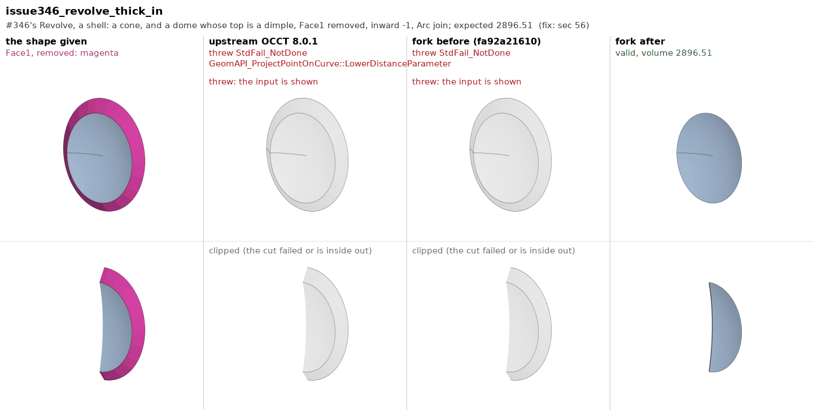

Over the corpus (1072 runs) 36 change: these and the other peaks and
dimples of `breps/apex/`, with and without their sphere, refused or wrong
to valid. Nothing else moves. (On Linux 40: the mirrored `rev3` runs it
refused there, as the corpus README says, are made too.)

**Regression** (`a8c10c303f`, on Linux): Part 390, PartDesign 486 and
ShapeStorage 63 OK, plain and frozen; thickness PASS=602 at fix levels 0 and
1, plain and frozen, the 16 cases above among them (PASS=586 before); the
thickness sweep right in all 928 runs at both levels, plain and frozen;
fillet PASS=815 XFAIL=1, draft 104 + 1 FAIL (Linux's standing
`new_roof_L_a-30`) and boolean 67, as before, fillet and draft frozen too.

Still open on this shell: the peaks inward with the Intersection join
(refused: the dome's offset is left whole and dropped as hanging), the dome
removed (refused, or inside out inward), and the two outward deviations
above.

## A revolution stretched on its own meridian, from fix level 2 (2026-11-07, sec 57)

**What was off.** #346's shell offset outward with the cone removed, either
join: the rim's corner on the cone lay 5.4e-4 off its place along the cone,
under a vertex tolerance of 2e-7 (Intersection join), the volume 3030.5581
for 3030.5493. And the whole shell offset with the Intersection join: the
sharp corner at the rim off with it, the area up to 0.63 off (5782.0139 for
5782.6449 at -1). The offset faces are stretched past their outline before
they are cut (`BRepOffset_Tool::EnLargeFace`), and a surface of revolution
was stretched by `GeomLib::ExtendSurfByLength`, a B-spline continuation:
its meridian, a circle here, left the circle past the rim.

**The fix.** A revolution whose meridian is a trimmed piece of a conic or a
line is trimmed wider on that same curve, by the same lengths. Not past a
circle's origin: the revolution keeps a copy of its meridian, and the copy
takes a range from below the origin into the next period, away from the
face's own parameters -- those are stretched as before. (#346's file has its
arc from 1.13 rad; the corpus's `rev*` and the profiles `run_tests.py`
builds start theirs at the circle's origin, and do not change.)

It moves shapes some input already had beyond their tolerance, so it is
made from the fork's offset fix level 2 only (sec 31's rule): a document
saved before recomputes as it did. FreeCAD gives new objects the level its
`OCCTOffsetFixLevelLatest` names.

By booleans and by hand: the thicknesses are sec 56's boolean values to the
digit (3030.5493, 1498.3352, both joins), the corner within 1e-6 of where
the grown arc crosses the cone's line; the whole offsets the meridian
section offset in 2D as an open wire with sharp corners, revolved
(5782.6449, 5648.3666, 5255.6121, 5384.8599), to the digit.

| Case | What it covers |
|------|----------------|
| `issue346_revolve_rim_corner_out_level2`, `_out_join_level2`, `_out_half_level2` | the rim's corner, +1 both joins and +0.5, within 1e-6 at fix level 2 |
| `issue346_revolve_rim_corner_out_level0` | the same at level 0, within 1e-3: as before |

At level 2 six cases the suite had move, every one to its exact value and
within the suite's tolerance of the value it holds (captured at level 0):
`issue346_revolve_in_join` 6053.7243 to 6056.3025, `_in_0.5_join`
5648.2105 to 5648.3666, `_out_join` 5002.0869 to 5002.0810,
`issue346_revolve_thick_out_join` 6198.1628 to 6198.0920, and sec 56's
`issue346_revolve_thick_out`, `_out_half` to 3030.5493, 1498.3352.

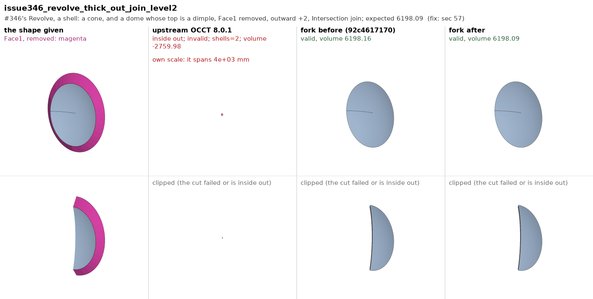

Over the corpus (1072 runs, the tools at level 0) nothing changes, and the
baseline stands. Run at level 2 (tools that set it), 8 change: #346's file,
the cone removed, +1 and +0.5, both joins, and its whole offset with the
Intersection join, all four: each to the exact value.

**Regression** (`f641986a36`, on Linux): Part 390, PartDesign 486 and
ShapeStorage 63 OK, plain and frozen; thickness PASS=606 at fix levels 0, 1
and 2, plain and frozen, the four cases above among them (602 before, levels
0 and 1 otherwise line for line as they were); the thickness sweep right in
all 928 runs at levels 0, 1 and 2, plain and frozen; fillet PASS=815 XFAIL=1,
draft 104 + 1 FAIL (Linux's standing `new_roof_L_a-30`) and boolean 67, as
before, fillet and draft frozen too.

## #346's peaked shells inward, the Intersection join (2026-11-07, sec 58)

**What was broken.** #346's profile with its arc centred off the axis the
other way -- the dome rising to a peak -- as a shell, the cone removed,
inward with the Intersection join: refused, or valid 0 and 8525.0624 for
2947.9117 (the steeper peak at -1). The Arc join made them (sec 56).

Inward the dome's offset meridian crosses the axis before its end, and the
face is cut there (sec 40), short of its basis's apex. Before the faces are
cut each offset is stretched past its outline (`EnlargeGeometry`), and a
revolution was kept from being stretched at an end only where the face's
own iso there is a point: here the face stops at the crossing, a whole
circle of the basis further on, and the basis was stretched past its apex.
Its meridian turned back up across the axis, the dome's offset was never
trimmed by the loops, and it was dropped as hanging. A revolution is not
stretched past an end of the surface on its axis now.

By booleans (sec 56's: the meridian and its mirror run on past the rim,
offset in 2D, the band revolved inside the cone): every run within 6e-7,
the Arc join's volumes.

| Case | Model | What it covers |
|------|-------|----------------|
| `issue346_peak_shell_thick_in_join`, `_in_half_join` | the peak (arc centred 1.05 off), the cone removed, -1 and -0.5, the Intersection join | 2922.2257, 1477.6882; refused before |
| `issue346_steep_peak_shell_thick_in_join`, `_in_half_join` | the steeper peak (3 off), the same | 2947.9117, 1490.5524; invalid (8525.0624) and refused before |

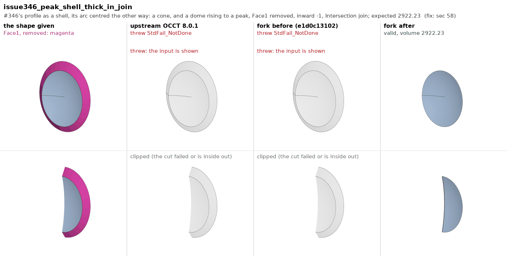

Over the corpus (1072 runs) 8 change, at fix levels 0 and 2 alike: these
and their twins closed by a sphere (`breps/apex/rev-1.05`, `rev-3`,
`revs-1.05`, `revs-3`, -1 and -0.5), refused or wrong to valid. Nothing
else moves, so no level: the fix lands plainly. The last two of the Linux
and macOS corpus differences (`rev-3` -1) go with it.

**Regression** (`02fba5930a`, on Linux): Part 390, PartDesign 486 and
ShapeStorage 63 OK, plain and frozen; thickness PASS=610 at fix levels 0, 1
and 2, plain and frozen, the four cases above among them (606 before, the
rest line for line as they were); the thickness sweep right in all 928 runs
at all three levels, plain and frozen, unchanged; fillet PASS=815 XFAIL=1,
draft 104 + 1 FAIL (Linux's standing `new_roof_L_a-30`) and boolean 67, as
before, fillet and draft frozen too.

## #346's dome removed, and the apex outward, from fix level 3 (2026-11-09, sec 59)

**What was broken.** Four things on #346's shell (a cone and a dome
coming to a point on the axis) and the corpus's profiles like it:

- **The dome removed, inward**: valid 0, -15929.7133 -- the shell itself.
  The cone's offset never met the dome and was dropped as hanging; what was
  left was the dome's own image, and the solid glued from it was the input.
  Outward it was refused. With the dome gone the cone's top edge is free and
  no removed face covers it, a cup with its bottom removed, which the fork
  refuses (an open box the same): refused now inward too. An offset of the
  removed faces' rims alone is no thick solid.
- **A dimple outward**: its offset's meridians cross the axis before their
  end. The Arc join never looked at the apex outward, and the Intersection
  join left the crossing open since sec 43; the face ran on past the axis to
  a circle 0.015 across and a sphere round the apex closed it -- a face
  crossing itself. BRepCheck passes it; BOP's argument check does not, and a
  cut of the boolean reference from it gave 5519 (the reference is 3030).
  The steeper dimple (the arc centred 3 off the axis) was 3.9e-3 off. Now
  the offset is trimmed where it crosses, with either join: both give the
  crossing, a concave corner, and a sharp one.
- **Sec 57's origin**: the stretch of a revolution on its own meridian
  stopped at a circle's origin, where a copy of the meridian takes its
  range a period on. The corpus's profiles and the suite's start there, and
  their rims stayed 6.6e-4 off. Such a range is taken a period on now, and
  the face's pcurves with it (`EnLargeFace`, and `ExtentFace`'s own copy):
  the same points, kept through a copy and a BRep write and read. The face's
  own offset surface is no longer changed in place for it: a trimmed surface
  round it keeps its bounds.
- **A peak outward, the Intersection join**: its offset falls short of the
  axis and is extended there, by GeomLib as a B-spline of the whole offset,
  9.1e-4 off at the tip, the thickness 0.042 over. A revolution of a circle
  is carried to the axis on the concentric circle now.

The first moves only results that were not answers, so it lands at every
level. The other three move shapes some input already had beyond their
tolerance, so they come from the fork's offset fix level 3 (sec 31's
rule); FreeCAD's `OCCTOffsetFixLevelLatest` names it for new objects.

By booleans, sec 56's for the thicknesses (the band of the meridian section
offset in 2D, revolved, inside the cone) and sec 57's for the whole offsets
(the section offset as an open wire, revolved): every run below to the
digit, every face within 6.3e-7.

| Case | Model | What it covers |
|------|-------|----------------|
| `issue346_dome_removed_in_refused`, `_in_half_`, `_in_join_`, `_in_half_join_` | #346's Revolve, the dome (face 2) removed, -1 and -0.5, both joins | refused; the shell itself before |
| `issue346_revolve_apex_thick_out_level3`, `_out_join_`, `_out_half_` | the Revolve, the cone removed, +1 both joins, +0.5 | 3030.5493, 1498.3352, no sphere, the axis reached by the dome and its offset alone |
| `issue346_steep_dimple_shell_apex_thick_out*_level3` | the arc centred 3 off the axis, a steeper dimple, +1 and +0.5, both joins | 3008.6805, 1487.3880; 3008.6925 and 1487.3895 before |
| `issue346_peak_shell_apex_thick_out*_join_level3`, `issue346_steep_peak_shell_...` | the peaks, +1 and +0.5, the Intersection join | 3056.3047, 1511.2079; 3082.1592, 1524.1143; 0.04 over before |
| `issue346_*_apex_out*_level3` | the whole offsets: the Revolve +1, the steeper dimple +1 and -1 with the Intersection join, the peaks +1 with it | 5255.6121, 5236.1734, 5758.1468, 5278.6402, 5301.8746 |
| `issue346_revolve_apex_out_level0` | the Revolve at level 0 | as before: the sphere, and the offset across the axis under it |

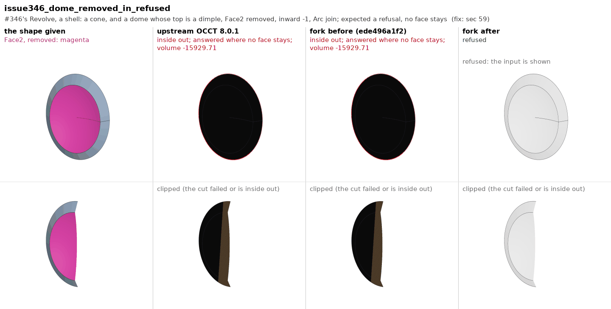

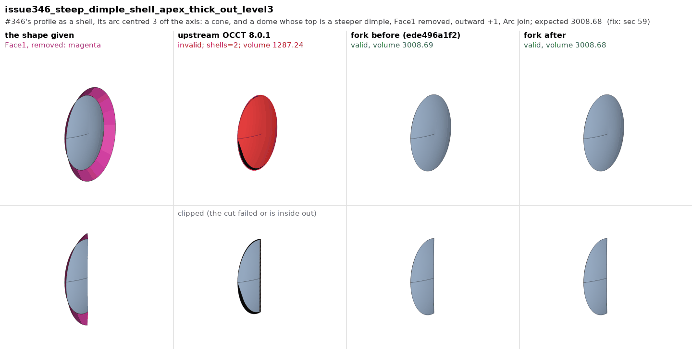

Over the corpus (1072 runs) 36 change at levels 0 and 2: these refusals,
on #346's file and every profile of `breps/apex/`, invalid to refused.
Nothing else moves, and the baseline takes them. At level 3, 76 more
(against level 2), all on the apex corpus and #346's file, each to its
boolean value: the dimples' thicknesses and offsets outward, the peaks'
with the Intersection join, and the profiles that start at their circle's
origin, sec 57's stretch now reaching them.

Found on the way, left: the rim's section of the cone and the dome's
offset, a B-spline, lies 1.27e-7 from its pcurves under a tolerance of
1.02e-7 (BOP's argument check calls it `InvalidCurveOnSurface`; BRepCheck
passes it), at every level.

**Regression** (`6b8ecdcf9f`, on Linux): Part 390, PartDesign 486 and
ShapeStorage 63 OK, plain and frozen; thickness PASS=631 at fix levels 0, 1,
2 and 3, plain and frozen, the 21 cases above among them (610 before, the rest
line for line as they were); the thickness sweep right in all 928 runs at
all four levels, plain and frozen; fillet PASS=815 XFAIL=1, draft 104 + 1
FAIL (Linux's standing `new_roof_L_a-30`) and boolean 67, as before, fillet
and draft frozen too.

## #360: walls thinner than twice the thickness, a second way to the loops' wires (2026-11-10, sec 60)

**What was broken.** #360's Thickness -- a plate 10 thick with square
holes 4.3 apart and 2.5 from its outline, the top removed, 4 inward, the Arc
join, Intersection on -- was refused; upstream makes it, 38747.1395, and so
did the build the document was saved by. Bisected over the chain's 125
commits to its first, `dfce6bbb3b` (2024, "keep every piece of a cut
edge"): at that one it throws, the commits after it search for the wires
until memory is gone (62 GB, twice, with the machine), and since the search
has a limit it gives up and the thickness is refused.

It is not this plate alone. Two holes nearer each other than twice the
thickness, or one hole nearer the outline, a face removed inward: the fork
refused every one of them or gave an invalid solid, and upstream makes them
(with Intersection on).

Inward, the offset of a wall moves into the material. Where the wall
between two holes is thinner than twice the thickness the two offsets pass
each other, and between them lies a strip (two square holes) or a lens (the
rounded corners of the Arc join) that is no pocket: it is material. An edge
has what is left of its face on one side, the side its orientation gives,
and round that strip two edges say one thing and two the other. Upstream
cuts each edge by the orientation of the vertices on it and never makes the
strip's pieces. The fork keeps every piece (the fix for #1's concave
removed face, where that orientation is wrong) and chooses among the
regions the pieces bound by what they share with each other, the edges'
orientations unread: the strip is a region like any other. On the offset
bottom it became a pocket's floor; on the removed face, whose own edges the
fork stretches far past their ends, the stretched sides of the holes cut
the rim into dozens of pieces -- 2406 pieces of edges on #360's top, 1200
of them lying on another (the sides of a row of holes are one line, a notch
and its mirror image another) -- and what stood out among the regions was
the openings of the holes.

**The fix.** Nothing is changed in what was made: a thick solid is made as
before, and where that gives no valid answer -- refused, or invalid -- it
is made once more with the loops' wires on planar faces taken by the way
their edges run (`BRepAlgo_LoopByOrientation`, `BRepAlgo_Loop.cxx`
`FindRegionWires`). The regions come from the walk as before, the pieces of
stretched edges lying on another left out but one. Then:

- on an offset face, a region is of the face where every edge round it has
  it on its face's side: the strip, two for and two against, is not;
- on a removed face, a region is of the face where it lies within the face
  as it was (a point of it, classified) and is not an opening -- every edge
  round it, and round the regions it runs on into across stretched pieces,
  against. The strip stays, and the walls that stood round it, their tops
  now inside the face, hang and are dropped;
- the wires are those of the edges between a region of the face and one
  that is not, walked again; a part of the network inside a region of
  another (a hole no side of which is stretched through the rest) counts
  from that region.

The second answer is taken only where it is valid and passes through
itself nowhere (BOP's self-intersection check; BRepCheck alone passed #360's
plate 2 inward as the whole plate with eight closed boxes in it). A
removed face whose own edges say the offset is outward is left as it was:
no such case came here.

Since what was refused or invalid needs no level (sec 31's rule), there is
none. `BRepExtrema_DistanceSS` no longer throws on a vertex with no
parameter on the edge it is asked about (`isOnBoundary`: #360's loop gave
such vertices to edges not yet cut).

A plate is a prism, so its skin is the plate less the top eroded by the
thickness, as deep as the plate less the thickness; the erosion worked as a
polygon's gives every volume below to 1e-3, upstream's where it has one to
the digit.

| Case | Model | What it covers |
|------|-------|----------------|
| `issue360_plate_top_in4_inter`, `_bottom_` | #360's plate (`models/issue360_plate.brep`), Face5 or Face4 removed, -4 | 38747.1395: four pockets in the corners; refused before |
| `issue360_plate_top_in1_inter` | the same, -1 | 24071.6589: one pocket round the plate; refused before |
| `plate_row2_top_in4_inter`, `plate_row3_` | 80 x 30 x 10, two and three square holes 4.3 apart, the top removed, -4 | 15869.0119, 16365.0709; refused before |
| `plate_two6_`, `plate_two7.9_` | two holes 6 and 7.9 apart | 16057.5879, 16241.9608; refused before |
| `plate_staggered_top_in4_inter` | two holes 4.3 apart, not in line | 15683.8564; invalid before, and upstream refuses it |
| `plate_edge6_`, `plate_edge3_`, `plate_edge3_top_in4` | one hole 6 and 3 from the outline; the last with Intersection off | 15165.1911, 14802.1564; invalid and refused before (upstream, Intersection off: 22462.4, valid and wrong) |

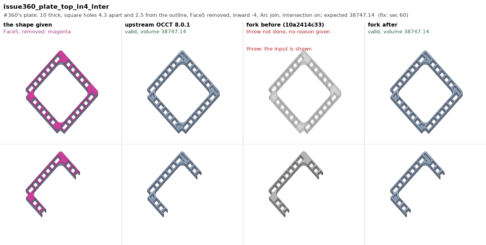

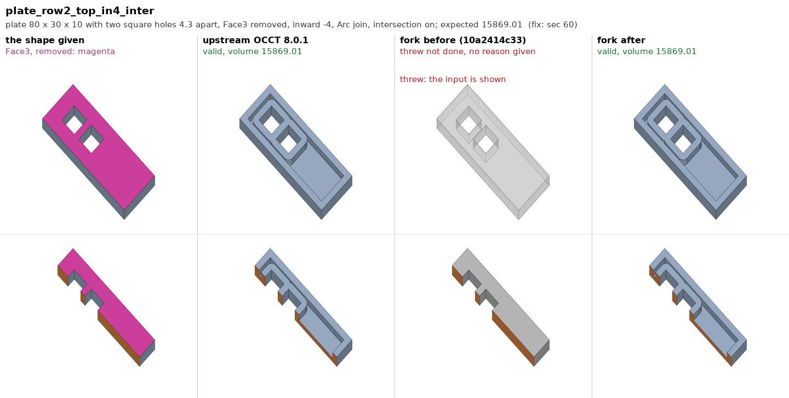

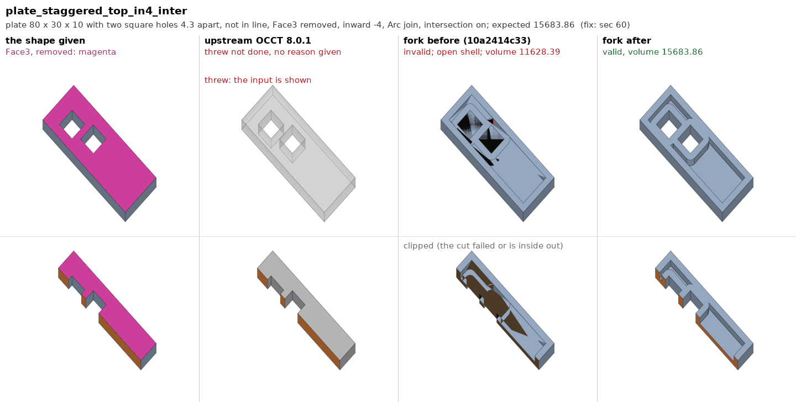

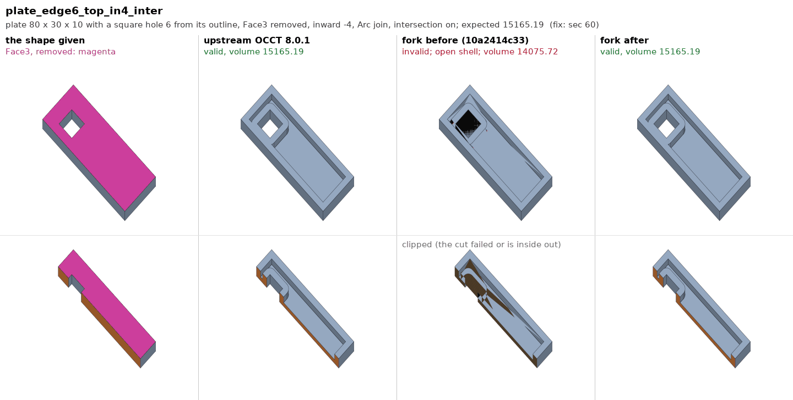

**Still broken then** (the first and the last of these are sec 61's): four
holes in a square, 4.3 apart both ways
(`plate_grid_top_in4_inter`, 21014.47), refused; two round holes 4.3 apart
(`plate_round2_top_in4_inter`, 15826.15), invalid -- the walls are
cylinders, and the second way reads planar faces only; #360's plate 2
inward (`issue360_plate_top_in2_inter`, twelve pockets, 33212.8), refused.
Without Intersection the rows of holes are refused as upstream refuses
them. #360's plate with the Intersection join is refused at -4 (upstream
gives the plate back, unhollowed) and at -2 (upstream's is invalid).

#360's plate takes 70 s where a second is its due: the first way's search
runs to its limit before the second is asked.

Over the corpus (1072 runs) none changes, and the sweep is right in 928 of
928: nothing they refuse has an answer the second way either.

**Regression** (`75bce7e802`, on Linux): thickness PASS=642 XFAIL=3 at fix
levels 0 and 3, and frozen at 3, the 11 cases above among them (631 before,
line for line as they were, at 0 and 3); the thickness sweep right in all
928 runs (level 0, plain); the corpus's 1072 runs as before; fillet
PASS=824 XFAIL=1, boolean 67 and draft 104 + 1 FAIL (Linux's standing
`new_roof_L_a-30`), as before. Not run: FreeCAD's own Part and PartDesign
tests, levels 1 and 2, the sweep frozen and placed.

## Four holes in a square, and #360's plate 2 inward: regions on cylinders, sampled off the edge (2026-11-11, sec 61)

Two of sec 60's three open cases, two faults in its second way.

**Four holes in a square**, 4.3 apart one way and 7.6 the other, the top
removed 4 inward: refused. The walls between the holes pass each other
both ways; what is left in the middle is a pocket between the four rounded
corners, 0.69 in area. The removed top came out right the second way --
eight wires, as the erosion has it -- and so did the floor and twelve of
the sixteen walls. The other four had no outline: of the edge each shares
with the rounded corner at its far end it was handed, as an edge already
cut, the piece below the floor only. The corner had been cut first, and
the corner is a cylinder: the second way read planar faces only, the
search had the corner, and the search kept that piece. A cylinder taken
less than a turn round is read by regions now, as a plane is
(`IsRegionSurface`).

**#360's plate 2 inward** (twelve pockets), and 3: refused. On the removed
top a region is of the face where it lies within the face as it was, told
by a point just inside the region -- a hundredth of a side off the middle
of a chord of the region's polygon. The plate's opening has rounded
corners, and between a chord and its arc lies a sliver of the other side:
the rim's point fell in the opening, the rim was read as outside the face,
55 of its edges then said the offset was outward, and the face was left to
the search. The point is taken off the middle of the edge itself now,
along its normal there.

Nothing that was made changes: the second way is still asked only where
the first has no valid answer, and what it answers is still kept only
where it is valid and crosses itself nowhere.

| Case | Model | What it covers |
|------|-------|----------------|
| `plate_grid_top_in4_inter` | 60 x 55 x 10, four square holes in a square, 4.3 and 7.6 apart, the top removed, -4 | 21014.4693, the erosion's and upstream's; refused before |
| `issue360_plate_top_in2_inter` | #360's plate, Face5 removed, -2 | 33213.1056: twelve pockets (33213.03 by the erosion); refused before, and upstream's is invalid (21741.36) |
| `issue360_plate_top_in3_inter` | the same, -3 | 36527.3399: four pockets (36527.29 by the erosion); refused before |

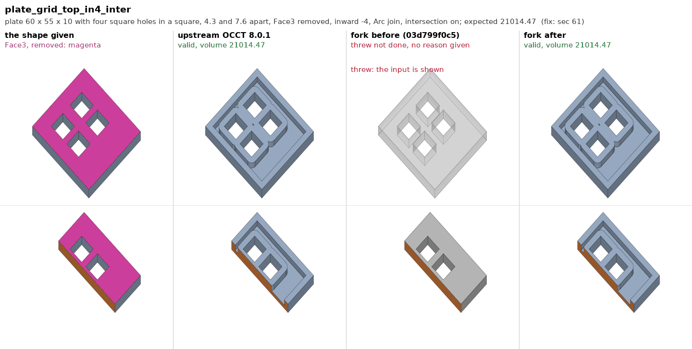

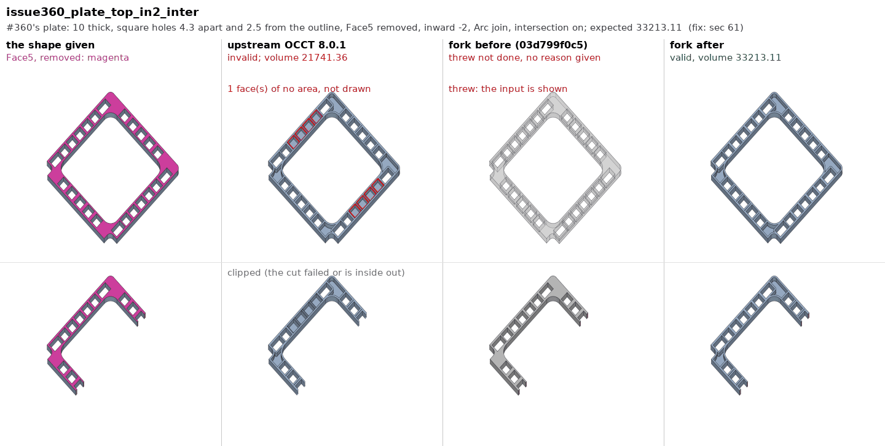

**Still broken then** (the first is sec 62's): two round holes 4.3 apart
(`plate_round2_top_in4_inter`, 15826.15), invalid -- their walls are whole
cylinders, seam and all, and the second way reads a cylinder only where
it is taken less than a turn round. Not in the suite: #360's plate 5
inward (four pockets, 40288.27 by the erosion) is refused both ways, the
removed top right and something after it not.

#360's plate takes 22 s at 4 inward and 42 s at 2 on this box, run alone:
the first way's search still runs to its limit before the second is asked.

Over the corpus (1072 runs) none changes, and the sweep is right in 928 of
928.

**Regression** (`3e7a7cfd5e`, on Linux): thickness PASS=645 XFAIL=1 at fix
levels 0, 1, 2 and 3, and frozen at 3 (642 + 3 before, the same lines but
for the two cases made and the one added); the thickness sweep right in
all 928 runs (level 0, plain); the corpus's 1072 runs as before; fillet
PASS=824 XFAIL=1, boolean 67 and draft 104 + 1 FAIL (Linux's standing
`new_roof_L_a-30`), as before. Not run: FreeCAD's own Part and PartDesign
tests, the sweep frozen and placed.

## Round holes: regions on a cylinder with its seam (2026-11-11, sec 62)

The last of sec 60's open cases, and the commonest: **two round holes
nearer each other than twice the thickness**, a face removed inward, came
out an invalid solid (14518.74 for 15826.15), and upstream makes it. A
round hole's wall is a whole cylinder with its seam; its offset is one
too, and sec 61 read a cylinder by regions only where it is taken less
than a turn round. Three things:

- `FindRegionWires` works on the pieces either walk took: the walk by
  angle's edges, or the (u, v) walk's (`FindLoopsInUV`), where a seam is
  two pieces a period apart with the face between them. On an offset face
  with its seam a region runs on across the seam into the region within
  the seam's other piece, and the seam says nothing of the face's side.
  Where the face lies along the seam it is parted there, the seam in the
  wire of each part: the second hole's wall, whose seam lies away from the
  first hole, is two faces.
- Those wires are made on the face taken forward, and `WiresToFaces`
  reverses the wires of a reversed face, as made on the face as it is
  oriented: the seam took its other pcurve there, and one of the two parts
  came out as what its wire leaves free of the turn. A wire through the
  seam is handed over reversed.
- A round hole nearer the outline than the thickness (3 from it, 4
  inward): the wall's offset leaves the plate, and its section with the
  floor is two arcs of one circle, from the seam to the outline and from
  the outline back to the seam. The vertex the first starts at has its
  parameter on that circle from the first, 0; the second ends there at
  2 pi, and cut at 0 it had a piece from 0 to its own start, the long way
  round and over the first. `CutEdge` brings a vertex given a whole turn
  off the edge's range onto the edge -- with the wires by orientation
  only, so that what was made without them is made as it was.

A removed face with a seam is still left to the search: what lies within
it is told on a face taken once round.

| Case | Model | What it covers |
|------|-------|----------------|
| `plate_round2_top_in4_inter` | 80 x 30 x 10, two round holes r 6.2, 4.3 apart, the top removed, -4 | 15826.1480; invalid before |
| `plate_round3_`, `plate_round2stag_`, `plate_round2far_` | three in a row; two not in line; two 7.9 apart | 16402.8165, 15765.0693, 16002.1518 |
| `plate_round2x2_top_in4_inter` | 60 x 55 x 10, four round holes in a square, 4.3 and 7.6 apart | 20983.4068 |
| `plate_roundsq_top_in4_inter` | a round hole 4.3 from a square one | 15885.6196 |
| `plate_roundedge6_`, `plate_roundedge3_` | one round hole 6 and 3 from the outline | 15150.3404, 14876.6460 |
| `plate_round2_top_in2.5_inter`, `plate_round2small_top_in3_inter` | the two holes, -2.5; two holes r 2, 4 apart, -3 | 11071.8809, 12359.0046 |

Every volume is upstream's to the digit, and the erosion's to 1.2 (its
circles are polygons).

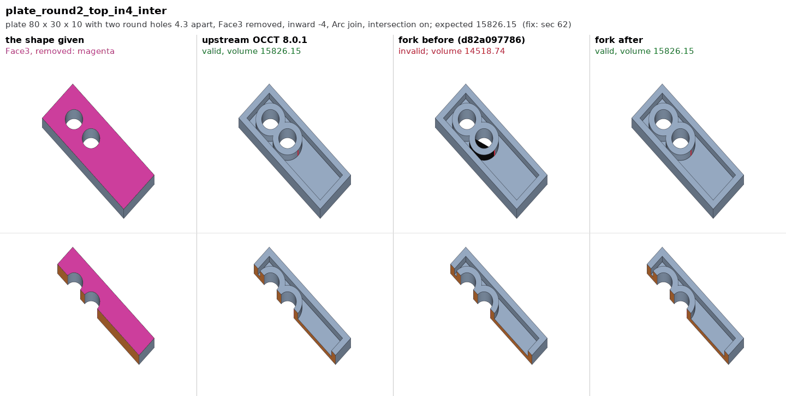

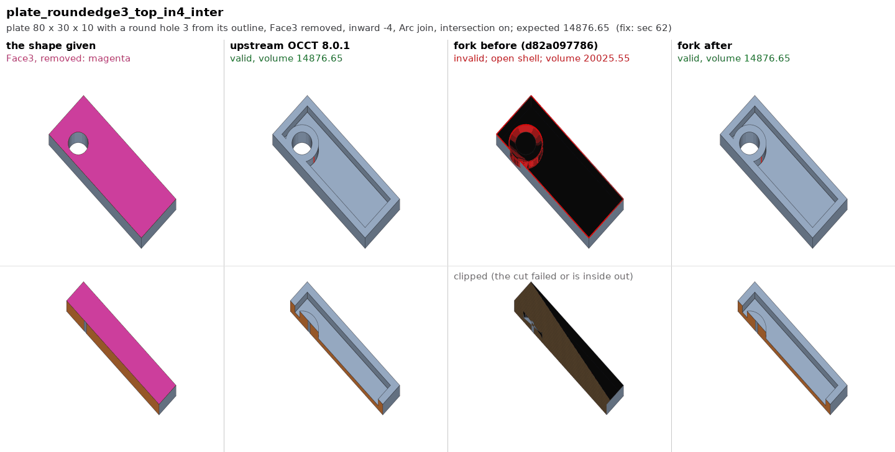

**Still broken then**, not in the suite (sec 63's): #360's plate 5 inward.

Over the corpus (1072 runs) four change, all from refused to made:
#363's Thickness001 base (`t001`) with its Face2 removed, the
Intersection join, at +1, -1, +0.5 and -0.5 (6627.9587, 6357.2578,
3288.2522, 3240.4163; `corpus/baseline.txt` has them). Each is what the
same solid with its groove in two quarter cylinders (`chg10`, f2) gave
already, to 1e-4. Upstream refuses all four. (This said "each upstream's
to the digit" until 2026-11-11: the corpus tool had been run with
upstream's libraries named by `LD_LIBRARY_PATH` in a directory without
the names the loader asks for, and had loaded the fork's. Corrected in sec
63, where the same was found.) The sweep is right in 928 of 928.

**Regression** (`d468af23e2`, on Linux): thickness PASS=655, nothing
marked known broken, at fix levels 0, 1, 2 and 3, and frozen at 3 (645 + 1
before, the same lines but for the one case made and the nine added); the
thickness sweep right in all 928 runs (level 0, plain); fillet PASS=824
XFAIL=1, boolean 67 and draft 104 + 1 FAIL (Linux's standing
`new_roof_L_a-30`), as before. Not run: FreeCAD's own Part and PartDesign
tests, the sweep frozen and placed.

## #360's plate 5 inward: an edge taken whole, then cut (2026-11-11, sec 63)

The last of #360's open cases: **the plate 5 inward, half its thickness**,
refused both ways (four pockets, 40288.27 by the erosion), where upstream
makes it. The second way
had every face's wires right; the offset then came apart, every face of it
dropped as hanging but the removed top's rim.

- Where a hole corner's offset -- a quarter cylinder -- meets the removed
  top it leaves an arc. The corner's own loop takes the arc whole, and it
  is its own image. The top's rim, built after, cuts the arc in two, at
  the point where the stretched side of a hole crosses it.
  `BRepOffset_MakeLoops` added the two pieces to the arc's image beside
  the arc, and `MakeFaces`, which hands a face built earlier the pieces of
  an edge cut since, gave the corner all three: the arc twice over in its
  wire, one of them free, and with it everything hanging went. The pieces
  now take the place of the edge whole (`AddCutImage`).
- That is the first way's fault as much as the second's, and mended it
  let through what it had held back by accident: #363's cylinder with a
  slot, the slot's ceiling removed outward with the Arc join, came out of
  the first way a closed shell of one side's offsets and half the
  cylinder's, valid to `BRepCheck`, of a volume of -819.3205. A thick
  solid of a volume below nothing is no answer (`IsInsideOut`, beside
  `IsRunaway`), and the second way then makes it. With a face removed
  only: with none the solid shrunk is the void of a hollow, asked for as
  such (FreeCAD's thickness to both sides with no opening, which its
  `testNoOpeningIsACentredHollow` holds).

| Case | Model | What it covers |
|------|-------|----------------|
| `issue360_plate_top_in5_inter` | #360's plate, Face5 removed, -5 | 40288.2902: four pockets (40288.27 by the erosion), upstream's to the digit; refused before |
| `slot_ceiling_out_arc`, `slot_ceiling_out_half_arc` | the cylinder with a slot, the slot's ceiling removed, +1 and +0.5, the Arc join | 6362.5515, 3085.7956; refused before; upstream gives the input back, invalid |

The slot's are checked by booleans: the cylinder's offset less the
cylinder, less what of it lies under the ceiling between the walls'
offsets, is 6363.8420 and 3085.9608; the result lies within it, short of
it by four corners of 0.3226 t^3 where the rim closes the opening.

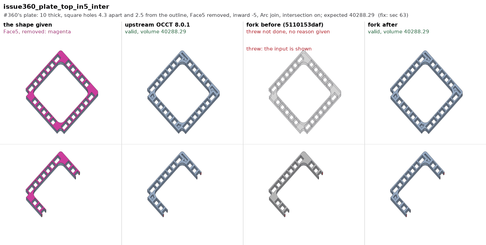

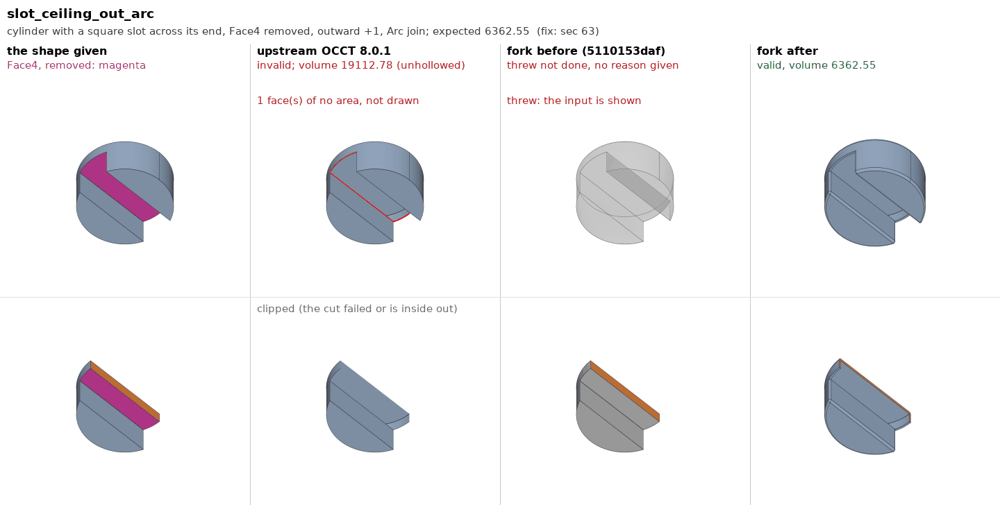

Over the corpus (1072 runs) six change, all from refused to made: the
slot's ceiling (`cslot`, f4) at +1 and +0.5 with the Arc join, as above,
and #613's model (`t613`) with either flat side of its ridge removed (f18,
f19), the Arc join, at +1 and +0.5 (7338.5623, 3587.9401). Upstream gives
the input back, invalid, for all six. #613's are checked less closely
than the slot's: valid, clean by BOP's check, the input and the skin
fused weigh what the two do apart, and the model's offset less the model
less a prism over the face is 7333.94 and 3586.74 -- the result differs
from that by a strip along each long edge of the face (29.70 and 34.29;
7.56 and 8.74 at 0.5, a quarter), where the rim closes the opening and
the fillet's offset below passes before the face.
`corpus/baseline.txt` has them. No run has a volume below nothing.

An earlier text of this section said the slot's -819.3205 was upstream's
too, and #613's four upstream's to the digit. Neither was so: the corpus
tool had loaded the fork's libraries, not upstream's (`LD_LIBRARY_PATH`
at a directory holding `libTKOffset.so.8.0.1` but no `libTKOffset.so.8.0`).
Upstream's results here are from `LD_PRELOAD`, checked with `ldd`; the
plate's is from the pictures, which preload too.

#360's plate takes 160 s at 5 inward on this box, run alone: the first
way's search runs to its limit before the second is asked (sec 61).
Sec 64 brings it to 8 s.

**Regression** (`7abaafc952`, on Linux): thickness PASS=658, nothing marked
known broken, at fix levels 0, 1, 2 and 3, and frozen at 3 (655 before,
the same lines but for the three added); the thickness sweep right in all
928 runs (level 0, plain); fillet PASS=824 XFAIL=1, boolean 67 and draft
104 + 1 FAIL (Linux's standing `new_roof_L_a-30`), as before. FreeCAD on
it: its Python suite 4359 OK, and of its C++ tests Tests 656, Part 117,
PartDesign 20, Sketcher 148 and TopoShapeEx 90. Not run: the sweep frozen
and placed.

## A search that will give up is not begun (2026-11-11, sec 64)

No result changes; the time does. **#360's plate took 146 s at 5 inward**
(sec 63), 23 s at 4, 44 s at 2, where upstream takes under a second
(invalid at 2) -- almost all of it in one function, giving up.

The first way's loops are found by a walk by angle and, where the walk
cannot describe the network, by `FindAllLoops`: every path through the
face's edges, with a million steps to spend (`378f5f83cd`, 2026-10-02). A search that
spends them all has no answer, and what it found is thrown away. But it
made a wire of every loop it found on the way, and on a face with enough
pieces those are long and many: the plate's removed top, 5 inward (1040
vertices), took 122 s and 5 GB to give up, and a wall after it 23 s; then
the second way made the solid in 3 s.

On a face that is not periodic the same paths are now walked first with
numbers for the vertices and edges, counting the same steps and making no
wire (`IsLoopSearchOutOfSteps`, a tenth of a second). Out of steps there,
the search is given up as it would have been; otherwise it runs as
before. (A periodic face's search is left as it is: its seam wires are
made between the starts, and take part in which edges are started along.)


| #360's plate, top removed | before | after | memory before | after | upstream |
|---|---|---|---|---|---|
| 1 inward | 16.0 s | 2.0 s | 0.5 GB | 46 MB | 0.8 s |
| 2 inward | 43.6 s | 2.4 s | 2.4 GB | 42 MB | 0.8 s, invalid |
| 3 inward | 20.3 s | 3.6 s | 1.7 GB | 42 MB | 0.7 s |
| 4 inward | 23.0 s | 3.6 s | 1.8 GB | 43 MB | 0.7 s |
| 5 inward | 145.9 s | 5.1 s | 5.2 GB | 45 MB | 0.7 s |

Each run alone on the dev box, `corpus/tools/thk` (Arc join, intersection
on); "before" is the libraries of `5110153daf` preloaded for 1 to 4 and
the fork at `7b20287a74` for 5, upstream its libraries preloaded and
checked with `ldd`. `pictures/search_time.py` draws the figure.

The search alone brought these to 3.8, 5.9, 6.7, 6.1 and 7.5 s
(`0beda9ad94`). The rest is a second change (`f35d92d6ef`): two passes of
`BRepAlgo_Loop::Perform` take every edge of the face against every other
(`BRepExtrema_DistShapeShape`, for crossings with no vertex) and every
vertex against every edge (a projection) -- tens of thousands of each on
the plate's top, nearly all between things nowhere near each other. A
piece of a line or of a circle has an exact box: two such edges whose
boxes, their vertices in them, are farther apart than the tolerance, and
a vertex farther from an edge's box than its own tolerance, are not
measured. Other curves are, as before.

What is left is the first way run to its end, its walk by angle failing
on the pieces that lie over each other, and the second way after it;
upstream is still three to seven times faster on this plate.

**Regression** (`0beda9ad94` and `f35d92d6ef`, each, on Linux): thickness
PASS=658, nothing marked
known broken, at fix levels 0, 1, 2 and 3, and frozen at 3, every line as
before; the thickness sweep right in all 928 runs and the same line for
line; the corpus (1072 runs) as its baseline; fillet PASS=824 XFAIL=1,
boolean 67 and draft 104 + 1 FAIL (Linux's standing `new_roof_L_a-30`).
FreeCAD on it: its Python suite 4359 OK, and of its C++ tests Part 117,
PartDesign 20 and TopoShapeEx 90. Not run: the sweep frozen and placed.

## A refusal that took 80 s (2026-11-11, sec 65)

No result changes; the time of a refusal does. **#613's model with its
side removed** (corpus `t613 thk f1`, eight runs) is refused by upstream at
once -- the faces that stay fall in two pieces, a shell not connected -- and
by the fork too, which makes each piece on its own (sec 11) and cannot
make the first: the model's top, two slopes and a ridge with B-spline
fillets against the removed side. But the fork took 20 to 80 s to say so,
both ways each time. Three causes, none in the loops:

- **The walls' check measured faces far apart**
  (`BRepOffset_MakeOffset.cxx`, `WallsCrossAtRemovedFace`, sec 10). It asks
  whether the inward offsets of two faces beside a removed one meet, by
  `BRepExtrema_DistShapeShape`, 0.3 to 1.4 s a pair of offsets of
  B-splines; the side has sixteen neighbours, 53 pairs, and 31 of them are
  17 and more apart. Pairs whose boxes are farther apart than the
  tolerance are not measured: 9 s of each attempt to 1.6 s.

- **A projection searched for its start before the curve's own**
  (`ProjLib_CompProjectedCurve.cxx`, upstream's). Where a curve does not
  project at its first parameter, the projector steps on, takes a point
  from the curve-surface extrema within the step, and seeks the exact
  bound between that point and one a step back from it -- which can be
  before the curve's start. A B-spline there is its end span carried on:
  the edge's curve projected on the offset of a corner fillet was given a
  part from -0.0193 where the curve starts at -0.0097, 0.38 off the
  surface at that end. The bound is now sought no further back than the
  curve's start. The pcurve that came of it missed its tolerance by
  0.012; it is 4e-9 off now.

- **The segments were doubled to no gain** (`ProjLib_ProjectedCurve.cxx`,
  the fork's own, `3c35c64037`). A pcurve of a curve of more spans than
  16 that misses its tolerance is approximated again in 32, 64, 128 and
  256 segments, the best kept. On the part above nothing could follow
  the jump at its start: the error stayed the same to six digits at every
  count, each point of it found by a search of the whole surface, 43000 of
  them, 28 s. The error does fall in steps -- the suite has curves that
  gain nothing at 32 and reach 1.4e-9 at 64 -- so two doublings in a row
  that gain nothing end it. With the bound mended this projection needs
  one doubling.

| run (`thk breps/t613.brep <offset> <join> 0 1`) | before | after |
|---|---|---|
| 1 outward, Arc | 0.4 s | 0.4 s |
| 1 inward, Arc | 20.3 s | 3.4 s |
| 0.5 outward, Arc | 0.5 s | 0.5 s |
| 0.5 inward, Arc | 24.2 s | 3.4 s |
| 1 outward, Intersection | 60.6 s | 4.0 s |
| 1 inward, Intersection | 80.6 s | 5.4 s |
| 0.5 outward, Intersection | 3.4 s | 3.9 s |
| 0.5 inward, Intersection | 27.2 s | 6.6 s |

Each run alone, Linux; all eight "not done" before and after, as upstream
(0.01 s). `pictures/refusal_time.py` draws the figure,
`models/pictures/issue613_side_refusal_time.png`.

The projection's two changes (`d75d827fba`; the walls' is `2b06c6870f`) are
in TKGeomBase, under every pcurve made by projection, so the whole set was
run: thickness PASS=658 at fix levels 0
to 3 and frozen at 3; the sweep 928 of 928, the same line for line; the
corpus as its baseline; fillet 824 + 1 XFAIL, boolean 67 (#617's pcurve
among them, its error falling at every doubling as before: 0.021, 0.012,
2e-5, 6e-10), draft 105; FreeCAD's Python suite 4360 OK, its C++ tests as before.

**Open**: the top piece itself. Its offset comes apart (every face of it
hangs and is dropped), inward and outward; no reference worked for it yet.

## A rim round a wall whose edge lies on the seam (2026-11-11, sec 66)

**#363's `Thickness002`**: the Cut's groove wall removed, 1 outward. Once
FreeCAD finds the wall again (FreeCAD `f3f19634fb`, `../occ-issues/`) the
thickness runs, and gave an invalid solid, 2098.8735, where the Cut as the
file stores it gives 3678.0197. Upstream throws with the Arc join and
gives the input back with Intersection, on either.

The two Cuts are one solid written two ways. The wall is half of the
cutting cylinder, and its straight edges lie in the bottom's plane, where
the cylinder's seam is. Made again, the Cut keeps the edge on the seam
with both of a seam's pcurves, at u = 0 and at 2 pi; the wall runs from 0
to pi and uses the first. (The stored Cut has that edge with one pcurve.)

Outward, the rim of a removed face is a ring on the face's own surface:
the new edges outside -- here from -0.125 to pi + 0.125 -- and the face's
outline its hole. The hole runs the outline the other way round, and an
edge with two pcurves the other way round is its other pcurve: the edge
came into the ring at 2 pi, a period away from everything else in it.
`BRepAlgo_FaceRestrictor` made of the two wires a face running round the
cylinder, or two faces, the hole's the one running round; either is dropped
(`goesRound`, sec 51), the wall is left with no image, and
`BRepOffset_MakeLoops::BuildFaces` builds it again from the new edges
alone: the whole wall's surface back in the offset, a second shell.

No face on that surface holds the ring as it is: the strip of it beyond
the seam is on the other side of the edge from the wall, and on that side
the edge is its second pcurve, at 2 pi, whatever the face. So the ring is
made in two (`BRepAlgo_Loop.cxx`, `SplitRingAtOwnClosedEdge`, `b62de1a33a`):
the seam's
line crosses it beyond each end of the edge, and where it meets the outer
wire at vertices two new edges are laid on it there, each with a seam's
two pcurves. The part on the wall's side keeps its place, with the hole's
other edges; the strip beyond is moved a period on, to where the edge's
second pcurve is. Its outer edges are the offset's own, not the input's:
the input is left as it was, text for text. Where the line does not meet
the outer wire at vertices, nothing is done and the ring is dropped as
before.

| Case | Before | Now |
|------|--------|-----|
| `issue363_cut_remade_wall_out{1,0.5,2}` | invalid (2098.8735, 214.1733, 6221.9936) | 3678.0197, 1783.0366, 7821.7054 |
| `issue363_cut_remade_wall_out{1,0.5,2}_join` | refused | 3704.4064, 1789.4711, 7932.6620 |
| `issue363_cut_stored_wall_out{1,0.5,2}`, `..._join` | the same six volumes | the same |
| `groove_tool_turned{90,270}_wall_out`, `..._join`, `..._half` | invalid, or refused (270, Intersection) | 3795.0668, 3844.0843, 1840.6349 |
| `groove_tool_turned180_wall_out`, `..._join`, `..._half` | the same three volumes | the same |

The volumes are checked three ways. The stored Cut, which never had the
fault, gives the remade one's to the digit. The built cylinder gives one
volume with the tool's seam in the bottom's plane on either side (90,
270) and away from it (180). And by booleans -- the solid's offset, less
the solid and the groove's column -- the Arc join's 1 is 3677.8013, wholly
inside the result; what the result has over it, 0.2183, is two slivers
along the rim, where the reference's own pipes are approximated to 1e-3.
The result does not cross itself (`BOPAlgo_ArgumentAnalyzer`), mirrored and
reversed copies give the same, and inward (3223.6398) is as it was.

Regression (`b62de1a33a`, Linux): thickness PASS=679 (21 new) at fix levels
0 to 3, frozen at 3; sweep 928 of 928, the same line for line; the corpus
as its baseline; fillet 824 + 1 XFAIL, boolean 67, draft 105; FreeCAD's
Python suite 4360 OK. Pictured: `issue363_cut_remade_wall_out1`,
`issue363_cut_remade_wall_out1_join`, `groove_tool_turned90_wall_out`.

## An edge left in the pieces a discarded wall cut it in (2026-11-11, sec 67)

**#360's plate again**: the thickness is right (38747.1395 at 4 inward,
sec 60) but came out of the second way with **642 edges and 496 vertices**
where the issue's file, the first way wherever it can make the plate, and
upstream all have **438 and 292** for the same 152 faces. 204 of the
vertices lay between two edges of one curve and nothing else.

The second way keeps every piece of an edge and chooses among them by the
way they run (sec 60). The offset of a hole's wall crosses the edges of
the walls it passes, and cuts them there; that offset is then thrown away,
having passed its neighbour's, and the edges it cut stay in two, three or
four pieces with a vertex at each crossing. The solid is valid and its
volume right, but it is not the solid a document was saved with: in the
issue's file `Sketch004` holds an edge of the plate 17.5 long as external
geometry, found three pieces of it (1.0, 10.8 and 5.7), and stopped the
recompute there ("Missing external geometry reference").

`BRepOffset_MakeOffset::JoinEdgePieces` (`ac01b0d63e`) joins them once the second
way has its solid: where a vertex has just two edges, they lie on the same curve
(by its handle) and, in each of their faces, on the same pcurve (the same
object, or one that is the other over its range -- a piece may carry a
copy on one face), and their ranges meet at the vertex. A run of pieces
becomes one edge on that curve, with a pcurve defined over all of it on
each face. Not at a vertex of the input, nor round a closed run, nor
where an edge is closed on a face. The faces are made again with the edge
whole (`BRepTools_ReShape`), the result is taken only if it is valid with
the faces it had, and the images follow, so that `Generated` and
`Modified` answer with the joined edges and the faces made again.

| Case | Before | Now | Upstream |
|------|--------|-----|----------|
| `issue360_plate_top_in4_inter_edges` | 642 edges, 496 vertices, 204 between two edges | 438, 292, none | 438, 292 |
| `issue360_plate_top_in3_inter_edges` | 630, 484, 192 | 438, 292, none | 438, 292 |
| `issue360_plate_top_in5_inter_edges` | 740, 594, 302 | 438, 292, none | 438, 292 |
| `issue360_plate_top_in2_inter_edges` | 668, 466, 62 | 606, 404, none | invalid |

Volumes as before (38747.1395, 36527.3399, 40288.2902, 33213.1056).
`pictures/edge_pieces.py` draws the figure,
`models/pictures/issue360_plate_edge_pieces.png`: the result's edges from
above, the vertices between two pieces marked.

In the issue's file every feature from the Thickness on (`Pocket002`,
`LinearPattern`, `Mirrored002`) now has the stored shape's faces, edges
and vertices to the count, and `Sketch004` finds its edge.

Regression (`ac01b0d63e`, Linux): thickness PASS=683 (4 new) at level 0, and 679
at fix levels 0 to 3 and frozen before the 4 were added; sweep 928 of 928,
the same line for line; the corpus as its baseline; fillet 824 + 1 XFAIL,
boolean 67, draft 105; FreeCAD's Python suite 4361 OK.

## A mended face that comes back in several (2026-11-12, sec 68)

**An exception where a refusal was due.** #613's model with face 6 or
face 12 removed, 1 mm either way with arcs, did not answer "not done": it
threw `Standard_TypeMismatch` ("TopoDS::Face") out of the whole offset,
past the second way (sec 60) and past the caller's `IsDone()`. So did the
model's top piece with its side removed (sec 65), which is what the
piecewise thickness (sec 11) hands on there.

Two places of the chain mend an invalid face with `ShapeFix_Shape` and
cast the result back to a face: the extended face in
`BRepOffset_MakeOffset::ToContext`, and the test face a loop is classified
against in `BRepAlgo_Loop`'s `SplitWires`. Where the face's bounds cross
-- on the top piece two corner blends' offsets meet on the extended top
face; in `SplitWires` the loop crosses itself -- the fix hands back the
face cut in several, a compound, and the cast throws.

The face is now kept as it was made unless the fix hands back a face
(`ff1dfd11f2`). It is as invalid as it was, and what follows refuses it
as it refuses everything else it cannot make.

| Run (`corpus/`, `t613`) | Before | Now | Upstream |
|-------------------------|--------|-----|----------|
| face 6 removed, 1 out, arcs | threw | not done | done, invalid |
| face 12 removed, 1 out, arcs | threw | not done | done, invalid |
| face 6 removed, 1 in, arcs | threw | not done | throws |
| face 12 removed, 1 in, arcs | threw | not done | throws |

No result changes and nothing new is made, so there is no figure: the
four lines of `corpus/baseline.txt` are the record. Making these four is
still open -- upstream does not make them either.

Regression (`ff1dfd11f2`, Linux): thickness PASS=683 at level 0, and at
level 3 frozen; sweep 928 of 928, the same line for line; the corpus as
its baseline but for these four lines; fillet 824 + 1 XFAIL, boolean 67,
draft 105.

## A wall made again says what it was (2026-11-12, sec 69)

**What a thick solid tells of the faces that stay in it.** No shape
changes; this is the history a caller asks for afterwards (`Modified`,
`Generated`, `IsDeleted`), which FreeCAD names the result's elements by.

A wall that shares an edge with the removed face is made again wherever
that edge is cut: `BRepOffset_MakeOffset::MakeFaces` rebuilds every face
that holds an edge the removed face's rim took in pieces, on the wall's own
surface, and records what it became in the images (`myImageOffset`), from
which the solid is glued. But `Generated` answers with a face's offset,
and `Modified` answered with a removed face's rim and nothing else. The
wall as it was is not in the result, the wall made again is, and no
element of the input answered for it. The same holds for the edge the wall
shares with the removed face, in its pieces or joined again (sec 67).

On #360's plate, the top removed 4 inward (sec 60), that was 78 of the
result's 152 faces and 78 of its 438 edges, each lying on the surface or
the curve of an input element that was gone. FreeCAD, with no history for
them, named those faces from their own edges and the edges from one face
and a number: in its name stability corpus 117 of the 191 references that
silently found another element after a change were on this plate (FreeCAD
`docs/TopoNamingEnhance.md` sec 9).

`BRepOffset_MakeOffset::Modified` now answers for a face or an edge of the
shape that is not a removed face, is not in the result, and has an image
there: its last image, of its own kind, where that is in the result.
`BRepOffsetAPI_MakeThickSolid::Modified` asks it for every face but a
removed one, and `IsDeleted` follows.

| #360's plate, inward | faces of the result that are the input's own | faces no input element answered for | edges on an input curve, the same | now |
|------|------|------|------|------|
| 2 | 95 of 216 | 22 | 22 | none, none |
| 3 | 61 of 152 | 56 | 56 | none, none |
| 4 | 39 of 152 | 78 | 78 | none, none |
| 5 | 7 of 152 | 110 | 110 | none, none |

The edges that are still told of by nothing (64 at 3, 4 and 5 inward) lie
on no input curve: they are where two offsets, or an offset and the rim,
meet.

What this does not change: the same wall is the input's own face at one
thickness and a face made again at another (61, 39 and 7 stay at 3, 4 and
5 inward), though the face made is the wall as it was. A caller sees
"unchanged" in one run and "modified" in the next.

The check is in FreeCAD's C++ tests, since no history is seen from Python:
`tests/src/Mod/Part/App/ThickSolidHistory.cpp`, a plate with two square
holes 2.5 from its outline, the top removed 4 inward, where one wall is
made again. There is no figure: nothing new is made.

Regression (`3bae7e462a`, Linux): thickness PASS=683 at fix levels 0 and 3,
frozen at 3; sweep 928 of 928; the corpus as its baseline; fillet 824 + 1
XFAIL, boolean 70, draft 104 + 1 FAIL (FreeCAD's SheetMetal branch, before
its `f2d9db811e`); FreeCAD's Python suite 5302 OK, and its
`ThickSolidHistory` check, which fails without this.

## #613: a flat of the roof removed (2026-11-14, sec 70)

**Where it was met.** The corpus (`corpus/`): #613's part with each of its
21 faces removed in turn, 1 and 0.5 either way, both joins -- 168 runs, of
which 133 were refused and 8 threw. Two faces are a pair: the flats of the
roof, face 15 and face 21, mirror images of each other but for the blend
below them, which is one face under 21 (face 12) and two under 15 (faces 2
and 6). With the Arc join face 21 was made at 1 outward and refused at the
other three; face 15 was refused at all four. (At 0.25 to 2 either way,
`models/issue613_roof_flat.cpp`: face 21 made at 1 and 2 outward and at 2
inward, refused at the other five; face 15 refused at all eight.)

Every edge of a flat is tangent to the face beside it -- the blend down to
the cone, a B-spline, and the blend up to the ridge, a cylinder -- so
nothing of a neighbour's offset reaches the flat, and the wall is closed by
a tube round each edge: a quarter turn from the neighbour's offset edge
down to the flat, where the rim starts (`BRepOffset_MakeOffset::ToContext`,
the filleted dome of sec 34 and 35).

**What was broken, face 15.** Its edge along the blend is two edges, one
going on from the other in the same direction where the blend's halves
meet. A tube is made round each, and each ends there in the same quarter
circle -- its own edge, with its own vertex on the flat. Two tubes that
meet at a corner of the flat cut each other; these two are tangent, nothing
cuts one by the other, and nothing made the two arcs one. The shell stayed
open along them, every face of the offset hung from there and was dropped
in turn, and what was left was the rim alone: refused (`OffsetRimOnly`), at
any value, either way.

**The fix** (`40ddbee82b`). `ShareTubeEnds()` in `BRepOffset_MakeOffset.cxx`:
before a tube is made, the tubes already made for the same removed face are
asked for an end arc that starts at the vertex this tube's upper edge ends
in and ends, within the tolerance, where its edge on the flat does. The
edge on the flat then takes that arc's vertex for its own, and the tube is
made with the arc for its end (`BRepOffset_Offset::Init` with a first or a
last edge, as the tubes of convex edges are given the arcs of the spheres
at their ends).

**What was broken, face 21.** At each corner of the flat its two tubes
touch -- they start from one vertex, with one normal -- and their section
runs from there down to where their edges on the flat cross. On the spline
tube that section's pcurve runs straight to its end: its direction is the
same to 5e-4 over the last hundredth of it. Its derivative at the end
parameter itself is another: (0.167, 0.748) for (-0.931, 1.260), 48 deg
off, and on the other side of the tube's own upper edge. The loop sorts
the edges at a vertex by the direction each leaves it in
(`FindLoopsByAngle()` in `BRepAlgo_Loop.cxx`), took the section for an edge
leaving outside the tube, and of the three regions of the tube -- the
strip and its two ends beyond the sections -- found one, an end. The strip
was not made, the edge on the flat lost the piece under it, and the rim
came out as the flat less a corner. Outward at 1 the same derivative is
(-0.298, 0.016), as far off but to the right side, which is why that
value was made. A guard for end tangents that stray was there already
(sec 35): it sends two directions closer than 0.2 rad to their chords,
and these two were 0.22 apart.

**The fix** (`575b0f6c53`). `DartAngle()`: the direction an edge leaves a
vertex in is the pcurve's derivative there, unless the chord to a point a
thousandth of the way along it differs from that by more than 0.05 rad;
then it is the chord. A curve that turns that much in a thousandth of its
length turns eight times round in all.

**The results.** `models/issue613_roof_flat.cpp` (16 runs) and
`run_tests.py`, `issue613_flat_split_blend_*` (face 15) and
`issue613_flat_whole_blend_*` (face 21):

| Removed | Offset | Before | Now |
|---------|--------|--------|-----|
| face 15 | 0.25, 0.5, 1, 2 | refused | 1617.8851, 3286.0136, 6773.6378, 14358.7727 |
| face 15 | -0.25, -0.5, -1, -2 | refused | 1575.4511, 3116.4126, 6096.2692, 11657.5021 |
| face 21 | 0.25, 0.5, 1, 2 | refused, refused, 6773.6496, 14358.8004 | 1617.8873, 3286.0189, 6773.6496, 14358.8004 |
| face 21 | -0.25, -0.5, -1, -2 | refused, refused, refused, 11657.5105 | 1575.4539, 3116.4171, 6096.2767, 11657.5105 |

All valid, one solid. The two flats agree to 2e-6 of the volume (the
blend is modelled twice). Each result is also read by points: 1500 at
random within the thickness of the part's skin and more than 1.6 times the
thickness from the removed flat, each inside the result exactly where it
is outside the part (inside, for an inward one) and nearer than the
thickness to it -- 11 of the 16 results read (`f15` and `f21` at 1 and 2
either way, `f15` at 0.5 either way, `f21` at -0.5), not a point wrong.
The rule near the flat is the tube's (sec 34), and is not read here.


Each case three ways -- upstream, the fork before, the fork now -- as the
other sections have them: upstream answers seven of the eight with an
invalid solid and one (face 21, 0.5 outward) with the part itself.


**What is left of the corpus' 168.** 126 refused and 8 throwing. Looked at and not mended:

- *The cylinder below the cone (face 3).* The cone leans 1.5 deg. Outward
  the cylinder, carried on upward, meets the cone's offset 38 above the
  cone's foot -- above the part; inward it never does, and the floor is
  cut loose from the rest. There is no answer of this kind.
- *The blends up to the ridge (faces 17 and 20), at 1.* They are 1.81
  wide: the rims from their two sides, each 1 wide, would overlap. At 0.5
  face 17 is made and face 20 is not: the offsets of the blend below and
  of a corner blend (faces 12 and 14) come out with an edge each along
  their common one, the same curve twice. (Mended: sec 71.)
- *The blends made as B-splines (faces 2, 4 to 6, 8 to 14).* A tube's edge
  on the removed face is found by a circle round each point of the edge
  meeting the face's surface. The surface of such a blend ends where the
  face does, and at a corner that is not square the circle passes 0.02 to
  0.05 outside it: no edge, no tube (`TangentTubeNoEdge`). Face 12's long
  tubes are made and its two end tubes are not.
- *The cone (face 1)*: 22 tubes; not looked into.
- *The Intersection join*: nothing was made but the top, the bottom and
  (outward) one flat before, and nothing more is now.

**What it moved.** Seven lines of the corpus, from refused to made
(`corpus/baseline.txt`). Nothing else: not a case line of the suites, not a
line of the sweep.

**Validation** (`575b0f6c53` against `7b79d5b639`, on Linux): thickness
PASS=691 (683 + these 8) at level 0 and at level 3 frozen, every other case
line the same; boolean 103, draft 105, fillet 827 + 1 XFAIL, the same line
for line; the corpus as its baseline but for the seven lines made here;
sweep 928 of 928, the same line for line; FreeCAD's Python suite 4388 OK
(`b4ff77d741`). Not run: macOS, thickness levels 1 and 2.

## #613: the blend up to the ridge, on the other side (`bdeae6c4e2`, 2026-11-14, sec 71)

**Where it was met.** Sec 70's list of what is left: the two blends up to
the ridge, faces 17 and 20, are mirror images, a quarter cylinder 1.81
wide. At 1 neither can be made (the rims from its two sides, each 1 wide,
would overlap). At 0.5, either way, face 17 was made and face 20 refused.

**What was broken.** With face 20 removed the offsets of the blend below
it (face 12) and of a corner blend (face 14) came out with an edge each
along their common one: the same curve, the same range, the same two
vertices, twice. The shell was open there, the two faces hung, and
everything went with them (`OffsetRimOnly`).

`BRepOffset_MakeLoops::BuildFaces` rebuilds a face when one of its edges
has an image, going over the faces until none is rebuilt. The loop of
the corner blend's offset renews the vertex at one end of that common
edge and with it the edge -- a copy, the same curve and range, with the
new vertex -- and the copy is the edge's image. The blend's offset, on
the other side of the edge, takes the copy if it is rebuilt after that.
Here it had been rebuilt before, with the common edge as it was, and a
face once rebuilt is not gone over again. At the end the renewed vertices are put back for the old ones
(`myVerVerMap`), and the copy then differs from the edge in nothing but
being another edge. With face 17 removed the faces come in the other
order and the blend's offset takes the copy.

**The fix.** After the vertices are put back, a face still holding an
edge whose image is one edge on the same curve, over the same range,
between the same vertices is given that edge.

| Case | What |
|------|------|
| `issue613_ridge_blend_left_out_half`, `_in_half` | face 20 removed, 0.5 and -0.5, Arc: 3629.8323 and 3453.5477 (refused before) |
| `issue613_ridge_blend_right_out_half`, `_in_half` | face 17, the mirror image: the same two volumes, made before too |

Read by points as in sec 70 (1500 at random, away from the removed
face): both of face 20's, not a point wrong. Upstream throws on the one
outward and answers the one inward with an invalid solid.


Of the corpus' 168 runs on this part 124 are refused now and 8 throw.

**What it moved.** Two lines of the corpus, from refused to made
(`corpus/baseline.txt`). Nothing else: not a case line of the suites, not a
line of the sweep.

**Validation** (`bdeae6c4e2` against `39599b9791`, on Linux): thickness
PASS=695 (691 + these 4) at level 0 and at level 3 frozen, every other case
line the same; boolean 103, draft 105, fillet 829 + 1 XFAIL, the same line
for line; the corpus as its baseline but for the two lines made here; sweep
928 of 928, the same line for line; FreeCAD's Python suite 4388 OK
(`b4ff77d741`). Not run: macOS, thickness levels 1 and 2.

## An offset's vertex in one of two places, by the run (`6a0d5260bf`, 2026-11-15, sec 72)

**Where it was met.** The check of the boolean suite's README, "The same
looked for elsewhere": seventeen operations on each sweep shape, each in
three processes, every result's faces, edges and vertices compared. One
differed from run to run: `makeOffsetShape(0.2, 1e-3)` of #474's coil with
its fillet (`../draft/sweep/shapes/issue474_Fillet.brep`), an offset that
is invalid in every run, had one vertex at x = -12.9985 in five runs of
eight and at x = -13.0000 in three. Everything else was the same.

**What was broken.** Four edges of the offset end there, at the foot of
the coil's first turn: the line where the tube round a vertical edge
touches an offset plane and a short edge of the tube end at x = -13; the
long edge of the turn's offset and an edge of 4 on the same plane end at
x = -12.9985, 0.0015 beside it. The intersections made a vertex at each,
and the loops bound each of the two to the other in the map of vertices to
replace (`BRepAlgo_Loop`'s, handed on from face to face).
`BRepOffset_MakeLoops::Build` compresses that map's chains, so that every
vertex is bound to the last of its chain, and of two vertices bound to
each other it keeps the one it starts from. It started from the map's own
order, which is the order of the addresses the vertices happen to have:
with the address space randomised, another one from one run of the same
program to the next. How the two came to be bound to each other was not
traced.

**The fix.** The compression starts from the vertices in the order the
faces' images hold them, and from the ones no face holds after that. What
comes out is one of the two results that came out before -- here the
vertex on the line -- and the same in every run (twenty of twenty).


The case is `issue474_coil_offset_vertex_same_every_run`: one vertex
within 0.05 of the place, on the line. It does not ask the offset to be
valid, which it is not, before or now; before the fix it failed in five
runs of eight. On arm64 (macOS) this offset is not made at all -- "Null
shape", eight tries of eight at `6a0d5260bf` and four of four with the
file as it was before it -- and the case, with no vertex to look at,
passes saying so.

**What it moved.** Nothing else: not a case line of the suites, not a line
of the corpus or the sweep, not a model of the issues.

**Validation** (`6a0d5260bf` against `121087d66c`, on Linux): thickness
PASS=696 (695 + this one) at level 0 and at level 3 frozen, boolean 106,
draft 105, fillet 911 + 1 XFAIL at fix levels 0, 1, 2 and 3, every other
case line the same; the corpus as its baseline (1073 lines); the sweep 928
of 928, the same line for line; the 29 issue models recompute as before;
FreeCAD's Python suite 4388 OK (`7e8a9fdad3`). Not run: macOS, thickness
levels 1 and 2.

## #613: an exception where a refusal is due (`28112588a2`, 2026-11-15, sec 73)

**Where it was met.** Sec 70's list of what is left of the corpus on
#613's part: 8 of the 168 runs threw. All eight are with the
Intersection join, a flat of the roof or a blend removed: faces 15, 17
and 20 at 1 and 0.5 outward, faces 11 and 14 at 1 inward.

**What was broken.** `BRepOffset_MakeOffset::MakeThickSolid` computes the
thick solid and, where that gives no valid answer, computes it again with
the loops' wires taken by the way their edges run (sec 60). An exception
out of the first computation went straight on to the caller: no error
set, the second way untried, and for a message the kernel's class and
function -- in FreeCAD "Geom_TrimmedCurve::parameters out of range" or
"Geom_OffsetSurface::EvalD0" for a thickness that cannot be made. The
eight throw from four places, all in the Intersection join's own path
(`BuildOffsetByInter`):

| Removed | Thrown | From |
|---------|--------|------|
| face 15, 1 | `Geom_TrimmedCurve::parameters out of range` | `TrimEdge`, the edge's `BRepLib::SameParameter`: a pcurve trimmed to no range |
| face 15, 0.5 | the same | `PiecesOnTheFace`, a point sought in a face (`IntTools_Context::Hatcher`) |
| faces 17 and 20, 1 and 0.5 | `GeomAdaptor_Surface::EvalD0`, `EvalD2` | `BRepOffset_Inter2d`'s `EdgeInter`: a curve on a surface evaluated outside it |
| faces 11 and 14, -1 | `Geom_OffsetSurface::EvalD0` | `BRepOffset_Inter2d::FuseVertices`, a vertex's tolerance read on an offset surface that has no normal there |

**The fix.** The exception is caught at the outermost computation: not
done, `BRepOffset_UnknownError`, and the second way is tried as after any
other refusal. What made each state that threw is not mended: with this
join nothing is made on this part but its top, its bottom and (outward)
one flat (sec 70).

**The results.** The eight are refused: the second way makes none of
them. In FreeCAD they fail as a thickness that cannot be made
("Thickness failed"), not with the kernel's exception. `run_tests.py`,
`issue613_inter_join_f<face>_<way><value>_refused` (8), which take a
refusal of the offset's own and not an exception handed on.

No picture: nothing is made before or now.

**What it moved.** Eight lines of the corpus, from threw to refused
(`corpus/baseline.txt`). Nothing else: not a case line of the suites, not
a line of the sweep.

Of the corpus' 168 runs on this part 132 are refused now and none
throws.

**Validation** (`28112588a2` against `fd614fc070`, on Linux): thickness
PASS=704 (696 + these 8) at level 0 and at level 3 frozen, every other
case line the same; boolean 111, draft 105, fillet 919 + 1 XFAIL at fix
levels 0 to 4, the same line for line; the corpus as its baseline but for
the eight lines; sweep 928 of 928, the same line for line; the 29 issue
models as before; FreeCAD's Python suite 4388 OK (`763d0acadb`). Not run:
macOS, thickness levels 1 and 2.

## #613: a crease taken for tangent, from fix level 4 (`313767fc27`, 2026-11-16, sec 74)

**Where it was met.** Sec 41's cases on the issue's own shape pass with a
loose end of 0.05 allowed (`loose_ok=0.06`): the edge between the offsets
of the part's cylinder and of the cone above it has a tolerance of 0.055.
Asked what that looseness holds, the answer was a wrong volume.

**What was broken.** The part's side is a cylinder of radius 22.5 up to
z = 8 and above it a cone that leans in by 1.5 deg: a crease of 1.5 deg
all round. `BRepOffset_Analyse` gives every edge the way its two faces
meet -- convex, concave or tangent -- and the offset is built by it: the
offsets of faces that meet at an angle are cut by each other (or joined by
a tube, outward with the Arc join), the offsets of tangent faces are
joined as they are, along the offset of their edge. Tangent is decided
twice: by the angle the tolerance allows over the offset
(`analyseTolAngle`), and, for two faces that are not both planes, by a
"weak condition", `ChFi3d::IsTangentFaces` at its default of 0.1 rad --
5.7 deg, whatever the offset. The crease passed the second.

The crease's offset by the cylinder's normal and its offset by the cone's
are 2 x 2 sin(0.75 deg) = 0.052 apart at a thickness of 2. Inward the two
walls ran 0.052 past each other, outward they ended 0.052 apart, and the
edge between them was given the tolerance to hold either (0.055). Such a
solid is valid, by BRepCheck and by BOP's check, and a point asked of it
is answered right (6000 at random about the side, in the way of sec 70:
none wrong, at 2 and at 0.5, either way). Its volume is not: summed over
the faces, the band both walls cover is counted twice, and the band
neither covers not at all. That is 2/3 pi r^2 x 0.052 -- 46.09 at the
inner wall's 20.5 and 65.82 at the outer wall's 24.5 -- and the wall
between z = 2 and z = 12 came out 46.10 and 65.84 short of its value by
hand (the whole solid 10194.83 for 10240.23 and 11247.71 for 11312.65);
at 0.5 the whole was 13.08 and 14.30 short.

**The fix.** From the fork's offset fix level 4 the weak test's angle is
the one at which the two offsets miss each other by 0.001 -- the offset
times the angle; 0.001 is the distance within which that test takes the
faces to meet at all -- and no more than 0.1 rad nor less than 0.001. At a
thickness of 1 and more that is 0.001 rad, at 0.05 it is 0.02, at 0.01
and below the 0.1 of before. The offset is told to the analysis for the
calling thread while the offset is made
(`BRepOffset_Analyse::SetTangencyOffset`, a static function: the class
keeps its layout). Below level 4 nothing changes.

The lower bound is where faces that are tangent by their making end; past
it are blends that miss tangency (0.006 to 0.016: #962's, and #613's long
blends against its corner ones, sec 75) and the creases. Over the
29 issue models and the suites' own shapes, of 1539 edges between two
faces within 0.2 rad of each other and not both planes:

| Angle between the faces | Edges | Where |
|-------------------------|-------|-------|
| up to 5.3e-5 | 1221 | two B-splines 729, a cylinder and a torus 124, two cylinders 115, a B-spline and a plane 106, a B-spline and a cylinder 85 |
| 5.6e-4 | 3 | two B-splines of #474's model |
| 0.0058 to 0.0088 | 9 | #962's model: a B-spline against a plane and against a cylinder |
| 0.012 to 0.084 | 246 | 17 models: #613's cone (0.026), #662's (0.077), #876's (0.017), #474's coil (0.025 and 0.084) |
| 0.10 to 0.18 | 60 | |

(An edge is counted once for each feature of a model that still has it.)
A pair meant to be tangent misses by its offset times its angle whatever
is done with it; a pair past 0.001 rad whose offsets miss by more than
0.001 is a crease.

**A refusal kept.** With the crease cut, 20 of the corpus' runs on this
part that were refused came back "done" -- a blend of the roof removed
inward, both joins. Of the offsets only the bottom's and the cylinder's
are made in them (the roof's fail as before, sec 70), and the cone's with
the crease alone for its bounds: a face of no area that closes the two
into a void. The removed blend is back whole; the result is invalid, 21192
for a wall of some 3400. Below level 4, the crease not cut, a result of as
many faces weighs no less than the part and is refused for that.
`MakeThickSolid` keeps an invalid answer when its second way (sec 60) has
no sound one; from level 4 it does not keep one that opens through none
of the removed faces -- each of them still whole on the result's faces, by
a grid of its points. By points, not by areas: a T's arm top removed
outward leaves, of its plane, a rim of 12 round the opening and a strip of
4 under the stem's wall, the 16 of the face, which is open. The corpus'
other invalid answers (#363's slot, #521's) open, and stay.

**The results**, at level 4 (`run_tests.py`):

| Case | What |
|------|------|
| `issue613_fillet_top_bottom_in_level4`, `_top_in_`, `_top_bottom_in_half_` | top and bottom (or top) removed, 2 and 0.5 inward: 10240.2303, 12880.7391, 2660.6365; no end more than 0.001 off its vertex (0.052 before) |
| `issue613_fillet_top_bottom_out_level4`, `_top_out_`, `_top_bottom_out_half_` | outward: 11312.6514, 14954.3397, 2727.6577; no end more than 0.002 off |
| `issue613_wall_by_hand_<in, out, in_half, out_half>_level4` | the wall between z = 2 and z = 12, where the part is its side alone, against its value by hand (the meridian is a line and a line): 2699.4907, 2950.8840, 698.4409, 714.1529, each to four places |
| `issue613_wall_by_hand_in_level3`, `_out_level3` | the same below level 4: 46.0976 and 65.8383 short |
| `issue613_flat_<split, whole>_blend_<way>_level4` (8), `issue613_flat_..._wall_by_hand_..._level4` (8) | sec 70's flats: their volumes with the crease cut, and their walls by hand to four places |
| `issue613_ridge_blend_<right, left>_<way>_level4` (4) | sec 71's blends: 3644.1299 and 3466.6297 |
| `issue662_quarter_<out, in>_<arc, join>_level4` | #662's outer shape, a cone 4.4 deg off a cylinder, a quarter turn, 1.2 either way with both joins: the whole volume by hand to four places, nothing loose (below level 4 some 9.2 and 9.3 short outward, 6.7 and 2.7 inward, with an end 0.061 or 0.046 off) |
| `issue613_blend_f5_in1_join_refused_level4`, `_f12_in0.5_join_` | two of the twenty: refused (faces 11 and 14 at 0.5 inward with the Arc join were cases too, until sec 76 made them) |

The cases of sec 41, 70 and 71 run at the suite's level, 3 at most, with
the volumes they had.


The figure is drawn from numbers (`pictures/crease_dump.py`, under
FreeCADCmd, writes each face's section with the plane y = 0;
`pictures/crease_draw.py` draws them): the skin at the crease, 2 inward
and 2 outward, up to level 3 and at level 4. The panels of
`make_pictures.sh` look alike in their last two columns, the crease being
0.05 across on a part of 45:


**The issue models.** An object a file holds keeps its level. Made at
level 4, of the ten objects of the 29 models that offset, two change:
#613's Thickness as above, and #662's (1.2, the Intersection join):
1918.1739 with no end loose for 1908.1731 with an end 0.046 off, its wall
between z = 1 and z = 8 the value by hand (271.5077; 8.42 short before).
The other eight are the same to the digit.

**What it moved.** At level 4: the 18 cases of sec 41, 70 and 71 as
above; 44 lines of the corpus against level 3, all on #613's part and all
valid before and now (36 thicknesses, 8 offsets); not a line of the
sweep. At the levels below: nothing, not a case line of the suites, not a
line of the corpus or the sweep.

The corpus runs at a level now (`THICK_FIX_LEVEL=4 corpus/corpus.sh`),
and `corpus/baseline_level4.txt` is its result there.

**Validation** (`313767fc27` against `28112588a2`, on Linux): thickness
PASS=744 (704 + these 40) at level 0, at level 3 frozen and at level 4,
every other case line the same; boolean 111, draft 105, fillet 919 + 1
XFAIL at fix levels 0 to 4, the same line for line; the corpus as its
baseline at level 0 (1073 lines) and, at level 4, 126 lines from it
(`baseline_level4.txt`, made here); the sweep 928 of 928 at level 0 and at
level 4, the same line for line; the 29 issue models recompute as before;
FreeCAD's Python suite 4388 OK and its C++ test of the level with
`OCCTOffsetFixLevelLatest` at 4 (`d171a04be6`). Not run: macOS, thickness
levels 1 and 2.

## #613: the blends and the cylinder removed (`9bdefb1d40`, `e09fe137e3`, 2026-11-16, sec 75)

**Where it was met.** Sec 70's list of what is left of the corpus on
#613's part: the eleven blends made as B-splines (faces 2, 4 to 6, 8 to
14), each removed alone with the Arc join, were refused at 0.5 and at 1,
either way, and so was the cylinder under the cone (face 3).

**What was broken, the blends** (`9bdefb1d40`). A blend is tangent to the
faces beside it, so the wall is closed by a tube round each of its edges,
and a tube's edge on the removed face is found point by point: a circle
round each point of the edge, in its normal plane, met with the face's
surface (`TangentTubeEdgeOnCap`, sec 34). These blends are B-splines that
end where their faces do. At the two ends of a blend's end edge, where the
corner is not square, the circle passes 0.02 to 0.05 outside the long edge
beside it, off the surface: 19 points of the 21 found, two not, and the
edge given up -- no tube, the shell open there, refused. The two points
lie past where the next tube's edge crosses this one, and are cut off in
the end.

**The fix.** Where the surface is a B-spline or a Bezier that is not
periodic and the circle meets it nowhere, the point is found on the
surface carried on past its bounds, by Newton's steps from the point found
next to it. Carried on by the surface's own last span, not by an extension
of it (`GeomLib::ExtendSurfByLength` keeps the parameters inside the
bounds and has others outside): the edge's pcurve then stays one on the
removed face. No further off the surface than half the radius.

**What was broken, the nearly tangent edges** (`e09fe137e3`). An edge of
a removed face is closed by a tube where the face and its neighbour are
tangent within the analysis' tolerance -- the tolerance over half the
offset: wider for a thin wall than for a thick one. Past it the
neighbour's offset is carried on to the removed face's surface, which a
degree off tangent it reaches 57 thicknesses on, if at all. The part's
long blends meet its corner blends 0.9 deg off (0.0158 rad): tangent by
that tolerance at 0.5 and not at 1. Its cylinder meets the cone 1.5 deg
off, and the cone's offset carried on down never comes to the cylinder's
surface -- sec 70 had it that there is no answer of this kind. There is
one of the tubes' kind: the wall is what lies within the thickness of the
faces that stay, and round the crease that is a tube.

**The fix.** `MakeThickSolid`, refused both ways of the loops (sec 60),
and a removed face having an edge within 0.1 rad of tangent (the
analysis' weak tangency) that is not within its tolerance: once more with
such edges closed by a tube, either way of the loops, and the answer taken
only where it is sound -- valid and nowhere through itself (BOP's check).
After a refusal only: what had an answer keeps it, at every level.

**The results** (`run_tests.py`; each at the suite's level, 3 at most, and
at level 4, where the volumes are others for sec 74's crease):

| Case | Removed | Up to level 3 | Level 4 |
|------|---------|---------------|---------|
| `issue613_blend_f2_out0.5`, `_in0.5` (and `f6`, its other half) | half the long blend on the right | 3614.0645, 3453.1586 | 3628.3739, 3466.2519 |
| `issue613_blend_f12_out0.5`, `_in0.5` | the long blend on the left | 3581.5236, 3429.3979 | 3595.8266, 3442.4798 |
| `issue613_blend_f4_out0.5`, `_in0.5` (and `f8`) | a corner blend | 3643.9898, 3474.7121 | 3658.2869, 3487.7925 |
| `issue613_blend_f11_out0.5`, `issue613_blend_f14_out0.5` | the corner blends on the other side | 3644.0083 | 3658.3075 |
| `issue613_blend_f5_in0.5`, `_in1` (and `f9`, `f10`, `f13`) | a blend beside the top | 3474.3593, 6774.2630 | 3487.4382, 6799.2378 |
| `issue613_blend_f8_out1`, `_in1` | a corner blend at 1, by the last attempt | 7451.2253, 6774.4527 | 7481.0829, 6799.4308 |
| `issue613_cylinder_out0.5`, `_in0.5`, `_out1`, `_in1` | the cylinder, by the last attempt: two solids, the upper part and the bottom, a disc of pi 22.5^2 by the thickness | 2293.6306, 2197.8106, 4736.4219, 4351.5662 and the disc | the same |

All valid. Each of the 26 is read by points, at level 0 and at level 4
(the cylinder's are the same solids at both): 1500 at random about the
removed face, each in the wall exactly where it
is on the right side of the part and nearer than the thickness to a face
that stays -- which is the tubes' rule too, a tube being what lies within
the thickness of an edge. Not a point wrong. (Outward, a point whose
nearest kept point lies on an edge where the removed face's neighbour
stands at an angle is not read: there the wall ends flush with the removed
face's surface. That is the cylinder's edge with the bottom.) The 20 of
the first fix are read over the whole part as well, in the way of sec 70:
1200 points each, none wrong. And sec 74's results, the top and the bottom
removed at level 4, where the blends' 0.9 deg creases are cut too: 3000
points each over the whole part, at 2 and 0.5 either way, none wrong.


**What is left of the corpus' 168.** 106 refused, none throwing; 62 made
(36 before).

- *The long blends at 1 (faces 2, 6, 12).* A long blend is 3.21 wide at
  its ends and narrows to 1.75 at its lowest point: under 2 over the
  middle third of face 12's length (faces 2 and 6 are the two halves of
  the one on the right and narrow the same way toward their common end).
  At 1 the two rims overlap there. With the
  end edges closed by tubes (the last attempt) face 12 comes out valid,
  its two long tubes through each other and their edges on the blend
  crossed (BOP's check; 29 points of 2942 about the place wrong, a sliver
  0.7 x 2.6 x 0.4): nothing cuts a tube by one that is not its
  neighbour. Not taken, by the soundness test.
- *The corner blends (faces 4, 8, 11, 14)*, four mirror images, 3.2 to
  3.4 wide: an opening is left at 1. Made: all four at 0.5 outward, 4 and
  8 at 0.5 inward, 8 at 1 either way. Not made: 11 and 14 at 0.5 inward
  (face 11: a tube's end arc at a corner is left free and the shell is
  open there), 4 at 1, 11 and 14 at 1. The
  faces differ in their orientation and in what lies beside them (the
  long blend in one face or in two). Not traced further.
- *The blends beside the top (faces 5, 9, 10, 13), outward.* Their edge
  with the top stands at a right angle, and where its tube ends the corner
  between the two tubes and the removed face is a piece of sphere whose
  arc on the removed face is not found (`TangentCornerNoArc`): from its
  4th to 10th point of 21 on, the arc has left the blend's surface, and
  with the surface carried on by its own span (tried) it is still not
  found. Not traced further.
- *The blends up to the ridge (faces 17, 20) at 1*: 0.90 from the faces
  that stay at their furthest, so the rims close over them: the answer
  would be of the sealed kind. Refused.
- *The cone (face 1)*: 22 tubes; not looked into.
- *The Intersection join*: nothing is made but the top, the bottom and
  (outward) one flat.
- *One edge.* Face 6 removed, 0.5 inward: the section of two tubes lies
  6.0e-5 off one of its pcurves under a tolerance of 4.9e-5. BRepCheck
  takes it, BOP's check names it (`BOPAlgo_InvalidCurveOnSurface`). Its
  mirror image (face 2) has none, nor have the other 45 results looked at
  (25 of these 26 and 20 of those made before).

**What it moved.** 26 lines of the corpus at level 0 and the same 26 at
level 4, from refused to made (`corpus/baseline.txt`,
`corpus/baseline_level4.txt`). Nothing else: not a case line of the
suites, not a line of the sweep.

**Validation** (`e09fe137e3` against `313767fc27`, on Linux): thickness
PASS=792 (744 + these 48) at level 0, at level 3 frozen and at level 4,
every other case line the same; boolean 111, draft 105, fillet 919 + 1
XFAIL at fix levels 0 to 4, the same line for line; the corpus as its
baselines at level 0 and at level 4 but for the 26 lines made here; the
sweep 928 of 928 at level 0 and at level 4, the same line for line; the 29
issue models recompute as before; FreeCAD's Python suite 4388 OK
(`d171a04be6`). Not run: macOS, thickness levels 1 and 2.

## #613: the corner blends, a section's end beside the corner (`544d3a920a`, 2026-11-16, sec 76)

**Where it was met.** Sec 75's list of what is left: the four corner
blends (faces 4, 8, 11, 14) are mirror images of each other, and of the
sixteen runs on them eight were made: all four at 0.5 outward, 4 and 8 at
0.5 inward, 8 at 1 either way.

**What was broken.** A corner blend is closed by four tubes, and two
tubes that start from one corner of the blend -- from one vertex of the
offset, where the offsets of the two faces beside the blend meet -- have
their section run from that vertex down to where their edges on the blend
cross. The tubes all but touch there, so the section's end is found a
little off the vertex, and `BRepOffset_Tool::Inter3D` puts it on the
vertex where it is within a thousandth of the smaller face's size of it
(the filleted dome's corners, sec 35). At the corner where a corner blend,
the long blend beside it and the cone meet -- where the long blend stands
0.9 deg off the corner blend (sec 75) -- with face 11 removed 0.5 inward
the section ends 0.0033 off the vertex, a thousandth of the smaller tube
being 0.0032. Left where it was, it cut a piece 0.0033 long off the upper
edge of one tube in that tube's loop alone (`BRepAlgo_Loop`'s `CutEdge`):
the pieces were in one face each, the shell open along them, and every
face of the offset was dropped in turn. On the mirror side the section is
put on the vertex -- it ends within the thousandth there. The long blend
is one face on this side (face 12) and two on the other (2 and 6):
modelled twice, a little otherwise.

**The fix.** The last attempt of sec 75 -- after a refusal both ways of
the loops -- is made also where a section ended between one and five
thousandths of the smaller face's size from a vertex both faces have, and
puts such an end on the vertex (`BRepOffset_Tool::SetWideSectionSnap`,
`HasNearSectionEnd`, static functions for the calling thread). After a
refusal only: what had an answer keeps it.

**The results** (`run_tests.py`, `issue613_blend_f<face>_<way><value>` at
the suite's level, 3 at most, and `_level4`):

| Removed | Offset | Up to level 3 | Level 4 |
|---------|--------|---------------|---------|
| face 4 | 1, -1 | 7451.2254, 6774.4527 | 7481.0830, 6799.4308 |
| faces 11 and 14 | -0.5 | 3474.7235 | 3487.8039 |
| faces 11 and 14 | 1, -1 | 7451.2691, 6774.4680 | 7481.1316, 6799.4462 |

All valid and nowhere through themselves (BOP's check), no edge further
from its pcurve than its tolerance, and the volumes those of their mirror
images to 6e-6 (faces 4 and 8 to the last digit but one; 11 and 14
against them by what the two models of the long blend differ). Each is
read by 1500 points about the removed face, as in sec 75, at level 0 and
at level 4: not a point wrong.

No picture: the four are face 8's (sec 75), mirrored.

**What is left of the corpus' 168.** 98 refused; 70 made. Sec 75's list
without the corner blends. Two of sec 74's four refusal cases (faces 11
and 14 at 0.5 inward, the Arc join, at level 4) are made now, and are
cases of this section.

**What it moved.** 8 lines of the corpus at level 0 and the same 8 at
level 4, from refused to made. Nothing else: not a case line of the
suites, not a line of the sweep.

**Validation** (`544d3a920a` against `e09fe137e3`, on Linux): thickness
PASS=806 (792, less the two refusal cases that are made, plus these 16) at
level 0, at level 3 frozen and at level 4, every other case line the
same; boolean 111, draft 105, fillet 919 + 1 XFAIL at fix levels 0 to 4,
the same line for line; the corpus as its baselines at level 0 and at
level 4 but for the 8 lines made here; the sweep 928 of 928 at level 0
and at level 4, the same line for line; the 29 issue models recompute as
before; FreeCAD's Python suite 4388 OK (`d171a04be6`). Not run: macOS,
thickness levels 1 and 2.

## A box with its top edges filleted, the top removed: a tube that closes to a point (`56dbb35957`, 2026-11-16, sec 77)

**Where it was met.** A probe of plain shapes beside #613's part: a box
with its four top edges filleted, a cylinder with its top edge filleted,
a box with its upright edges and then its top edges filleted, a slot
shape likewise -- the top removed, 0.5 and 1 either way, both joins. With
the Arc join fifteen of the sixteen were right; the box with four
fillets, outward, was not.

**What was broken.** The result was an invalid solid at any thickness
(four faces `BRepCheck_UnorientableShape`), its volume right. Two fillets
of the box meet in a mitre, a sharp edge that fades out at the corner of
the top: there both fillets' normals are the top's. Outward the mitre is
rounded by a tube, and the tube closes to a point at that corner, between
the ends of the two fillets' offset edges -- two vertices at one point.
`BRepOffset_Offset::Init` flags a tube's end degenerated where its two
edges end in one vertex; with two it built an edge of no length. The
loops then rebuilt the tube's face with one of the two vertices merged
into the other, the edge of no length went with it, and the face's wire
was left open at the pole of its surface: three edges where there are
four in (u, v).

**The fix.** Three places. `BRepOffset_Offset::Init`: an end the tube is
given no edge for, whose two vertices are one point, is degenerated as
the end on one vertex is. `BRepOffset_MakeLoops`: such an edge is not cut
at the vertex one of its two was rebuilt on; it goes to the loop as it
is. `BRepAlgo_Loop`: the pole's edge, put on the vertex its wire reaches
the pole at, takes the way round the wire wants of it where that is plain
(turned it closes the wire in (u, v), as it is it does not) -- the edge
has the orientation its face gave it, and the wire may have been walked
the other way round. No fix level: the result was invalid.

**The results.** Worked out by hand (`run_tests.py`, `_roundtop_top_out`,
`_roundtop_top_in`). The box with its top edges rounded is convex, so
grown by t it gains A t + M t^2 + 4 pi t^3 / 3 (Steiner's formula; A its
area, M the integral of its mean curvature, along a mitre half the angle
between the fillets' normals, acos(sin^2), by the length). Outward the
skin is that less the column over the top plus the lip the tubes leave
round the opening; inward it is the box less the box shrunk by t, less
the same column, plus the same lip.

| Case | By hand | Before | Upstream 8.0.1 |
|------|---------|--------|----------------|
| `roundtop_top_out0.5`, `_out1` (10 x 8 x 6, r 2) | 181.3999, 407.5290 | the same, invalid | 165.2711, 353.0728, valid |
| `roundtop_top_in0.5`, `_in1` | 142.9159, 254.8319 | the same, valid | 147.3223, 257.7906, invalid |
| `roundtop_20x30x10_top_out1`, `_out2` | 1947.9537, 4406.1158 | the same, invalid | 1744.1127 at 1, valid |
| `roundtop_20x30x10_top_in1` | 1551.8938 | the same, valid | 1765.9203, invalid |


**What is left.** The same probe with the Intersection join: refused
where the top is tangent to its neighbours all round (the box with four
fillets either way; the box with its upright edges filleted too either
way; the cylinder and the slot shape inward), made outward on the
cylinder and the slot shape. Upstream gives the solid back unhollowed
inward (5917.2271 for the box of 20 x 30 x 10). The closure of a tangent
edge the Intersection join has (sec 9, `BRepOffset_Analyse::
TreatTangentCaps`) is made for a straight edge that ends on faces across
it, not for one that meets another tangent edge at a corner nor for a
curved one.

**What it moved.** Nothing made before: not a case line of the suites,
not a line of the corpus or of the sweep.

**Validation** (`56dbb35957` against `544d3a920a`, on Linux): thickness
PASS=813 (806 + these 7) at level 0, at level 3 frozen and at level 4,
every other case line the same; boolean 111, draft 105, fillet 919 + 1
XFAIL at fix levels 0 to 4, the same line for line; the corpus as its
baselines at level 0 and at level 4; the sweep 928 of 928 at level 0 and
at level 4, the same line for line; the 29 issue models recompute as
before; FreeCAD's Python suite 4388 OK (`d171a04be6`). Not run:
thickness levels 1 and 2. On Intel macOS (2026-11-16, `d075006c59`) the
suite is PASS=813 at the three levels with the seven cases at these
volumes, and the corpus as both baselines.

## Plain shapes with blends: a probe, and four faults of a tube and a box (2026-11-16, sec 78)

**Where they were met.** Sec 77's fault was found on the first plain shape
tried beside #613's part, so the same was done on more: 22 shapes as a
FreeCAD user makes them -- boxes, cylinders, a slot shape, a hexagon, a
tube, a boss, a pocket, an L bracket, a wedge, a cone, with edges filleted
or chamfered -- every face removed in turn, 0.5 and 1 either way, both
joins, at FreeCAD's tolerance (1e-7): 1792 runs (`probe/`). Each result with the Arc
join is read by 400 random points in the shape's box: a point is in the
wall where it is on the right side of the part and nearer than the
thickness to a face that stays; not read at an edge of the removed face
its neighbour stands at an angle to, nor beyond the removed face's
surface unless the nearest kept point is on a tangent edge of it (the
wall is cut off flush there, but for the tubes' lips). And the shape
given is compared with itself before and after: every edge of every face
with its range, tolerance and pcurve's ends, the vertices, validity.

**What was found, with the Arc join** (896 runs): 632 right by the
points; 2 valid and wrong; 12 invalid; 250 refused. With the Intersection
join (896): 483 valid, not read (the points' rule is the Arc join's); 27
invalid; 385 refused; one that did not return. One run left its input
changed. Four faults are fixed here -- after them 640 right, 2 wrong
below level 5 and refused from it, 4 invalid, 250 refused with the Arc
join, 386 with the other -- and the rest is listed below.

**1. A thick solid that did not return** (`cbba4ea216`,
`IntPatch_Intersection::CheckSingularPoints`). The tube (10 and 6 in
radius, 12 high, its two top edges filleted at 1) with the inner fillet
removed 1 inward, the Intersection join. The fillet's offset by its own
radius is a surface with no derivative across it, and the intersection's
check for singular points walks each boundary of a face in five points
until the surface has a derivative, `t += dt`: a boundary of no length in
its parameter has `dt = 0`, and the loop never ended. It ends after one
point there. Upstream's code, any client's: refused now, at once.

**2. A refusal that left the shape given invalid** (`d8047fb86e`,
`BRepAlgo_Loop`, `BRepOffset_MakeLoops::BuildOnContext`). The same tube,
the outer fillet removed 1 inward with the Intersection join: refused --
and afterwards the tube had eight vertices for six and two faces
`BRepCheck_UnorientableShape`, so that every thick solid made of the same
shape object after it was invalid (the bottom removed 0.5 outward:
701.8818, invalid). That is a script that keeps its shape; FreeCAD on
this fork freezes a property's shape value by default
(`ImmutableShapeValues`), and the suite runs unfrozen to see such
edits. The loops on a removed face take the face's own edges
as they are -- the shape's, shared with the faces beside it -- and where
a vertex of the new edges lay on the vertex of such an edge, the loop put
the shape's edge on the new vertex, as it does with any edge it stores
later (`StoreInMVE`): the fillet's two closed edges were on new vertices
and the seams beside them on the old. An edge of the shape given keeps
its vertex now and the edges stored on the other one take it
(`BRepAlgo_LoopInputEdges`, a set for the calling thread, which
`BuildOnContext` fills with the removed faces' edges).

**3. The box of sec 77 with a side removed outward** (`bef684f080`,
`BRepAlgo_Loop`). Invalid at 0.5 and at 1, each of the four sides: the
mitre's tube ends on the removed face there, and its pole's edge, kept
in the wire that holds its own vertex, went in as its face had it -- the
other of the two ways sec 77 turned it. One rule for both now.

**4. Two tubes through each other: offset fix level 5** (`7846725cda`,
`BRepOffset_MakeOffset::ToContext`). The tube with either fillet removed
1 outward, the Arc join: a valid solid of 6476.7086 (the inner fillet:
6489.9569) where the whole tube is 2391.1690. The fillet is tangent to
the faces on both sides, each of its two edges is closed by a tube that
turns into the fillet, and each tube is cut by the fillet alone. The
fillet is 1.57 wide: each tube's edge on it lies under the other tube
(60 deg round the fillet from its own edge, the two together 120 of the
fillet's 90), and the two tubes pass through each other. Nothing cuts a
tube by one it meets at no vertex (sec 75, the long blends at 1). From
level 5 that is refused: a point of a tube's edge on the removed face,
on that face, nearer than the thickness less a thousandth to another
tangent edge of the face that has a tube and shares no vertex with this
one. A point under the tube of an edge that does share a vertex with
this one is not counted, for that tube cuts this one off there: #613's
corner blends at 1, 1.81 wide at one end, are made right (sec 76), the
two long tubes meeting under the end's -- the first form of the test
refused those eight runs of the corpus. Two tubes that just touch are no
answer either: the tube's top, 2 wide, removed 1 outward was an invalid
solid at every level, and is refused from level 5 (the nearness is the
thickness and a thousandth of it). Below level 5 nothing changes; an
object a document holds keeps its level.

**The cases** (`run_tests.py`):

| Case | What |
|------|------|
| `tube_fillet_inner_in1_join_refused` | refused; it did not return |
| `tube_fillet_outer_in1_join_input_kept` | the fillet refused, the tube as it was, and its bottom removed 0.5 outward after it: 701.8818, valid |
| `roundtop_20x30x10_long_side_out0.5`, `_out1` | 979.4700, 2048.0806; invalid before |
| `roundtop_20x30x10_short_side_out0.5`, `_out1` | 1019.4700, 2128.0806; invalid before |
| `tube_fillet_outer_out1_refused_level5`, `_inner_` | refused at level 5 |
| `tube_fillet_outer_out0.5_level5`, `_inner_` | 788.1723, 801.1296 as at every level: the fillet is wide enough |
| `tube_fillet_top_out1_refused_level5` | the top, 2 wide, removed 1 outward: refused at level 5 (invalid below) |
| `tube_fillet_top_out0.5_level5` | 791.6257 as at every level |

The four sides are read by 3000 points each: not a point wrong.


**What is left of the probe**, the Arc join first:

- *A corner of the removed face where three faces that stay meet*: 136
  of the 250 refusals are the two chamfered boxes with a side or a
  chamfer removed (the box with every edge chamfered: all 104). At such
  a corner the offsets of two faces that share only that vertex must cut
  each other, and the Arc join intersects faces across an edge only;
  upstream throws there or gives the part back unhollowed (sec 79 makes
  36 of them, the inward ones). The fillets
  of the boxes (`box_top4` 16, `box_all12` 33, `box_round` 9, `hex_top`
  24) and the pocket's walls (24) are refused likewise; not traced one
  by one.
- *Invalid*: the box with its upright edges and its top edges filleted,
  an upright fillet removed (three runs, several faces unorientable);
  the tube's top removed 1 outward (BRepCheck's analyzer says invalid,
  FreeCAD's check names nothing). Not traced.
- *The Intersection join*: refused where the removed face is tangent to
  its neighbours along a curved edge or along two edges that meet (sec
  77, what is left); 27 invalid, 25 of them the box with every edge
  chamfered. The valid ones are not read: the points' rule is the Arc
  join's.
- With a tolerance of 1e-3, as the sweep passes it, one more run did not
  return in five minutes (the pocket with its floor's edges filleted, a
  side face removed 1 outward, the Intersection join: the loops' faces
  are sorted one against every other, `BRepAlgo_FaceRestrictor`). Not at
  1e-7, where it is refused in a second. Not traced.

**What it moved.** Nothing made before: not a case line of the suites,
not a line of the corpus or of the sweep, at levels 0 to 4. At level 5
the suite, the corpus and the sweep are as at level 4 but for the cases
above.

**Validation** (`7846725cda` against `56dbb35957`, on Linux): thickness
PASS=825 (813 + these 12) at level 0, at level 3 frozen, at level 4 and
at level 5, every other case line the same and level 5's lines those of
level 4; boolean 111, draft 105, fillet 919 + 1 XFAIL at fix levels 0 to
4, the same line for line; the corpus as its baselines at level 0 and at
level 4, and at level 5 as at level 4; the sweep 928 of 928 at levels 0,
4 and 5, the same line for line; the 29 issue models recompute as before;
FreeCAD's Python suite 4388 OK with new objects at level 5 (`82896672ef`);
the probe with the four fixes differs from the one before in the runs
named here and no other. Not run: macOS, thickness levels 1 and 2.

## A chamfered box: two offsets that meet at a vertex alone (`f683997bb8`, 2026-11-16, sec 79)

**Where it was met.** Sec 78's probe, the largest group of what it left:
of the box with its four top edges chamfered (20 x 30 x 10, chamfers of
2) and the box with all twelve, 136 of the 144 runs with the Arc join
were refused, and with the Intersection join 25 of the second box's were
invalid (a long side removed 0.5 inward: 4730.3015 for 844.9916).

**What was broken.** A side of the first box has, at each end of its top
edge, a corner where three faces that stay meet: the next side and two
chamfers. Inward the offsets of the next side and of the chamfer above
the removed side -- two faces that share that vertex and no edge -- cut
each other from the corner's offset to the removed face. The Arc join
intersects the offsets of faces across an edge (`ConnexIntByArc`), and
each offset with the removed face at that face's vertices
(`ContextIntByArc`); not two offsets that meet at a vertex alone. The
two came out whole, the shell open along them, and every face of the
offset was dropped in turn. Traced on the first box, a long side 0.5
inward: the next sides' offsets 20 x 8 and the chamfer's whole. Upstream
throws there outward and gives the box back unhollowed inward.

**The fix.** `MakeThickSolid`, after its other ways: where every face of
the shape is a plane and the caller did not ask for Intersection, once
more with it -- every pair of faces intersected -- either way of the
loops. An answer is taken where it is valid and crosses itself nowhere,
opens through the faces removed (`OpensNowhere`) and weighs no more than
a skin can: half the thickness times its area (`IsNoHeavierThanASkin`;
a wall between a surface and its offset is the thickness times the mean
of the two areas, less where two offsets cut each other, no more where a
tube or a piece of sphere joins them, by Steiner's formula). An invalid
answer is replaced so too -- made on another object first, so that it
stays where the new one is none. No fix level: what was made validly is
made as it was.

Of planes only. Tried on any shape, the corpus had three of #613's
blends at 1 back as valid solids of 43667, clean by BOP's check, where
the part is 21192, and one run past its two minutes; the weight above
would have refused the three, and is kept for that.

**The results.** Worked out by booleans (`run_tests.py`,
`_polyhedron_wall_in`): inward the skin of a convex polyhedron is the
polyhedron less what is left of it with every plane that stays moved in
by the thickness -- half spaces, cut one after another.

| Case | By booleans | Before |
|------|-------------|--------|
| `chamferbox_top4_long_side_in0.5`, `_in1` | 882.7938, 1696.4934 | refused |
| `chamferbox_top4_short_side_in0.5`, `_in1` | 918.0083, 1757.3513 | refused |
| `chamferbox_top4_long_chamfer_in0.5`, `_short_` | 959.1025, 968.6735 | refused |
| `chamferbox_top4_long_chamfer_in1_refused`, `_short_` | refused: the chamfer is 2.83 wide and the rims of the top and of the side reach 1.41 into it each | refused |
| `chamferbox_all_bottom_in0.5`, `_in1` | 719.5627, 1388.0285 | refused |
| `chamferbox_all_bottom_join_in0.5`, `_in1` | the same | invalid, 718.2264 and 1382.5471 |
| `chamferbox_all_long_side_join_in0.5` | 844.9916 | invalid, 4730.3015 |
| `chamferbox_all_corner_in0.5_refused` | refused: a corner's facet is covered whole by the rim | refused |

On the probe: the Arc join 36 runs from refused to right by its points
(all inward: 12 of the first box, 24 of the second); the Intersection
join ten from invalid and two from refused to valid, at the Arc join's
volumes; every other run as it was.


**What is left.** With the Arc join 100 runs of the two boxes stay
refused: the 68 outward, where every pair intersected finds no sound
answer either (sec 80 makes the first box's sixteen), and 32 inward -- the sixteen chamfers at 1
and the eight corner facets at 0.5 and at 1, whose opening the skin
closes. The shapes that
are not all planes (the fillets of the boxes, the pocket's walls) are as
sec 78 left them.

**What it moved.** Nothing made validly before: not a case line of the
suites at any level, not a line of the corpus (levels 0, 4 and 5) or of
the sweep (levels 0, 4 and 5).

**Validation** (`f683997bb8` against `7846725cda`, on Linux): thickness
PASS=839 (825 + these 14) at level 0, at level 3 frozen, at level 4 and
at level 5, every other case line the same; boolean 111, draft 105,
fillet 919 + 1 XFAIL at fix levels 0 to 4, the same line for line; the
corpus as its baselines at levels 0 and 4, and at level 5 as at level 4;
the sweep 928 of 928 at levels 0, 4 and 5, the same line for line; the 29
issue models recompute as before; FreeCAD's Python suite 4388 OK
(`82896672ef`); the probe differs from sec 78's in the 48 runs above and
no other. Not run: macOS, thickness levels 1 and 2.

## The chamfered box outward: two tubes at one vertex of the removed face (`27e8923907`, 2026-11-16, sec 80)

**Where it was met.** Sec 79's list of what is left: the box with its
four top edges chamfered, a side or a chamfer removed outward with the
Arc join -- sixteen runs of the probe, every face but the top and the
bottom, refused. Upstream throws there (`BRepAlgo_Image::Bind`). Boxes
whose sides lean (5 and 20 deg) and a wedge are made valid, every face,
either way, both joins, and seven of those runs read by 1500 points each
are right: there one convex edge ends at each vertex of the removed
face, askew, and its tube is cut by that face.

**What was broken.** At each end of the removed side's top edge two
convex edges of the faces that stay end on the removed face: the next
side's edge with its chamfer, and the mitre of the two chamfers. Each is
rounded by a tube, and the vertex has the two tubes' ends for images
(`BuildOffsetByArc`, "Particular processing if V is at least a free
border"). Three places took such a vertex to have one image.

- `BRepOffset_Inter3d::ContextIntByArc` gave every tube at the vertex
  the first image for its trace on the removed face. The second tube's
  own was not on it, it was passed over, and that tube was never cut by
  the removed face: its end stood 0.35 beyond it.
- Where the new edges replace the old (`BuildOffsetByArc`'s tables,
  `MakeOffsetShape`'s images), every other image of what a new edge came
  from was replaced by it: for an edge its older states, for a vertex the
  other tube's end. With the first place mended, the first tube had the
  second's trace for its end, and the edges' intersection met an edge
  with no curve on the face it was asked on.
- The mitre's tube is stretched to the removed face (`ExtentFace`) and
  has its edge with the chamfer made again, on a vertex of its own. The
  chamfer's offset touches the removed face in a vertex only, is cut by
  nothing, and kept the old edge: the two copies in one face each, the
  shell open along them (`BRepOffset_MakeLoops::BuildFaces` rebuilt a
  face only where one of its edges had been cut).

**The fix.** Each tube takes the image of the vertex that lies on it; a
vertex's images are not replaced by each other; a face that is to have
an edge it was not built with is rebuilt. No fix level: nothing made
before changes.

**The results.** Worked out by booleans (`run_tests.py`,
`_polyhedron_wall_out`): the box grown by the thickness -- its faces
pushed out, a cylinder round every edge, a ball at every vertex -- cut
off at the removed face's plane, less the box.

| Case | By booleans | Before |
|------|-------------|--------|
| `chamferbox_top4_long_side_out0.5`, `_out1` | 948.4371, 1958.5756 | refused |
| `chamferbox_top4_short_side_out0.5`, `_out1` | 992.6323, 2055.3566 | refused |
| `chamferbox_top4_long_chamfer_out0.5`, `_out1` | 1030.6271, 2126.3932 | refused |
| `chamferbox_top4_short_chamfer_out0.5`, `_out1` | 1049.2327, 2172.5315 | refused |

On the probe each of the sixteen is right by its points too, and every
other run is as it was.


**What is left.** The box with all twelve edges chamfered stays refused
outward (52 runs). At a corner of a removed side the corner's facet
touches that side in a vertex only and its offset passes through the
side's plane; the shell is open round it. Sec 81.

**What it moved.** Nothing made before: not a case line of the suites at
any level, not a line of the corpus (levels 0, 4 and 5) or of the sweep
(levels 0, 4 and 5).

**Validation** (`27e8923907` against `f683997bb8`, on Linux): thickness
PASS=847 (839 + these 8) at level 0, at level 3 frozen, at level 4 and at
level 5, every other case line the same; boolean 111, draft 105, fillet
919 + 1 XFAIL at fix levels 0 to 4, the same line for line; the corpus
as its baselines at levels 0 and 4, and at level 5 as at level 4; the
sweep 928 of 928 at levels 0, 4 and 5, the same line for line; the 29
issue models recompute as before; FreeCAD's Python suite 4388 OK
(`82896672ef`); the probe differs from sec 79's in the sixteen runs
above and no other. Not run: macOS, thickness levels 1 and 2.

## The box with every edge chamfered, outward: a facet beyond the removed face's corner (`f30bae47f5`, 2026-11-16, sec 81)

**Where it was met.** Sec 80's list of what is left: the box with all
twelve edges chamfered, any face removed outward with the Arc join, 52
runs of the probe refused.

**What was broken.** At a corner of a removed side the corner's facet --
a triangle, its normal along the box's diagonal -- touches the side in
one vertex, and its offset passes through the side's plane: beyond the
side's own outline, past its corner, 0.29 through at a thickness of 0.5.
`ContextIntByArc` intersects the offset of every face at a vertex of
the removed face with that face as it is (`CFV_E_Inter_`), not carried
on: no section. The tubes on either side of the facet were cut by the
removed face (sec 80) and the facet's offset was not: its two edges
with them stood whole beside the tubes' cut ones, and the shell was open
round it.

**The fix.** Where that intersection finds nothing, the face touches
the removed one at the vertex alone, both are planes, and the face's
offset of the vertex lies beyond the removed face's plane, the offset is
intersected with that plane carried on (`EnLargeFace`), and the section
that passes the vertex as near as the two planes' line does is taken.
No fix level: nothing made before changes.

**Why so narrowly.** The first form took any two surfaces and every
section the enlarged face gave. It made the 52 -- and of the probe's
other runs with the Arc join 153 that were right came back refused
(111), wrong by the points (37) or invalid (5), the corpus changed in 18
lines and the sweep in 32: sections of the removed face's surface with
offsets far from the vertex. The cases of this section and the booleans'
volumes passed with either form; the probe, the corpus and the sweep are
what told them apart.

**The results.** By booleans (`_polyhedron_wall_out`, sec 80):

| Case | By booleans |
|------|-------------|
| `chamferbox_all_long_side_out0.5`, `_out1` | 904.2196, 1866.8908 |
| `chamferbox_all_bottom_out0.5`, `_out1` | 769.7561, 1589.0368 |
| `chamferbox_all_short_side_out1` | 1944.7447 |
| `chamferbox_all_chamfer_out0.5` (the chamfer of a long side with the bottom) | 946.7135 |
| `chamferbox_all_corner_out0.5` | 992.5678 |

On the probe the 52 are right by its points, and every other run is as
it was. With the Arc join the probe now stands at 744 right, 2 wrong
below level 5 and refused from it, 4 invalid and 146 refused, for 632,
2, 12 and 250 at the start of sec 78.


**What is left of the probe, with the Arc join.** The 146 refusals:
blend faces themselves removed (the boxes' fillets and corner spheres,
the hexagon's and the pocket's fillets, a fillet of the slot shape and
the countersink at 1: 100), the pocket's walls inward (8), the chamfers
and corner facets whose opening the skin closes (32), and the tube 1
inward, the radius of its fillets (6). None is traced. The 4 invalid: an upright
fillet of the box with all its edges rounded (3) and the tube's top
removed 1 outward below level 5.

**What it moved.** Nothing made before: not a case line of the suites at
any level, not a line of the corpus (levels 0, 4 and 5) or of the sweep
(levels 0, 4 and 5).

**Validation** (`f30bae47f5` against `27e8923907`, on Linux): thickness
PASS=854 (847 + these 7) at level 0, at level 3 frozen, at level 4 and at
level 5, every other case line the same; boolean 111, draft 105, fillet
919 + 1 XFAIL at fix levels 0 to 4, the same line for line; the corpus
as its baselines at levels 0 and 4, and at level 5 as at level 4; the
sweep 928 of 928 at levels 0, 4 and 5, the same line for line; the 29
issue models recompute as before; FreeCAD's Python suite 4388 OK
(`82896672ef`); the probe differs from sec 80's in the 52 runs above and
no other. Not run: macOS, thickness levels 1 and 2.

## Convex polyhedra held against booleans, and the Intersection join where it is the Arc join (`e5637b606b`, 2026-11-16, sec 82)

**A bench.** The probe reads an Arc result by random points, which
passes a small fault and says nothing of the Intersection join. For a
convex polyhedron the skin is known exactly, by booleans that share
nothing with the offset (`probe/poly.py`, `probe/poly.sh`):

- inward, either join: the polyhedron less what is left of it with
  every plane that stays moved in by the thickness;
- outward, the Intersection join: every plane that stays moved out, the
  removed face's as it is, less the polyhedron;
- outward, the Arc join: the polyhedron grown by the thickness (its
  faces pushed out, a cylinder round every edge, a ball at every
  vertex), cut off at the removed face's plane, less the polyhedron --
  where no face beside the removed one stands at less than a right
  angle to it. At a sharper edge the neighbour's offset is carried on
  to the removed face's plane, t^2 (tan b - b) / 2 a length more than
  the cylinder's sector (b the angle short of a right one), and the
  bench gives such a run no reference: a prism on a triangle read 0.32
  over at 0.5 for that, and is not wrong.

Fifteen shapes -- a box; boxes with chamfers of 2, of 2 by 1 and of 1
by 3 on the top edges, on every edge, on one edge and on two; two boxes
whose sides lean; a wedge; prisms on a triangle, a pentagon and a
hexagon; a box with a corner cut off; a hexagon with its top edges
chamfered -- every face, 0.5 and 1, either way, both joins: 1088 runs.

**What it found.** With the Arc join nothing wrong that has a
reference. With the Intersection join inward 28 invalid and a number
refused where the Arc join is right: the box with every edge chamfered
(15), chamfers of 1 by 3 (a side or an end removed: 4 invalid, 4
refused), the chamfered hexagon (a side: 8 invalid, 4 refused).

**The fix.** The two joins differ at an edge between two faces that
stay which the Arc join rounds with a tube (a concave one inward, a
convex one outward) and at an edge where a removed face is tangent to
its neighbour. A shape that has neither has one skin for both.
`MakeThickSolid`, asked for the Intersection join and left with no
valid answer on such a shape, makes the Arc join's -- as that join
makes it, with every pair of faces intersected where the shape is all
planes (sec 79) -- on another object first, so that this one keeps what
it has where there is none. No fix level: what was valid is as it was.

**The cases** (`run_tests.py`, `_same_join_cases`; the references by
`_polyhedron_wall_in`):

| Case | By booleans | Before, the Intersection join |
|------|-------------|-------------------------------|
| `chamfer1x3_end_in0.5`, `_in1`, and `_join_` | 925.4189, 1769.1707 | invalid |
| `chamfer1x3_side_in0.5`, `_in1`, and `_join_` | 885.1375, 1698.0449 | refused |
| `hexchamfer_side_in0.5`, `_in1`, and `_join_` | 413.9746, 778.5125 | invalid |

No picture: the solids are the Arc join's.

**Where the bench stands.** 960 right of 1088 (928 before), and 30
with the Arc join outward that have no reference (the leaning boxes,
the prism on a triangle, the wedge). 4 invalid: a chamfer of the box
with every edge chamfered removed 1 inward with the Intersection join
(3), where the Arc join refuses, and the one chamfer of a box removed 1
inward with the Arc join. 94 refused: 90 inward, chamfers at 1 and
corner facets, by both joins alike (the skin closes the opening where
looked at, sec 79); and 4 outward that are made at 1 and refused at
0.5, the chamfers of 2 by 1 with the Arc join -- not traced.

**What it moved.** Nothing made validly before: not a case line of the
suites at any level, not a line of the corpus (levels 0, 4 and 5) or of
the sweep (levels 0, 4 and 5); of the probe's two sets (3352 runs) the
twelve runs of the box with every edge chamfered that were invalid with
the Intersection join, valid now.

**Validation** (`e5637b606b` against `f30bae47f5`, on Linux): thickness
PASS=866 (854 + these 12) at level 0, at level 3 frozen, at level 4 and
at level 5, every other case line the same; boolean 111, draft 105,
fillet 919 + 1 XFAIL at fix levels 0 to 4, the same line for line; the
corpus as its baselines at levels 0 and 4, and at level 5 as at level 4;
the sweep 928 of 928 at levels 0, 4 and 5, the same line for line; the 29
issue models recompute as before; FreeCAD's Python suite 4388 OK
(`82896672ef`). Not run: macOS, thickness levels 1 and 2.

## Two ends a hair apart: a chamfer removed outward (`d8c16903eb`, `1617767b34`, 2026-11-16, sec 83)

Found by the bench of sec 82: a box of 30 x 20 x 10 with chamfers of 2
by 1 on its top edges, a chamfer removed 0.5 outward with the Arc join,
refused -- and made at 1. A scan of four chamfered boxes (chamfers of
2 by 1, of 2, of 1 by 3 on the top edges; of 2 on every edge), two
chamfer faces each removed outward at 30 thicknesses from 0.05 to 1.5,
had 232 made of 240: chamfers of 2 by 1 refused from 0.45 to 0.55, and
chamfers of 1 by 3 at 0.05 (by hand: 0.04 too; made at 0.02 and 0.06).

**The first.** The tube round the box's upright edge and the tube round
the next chamfer's lower edge both end on the removed face, at one
point; their sections with it have a vertex each there. At 0.4 the two
are the same point to the last digit. At 0.5 one is 1.5e-7 above the
other, each vertex good to 1e-7. `BRepAlgo_Loop`, looking for vertices
of other edges that lie on an edge, passes over one at the edge's own
end -- by that vertex's tolerance alone, so that this one was not
passed over, and the section was taken as cut there: its piece (all of
it but 1.5e-7) put on the other vertex. The tube's other edges stayed
on its own vertex, and the shell had a free edge up the box's corner.
The end test now takes both vertices' tolerances (`d8c16903eb`).

**The second.** An edge two faces share, renewed in the loop of one of
them because a vertex at its end was, is given to the face still
holding the old one (`BRepOffset_MakeLoops::BuildFaces`, sec 71) --
where the two have the same curve, the same vertices and the same range
to 1e-9. The copy ends at the parameter of the vertex it was given,
which the loop had taken for the old one from 2e-7 away: with chamfers
of 1 by 3 at 0.05 the tube's upright edge was 9 long and its copy
9.0000002, the plane beside the tube kept the old edge, and the shell
was open along it. At 0.06 the faces come the other way round and the
plane is rebuilt after the tube. The ranges now agree where their ends
are within the loop's own tolerance for two vertices being one, and
nearer than half the edge in parameter (`1617767b34`).

No fix level: both make what was refused.

**The cases** (`run_tests.py`, `_chamfer_hair_cases`; each against the
volume booleans give, `_polyhedron_wall_out`). "Short" and "long" are
the chamfers over the box's short and long sides.

| Case | Volume | Before |
|------|--------|--------|
| `chamfer2x1_short_chamfer_out0.4` | 853.2113 | the same |
| `chamfer2x1_short_chamfer_out0.45`, `0.5`, `0.55` | 963.0755, 1073.6573, 1184.9579 | refused |
| `chamfer2x1_long_chamfer_out0.4` | 841.0104 | the same |
| `chamfer2x1_long_chamfer_out0.45`, `0.5`, `0.55` | 948.8915, 1057.3885, 1166.5025 | refused |
| `chamfer1x3_short_chamfer_out0.04`, `0.05` | 82.6375, 103.3647 | refused |
| `chamfer1x3_short_chamfer_out0.06` | 124.1189 | the same |
| `chamfer1x3_long_chamfer_out0.04`, `0.05` | 81.3334, 101.7222 | refused |
| `chamfer1x3_long_chamfer_out0.06` | 122.1332 | the same |


**What it moved.** Nothing made before: not a case line of the suites
at any level, not a line of the corpus (levels 0, 4 and 5) or of the
sweep (levels 0, 4 and 5), not a run of the probe's two sets (3352).
The scan: 240 made of 240. The bench of sec 82: 964 right of 1088 (960),
the four runs refused there with the Arc join outward made, each the
booleans' volume; 90 refused, all inward; 4 invalid and 30 without a
reference as they were.

**Validation** (`1617767b34` against `e5637b606b`, on Linux): thickness
PASS=880 (866 + these 14) at level 0, at level 3 frozen, at level 4 and
at level 5, every other case line the same; boolean 111, draft 105,
fillet 919 + 1 XFAIL at fix levels 0 to 4, the same line for line; the
corpus as its baselines at levels 0 and 4, and at level 5 as at level 4;
the sweep 928 of 928 at levels 0, 4 and 5, the same line for line; the 29
issue models recompute as before; FreeCAD's Python suite 4388 OK
(`82896672ef`). Not run: macOS, thickness levels 1 and 2.

## A scan over the thickness, and a crossing a period off (`4b348c4a11`, 2026-11-16, sec 84)

**The scan.** Sec 83's two faults showed at some thicknesses and not at
their neighbours, and the probe asks for 0.5 and 1 only. So every face
of 49 shapes -- 42 of the probe's 43, the three chamfered boxes of sec
83, a box with a notch across a corner, two frustums and a wedge, 466
faces -- was removed at 30 thicknesses from 0.05 to 1.5, either way,
with the Arc join (27960 runs), and read for islands: a thickness
refused or invalid between two that are made, and a volume out of line
with its neighbours'. It had 24507 made, 3252 refused, 201 invalid, and
92 islands on six shapes. This section and the next take the first three
causes found. The scan was made with a scratch driver on saved shapes;
`probe/scan.py`, `scan.sh` and `islands.py` are the same in the tests'
own terms, over the probe's two sets and `probe/shapes3.py` (the
chamfered boxes and the notched one; the frustums and the wedge had no
island and were not kept).

**The notched box.** A box of 30 x 20 x 10 with a notch across a corner
(a triangle of 6 by 9, 4 deep), any outer face removed 1.45 or 1.46
outward: refused; made at 1.44 and at 1.47.

The notch's wall, offset, is cut by the tube round the edge of the
notch's floor in an ellipse, an edge from 3.73 to 3 pi / 2. Its crossing
with the next edge of the wall's outline fell 6e-8 past that end, and
`Geom2dInt_GInter` gave it at - pi / 2, a period down. The vertex was
stored on the edge there: the edge's end on the ellipse, nowhere near
it on a pcurve that is not periodic, and not seen by the test for a
crossing at an end (within 1e-7 of the range's end). When the vertex
was fused with its neighbours, the new one was measured against the
edge's curves at that parameter and took a tolerance of 5.98; the loops
then merged what lay within it.

**The fix.** `BRepOffset_Inter2d`'s `EdgeInter` and `RefEdgeInter` take
a crossing's parameter on a periodic pcurve a period nearer the curve's
range where that is nearer (`NearRange`). No fix level.

**The last digits.** The box that shows it has its notch cut by a prism
extruded down from the top. Cut by the same prism extruded up from the
notch's floor -- the same eight faces, the same eighteen edges -- it was
made at 1.45 and 1.46 before the fix as after: the crossing falls the
other side of the range's end. The cases and the picture build it the
first way.

**The cases** (`run_tests.py`, `_notch_box_cases`; each against the
volume booleans give, `_polyhedron_wall_out` -- the notched box grown
by the thickness, cut at the removed face's plane, less the box):

| Case | Volume | Before |
|------|--------|--------|
| `notchbox_side_out1.4` | 2917.7561 | the same |
| `notchbox_side_out1.45`, `1.46` | 3031.3550, 3054.1545 | refused |
| `notchbox_top_out1.4` | 2477.4899 | the same |
| `notchbox_top_out1.45`, `1.46` | 2574.4436, 2593.9063 | refused |


**What it moved.** The scan: the five runs of the notched box at 1.45
made (five faces), no other run changed, none made before different.
The bench of sec 82, the probe's two sets (3352 runs), the corpus at
levels 0 and 5 and the sweep as they were.

## Two tubes' section: an exception, and a curve gone astray (`bb59eaae9a`, `a444240f89`, 2026-11-16, sec 85)

The scan's islands on the filleted shapes. A stadium (two half
cylinders and two flats, 8 high, its top edge filleted 1.5), an end
fillet removed outward: up to 1.15, refused at 0.2, 0.25, 0.3, 0.45,
0.6, 0.65, 0.8, 0.9, 1.05 and 1.1 and made at the thicknesses between
(the other end's fillet, its mirror image: at 0.25, 0.6, 0.7, 0.75, 1.0,
1.05 and 1.1). A box of 20 x
30 x 10 with all twelve edges filleted, 2: an edge's fillet or a
corner's ball removed, refused at most thicknesses either way.

A removed fillet is tangent to the faces beside it all round, and each
of its edges is closed by a tube. Two tubes that meet at a corner of
the fillet are intersected with each other (`BRepOffset_Tool::PipeInter`,
`GeomInt_IntSS`), and both faults are in that intersection.

**An exception.** Cutting the walked line where it leaves a surface's
bounds, `GeomInt_LineTool`'s `FindPoint` looks for the boundary point in
line with the last two points. Where the last point lies on the
boundary already, the vector from it to that point has no length, and
`gp_Vec2d::Angle` threw `gp_VectorWithNullMagnitude` -- the stadium at
0.45. Such a candidate is now passed over (`bb59eaae9a`), which is what
the test made on it says of a vector of no length. `IntTools_WLineTool`
has the same lines and is left as it is, no case having been met there.

**A curve gone astray.** At 0.2 one of the stadium's four sections,
0.396 long, came back from the approximation 3.46 long and up to 10.5
off the tubes, its two ends in place; its mirror image across the part
was right to 3e-8, and the same line asked for without approximation
right to 2.8e-7. The loops could close no wire with it. `PipeInter` now
measures each section against the two surfaces at 15 points, and where
one is further off than a thousandth of the smaller face's size -- what
a section's end is snapped by -- takes the lines as walked: a curve
fitted to the walked points where that lies as near the surfaces as the
points joined, the points joined otherwise; the pcurves by projection
(`a444240f89`).

No fix level: both make what was refused.

**How the results were judged.** No boolean gives these skins. By the
probe's random points (sec 78): the stadium, every face at 0.2, 0.25,
0.45, 0.6, 0.65 and 0.9 outward, 60 runs, valid and not a point wrong of
the 172 to 400 read in each; the rounded box's 36 newly made probe runs
likewise. And by symmetry: the stadium's two end fillets are mirror
images and have one volume to the last digit, as have its two side
fillets, its two half cylinders and its two flats; the rounded box's
eight corners have one volume, and the fillets along one axis -- where
one of a pair was made before and the other refused, the one now made
has the volume the other had.

**The cases** (`run_tests.py`, `_stadium_cases` and `_rounded_box_cases`;
the volumes are the kernel's own, the same for both faces of a pair):

| Case | Volume | Before |
|------|--------|--------|
| `stadium_left_end_fillet_out0.2`, `_right_` | 215.5817 | the left refused |
| `stadium_left_end_fillet_out0.45`, `_right_` | 501.9640 | the left refused |
| `stadium_left_end_fillet_out0.6`, `_right_` | 683.0455 | both refused |
| `stadium_left_end_fillet_out0.9`, `_right_` | 1066.6306 | the left refused |
| `roundedbox_first_x_fillet_out0.5`, `_in0.5`, `_out1`, `_in1`, and `_last_` | 1018.5897, 936.0100, 2137.6125, 1803.9267 | Face14 refused, all four; Face19 the same before |
| `roundedbox_first_y_fillet_out0.5`, `_in0.5`, `_out1`, `_in1`, and `_last_` | 1005.0539, 925.9839, 2115.7278, 1794.3955 | Face20 refused, all four; Face3 the same before |
| `roundedbox_first_corner_out0.5`, `_in0.5`, and `_last_` | 1037.1089, 950.1744 | Face26 refused at 0.5 outward; Face6 the same before |


**What it moved.** The exception: 25 of the scan's refused runs made
(the stadium 12, an enclosure 7, a box with rounded uprights 6), and
three of the probe's; nothing else. The section: 536 of the scan's
refused runs made (the rounded box 480, the box with rounded uprights
38, the enclosure 9, the stadium 9) and 6 invalid ones; 8 invalid ones
refused; one that was valid and wrong refused -- the rounded box with a
corner's ball removed 1.35 outward, 5804.7114 between 2645.2770 at 1.2
and 3391.2594 at 1.5; 36 of the probe's refused runs made. Nothing made
before is different. Left worse in kind: 14 of the scan's refused runs
come back invalid -- 13 of them the corner blend of the box with
rounded uprights removed outward, invalid at the other 17 thicknesses
as it was (a fault of its own, still open), and one an island among
valid neighbours (the rounded box, a fillet removed 0.65 outward) --
and two of the probe's, that corner blend again. The bench of sec 82,
the corpus at levels 0 and 5 and the sweep as they were.

**Where the scan stands** (the three fixes): 25078 made, 2681 refused,
201 invalid. Not looked at yet: the stadium's end fillets are refused
from 1.2 outward on, and at 1.15 come back valid at 5798.4033, between
1338.6259 at 1.1 and nothing -- wrong, as it was before these fixes,
and the first thing to take next.

**Validation** of secs 84 and 85 together (`a444240f89` against
`1617767b34`, on Linux): thickness PASS=914 (880 + sec 84's 6 and these
28) at level 0, at level 3 frozen, at level 4 and at level 5, every other
case line the same; boolean 111, draft 105, fillet 919 + 1 XFAIL at fix
levels 0 to 4, the same line for line; the corpus as its baselines at
levels 0 and 4, and at level 5 as at level 4; the sweep 928 of 928 at
levels 0, 4 and 5, the same line for line; the 29 issue models recompute
as before; FreeCAD's Python suite 4388 OK (`82896672ef`). Not run:
macOS, thickness levels 1 and 2.

## Valid and no skin: a thick solid that holds its own shape (2026-11-17, sec 86)

The scan's other reading, a volume out of line with its neighbours'.
A tube with its rim filleted 1, a rim fillet removed outward: from 0.8
on, one closed valid shell of 6098.8545 and more where the whole tube
is 2391.1690 -- the skin and the tube with it, the cavity counted as
material. Sec 78 refused it, from fix level 5, where the two closing
tubes pass through each other; at 1.45 and 1.5 that test does not see
it, and level 5 gave 7410.0423 and 7521.4676. The stadium of sec 85 the
same below level 5: an end fillet 1.15 outward 5798.4033 (1338.6259 at
1.1), a side fillet 1.4 outward 6157.8056, the stadium being 2194.8516.

**The check.** A skin made outward lies outside the shape it is made
of. `MakeThickSolid` now reads each answer at points a tenth of the
thickness behind the faces that stay, inside the shape: where two or
more of them, and most, are in the result, the answer is dropped like
one that runs away or is inside out (`HoldsItsShape`), and the other
attempts go on. At every fix level: nothing is released that a document
could have been saved with (the user, 2026-11-17).

**The cases** (`run_tests.py`, `_holds_its_shape_cases`): refusals,
`tube_fillet_outer_out1.5_refused`, `tube_fillet_inner_out1.5_refused`,
`stadium_end_fillet_out1.15_refused`, `stadium_side_fillet_out1.4_refused`.
No picture: nothing is made.

**What it moved** (`probe/scan.py` over the probe's two sets and
`shapes3.py`, 27420 runs, and the probe, at level 0 and at level 5,
against the same build with the check off). At level 0: 46 runs that
were made refused -- the tube 40, the stadium 6, every one a volume
between 5798 and 7521 for a part of 2194.85 or 2391.17 -- and 27
invalid ones refused (an enclosure's blend 25, 35527 to 41250 for a
skin; the box with rounded uprights 2); of the probe two wrong runs and
two invalid ones refused. At level 5: the four tube runs at 1.45 and
1.5. No run made and right by the probe's points is refused; nothing
else changes; the corpus at levels 0 and 4 and the sweep at levels 0
and 5 as they were.

**What it costs.** Every face of eight of the probe's shapes removed
0.5 outward, 85 runs of which 81 are made, alone on the machine, three
passes twice over: 3.16 to 3.28 s with the check, 3.07 to 3.19 s with
it compiled out -- 0.09 s, 3 per cent, a millisecond a thickness.

**Validation** (on Linux): thickness PASS=918 (914 + these 4) at level
0, at level 3 frozen, at level 4 and at level 5, the 914 as they were;
boolean 111, draft 105, fillet 919 + 1 XFAIL; the corpus as its
baselines at levels 0 and 4; the sweep 928 of 928 at levels 0 and 5;
FreeCAD's Python suite 4388 OK (`82896672ef`). Not run: the 29 issue
models (their comparison logs were lost with the scratch directory),
macOS.

## A corner blend that starts on its torus' seam (`aa55f2567b`, 2026-11-17, sec 87)

Sec 85 left it: a box of 20 x 30 x 10 with its uprights filleted 4 and
its top edge 2, one corner blend of the four removed with the Arc join,
invalid outward at every thickness -- 100 faces -- and refused inward;
the other three corners made.

The blend is a patch of a torus, a quarter turn by a quarter turn, and
the first of the four starts on the torus' seam, u = 0. The tubes that
close its edges have their sections with it carried across that seam
and cut there; the pieces on the face keep the whole section's pcurve,
past the seam, at 2 pi to 2 pi + 0.2. `BRepAlgo_Loop` then saw a face
spanning more than a period, searched its loops where it walks them,
and made 54 faces of nine regions.

**The fix.** Before a periodic face's loops are made, an edge that lies
within the box of the face's own outline once moved by whole periods,
and not before, has its pcurve moved there. No fix level.

**The cases** (`run_tests.py`, `_rounded_uprights_cases`): the first
corner and the last, each with the volume the last had before.

| Case | Volume | Before, the first corner |
|------|--------|--------------------------|
| `roundeduprights_first_corner_out0.5`, `_last_` | 1048.7017 | invalid, 1258.3886 |
| `roundeduprights_first_corner_in0.5`, `_last_` | 958.9712 | refused |
| `roundeduprights_first_corner_out1`, `_last_` | 2190.7156 | invalid, 2374.5917 |
| `roundeduprights_first_corner_in1`, `_last_` | 1830.1308 | refused |


**What it moved** (against the build before, `probe/scan.py` at level
0, 27420 runs): 236 runs made that were invalid (132) or refused (104),
on this box and on an enclosure with the same corners; none made before
is different. The probe at levels 0 and 5: 16 runs right at every point
read that were invalid or refused. The bench of sec 82, the corpus at
levels 0 and 4 and the sweep at levels 0 and 5 as they were. The scan
at level 0 now: 24728 made, 2648 refused, 44 invalid.

**What it costs.** The 85 thicknesses of sec 86, with and without by
turns, three times: 3.28 to 3.55 s and 3.27 to 3.47 s -- nothing to
measure.

**Validation** (on Linux): thickness PASS=926 (918 + these 8) at level
0, at level 3 frozen, at level 4 and at level 5, the 918 as they were
and the four of the first corner failing on the library of before;
boolean 111, draft 105, fillet 919 + 1 XFAIL; FreeCAD's Python suite
4388 OK (`82896672ef`). Not run: the 29 issue models, macOS.

## #613: the long blends at 1, two tubes cut by each other (`800e939eaa`, 2026-11-19, sec 88)

**Where it was met.** Sec 75's list of what is left of the corpus on
#613's part: the long blends (faces 2, 6 and 12), each removed alone at 1
with the Arc join, either way, refused.

**What was broken.** A long blend is 3.21 wide at its ends and 1.75 at
its lowest point. Removed, it is closed by a tube round each of its
edges, and each tube's edge on the blend runs one thickness inside the
blend's own edge. At 1, over the middle third of the blend, the two long
tubes' edges have passed each other: each lies under the other tube. A
tube is cut by the tubes it meets at a vertex and by the removed face,
and by nothing else, so the two went through each other. The first
attempts lost every offset and were refused (the removed face's rims
alone were left); the last attempt of sec 75 made a solid that is valid
and through itself, which is not taken. From fix level 5 the two tubes
are found before anything is built and the thickness refused for that
(sec 78).

**The fix.** Two tubes of one removed face that share no vertex and pass
through each other are found at every level now (`ToContext`, the test
of sec 78: a point of one tube's edge on the removed face, on that face
and not under a neighbour's tube, nearer than the thickness to the other
tube's edge). Found, they send a refused thickness to its last attempt,
and there each is cut by the other (`Intersection3D`, the two tubes'
faces intersected as two neighbours' are). The rims then close over the
middle of the blend and the solid opens at its two ends. From level 5
the last attempt refuses where the two tubes have no section. After a
refusal only: what had an answer keeps it, at every level.

**Not made: a removed face the rims close over altogether.** The blends
up to the ridge (faces 17 and 20) are 1.8 wide all along. With their two
tubes cut by each other the answer at 1 is the part hollow, the removed
face back whole, with no way in: valid, sound, right at every point read
(2822 to 2933 points each), and not a thick solid of the face removed.
The last attempt does not take an answer made with two tubes cut that
opens through none of the removed faces (`OpensNowhere`, sec 79's test).
Refused, as before; two cases hold that.

**The results** (`run_tests.py`, `issue613_blend_f<face>_<way>1` at the
suite's level, 3 at most, and `_level4`):

| Removed | Offset | Up to level 3 | Level 4 |
|---------|--------|---------------|---------|
| face 12, the long blend on the left | 1, -1 | 7369.4553, 6747.1344 | 7399.3349, 6772.1238 |
| face 2, half the long blend on the right | 1, -1 | 7411.4308, 6761.4043 | 7441.3026, 6786.3975 |
| face 6, its other half | 1, -1 | 7411.4368, 6761.3972 | 7441.3063, 6786.3943 |

All valid, one shell, and nowhere through themselves (BOP's check). Each
is read by points at level 4: 4000 about the removed face (6000 for face
12 outward) and, for face 12, 3000 over the whole part, each in the wall
exactly where it is on the right side of the part and nearer than the
thickness to a face that stays. Not a point wrong.

**Face 12 was wrong as first pushed** (`c7ac0b7073`, the same day). The
two tubes were cut by each other and the loops left to choose the
pieces. They keep them all: every edge of a piece within the other tube
is shared, the section by the four pieces of the two tubes, and no face
of the rim is made between the tubes' two edges on the removed face.
The solid was valid, nowhere through itself by BOP's check, and had a
groove along the middle of its rim down to the section, the section on
four faces: 7368.7620 and 6744.6532 (7398.6431 and 6769.6442 at level
4), short of the wall by the groove. The 6000 points of the first
reading did not meet it; read by points within 0.7 of the removed face,
4 of 541 were wrong inward. It was seen in the picture, where an edge
not used once each way is drawn red. Now, after the faces are made, a
piece of one tube with a point nearer than the thickness to the other
tube's edge is dropped and the rim closed between the edges the dropped
pieces had on the removed face (left as it was where that face cannot
be made). The volumes in the table are the new ones; every edge is on
two faces (`issue613_blend_f12_out1_two_faces_an_edge`, `_in1_`,
failing before), and 541 and 394 points about the removed face read
right. Faces 2 and 6, where the tubes cross once at the blend's end,
had no such edge and are as they were.


**One edge.** Face 2 removed 1 outward: an edge 2.12 long at the blend's
end, where the corner blend's tubes meet, lies 9.6e-5 off one of its
pcurves under a tolerance of 2.8e-5, at one end. BRepCheck takes it,
BOP's check names it (`BOPAlgo_InvalidCurveOnSurface`), as it does one
edge of face 6 at 0.5 inward (sec 75). Its mirror image (face 6) has
none, nor have face 12's two. Not an edge of the new section.

**What is left of the corpus' 168 on #613's part.** With the Arc join 16
of 84 refused:

- *The blends up to the ridge (faces 17, 20) at 1*, either way: the
  sealed answer above. Four runs.
- *The blends beside the top (faces 5, 9, 10, 13), outward*, at 0.5 and
  at 1: eight runs. The corner between a tube and the top's rounded edge
  is a piece of sphere whose arc on the removed face is not found
  (`TangentCornerNoArc`). Traced now: the arc runs from the tube's foot
  up to one thickness above the blend's top edge, and leaves the blend's
  surface at its 6th to 8th point of 21 -- the B-spline ends there (u
  from 0 to 4.1151, the face's whole range, and the removed face's image
  has the same bounds: it is not carried on). It wants the removed
  face's surface extended by the thickness and the arc built on the
  extension.
- *The cone (face 1)*: four runs. Its edge with the top is two arcs
  0.022 long, at the end of a tongue of the cone 0.022 wide and 3 long
  between the blends beside the top: the two tubes there pass through
  each other from end to end. And where a long blend meets a corner
  blend the cone's boundary turns by 1.32 deg: the two tubes' ends on
  the cone lie 0.006 apart (0.5 inward), and one of the two tubes comes
  out a sliver of 0.006. With the tubes of the tongue
  cut by each other and the ends shared (tried) the cone's own rim still
  comes out wrong (914.7 for a band of some 85). Not solved.

With the Intersection join 76 of 84, as they were.

**What it moved.** 6 lines of the corpus at level 0 and the same 6 at
level 4, from refused to made (`corpus/baseline.txt`,
`corpus/baseline_level4.txt`). At level 5, 12 runs of the scan
(`probe/scan.py`, the first set): a tube with its rim filleted at 1, a
fillet removed 1.05 to 1.30 inward, refused there since sec 78 and made
at level 0 all along -- made now with the volumes of level 0 (1445.6753
to 1729.6753), and two of them read by 3946 and 3953 points over the
whole part at both levels, none wrong. The scan's first set at level 5
now: 11821 made, 1614 refused, 5 invalid. Nothing else: not a case line
of the suites at levels 0, 3 frozen, 4 and 5, not a line of the sweep
(levels 0 and 5), of the probe's two sets (levels 0 and 5), of the scan's
three sets at level 0 or its other two at level 5, of the bench of sec
82.

**What it costs.** The 85 thicknesses of sec 86, with and without by
turns, twice, three passes each: 3.70 to 4.15 s without and 3.65 to 4.08
s with -- nothing to measure.

**Validation** (on Linux): thickness PASS=940 (926 + these 14) at level
0, at level 3 frozen, at level 4 and at level 5, the 926 as they were
line for line and the twelve of the long blends failing on the library
of before; boolean 111, draft 105, fillet 962 + 1 XFAIL, the same line
for line; FreeCAD's Python suite 4388 OK (`67936c97e3`). Not run: the 29
issue models, macOS.

## The same solid as B-splines: its analytic twin (`39fe3506da`, `cd3a8ab47e`, 2026-11-19, sec 89)

**Where it was met.** A box of 10 x 8 x 6 with its uprights filleted,
turned to B-splines (`Shape.toNurbs`), a flat side removed 0.5 outward
with the Arc join: invalid, where the box as it is comes out right. The
same solid, the same thick solid -- and a solid comes to be B-splines
easily: scaled unevenly, transformed, or read from a file written so.

**A bench** (`probe/nurbs.py`, `probe/nurbs.sh`): the 47 shapes of the
probe (`shapes.py`, `shapes2.py`, `shapes3.py`) turned to B-splines,
every face removed 0.5 either way with the Arc join, each run held
against the same run on the shape as it is. 914 runs; in 67 the analytic
run is no reference. Of the other 847, at level 0: 388 the same volume,
457 refused and 2 invalid, with the first fix here in. Most shapes with
a cylinder are refused whole, and polyhedra too: a box with its top
edges chamfered has 16 runs of 20 refused.

**What was broken, the invalid ones** (`39fe3506da`). A face whose
B-spline surface is a plane is offset through a twin on that plane
(`IsPlanar`, upstream's), and where an edge it shares with a removed
face is cut -- by the ends of the tubes round the removed face's other
edges -- the face rebuilt with the pieces is the twin's image. The thick
solid is put together of the shape's faces and their images, the image
looked up under the face itself: the B-spline face went in as it was,
its edge whole beside the rim's three pieces, and the solid had free
edges. The image is looked up under the twin.

**What was broken, the refused ones.** Not one thing. A tube round an
edge whose line is a B-spline is swept along it and comes out a B-spline
(`GeomFill_Pipe`), not a cylinder, and its sections with the offsets
beside it are found by approximation. The one traced: the box with its
top edges chamfered, a side removed 0.5 outward -- the tube between two
chamfers that ends at the removed side has three edges free, the two
chamfers' offsets have the same edges as others, free too, and every
offset is dropped. The paths a B-spline takes through the offset are
made for surfaces that are no plane or cylinder; the same solid in
analytic form takes the others.

**The fix** (`cd3a8ab47e`). `BRepOffset_Tool::AnalyticTwin` makes the
solid again in analytic form: each face whose B-spline or Bezier surface
is a plane, a cylinder, a cone, a torus or a sphere to 1e-7 on that
surface, each edge between such faces whose curve is a line or a circle
on that curve, the pcurves made anew. A cylinder's, cone's, torus' or
sphere's seam is put where the face has its seam edge, or away from the
face where it has none; a sphere's axis through the pole the face has a
degenerated edge at; a torus only for a face within one turn round its
tube. The twin is taken where it is valid and has the solid's volume and
area to 1e-6 of them. No face to convert, no twin.

`MakeThickSolid` makes the thick solid of the shape as given
(`MakeThickSolidAsGiven`, what it was), and, refused or invalid, of the
twin; the twin's answer is taken where it is valid and nowhere through
itself, its images given back under the faces and edges of the shape
given (`TakeThickSolidOf`, what a solid split or joined was taken by
already). After a refusal or an invalid answer only: what had a
valid answer keeps it, at every level. The faces of such an answer that
stay are the twin's, analytic.

**A twin's answer that was wrong** (`24df802bf9`, the same day). The bench at
a thickness of 1 (`TS="1 -1"`): a shaft in two steps with a fillet
between them, its end removed 1 inward, came back from its twin valid,
nowhere through itself and 4131.4075 where the analytic shape gives
1424.3925 -- the shaft with a dent, every offset dropped and the rim's
faces left; refused before there was a twin. The twin's answer is now
also to open through the faces removed (`OpensNowhere`, as sec 88's)
and to have in it the offset of a face that stays. At 0.5 and 1 either
way, 1828 runs: 1643 the analytic volume, 13 refused, none of another
volume, 172 with no reference. Of the 13: the two below, and two more
on the wedge at 1; this shaft; three of a revolved cup at 1 inward, two
of them a face of its bottom, where the analytic shape answers with a
solid through itself (2509.0262 for a wall of 2433.39, BOP's check);
and five where the twin's answer opens nowhere -- a chamfer's cone or a
fillet's torus narrower than twice the thickness, which the analytic
shape as given still answers sealed (two of the five looked at).
A case holds the shaft refused
(`nurbs_stepped_shaft_fillet_f1_in1_dent_refused`, failing on
`cd3a8ab47e`); thickness PASS=953 at level 0, and 952 at levels 0, 3
frozen, 4 and 5 before the case, every line as it was. The gate was not
run again whole: with the twin it had not a line of another outcome, and
this only takes answers of the twin's away.

**The twin's faces had no history** (`b22f42a9d3`, the same day). The
faces and edges of the twin that stay are in the result for the shape's
own, and `Modified()` said nothing of them: FreeCAD, which names a
result's faces by that history, left them unnamed -- a stadium as
B-splines, a side removed, 9 faces of 32 with no name and 101 names for
the analytic shape's 134. They are now bound under the shape's own
faces and edges (`myImageOffset`, which `Modified()` reads), and the
names are the analytic shape's, 134 of them. `Modified()` also looks a
face made planar up under its plane, so that a B-spline plane rebuilt
for a cut edge is named as its face modified, as a plane is.

**The bench now**, at level 0 and at level 5 alike: 845 the same volume
as the analytic run, 2 refused, none invalid, none of another volume.
The two: a wedge with a fillet, its slope removed outward, and the
enclosure of sec 87, one of its upright fillets removed outward -- the
twin is made, and its own thick solid is refused (the wedge's) or not sound
(the enclosure's), where the shape as modelled is right.

**The two, traced** (`e06b98c1ff`). The wedge: its twin had the slope left
a B-spline. The slope is a plane, its four poles 4e-15 off one, and
neither conversion took it for one at 1e-7: `GeomLib_IsPlanarSurface`
holds the root of the least moment of inertia of its sample points
against the tolerance, and that root is 6e-8 for the four poles by
rounding alone on a face 27 long. The twin now asks the poles themselves
(`planeOfPoles`: each within 1e-7 of the plane through their centre),
after the other two have declined; the wedge is made, 669.1214 at 0.5 and
1403.7863 at 1 as the analytic one (`nurbs_wedge_fillet_f1_out0.5`,
`_out1`, refused before).

The enclosure: the twin's thick solid is valid and of the right volume,
2121.4539, and not sound. The section of the tube round the removed
fillet's edge with the offset of the torus under it ends at the vertex
five edges meet at (40.5, 5, 2) with a hook: its last thousandth runs
0.0002 along the edge beside it, and the two edges are found through each
other. On the analytic shape the same curve ends straight -- and with the
shape turned half round an axis it has the hook too (valid, the same
volume, not sound; it is no refusal there, a first answer is not asked
for soundness). Where the seams of the twin's cylinders and tori are put
changes nothing. Open: the end of that section.

Validation of `e06b98c1ff` against `c7ac0b7073` (on Linux): thickness 957
at levels 0, 3 frozen, 4 and 5, the two new lines the only ones moved;
boolean 111, draft 105, fillet 962 and 1 XFAIL; not a line of the corpus
(levels 0 and 4), the sweep (levels 0 and 5), the probe's two sets, the
scan's three (levels 0 and 5) or the bench of sec 82. The bench of this
section: at 0.5, level 5, 846 the same and 1 refused; at 0.5 and 1,
level 0, 1646 the same, 10 refused, none of another volume. Cost: the
bench of three shapes, with and without by turns, three times: the wedge
5.28 to 5.32 s without and 5.19 to 5.21 s with, the box chamfered 2 by 2
14.23 to 14.27 and 14.18 to 14.40 s, the stadium 6.55 to 6.59 and 6.57 to
6.59 s.

**The cases** (`run_tests.py`; `nurbs_<shape>_f<face>_<way><value>`, the
probe's shapes as B-splines, each with the analytic shape's volume):

| Case | Volume | Before |
|------|--------|--------|
| `nurbs_chamfer_2x2_f1_out0.5`, `_in0.5` (all planes) | 992.6323, 918.0083 | refused |
| `nurbs_stadium_f2_out0.5`, `_in0.5` (a cylinder removed) | 523.8603, 464.2097 | refused |
| `nurbs_stadium_f7_out0.5`, `_in0.5` (a torus removed) | 561.5438, 495.9301 | refused |
| `nurbs_box_all12_f6_out0.5`, `_in0.5` (a corner's sphere removed) | 1037.1089, 950.1744 | refused |
| `nurbs_capsule_f2_out0.5`, `_in0.5` (half a sphere removed) | 250.1816, 216.6554 | refused |
| `nurbs_filletbox_side_out`, `nurbs_filletbox_top_out` (the first fix) | 182.3593, 175.5739 | invalid, the same volume |

No picture: each is its analytic twin's solid.

**What it moved.** Nothing made before: not a case line of the suites
at levels 0, 3 frozen, 4 and 5, not a line of the corpus (levels 0 and
4), of the sweep (levels 0 and 5), of the probe's two sets, of the
scan's three (levels 0 and 5), of the bench of sec 82 -- with either
commit. #613's part has B-spline faces that are analytic, and so a twin;
its refusals stay refusals.

**What it costs.** The 85 thicknesses of sec 86, with and without by
turns, twice, three passes each: 3.42 to 4.30 s without and 3.67 to 4.25
s with -- nothing to measure, 81 of them being made. A refusal of a
shape that has a twin is asked a second time: #613's part, each of its
21 faces removed 1 outward with the Intersection join (19 refused), with
and without by turns, twice, two passes each: 17.04 to 17.72 s without
and 26.83 to 27.34 s with. Making the twin is 0.035 s of each.

**Validation** (on Linux): thickness PASS=952 (940 + these 12) at level
0, at level 3 frozen, at level 4 and at level 5, the 940 as they were
line for line; the ten twin cases failing with the first fix alone, and
the two of the box with its uprights filleted too on the library before
it. Boolean 111, draft 105, fillet 962 + 1 XFAIL, the same line for
line; FreeCAD's Python suite 4388 OK (`67936c97e3`). The first fix was
gated on its own, the same gate, nothing moved. Not run: the 29 issue
models, macOS.

## An edge on more than two faces: no solid (`7ca358fa78`, level 5, 2026-11-19, sec 90)

**Where it was met.** #613's long blend (sec 88) came back with an edge
on four faces that 6000 points and BRepCheck had passed, seen in its
picture. So every result of the probe's 47 shapes was asked: each face
removed 0.5 and 1 either way, both joins, level 0 -- 2955 made, 2947
with every edge on two faces, 5 invalid ones of the Intersection join,
and 3 valid with an edge on four:

- a cylinder with its top chamfered, the chamfer removed 1 inward, with
  either join: 988.5545;
- a shaft in two steps with a fillet between them, its end removed 1
  inward, with the Arc join: 1424.3925.

Both are of two shells, the cavity closed -- it reaches no removed face
-- and touching the skin along a circle, the edge the four faces share.
Two sheets of the boundary touch along such an edge and what they bound
is no solid; BRepCheck does not ask.


**The decision** (the user's, 2026-11-19): such an answer is refused. A
cavity closed below the removed face (sec 10) stays an answer where it
is a solid: its two shells apart, every edge on two faces --
`conehole_top_in_sealed_*`, as they were at every level.

**The fix** (`7ca358fa78`). From level 5 `MakeThickSolid` refuses an
answer with an edge on more than two faces, a seam counted twice on its
face (`HasEdgeOnMoreThanTwoFaces`); one of the shape as given is first
asked of its analytic twin (sec 89) where it has one. Below level 5
nothing changes.

**The cases**: `cyl_chamfer_top_f2_in1_edge_on_four_faces_refused`,
`stepped_shaft_fillet_f1_in1_edge_on_four_faces_refused` (level 5; both
answered on the build before).

**What it moved.** At level 5: the probe's three results above, and of
the scan five runs from made to refused -- the cylinder's chamfer at
-1.00, the shaft's end at -1.00, and a cylinder chamfered at both ends,
either chamfer at -0.75 (844.6243); and of the corpus at level 5 (not
run then; found on macOS, the same on Linux) six runs from made to
refused -- `chg10` and `t001`, face 2 removed 0.5 inward with either
join, valid and two solids touching along a circle (3240.416), and
`cslot`, face 4 removed 1 and 0.5 inward with the Arc join, invalid
before. Nothing else: not a case line of the
suites at levels 0, 3 frozen, 4 and 5 but the two new ones (thickness
959, boolean 111, draft 105, fillet 962 and 1 XFAIL), not a line of the
corpus (levels 0 and 4), of the sweep (levels 0 and 5), of the probe and
the scan at level 0, of the bench of sec 82; the bench of sec 89 as it
was (846 and 1 at level 5; 1646 and 10 at level 0).

**What it costs.** The bench of sec 89 on three shapes at level 5, with
and without by turns, three times: the box with every edge filleted
30.00 to 31.35 s without and 30.11 to 31.38 s with, the enclosure 32.01
to 33.59 and 32.05 to 33.20 s, the stadium 6.78 to 7.24 and 6.75 to 7.15
s. Nothing to measure.

**Open, found by the same kind of audit.** Of 1658 results of the Arc
join at level 0, 64 are valid, every edge on two faces, and named by
BOP's check of a shape against itself: the box with every edge filleted
26, the hexagon with its top filleted 12, the enclosure 9, the rounded
box 6, the stadium 6, three others 5. One is traced (sec 89, the
enclosure: a section ending in a hook where two tubes are tangent); the
others are not looked at.

## An edge a hair off its pcurve: the tolerance it has (`df9e5429e1`, level 5, 2026-11-19, sec 91)

**Where it was met.** The audit sec 90 ends with: of 1658 results of the
probe's shapes with the Arc join at level 0, 64 valid, every edge on two
faces, and named by BOP's check of a shape (`Shape.check(True)`). By
what it names:

| Named for | Results |
|-----------|---------|
| an edge off one of its pcurves by more than its tolerance (`BOPAlgo_InvalidCurveOnSurface`) | 50 |
| edges too small (the hexagon with its top filleted, four in each) | 12 |
| an edge through a face (`BOPAlgo_SelfIntersect`: the revolved cup, faces 1 and 5 removed 1 inward) | 2 |

**The 50.** The edges are sections, B-splines 0.8 to 2.4 long, and lie
off the pcurve by a hair more than the tolerance: 1.4e-7 under 1.4e-7,
1.2e-7 under 1.1e-7. A section's tolerance is what its curve and pcurves
part by at the points they were fitted or compared at, and between those
they part by a little more. BRepCheck takes them; BOP's check measures
finer (`BOPTools_AlgoTools::ComputeTolerance`).

**The fix** (`df9e5429e1`). From level 5 `MakeThickSolid` gives each edge
of its answer that is not the given shape's, and lies off a pcurve by
more than its tolerance and by no more than 1e-6 -- by the check's own
measure -- that distance and 5 per cent for its tolerance, and its
vertices' no less (`SettleEdgeTolerances`). Nothing of the geometry
changes. An edge further off than 1e-6 is no rounding and is left named.
Below level 5 nothing changes.

**The 64 at level 5:** 49 of the 50 clean. One stays named: the
enclosure, a fillet along its floor (face 14) removed 1 outward, named
twice still -- further off than 1e-6: a section 2.12 long, 4.8e-6 off
its pcurve near one end (measured at 2001 points, 2026-11-20). The 12
and the 2 as they were; not looked at.

**The cases** (`<shape>_f<face>_<way><value>_bop_clean`, level 5: the
volume and BOP's check clean; each named for
`BOPAlgo_InvalidCurveOnSurface` on the build before):
`box_all12_f2_out1` 2159.4971, `box_all12_f6_in0.5` 950.1744,
`box_top1_f3_out0.5` 1091.8779, `stadium_f2_out1` 1118.2745,
`enclosure_f3_out1` 4427.1741, `box_round_f9_in1` 1830.1308.

No picture: not a point of any result moves.

**What it moved.** Nothing but the six new lines: thickness 965 at
levels 0, 3 frozen, 4 and 5, boolean 111, draft 105, fillet 962 and 1
XFAIL; not a line of the corpus (levels 0 and 4), of the sweep (levels 0
and 5), of the probe's two sets and the scan's three (levels 0 and 5),
of the bench of sec 82; the bench of sec 89 as it was.

**What it costs.** Every edge of the answer is measured on each of its
faces. The bench of sec 89 on three shapes at level 5, the build before
sec 90 and this one by turns, three times: the box with every edge
filleted 30.67 to 30.68 s before and 32.70 to 33.04 s now, the enclosure
31.75 to 32.78 and 32.49 to 33.68 s, the stadium 6.67 to 7.04 and 6.79
to 7.12 s -- some 2 s of 31 on the box, under 1 s of 32 on the
enclosure, 0.1 s of 7 on the stadium (sec 90's test alone: nothing to
measure).

## A face's offset on the wrong side of it (`5a30bcf665`, level 5, 2026-11-19, sec 92)

**Where it was met.** The two results of sec 91's table that BOP's check
names for an edge through a face: a cup turned of a wall 1.955 thick (the
probe's `revolve_cup`), its bottom (face 1) or its floor (face 5) removed
1 inward. Both valid, every edge on two faces, 2509.0262 and 2494.6529.

**What is wrong.** The thickness is more than half the wall, and the
offsets of the wall's two sides pass each other inside it without
meeting. Both are kept: a slit up the wall, bounded by the two offsets
and closed under the rim by a ring that faces up, the wall's material
between them counted inside out. By the definition -- the points of the
cup within 1 of a face that stays -- the bottom removed leaves the cup
less a pocket in its bottom, 2438.3 worked out by hand; the result has
70.7 more. Read by random points over the cup's box (within 0.02 of a
boundary not read, nor those nearest to an edge of the removed face,
where an offset ends flush):

| Run | Result | Points wrong |
|-----|--------|--------------|
| face 1, -1.00 | 2509.0262 | 199 of 2940 |
| face 1, -1.05 | 2627.7023 | 206 of 2938 |
| face 1, -1.10 | 2745.7524 | 188 of 2939 |
| face 5, -1.00 | 2494.6529 | 254 of 2920 |
| face 5, -1.05 | 2606.3191 | 250 of 2922 |
| face 5, -1.10 | 2716.7631 | 225 of 2921 |
| face 1, -0.90 (the wall wide enough) | 2269.7849 | 0 of 2916 |
| face 5, -0.90 (the same) | 2267.6413 | 4 of 2901 |


**The fix** (`5a30bcf665`). The wall between a face and its offset lies
behind the offset: the face is one thickness back along the offset's
normal. From level 5 `MakeThickSolid` takes a point of each face of its
answer that is the image of a face that stays (`Generated`), and where
the face that stays lies one thickness in front of it (to a thousandth
of the thickness) and not behind (further than half the thickness), the
answer is refused. Below level 5 nothing changes.

A refusal, not the answer: the right one has the wall solid and a pocket
in the bottom, and needs the offsets that passed each other dropped --
the thickness-over-half-a-wall problem of sec 86, open.

**The cases**: `revolve_cup_f1_in1_offset_on_the_wrong_side_refused`
(gone with sec 93, which makes that run),
`revolve_cup_f5_in1_offset_on_the_wrong_side_refused` (level 5; both
answered on the build before).

**What it moved.** At level 5: the six runs of the table from made to
refused, the two at -1.00 with the Intersection join too (2518.1827 and
2494.6529), and of the scan a box with two of its edges chamfered
(`chamfer_2x1`), faces 1, 2, 5 and 6 removed 1.15 to 1.50 outward, 32
runs from invalid to refused -- which face of those is caught not
traced; and of the corpus at level 5 two runs from invalid to refused,
`i521` with face 3 or 5 removed 1 inward and the Intersection join.
Nothing else: not a case line of the suites at levels 0, 3
frozen, 4 and 5 but the two new ones (thickness 967, boolean 111, draft
105, fillet 962 and 1 XFAIL), not a line of the corpus (levels 0 and 4),
of the sweep (levels 0 and 5), of the probe and the scan at level 0, of
the bench of sec 82; the bench of sec 89 as it was (846 and 1 at level
5; 1646 and 10 at level 0). No right answer is refused that these hold.

**What it costs.** A point of each offset face projected on the face it
is the offset of, and a second time only where the first finds the face
in front. The bench of sec 89 on three shapes at level 5, the build
before and this one by turns, three times: the box with every edge
filleted 31.18 to 31.38 s before and 32.01 to 32.18 s now, the enclosure
31.69 to 31.96 and 31.78 to 32.01 s, the stadium 6.44 to 6.62 and 6.49
to 6.71 s -- some 0.8 s of 31 on the box as B-splines (52 runs, a
projection on a B-spline surface each face), nothing to measure on the
others.

The four points of the table's last line lie just under the floor's
plane beside the wall's foot (r 10.87 to 10.98, z 1.93 to 1.98), nearer
to the wall than to the floor's edge by 0.0002 to 0.006: the wedge
between the removed face's plane, where the result's wall ends, and the
normals at the wall's foot, where the measure's does. The measure's, not
the result's.

**Open.** The hexagon's 12 results with edges too small (sec 91): not looked at.

## Two walls nearer than twice the thickness: every pair of faces (`413b17c600`, level 5, 2026-11-20, sec 93)

**Where it was met.** Sec 92 refuses the cup's bottom or floor removed 1
inward, and leaves two things: the right answer, and the same runs at
0.95 -- valid, 2389.7212 and 2381.7613, and not caught. The wall is 1.887
thick at its foot and 1.955 at the rim: at 0.95 the two offsets cross by
0.014 near the foot and are apart at the rim, and no face lies wholly
on the wrong side.

**A second test** (`HasVertexInAWall`). A vertex of the answer inside the
wall of a face that stays: nearer to the face than its thickness (by a
thousandth of it, or ten times the vertex' tolerance), on the wall's
side, the foot of its normal within the face -- on the face's seam is
within it. The wall is material, and no boundary passes through it. Not
a vertex on a removed face's surface with every edge it has: the walls
end there, and where two have closed over the removed face the rim is
all there is (the cup's rim removed 1 inward: the cup whole with a void
at the foot, 2819.3897, right by 2932 points -- its rim vertices lie in
the outer wall).

**The answer.** The offsets of two walls that pass each other share no
edge, and only faces across an edge are intersected. An answer either
test names is made again with every pair of faces intersected (the
caller's Intersection, not asked for), and taken where it is valid, has
no edge on more than two faces and passes both tests; refused
otherwise. From level 5; below it nothing changes.

| Run | Before | Now | Points wrong |
|-----|--------|-----|--------------|
| bottom, -0.95 | 2389.7212, valid, 48 of 2929 wrong | 2388.3108 | 0 of 2929 |
| bottom, -1.00 | refused (sec 92; 2509.0262 before it) | 2433.3864 | 0 of 2940 |
| bottom, -1.05 | refused (2627.7023) | 2458.0166 | 0 of 2938 |
| bottom, -1.10 | refused (2745.7524) | 2481.7323 | 0 of 2939 |
| bottom, -1.00, Intersection join | refused (2518.1827) | 2438.2885 | 1 of 2940 (read for the Arc join) |
| floor, -0.95 | 2381.7613, valid, 53 of 2910 wrong | refused | |
| floor, -1.00 to -1.10 | refused (sec 92) | refused | |

The three Arc results of the bottom at -0.95, -1.00 and -1.10 are clean
by BOP's check of a shape too.


**Not solved: the floor.** With the floor removed the two offsets of the
wall meet nowhere -- one lies wholly beyond the other from the removed
face's plane up -- and intersecting them cuts nothing: the same wrong
solid, refused. The right answer needs the buried offset dropped. Nor
the bottom at -1.2: refused before either test is asked (right with the
caller's Intersection, 2527.0493, 0 of 2942 points).

**The cases** (level 5): `revolve_cup_f1_in0.95_bop_clean`,
`revolve_cup_f1_in1_bop_clean`, `revolve_cup_f1_in1.1_bop_clean` (the
volume and BOP's check), `revolve_cup_f5_in0.95_vertex_in_a_wall_refused`;
sec 92's `revolve_cup_f1_in1_offset_on_the_wrong_side_refused` is gone,
that run being made.

**What it moved.** At level 5 the cup's runs of the table: of the probe
the bottom at -1 with either join from refused to made, of the scan the
bottom at -0.95 from 2389.7212 to 2388.3108 and at -1.00, -1.05 and
-1.10 from refused to made, the floor at -0.95 from made to refused.
Nothing else: not a case line of the suites at levels 0, 3 frozen, 4 and
5 but those above (thickness 970, boolean 111, draft 105, fillet 962 and
1 XFAIL), not a line of the corpus (levels 0, 4 and 5), of the sweep
(levels 0 and 5), of the probe and the scan at level 0, of the bench of
sec 82; the bench of sec 89 as it was (846 and 1 at level 5; 1646 and 10
at level 0). The second test alone, refusing, moved the two runs at
-0.95 and nothing else.

**What it costs.** One projector a face, not one a point, for both
tests. The probe's shapes as modelled, every face of four of them
removed 0.5 and 1 either way, twice (992 thicknesses), the build before
sec 92 and this one by turns, three times: the box with every edge
filleted 16.31 to 16.55 s before and 16.36 to 16.76 s now, the enclosure
8.51 to 8.69 and 8.58 to 8.65 s, the stadium 3.88 to 3.96 and 3.89 to
3.93 s, the hexagon 25.07 to 25.43 and 25.08 to 25.15 s -- nothing to
measure. On B-spline surfaces a projection is dear: the bench of sec 89
on three shapes, the same two builds, twice: the box 30.19 to 30.66 s
before and 33.86 to 33.96 s now, the enclosure 31.11 to 31.73 and 31.61
to 32.17 s, the stadium 6.45 to 6.49 and 6.60 to 6.79 s -- some 3.3 s of
30.5 on the box as B-splines for the two tests together (sec 92's alone
0.8), 0.5 s on the enclosure.

## Determinism cases (intersection mode, Arc join)

`arc_inter_boss_same_every_run`, `arc_inter_lbox_same_every_run`,
`arc_inter_boxhole_same_every_run` run one thickness (intersection on,
join=Arc, +1) eight times on freshly built shapes and require one result.
`BuildOffsetByArc` iterated its offsets (`MapSF`, a DataMap) in hash order,
and a shape's hash is its TShape's address, so the order -- and with it the
result -- changed from run to run: up to four results in eight runs of the
same input. The offsets are now taken in the shape's topological order
(models/Thickness.md sec 1). The cases check that the result is
the same every run, not that it is right. The boss and the box with a blind
hole settled on an invalid solid until sec 2's loop fixes; all three are
valid now, the boss and the box with the hole at upstream's volumes.

## The sweep (2026-10-02, sec 16, 19 and 20)

The suite pins chosen cases; the sweep covers the ground between them: 24
solids, every face removed in turn, +1 and -1, intersection off and on, the
Arc and the Intersection join -- 928 runs. It is what found most of the
faults above, and it lived in a scratch directory until sec 16. Six
solids are sec 19's: a ball cut by its equator and by planes through
its axis, a face of a sphere at a pole with flat neighbours. The last two
are sec 20's: a third and half of a ball from pole to pole.

```
sweep/sweep.sh out.txt            # the fork as built; about three minutes
sweep/sweep.sh up.txt <libdir>    # another build's TKBool/TKOffset (and TKTopAlgo, TKGeomBase) preloaded
python3 sweep/check.py out.txt    # exit 1 unless every run is right
SWEEP_PLACE=placed sweep/sweep.sh placed.txt   # every solid under a location
SWEEP_PLACE=baked sweep/sweep.sh baked.txt     # every solid's geometry turned and moved
SWEEP_PLACE=baked SWEEP_PLACEMENT="-7 2 11 -2 1 0.5 137" sweep/sweep.sh baked2.txt   # elsewhere
```

A solid weighs the same wherever it lies, so `reference.txt` judges the
placed and the turned sweep as it does the plain one. Sec 20 added the
two: placed, 144 of 228 probe runs on pole solids differed from plain
before it, and turned, six of the sweep's did. (`baked` is FreeCAD's
`transformShape` with a copy: the geometry is turned, and the shape is left
with a location that is the identity -- not none, which is its own case.)

`check.py` judges a run by `sweep/reference.txt`: the volume to 2e-3, the
number of solids and of shells, or a refusal, and the input left alone. The
sweep used to be judged by a ratio -- valid, closed, a volume plausible for
a skin -- which passed what it should not have: a lip of 382.017 where
422.796 is right, 577.918, and 307.955 beside 307.1946. Every reference
line says where its value comes from:

| | Runs | The value is |
|---|---|---|
| `U` | 492 | what upstream's chain gives too: two implementations agree |
| `H` | 296 | worked by hand in `sweep/hand.py`, from the closing and join rules the fixes settled; the formulas are there. The pole solids' 146 are worked numerically by `sweep/polehand.py` (its table is `polehand.txt`), which at a thickness of 0.5 gives the 76 volumes the suite had for the first six of them |
| `S` | 120 | the reference volume of a case of `run_tests.py`, worked by hand there (matched by value, not by case) |
| `R` | 20 | a ruling: a sphere's or a torus's one face removed is refused (16); the holed cone's top inward is a skin and a sealed void (4) |

The fork is right on 928 of 928 -- plain, frozen, placed and turned;
upstream's chain on 494 (the 492, and the sealed void with intersection
on). `check.py out.txt --write-ref up.txt`
rebuilds the reference from a sweep of the fork and one of upstream, and
refuses a run none of the four confirms: a changed value needs a hand value
or a suite case before it can become the reference.

The sweep has no cone with its apex, no shape cut across a seam, and no
ball wedge from pole to pole on more than half a turn (its sphere removed,
wrong at sec 21, is right since sec 22 and in the suite as `ball270_*`);
what it does not cover it does not vouch for (sec 14, sec 16).

Since 2026-10-21 a valid run with an edge whose curve ends short of its
vertex (`loose_ends.py`) is reported `LOOSE:<gap>` in place of `OK`, and
`check.py` counts it wrong as it does `BAD`. Run so the same day: 928 of
928 right, none `LOOSE` (the fillet sweep, which has marked `LOOSE` since
2026-10-15, has such results; the thickness one has none).

## Pictures

`models/pictures/<case>.png` shows, for each case a fix turned from failing
to passing, the shape given with its removed faces in magenta and three
results beside it -- upstream's chain files at `91be8c4c71`, the fork just
before the fix, the fork now -- each whole and cut open. `models/Thickness.md` walks through them fix by fix and says
how to read them. `pictures/make_pictures.sh` makes them again (scratch
libraries for upstream and for each stage, the cases run on each, rendered
under Xvfb, or on the screen on macOS); add a case to `pictures/cases.py`,
with its stage, to picture it, and `ONLY="<case> ..."` draws just those.
`pictures/mkpage.py` then makes the "Thickness Before and After" page from
them, published again after every fix.
Sec 72's picture is drawn otherwise, from numbers:
`pictures/vertex_dump.py` and `pictures/vertex_draw.py`; so is sec 74's
figure, by `pictures/crease_dump.py` and `pictures/crease_draw.py`.

## Layout

```
tests/fork/thickness/
  README.md          this file
  run_tests.py       the suite (FreeCADCmd script)
  models/            captured user models, one per reported issue
    Thickness.md     the fixes, before and after, in pictures
    pictures/        before and after, one PNG per fixed case
  pictures/          the tools that make them (make_pictures.sh)
    sliver/          the Arc join's sliver face, a figure of its own (sec 25)
  sweep/             the 928-run sweep, its reference and its hand values,
                     the two surveys (survey.sh), and one run looked into
                     (probe.py)
```
